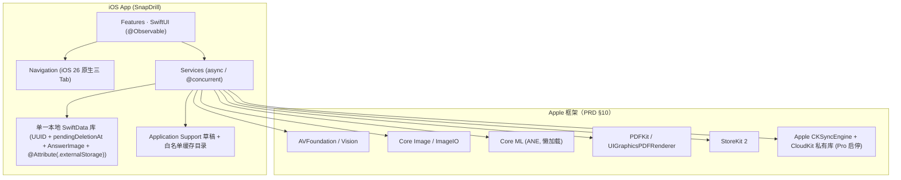

# SnapDrill · 架构与协作边界（greenfield）

> **目的**：让多人 / 多 Agent **并行开发**时拥有唯一可执行的技术地图：模块怎么拆、Swift 6 并发与 SwiftData/`CKSyncEngine` 怎么约束、接口合同怎么接。  
> **权威顺序**：见 [`GOVERNANCE.md`](GOVERNANCE.md) §1（[`PRD.md`](PRD.md) 管产品 > [`GOVERNANCE.md`](GOVERNANCE.md) · 本文管结构与合同 > [`DEVELOPMENT_PRINCIPLES.md`](DEVELOPMENT_PRINCIPLES.md) > [`ENGINEERING.md`](ENGINEERING.md) > 代码）。全仓文档唯一索引见 [`GOVERNANCE.md`](GOVERNANCE.md) §3。

| 文档版本 | 2.5 |
|---|---|
| 对应 PRD | 见 [`PRD.md`](PRD.md) 文内当前版 |
| 最后更新 | 2026-11-27 |

---

## 1. 设计原则（大白话版）

1. **产品规则只信 PRD**，需求争议回到 [`PRD.md`](PRD.md) 或 PO，不在代码里「偷偷改产品」。
2. **模块有边界**：Feature 负责界面与流程；Service 负责可测试能力；Model 负责持久化数据结构；严禁跨层直连。
3. **并行开发靠「合同」**：跨模块/跨轨道只暴露 Swift 值类型 / protocol / 少量 `@Observable` Store；内部实现可替换。
4. **阶段 0 与 MVP 并行（方案 1）**：去手写（轨道 B）与产品功能（轨道 A）并行推进，通过 `HandwritingRemovalService` 衔接。
5. **greenfield 不继承旧 `develop` 实现**：严格执行只读考古与拣零件闸门（[`LEGACY_PARTS_INVENTORY.md`](LEGACY_PARTS_INVENTORY.md)），禁止整支 merge。

---

## 2. 系统一览



> **禁止直连**：UI 层（`Features/`）**严禁**直接依赖 `PDFKit`、`AVFoundation`、`Vision`、`CoreImage`、`CoreML` 或 `CloudKit` 执行业务处理；上述系统框架必须下沉到 `Services/` 并经由合同暴露能力。  
> **部署形态**：核心处理纯端侧、无自建业务服务器、无第三方追踪；Pro 同步仅由 `Services/Sync` 内的 Apple 原生 `CKSyncEngine` 与用户个人私有 iCloud 通信（合规表述见 [`PRD.md`](PRD.md) §9 / §9.1）。

---

## 3. 代码分层、目录与 Swift 6 严格并发

| 层级 | 路径 | 职责 | 允许依赖 |
|---|---|---|---|
| **App 入口** | `SnapDrillApp.swift`, `Navigation/AppRootView.swift` | 生命周期、唯一本地 SwiftData 容器与故障态路由、冷启动扫描待删及监听 `Transaction.updates` | Navigation, Services |
| **Navigation** | `Navigation/` | iOS 26 原生三 Tab、全屏采集流路由壳 | Features |
| **Features** | `Features/<Name>/` | 单屏 / 2 步采集 UI、`@Observable` 视图状态 | Design, Models, Services（经合同） |
| **Services** | `Services/` | 相机预览容器桥接、脱敏、增强、去手写、图库 CRUD、复习、PDF、订阅、`CKSyncEngine` 同步、草稿与存储审计 | Models, Apple 框架 |
| **Models** | `Models/` | SwiftData `@Model`（全实体自生成 `UUID`、独立 `AnswerImage`、禁 `.cascade`/`.deny`/`.unique`）、值类型 | **仅** Foundation / SwiftData |
| **Design** | `Design/` | `SnapDrillTheme`（固定 3 套主题 × 浅/深共 6 组 WCAG AA 调色板）、字体 Token | SwiftUI |

**严格禁止**：
- Feature A 直接 `import` 并耦合 Feature B 的私有 View 细节
- Model 里依赖 SwiftUI / UIKit 相机或任何视图逻辑
- Service 里塞进业务 SwiftUI `View`（**唯一允许的例外**是 `Services/Capture/` 内协议隔离的轻量相机预览桥接视图封装及 `#Preview`；全部裁剪/交互业务 UI 必须留在 `Features/Capture/`）

**Swift 6 严格并发规约**：
- Xcode 工程启用 Swift 6 Complete Concurrency Checking，Release 构建须保持零警告。
- `ModelContext` 非 `Sendable`：SwiftData 写入统一在 `@MainActor` 协调器或独立 `@ModelActor` 内完成，严禁跨隔离域直接传递 `@Model` 实例。
- 重图像处理与同步（ImageIO 降采样、EXIF GPS 剥离、Core Image 增强、JPEG/HEIC 异步编码、Core ML 推理、PDF 渲染、`CKSyncEngine` 资产打包/落盘）**必须**在后台异步执行（`@concurrent` / `Task.detached` / `actor`），严禁阻塞主线程造成 UI 掉帧。

**目标目录（随唯一 `Slice 1–8` 补齐）**：

```text
Services/
  Capture/          # 轻量相机预览桥接、PHPicker、VNDetectDocumentSegmentationRequest、2 步编排
  Image/            # PhotoDataSanitizing（全入口 GPS 剥离）、ImageEnhancementService（async）、异步编码与 10 秒补压队列
  Handwriting/      # HandwritingRemovalService（懒加载 + MistakeItem.backfillState 回填 + 6s 降级）
  Library/          # LibraryServing（Slice 2 入库/预检子集 → Slice 4 筛选/持久化 5s 撤销/重裁）
  Review/           # ReviewServing（筛选继承、顺序/乱序、进度）
  Export/           # PDFExportService（A4/B5/Letter、统一公式留白、双超页缩放、多页答案、水印）
  Subscription/     # ProEntitlementStore（StoreKit 2 3.1.2、宽限/重试、.pending 零权益、revocationDate）
  Sync/             # CloudKitSyncEngine（Apple CKSyncEngine 封装：LWW、CKAsset、presetKey 合并、墓碑同步）
  Storage/          # CaptureDraftStore（Application Support）、StorageAuditService（F-66 白名单清理）
```

### 3.1 Capture：**强制 Protocol-First（唯一扫描技术路线）**

适用于 **整个收录域**（`Features/Capture` + `Services/Capture`）：

| 顺序 | 谁做 | 做什么 |
|---|---|---|
| **① 合同** | 任意 Agent | 改 `CapturePipelineServing` + 值类型；更新本文 §4.3；补 `SnapDrillTests/CapturePipelineContractTests` |
| **② 桩** | 同上 | 同步维护 `CapturePipelineStub` 与 Mock |
| **③ UI** | 另一 Agent | 只改 `Features/Capture/*`，经 `CapturePipelineFactory` 注入；**禁止** `import AVFoundation/Vision/CoreImage/CoreML` |
| **④ 真实现** | Slice 2–3 | 填满 `CapturePipelineLive`，不改 UI 对外协议契约 |

**唯一扫描路线锁定**：因 [`PRD.md`](PRD.md) §8.2 要求同屏相机+相册入口、10 张硬上限、四角微调与三档增强联动，P0 **唯一锁定**由 `Services/Capture/` 持有 `AVFoundation` 预览会话与 `VNDetectDocumentSegmentationRequest` 透视找边，并仅向 `Features/Capture/` 暴露协议隔离的轻量预览容器视图（不采用封闭系统扫描器 `VNDocumentCameraViewController`）。

**静态门禁**：`CI` 脚本（`L10` 落地后自动化）+ PR 评审检查确保 `Features/Capture/` 不直接引入底层相机、Vision 矩形检测、CIFilter 或 Core ML。

---

## 4. 核心领域与数据流（MVP）

### 4.1 两步收录主路径（对齐 [`PRD.md`](PRD.md) §8.2，命名与 §4.3 一一对应）

```text
独立拍摄入口 → CaptureFlow（2 步流畅路径）
  步骤 1 · 拍摄/导入与校正：
    CapturePipelineServing（唯一 AVFoundation 预览桥接 / PHPicker ≤10 张 + VNDetectDocumentSegmentationRequest）
    → PhotoDataSanitizing（全量剥离 EXIF GPS）
    → ImageEnhancementService（async 后台：增强 / 原图 / 黑白）
  步骤 2 · 框选单题与 1 秒极速保存：
    单页 ≤10 框 / 整批总题数硬上限 ≤30 题（退回步骤 1 联合配额 `min(10−M, 30−N)`）+ 随时「+ 新建」个性化科目（后台提前异步编码）
    → LibraryServing.commitSave（Slice 2 前建合同；三路落库遵从 PRD §8.2 转移表与下文 §4.3：① 无手涂且已编码 → `isOriginalEncoded = true, backfillStateRaw = pending, needsLocalBackfill = true, cleanedImageSourceRaw = none, needsCloudUpload = true, editNonce = UUID()`；② 无手涂超 300ms → `isOriginalEncoded = false, needsCloudUpload = false` 交 `Services/Image/` 10s 补压；③ 已有步骤 2 `F-12` 草稿 → 同步压缩 10s 内压完直落 `isOriginalEncoded = true, backfillStateRaw = completed, cleanedImageSourceRaw = manual, needsLocalBackfill = false, needsCloudUpload = true` 并停在途 auto）
    → 冷启动分叉保障：`AppRootView` 启动最先清空 `Application Support/CKAssetUploadStaging/` 无活跃批次孤儿文件并提交全部 `pendingDeletionAt != nil`（按当下权益写本地墓碑），**之后方进入** Free/Pro `CloudKitSyncEngine` 启停分支；后台分别由 `Services/Image/`（10s 补压）与 `HandwritingRemovalService`（并发 1–2 + `beginBackgroundTask` + 6s 降级）异步回填
```

### 4.2 持久化实体架构与 `CKSyncEngine` 启停同步（替代黑盒镜像）

> [!NOTE]
> 为彻底解决苹果 `NSPersistentCloudKitContainer` 无法按订阅状态关闭云端上行导出、及双库搬家产生孤岛的问题，本项目全周期只保留 **单一本地 SwiftData 库（`cloudKitDatabase: .none`）**，并由 **Apple 原生 `CKSyncEngine`（API iOS 17+，本产品最低系统版本以 PRD iOS 26+ 为准，封装于 `Services/Sync/`）** 负责 Pro 订阅期的数据同步与过期精准停同步。

#### ① 完整 `@Model` Schema 与删除红线（v1.0 MVP 冻结范围全部持久化字段，无任何隐含字段；v1.1/P1 扩展须先经 `PRD.md` 修订并增量更新本表；**文本与数量标量上限见 `PRD.md` §8.6，由 `LibraryServing` 入库与编辑强制校验**）
- **`Subject`**：`uuid: UUID`、`presetKey: String?`、`customName: String?`、`colorHex: String`、`sortOrder: Int`、`createdAt: Date`、`updatedAt: Date`、**`editNonce: UUID`**（每次本地修改刷新，供同 `UUID` 平局决胜）、**`needsCloudUpload: Bool`**（**仅本地持久化、不编码进 `CKRecord`**；本地新建/改写置 `true`，`sentRecordZoneChanges` 成功确认后置 `false`）、`mistakes: [MistakeItem]?`（`deleteRule: .nullify`, `inverse`）。
- **`MistakeItem`**：`uuid: UUID`、`subject: Subject?`（`.nullify`）、`originalImageData: Data?`（`@Attribute(.externalStorage)`）、**`isOriginalEncoded: Bool`**（**仅本地持久化、不编码进 `CKRecord`、绝不上云**；正式 HEIC/JPEG 落盘或远端非空 `originalImageAsset` 写入后置 `true`；仅 3 类合法 `false` 入口：**300 ms 兜底落未压缩块**、**详情重裁改像素**、**「重新编码」重入**，及极少数超 10 秒同步压缩的步骤 2 手涂）、**`needsLocalBackfill: Bool`**（**仅本地持久化、不编码进 `CKRecord`、绝不上云**；无手涂的编码完成、重跑或重裁入队时置 `true`，**远端拉取、`F-12` 完成以及 `manual` 补压成功保持 `false` 禁止自动抢跑**）、**`needsCloudUpload: Bool`**（**仅本地持久化、不编码进 `CKRecord`**；**仅当 `isOriginalEncoded == true` 时**，回填完成/编辑/重跑/外键修复置 `true`；**处于 `isOriginalEncoded == false` 窗口时（含重裁当拍与未编码外键改指）保持 `false` 严禁入队，待补压成功置 `isOriginalEncoded = true` 时随最新字段一并置 `true` 上行**；待 `sentRecordZoneChanges` 成功后置 `false`）、`cleanedImageData: Data?`（`@Attribute(.externalStorage)`；**仅非手涂编码失败或 ML 6 秒推理失败致 `backfillState == failed` 时保持 `nil` 不冗余占空间**）、**`backfillStateRaw: String`**（`pending` / `completed` / `failed`——**产品语义名 `backfillState`，实现须使用单一 `RawRepresentable` 枚举，严禁散落字符串字面量**）、**`cleanedImageSourceRaw: String`**（`none` / `auto` / `manual`——随记录上云，同采用单一 `RawRepresentable` 枚举；标记 `F-12` 手涂来源以统一触发重跑/重裁覆盖确认）、**`pendingDeletionAt: Date?`**（**仅本地持久化、不编码进 `CKRecord`、绝不上云**；非空即处于 5 秒待删窗口，强杀后冷启动最先据此提交；列表/复习/PDF 查询均须显式过滤 `pendingDeletionAt == nil`）、`answerText: String?`、`note: String?`、`answerImages: [AnswerImage]?`（`.nullify`）、`reasons: [MistakeReason]?`（`.nullify`）、`tags: [MistakeTag]?`（`.nullify`）、**`createdAt: Date`**、`updatedAt: Date`、**`editNonce: UUID`**。
- **`AnswerImage`**（独立实体，每题最多 3 条）：`uuid: UUID`、**`index: Int`（幸存条数 $n \le 3$ 时取连续 `0..<n`，最大值为 `2`）**、`imageData: Data?`（`@Attribute(.externalStorage)`）、`createdAt: Date`、**`updatedAt: Date`**、**`editNonce: UUID`**、**`needsCloudUpload: Bool`**（仅本地）、`mistakeItem: MistakeItem?`（`.nullify`）。
- **`MistakeReason`**：`uuid: UUID`、`presetKey: String?`、`customName: String?`、**`sortOrder: Int`**（神谕表预置顺次 `0..5`）、`createdAt: Date`、`updatedAt: Date`、**`editNonce: UUID`**、**`needsCloudUpload: Bool`**（仅本地）、`mistakes: [MistakeItem]?`（`.nullify`）。
- **`MistakeTag`**：`uuid: UUID`、`name: String`、`createdAt: Date`、`updatedAt: Date`、**`editNonce: UUID`**、**`needsCloudUpload: Bool`**（仅本地）、`mistakes: [MistakeItem]?`（`.nullify`）。
- **`DeleteTombstone`**（本地同步追踪表；其中 `presetKey != nil` 的预置墓碑须同步至私有库 Zone `DeletedPresetKey`，普通删除驱动 `deleteRecordIDs` 与防回灌）：`uuid: UUID`、`recordType: String`（**合法枚举值仅限**：`"Subject"` / `"MistakeItem"` / `"AnswerImage"` / `"MistakeReason"` / `"MistakeTag"`）、**`targetUUID: UUID?`**（仅当空库从远端拉取 `DeletedPresetKey` 且本地尚无实体 `UUID` 时允许 `nil`）、**`presetKey: String?`**、`deletedAt: Date`、`syncedToCloud: Bool`。
- **`SyncCursorState`**（**全库至多一行单例**，严禁编码入 `SnapDrillPrivateZone`，且遵守禁 `@Attribute(.unique)` 红线）：**`id: UUID`**（仅本地固定文档常量 **`00000000-0000-0000-0000-000000000001`**，全库至多存在这一行）、**`stateData: Data`**（`CKSyncEngine.State.Serialization` 二进制归档）、**`presetSeedReconciliationPending: Bool`**（跨进程持久化断网/无账号/Zone 失败首播后的待对账状态，首次成功对账完成后清 `false`）与 **`lastSyncedAt: Date?`**（仅本地 UI 展示用，不参与增量游标判定）。
- **Schema 绝对红线**：
  1. **全模型统一使用 `deleteRule: .nullify`，严禁 `.cascade` 与 `.deny`**（删非空科目连题删除须由 `LibraryServing` 在同一事务内逐题及科目写 `DeleteTombstone`，严禁绕过墓碑）；
  2. 全模型**严禁 `@Attribute(.unique)`**，严禁使用 SwiftData 自动生成的 `persistentModelID` 作为跨机主键（跨机唯一识别仅认自生成 `UUID` 或预置 `presetKey`）。

#### ② 单本地库 + `CKSyncEngine` 启停、预设计 `CKRecord` 映射、上云门槛与先写墓碑规则
1. **Free 态 / `.pending` 挂起态**：`AppRootView` / `ProEntitlementStore` **绝不实例化 `CKSyncEngine`**，App 100% 仅读写唯一本地库，无线电开启时 App 进程零 CloudKit 私有库请求。
2. **首次开通 Pro / 恢复购买 / Pro 冷启动**：
   - **冷启动按持久化 `State` 清孤儿暂存与待定删除（零联网、先于引擎判定）**：`AppRootView` 每次冷启动（**含 Free、降级与 Pro 全部状态**）**仅以只读方式加载本地 `SyncCursorState.stateData`（不发起联网请求、不实例化同步引擎）**：在 Free、空 `stateData` 或其中零待传 `CKAsset` 引用时整体清空 `Application Support/CKAssetUploadStaging/`；若 `stateData` 中仍引用部分待传文件 URL，**仅删除未被任何 pending change 引用的孤儿文件（被引用文件留待随后的 `sentRecordZoneChanges` 完成后清理）**；同步完成全部 `pendingDeletionAt != nil` 的未撤销记录提交（遵循此刻 `ProEntitlementStore` 快照写 `DeleteTombstone(syncedToCloud = false)`，**含被删 `MistakeItem` 本身及每一个子 `AnswerImage` 逐条墓碑**，并物理删本地对象与外存字节）；**之后才**进入 Free/Pro 判断并按需初始化启动 `CloudKitSyncEngine`（`CKSyncEngine`，生产私有库自定义 Zone：**`SnapDrillPrivateZone`**）；
   - **状态机事件交错、启动入队与「运行时变更必调 `enqueue*`」双重不变量**：由于 `CKSyncEngine` 在网络层面会交错触发发送（`nextRecordZoneChangeBatch`）与拉取（`fetchedRecordZoneChanges`）回调，禁止假设严格阻塞串行网路先后。双不变量合同为：① **引擎启动或重建时**：先把本地全部 `syncedToCloud == false` 的 `DeleteTombstone`（非空 `targetUUID` 删除与 `DeletedPresetKey` 上行）与全部通过上云门槛的 `needsCloudUpload == true` 记录批量入队至持久化 `CKSyncEngine.State`；② **引擎已实例化运行期间（`P0` 闭环关键）**：**凡任何事务在引擎运行期间新写入 `syncedToCloud == false` 的 `DeleteTombstone`，或对通过上云门槛的实体将 `needsCloudUpload` 置为 `true`（包括 `SubjectCatalog` 首拉后播种、`presetKey` 合并改指外键、`DeletedPresetKey` 对账后错题迁移、`Services/Image/` 补压成功、`HandwritingRemovalService` 推理结果与 `LibraryServing` 编辑/重排），在同一 SwiftData 事务提交后必须立刻调用 `CloudKitSyncEngine.enqueueUpsert` / `enqueueDeletion`（若此刻引擎未实例化则仅留持久化脏标待下次启动入队）**；③ 在每一次 `fetchedRecordZoneChanges` 本地落库入口强制经过本地墓碑过滤网关；
   - **上云三态门槛与 `CKAsset` 暂存生命周期**：① **`isOriginalEncoded == false`、`originalImageData == nil` 或 `pendingDeletionAt != nil` 的记录严禁入队/上行**，且未编码态严格保持 `needsCloudUpload = false`（**优先序铁律：任何记录处于 `isOriginalEncoded == false` 期间发生编辑、外键改指或预置合并迁移，仅写本地关系并保持 `needsCloudUpload = false` 不调 `enqueueUpsert`，待补压成功置 `isOriginalEncoded = true` 时连同最新外键一并置 `true` 上行**；后台 10 秒补压超时落入终态后仍不上云，由详情页「重新编码」重入；详情态若在未编码完前保存 `F-12` 手涂亦保留本地且 `needsCloudUpload = false` 待补压完成上云）；② **`isOriginalEncoded == true` 且 `backfillState == pending`** 时若 `needsCloudUpload == true` **可先行推送 `originalImageData` 上云**并调 `enqueueUpsert`，待去手写完成后刷新 `updatedAt` / `editNonce` 并置 **`needsCloudUpload = true`** + `enqueueUpsert` 补推 `cleanedImageData`；③ **`isOriginalEncoded == true` 且 `failed / completed`** 凡 `needsCloudUpload == true` **必须入队上行**。`CKSyncEngine` 仅在收到 `sentRecordZoneChanges` 成功回执（且期间本地未再次变更 `editNonce`）后将 `needsCloudUpload` 清零。封装 `CKAsset` 生成的临时文件统一存放于 **`Application Support/CKAssetUploadStaging/`**（`isExcludedFromBackup = true`），**活跃及已持久化待重传批次文件必须保留至 `sentRecordZoneChanges` 回调确认（成功或不可恢复失败）后再删除**，无引用孤儿文件由上述冷启动按 `stateData` 清扫；
   - **完整预置去重、`DeletedPresetKey` 防复活、`presetKey` 优先检查与空库首拉/失败对账**：
     - 带 `presetKey != nil` 的 `DeleteTombstone` 同步映射为云端 **`DeletedPresetKey`** 记录（稳定 `recordName = presetKey`）；他机拉取到该记录后写入本地 `DeleteTombstone(presetKey: key, targetUUID: nil, recordType: derivedType, syncedToCloud: true)`（其中 **`targetUUID: UUID?` 允许为 `nil`**，**`recordType` 按互斥前缀确定性派生：`preset.subject.*` → `"Subject"`、`preset.reason.*` → `"MistakeReason"`**）。**Pro 全新空库初始化优先等待 `CloudKitSyncEngine` 发出一次性终结引导事件（`initialZoneFetchCompleted` 或 `initialZoneFetchFailed(reason)`，配目录侧超时上限）**：收到 **`initialZoneFetchCompleted`** 后执行 `SubjectCatalog` 播种（**插入条件须同时检查：本地不存在该 `presetKey` 且不存在 `DeleteTombstone(presetKey)`**，跳过首拉已入库与远端已墓碑的 `presetKey`，清 `presetSeedReconciliationPending = false` 并立刻 `enqueueUpsert`）；**若收到 `initialZoneFetchFailed(reason)`（含完全断网、未登录 iCloud 或首次 Zone 拉取失败/超时）**，则立即按命中矩阵本地播种并置 **`SyncCursorState.presetSeedReconciliationPending = true`**，并在**后续首次收到成功 Zone 拉取时执行幂等对账**（严格互斥 3 步）：① 写入/确保 `DeleteTombstone(presetKey: key, targetUUID: nil, recordType: derivedType, syncedToCloud: true)`；② 若本地预置副本 `UUID_local` **绑定 0 道错题**：无条件从 pending save 撤消并物理删除本地副本，**并无条件写 `DeleteTombstone(presetKey: nil, targetUUID: UUID_local, recordType: derivedType, syncedToCloud: false)` 立即调 `enqueueDeletion`（CloudKit 对云端不存在的 `recordID` 按幂等成功处理）**；③ 若 `UUID_local` **已挂接本地错题**：将 `Subject` 外键迁至 `uncategorized` 或从受影响 `MistakeItem.reasons` 剔除失效键、**仅对 `isOriginalEncoded == true` 错题刷新 `updatedAt` / `editNonce` 置 `needsCloudUpload = true` 并调 `enqueueUpsert`（未编码仅改本地关系保持 `false`）**，物理删除该本地预置副本，**并写 `DeleteTombstone(presetKey: nil, targetUUID: UUID_local, recordType: derivedType, syncedToCloud: false)` 立即调 `enqueueDeletion`**；全部命中项处理完毕清零 `presetSeedReconciliationPending = false`；
     - **远端拉取 `Subject` / `MistakeReason` 入库前必须先检查 `presetKey` 是否命中本地 `DeleteTombstone(presetKey)`（严格优先于 `targetUUID` 检查）**：若命中 `presetKey` 墓碑，则直接丢弃该远端记录、写独立条 `syncedToCloud = false` 云删墓碑并立刻 `enqueueDeletion(远端UUID)`；若本地恰存在同名未删预置副本亦同步外键降级/剔除与删除并 `enqueueUpsert` 受影响错题；
     - **所有其余未墓碑的非空 `presetKey` 预置科目与预置错因均按 `presetKey` 去重合并**：保留 `createdAt` 较早者（相等取 `uuid.uuidString` 字典序较小者）作幸存主身份，**删除冗余副本前按 `(updatedAt 降序, editNonce.uuidString 降序)` 将 `customName` / `sortOrder` / `colorHex` 等可变展示字段合并入幸存记录（若字段发生变更则置幸存条 `needsCloudUpload = true` 调 `enqueueUpsert`）**，同 SwiftData 事务内改指全部 `MistakeItem` 外键（科目 `subject` 或错因 `reasons` 去重替换）至幸存记录，**仅对 `isOriginalEncoded == true` 的受影响 `MistakeItem` 刷新 `updatedAt` / `editNonce`、置 `needsCloudUpload = true` 并在提交后调 `enqueueUpsert`（未编码仅改本地关系保持 `false`）**，删除冗余预置副本并写普通 `DeleteTombstone(presetKey: nil, targetUUID: 冗余UUID, syncedToCloud: false)` 立刻 `enqueueDeletion`（此去重不写 `DeletedPresetKey`）；
   - **同一 `UUID` 并发冲突、入站派生、未编码窗口保护与胜负拆分、`AnswerImage` 重排与 LWW 外键自愈**：
     - 同一 `UUID` 并发修改时**可同步字段按 `(updatedAt 降序, editNonce.uuidString 降序)` 后写获胜（LWW）**，从而彻底消除同一 `UUID` 下比较 `uuid` 恒等失效的漏洞；
     - **本地独占字段隔离、`needsCloudUpload` 胜负拆分与未编码保护规则**：
       1. **全新插入任意含题干资产的远端 `MistakeItem`（无论 `completed` / `failed` / `pending`）**：一律派生 **`isOriginalEncoded = true`**、**`needsLocalBackfill = false`**、**`needsCloudUpload = false`**（绝不对远端 `pending` 自动抢跑 Core ML）；
       2. **未编码窗口保护（防死锁铁律）**：**当本地已存在记录仍处于 `isOriginalEncoded == false`（300 ms 兜底、重裁或补压未完成窗口）时，远端 LWW 严禁覆写本机 `originalImageData`、`cleanedImageData`、`backfillStateRaw` 与 `cleanedImageSourceRaw`**（仅允许按 LWW 合并答案文本、备注、科目、错因、标签等非图像字段），待本地编码完成或进入终态后再正常参与后续 LWW；
       3. **其余已编码记录由远端 LWW 获胜覆盖本地**：采用远端可同步字段并置 **`needsCloudUpload = false`**，**绝不覆写既有仅本地字段（`needsLocalBackfill`、`pendingDeletionAt`；若远端为 `pending` 保持 `needsLocalBackfill = false`）；凡本轮将远端非空 `originalImageAsset` 写入本地 `originalImageData` 时同步置 `isOriginalEncoded = true`（严禁把本地 `true` 降回 `false`）**；
       4. **本地 LWW 获胜**：保持本地可同步字段不动，并**原样保留本地既有 `needsCloudUpload`**（若仍 `true` 维持待上云）；
     - **远端拉取记录落地前，再比对本地 `DeleteTombstone.targetUUID`，命中则直接丢弃回灌，并重新将该 `targetUUID` 调 `enqueueDeletion` 加入云端删除队列**，阻止他机离线后写长期滞留云端（**MVP 期间绝不回收任何本地 `DeleteTombstone`：`syncedToCloud == true` 仅表云端删除已确认，不表可删除本地墓碑行**）；
     - **LWW 落库前外键悬空修复（分批安全判定）**：**仅当目标 `Subject` / `MistakeReason` / `MistakeTag` 的 `targetUUID` 或 `presetKey` 已命中本地 `DeleteTombstone`（已确认删除）时**，才在同一事务内确定性回退 `subject` 指向 `preset.subject.uncategorized` 或剔除已墓碑的 `reasons` / `tags`（**并仅对 `isOriginalEncoded == true` 错题置 `needsCloudUpload = true` 调 `enqueueUpsert`，未编码保持 `false`**）；**若目标记录仅仅尚未随当前 `fetchedRecordZoneChanges` 批次到达（本地无对应墓碑），严禁误改 `subject` 或剔除引用，保留远端传来的引用 UUID 且不翻脏 `needsCloudUpload = true`，待后续批次父记录到达后自然挂接**；
     - 同一 `MistakeItem` 合并后若 **`AnswerImage` 超过 3 条**，在同一 SwiftData 事务内按 **`(updatedAt 降序, editNonce.uuidString 降序, uuid.uuidString 降序)` 保留前 3 条**，超额项写 `DeleteTombstone(recordType: "AnswerImage", syncedToCloud: false)` 清理本地并 `enqueueDeletion`；幸存条按 `(index 升序, updatedAt 降序, editNonce.uuidString 降序, uuid.uuidString 降序)` 确定性重排为连续 `index = 0..<(count)`，**仅 `index` 改变的幸存条刷新 `updatedAt` / `editNonce`、置 `needsCloudUpload = true` 并在提交后调 `enqueueUpsert`**；
     - 网络中断或部分失败时 `CKSyncEngine` 依托持久化状态指数退避重试，**零本地数据损失**。
3. **三态提交删除（先写本地墓碑事务，随附子图 `AnswerImage` 逐条墓碑）**：
   - 5 秒撤销提交（到期 / 连删 / 切离 / 冷启动清理 `pendingDeletionAt != nil`）**一律以实际执行提交隔离时刻的 `ProEntitlementStore` 快照为准**；
   - **三种场景下的统一第一步**：先在本地 SwiftData 事务内删除目标实体及其关联 `AnswerImage` 与外部资产，**同事务内须为被删主实体（如 `MistakeItem` / `Subject`，若为预置项带 `presetKey`）及每一条实际被删除的子 `AnswerImage`（`recordType = "AnswerImage"`、`presetKey = nil`）逐一写入独立 `DeleteTombstone(syncedToCloud = false)`**（防止 `.nullify` 下云端残留孤儿答案图）；
   - **三路投递分支**：① **提交时刻为 Pro 且 `CKSyncEngine` 运行中**：随后通过 `enqueueDeletion` 异步通知引擎冲刷全部对应 `targetUUID`（含主实体与全部子 `AnswerImage`）的 `deleteRecordIDs` 及预置 `DeletedPresetKey`，确认后标记 `syncedToCloud = true`；② **提交时刻为正常 Pro 冷启动但 `CKSyncEngine` 尚未启动**：先落上述 `syncedToCloud = false` 本地墓碑不发 RPC，随即在同一次启动紧随启动引擎时立即批量入队清理（**绝不推迟至下次购买**）；③ **提交时刻为 Free 或 Pro 降级态（引擎已停/未启）**：仅保留本地 `DeleteTombstone`（**严禁向已释放引擎发起 CloudKit 删除 RPC**），待下次开通或续费重建引擎时入队清理云端。
4. **Pro 到期 / `revocationDate != nil` 撤销降级**：
   - **立即停止并释放 `CKSyncEngine` 实例**（保留本地 `SyncCursorState` 与全部 `DeleteTombstone`；**实例释放后丢弃一切迟到回调如 `sentRecordZoneChanges` / `fetchedRecordZoneChanges`；iCloud 登出或账号变更走完全相同的释放路径，保留本地库、`SyncCursorState` 与全部墓碑且不发新 RPC**），原地继续读写同一份本地 SwiftData 库——**既有错题与图片 100% 可看可改可导，且物理保证降级后 App 进程零 CloudKit 上下行请求**。
5. **再次续费恢复 Pro**：使用保留的 `SyncCursorState` 重建 `CKSyncEngine`，按第 2 条冷启动规则将积压 `DeleteTombstone` 与 `needsCloudUpload == true` 记录重新入队并同步增量差异（无重复导入、无“删而复生”）。

- **预设计 `CKRecord` 映射合同表（单私有 Zone：`SnapDrillPrivateZone` · 须经 §4.2③ 6 条 Spike 真机签收核验）**：

| 云端 `CKRecord.RecordType` | 稳定 `recordName` | 同步属性与 `CKAsset` 字段 | 显式排除（仅本地字段，严禁编码入云） |
|---|---|---|---|
| **`Subject`** | `uuid.uuidString` | `uuid`, `presetKey`, `customName`, `colorHex`, `sortOrder`, `createdAt`, `updatedAt`, **`editNonce`** | **`needsCloudUpload`** |
| **`MistakeItem`** | `uuid.uuidString` | `uuid`, `subjectUUID`, `originalImageAsset` (`CKAsset`), `cleanedImageAsset` (`CKAsset?`), `backfillStateRaw`, **`cleanedImageSourceRaw`**, `answerText`, `note`, `reasonUUIDs`, `tagUUIDs`, `createdAt`, `updatedAt`, **`editNonce`** | **`pendingDeletionAt`**、**`isOriginalEncoded`**、**`needsLocalBackfill`**、**`needsCloudUpload`** |
| **`AnswerImage`** | `uuid.uuidString` | `uuid`, `mistakeItemUUID`, `index`, `imageAsset` (`CKAsset`), `createdAt`, `updatedAt`, **`editNonce`** | **`needsCloudUpload`** |
| **`MistakeReason`** | `uuid.uuidString` | `uuid`, `presetKey`, `customName`, **`sortOrder`**, `createdAt`, `updatedAt`, **`editNonce`** | **`needsCloudUpload`** |
| **`MistakeTag`** | `uuid.uuidString` | `uuid`, `name`, `createdAt`, `updatedAt`, **`editNonce`** | **`needsCloudUpload`** |
| **`DeletedPresetKey`** | `presetKey`（如 `preset.subject.math`） | `presetKey`, `deletedAt` | 本地 `targetUUID: UUID?`、`syncedToCloud`、`recordType`、普通删除走 `deleteRecordIDs`、`SyncCursorState`（`stateData`、`lastSyncedAt`）不入云 |

- **映射编码与空资产清除规则**：
  1. `MistakeItem` 表中 `subjectUUID`、`reasonUUIDs`、`tagUUIDs` 仅为 `SnapDrillPrivateZone` `CKRecord` 的规范化引用属性，**本地 `@Model` 不另建冗余存储列**：上行编码时在同一 SwiftData 事务内由 `.nullify` 关系确定性派生（`subject?.uuid`、`reasons.map(\.uuid).sorted { $0.uuidString < $1.uuidString }`、`tags.map(\.uuid).sorted { $0.uuidString < $1.uuidString }`），下行落库时按集合语义同事务反查并回写关系（不把 `reasonUUIDs`/`tagUUIDs` 数组下标当作用户排序）；
  2. 当 `cleanedImageData == nil`（如 `failed` 降级或重裁重置）发起上行同步时，必须在 `CKRecord` 上**显式将 `cleanedImageAsset` 键置空（`nil`）以清除云端旧资产**，严禁仅省略该键导致他机残留上一版去手写图。

#### ③ Slice 1 建库前强制 `CKSyncEngine` Spike（6 条标准 + 失败 Plan B 流程）
在 **Slice 1 正式落盘 SwiftData Schema 前**，轨道 C 须在真机完成 Spike 验证并把结论写入 §8 与 `M-freeze`：
1. `MistakeItem` 与 `AnswerImage`（含合并超 3 条按 `(updatedAt, editNonce)` 截断与 `index` 重排并发推 `needsCloudUpload`）的 `@Attribute(.externalStorage)` ↔ `CKAsset` 双向读写、`CKAsset` 暂存文件保留至 `sentRecordZoneChanges` 后删除，及同 `UUID` 并发修改 **LWW（以 `(updatedAt, editNonce)` 判定胜者；获胜版本 `CKAsset` 字节 100% 完整无断链且不覆盖本地独占状态字段）**；
2. 双机分别离线创建数据后升 Pro：**地区专属键（`cn_chinese` vs `tw_guowen`）不误合并，通用键（含 `Subject` 与 `MistakeReason` 如 `preset.subject.math` / `preset.reason.careless`）按较早 `createdAt` 合并为一、改指外键置 `needsCloudUpload = true` 并零掉科**；并发删科/改科触发 LWW 后确定性回指 `uncategorized`；
3. 模拟到期/`revocationDate` 停止释放 `CKSyncEngine` 后，验证无线电开启态下 App 进程**零 CloudKit 请求**且本地增删改正常；
4. 降级期间执行单删与连删非空科目先写 `DeleteTombstone`（含冷启动清理 `pendingDeletionAt != nil`、他机并发写命中墓碑重申云删压测），续费与 Pro 常规冷启动均先入队 `syncedToCloud == false` 与 `needsCloudUpload == true` 并经过接收墓碑过滤，云端彻底删除、**无“删而复生”**；
5. 仅 `isOriginalEncoded == true` 后允许封装 `CKAsset` 上传，`sentRecordZoneChanges` 后清零 `needsCloudUpload`；他机拉取远端 `pending` 记录时强制维持 `needsLocalBackfill == false`、直接显示 `originalImageData` 且不反覆盖 `cleanedImageSourceRaw`（区分 `auto` 与 `manual`），全量 `CKAsset` 典型单题平均体积 ≤ 1 MB；
6. **预置墓碑防复活**：A 机删除某预置 `presetKey` 并同步 `DeletedPresetKey` 后，B 机全新空库开通 Pro 首次拉取（写 `targetUUID = nil` 本地墓碑）及离线先播后首次连网对账（`presetKey` 检查先于 `targetUUID`）均**绝不复活该已删 `presetKey`**。
- **Spike 失败 Plan B 与强制程序**：若 Spike 证明 `CKSyncEngine` 开发或调试复杂度超出 MVP 承受度，**立即暂停 Slice 1 建库**并上报 PO 书面二选一拍板：① 改用终身 CloudKit 镜像方案（到期停水印/排版/主题但不停同步），或 ② 首版专注单机并将 `F-60` 延至 v1.1。**一旦触发 Plan B，强制执行「`PRD.md` 修订 PR + 重跑分级盲审 checklist」并通过后方可签署 `M-freeze` #1**。

#### ④ 播种边界、草稿与白名单缓存路径
| 模块 / 路径 | 规则 |
|---|---|
| `SubjectCatalog` 播种红线 | **仅在首次空库初始化时执行一次播种**（种子集 = **科目 `命中地区矩阵 ∪ {preset.subject.uncategorized}`（`sortOrder` 0 递增/未分类 `999`）+ 6 条预置错因 `preset.reason.*`（`sortOrder = 0..5`）**；本地播种置 `needsCloudUpload = true`）；Pro 等待一次性终结引导事件 **`initialZoneFetchCompleted` 或 `initialZoneFetchFailed(reason)`（配目录侧超时上限）**：成功后再播本地不存在且未墓碑的剩余键并清 `presetSeedReconciliationPending = false` 且调 `enqueueUpsert`，**失败/超时/断网/未登录先播并置 `SyncCursorState.presetSeedReconciliationPending = true`、首拉成功后按 3 步互斥对账（无条件写多余 `UUID_local` 墓碑）清零并调 `enqueueDeletion`/`enqueueUpsert`**；凡 `DeleteTombstone(presetKey)` / 云端 `DeletedPresetKey` 存在对应键，**严禁重建复活** |
| `CaptureDraftStore` → **`Application Support/CaptureDrafts/`** | 严禁存 `tmp/`；设 `isExcludedFromBackup = true`（不随整机备份迁往新机）；全应用同一时刻至多 1 份未决草稿（完整保留页序、增强档、透视四角、旋转、裁框、每题已暂存的 `F-12` 手涂位图/笔画与草稿级 `manual` 标记及选填字段；恢复补默认框须校验 `N_reserved ≤ 30`；进拍摄前须续编或丢弃）；**用户确认丢弃或 `LibraryServing.commitSave` 事务提交成功后立即物理删除该草稿（预检失败或回滚须保留草稿以防强杀丢失）** |
| `StorageAuditService`（`F-66` 精确白名单） | **两套正交清理规则**：① `tmp/thumbnails/` 与 `Library/Caches/SnapDrillImageCache/` 仅清理无对应在库 `UUID` 且 `mtime > 7 天` 的过期碎片；② **`tmp/pdf-export/` 每次发起新导出前、分享完成/取消、App 冷启动及设置存储统计重算时按目录整体清空**（非 7 天规则）；**显式排除 `Application Support/CaptureDrafts/`、SwiftData external storage 目录与 `Application Support/CKAssetUploadStaging/`（`isExcludedFromBackup = true`，其孤儿文件仅由 `AppRootView` 每次冷启动按持久化 `stateData` 引用单独清扫）** |
| `LibraryServing`（磁盘预检 + 回滚） | 自 **Slice 2 开始前**，写库前校验可用空间（保留 ≥ 50 MB 安全余量）；失败回滚上下文不留半条脏数据 |
| `AppRootView`（冷启动 + 故障路由） | 每次冷启动只读检查 `SyncCursorState.stateData` 并仅清 `CKAssetUploadStaging/` 中未再被 `stateData` 引用的孤儿文件（Free/空 State 清全目录），然后补提交 `pendingDeletionAt != nil`；`ModelContainer` 初始化失败时路由至故障恢复页提供原始资产压缩自救导出，**严禁渲染成空错题本** |

### 4.3 关键接口合同（并行开发的唯一边界）

实现可替换，**签名与行为语义**变更须更新本文合同表并经 PO 确认（Slice 编号严格对齐 [`ROADMAP.md`](ROADMAP.md) 唯一 `Slice 1–8`）：

> 注：下表产品语义名 `cleanedImageSource` / `backfillState` 均严格对应 §4.2① 持久化列 `cleanedImageSourceRaw` / `backfillStateRaw`（单枚举 `RawRepresentable` 映射）；**§3.1 中的 `CapturePipelineFactory` 为 App 层静态装配点，仅组装注入实现，不改变 `CapturePipelineServing` 协议签名**。

| 接口 / 服务 | 所有者 · 强制建合同时点 | 合法消费者 | 行为摘要与强约束 |
|---|---|---|---|
| **`CapturePipelineServing`** | A · **Slice 2 开始前** | `CaptureFlowView`（**唯一**） | 见 `CaptureContracts.swift`；先合同+Stub 后 UI；封装唯一 `AVFoundation`+Vision 2 步流程（0 页删除退出、退回联合上限 `min(10−M, 30−N_reserved)`（`N_reserved = N + 未物化默认框页数`）、30 题禁增页（进入步骤 2 断言 `N_reserved ≤ 30`）、删页/重拍/旋转作废裁框并重算及作废该页在途 `auto`、切换增强档作废预编码并作废该页在途 `auto`、步骤 2 预览 `F-12` 草稿覆盖）与提前异步编码 |
| **`LibraryServing`** | A · **核心入库/预检子集：Slice 2 开始前**<br>（完整扩展：**Slice 4 开始前**） | `CapturePipelineLive`、Home、列表、详情、**设置域科目/错因/标签管理 Feature（严禁 UI 直写 SwiftData）** | **Slice 2 前落 `commitSave`（等待编码 ≤300 ms、写入字段遵循 PRD §8.2 统一状态转移表：无手涂且已编码置 `isOriginalEncoded = true` / `needsLocalBackfill = true` / `cleanedImageSource = .none`，已有步骤 2 `F-12` 草稿优先走手涂终态 `.manual` / `.completed` / `needsLocalBackfill = false` 并停自动队列；若步骤 2 `F-12` 入库预压（整批共用 10 秒硬上限）超时，仍保留手涂并落入未编码手涂终态（`cleanedImageData` 完整留存、`cleanedImageSource = .manual`、`backfillState = .completed`、`needsLocalBackfill = false`、`isOriginalEncoded = false`、`needsCloudUpload = false`，**绝不覆写为 `.failed` 且严禁调 `enqueueUpsert`**）；非手涂已编码资产 1 秒事务提交与上述手涂终态落盘（含 `editNonce` / 仅已编码置 `needsCloudUpload = true` / ≥50 MB 预检 + 回滚），事务提交后删 `CaptureDrafts/` 草稿）+ 单测**；Slice 4 扩组合筛选、重跑/重裁（若 `cleanedImageSource == .manual` 二次确认；重裁重置 `isOriginalEncoded = false`、`needsCloudUpload = false` 交 `Services/Image/` 10s 补压）、**若 §10 升格 `F-12` 则提供详情手涂保存写接口（写 `cleanedImageData`、`.manual`、`.completed`、`needsLocalBackfill = false`、刷新 `updatedAt` / `editNonce`、仅 `isOriginalEncoded == true` 时置 `needsCloudUpload = true` 调 `enqueueUpsert`，未编码时保持 `false` 并丢弃在途 `auto`）**、详情「重新编码」、科目管理（**`preset.subject.uncategorized` 禁止删除且 `mistakes.count == 0` 时首页不展示**）、科目/错因/**标签（`MistakeTag`：与删错因一致，仅解除错题引用、写 `DeleteTombstone` 置脏，不删错题）**增删改及外键重写**（外键重写仅在 `MistakeItem.isOriginalEncoded == true` 时刷新 `updatedAt` / `editNonce` 置 `needsCloudUpload = true` 并调 `enqueueUpsert`，未编码仅改本地关系保持 `false`）**、`pendingDeletionAt` 排除查询与强杀最先补提交、读 `ProEntitlementStore` 提交快照（Slice 4–6 注入只读恒 Free Stub）同事务写 `MistakeItem` 与逐条子 `AnswerImage` `DeleteTombstone`（禁 `.cascade`）、调 `enqueueDeletion`、`AnswerImage` ≤ 3 合并重排 |
| **`PhotoDataSanitizing`** | A · Slice 2 | `CapturePipelineLive`、`LibraryServing`（**公共前置**） | ImageIO 降采样 + **强制剥离 EXIF `{GPS}`**；**同时覆盖采集题干图与 `AnswerImage` 答案图全部入口** |
| **`ImageEnhancementService` & `AsyncEncodingQueue`（`Services/Image/`）** | A · Slice 2 | `CapturePipelineLive`、`LibraryServing`（详情重裁 / 「重新编码」） | 三档滤镜 `async` 后台执行（禁阻塞主线程）；**独占 10 秒补压编码队列**：扫描 **`isOriginalEncoded == false && (backfillState == .pending || cleanedImageSource == .manual) && pendingDeletionAt == nil`**，设 **10 秒**硬超时——成功则覆写正式 `originalImageData`、置 `isOriginalEncoded = true`、`needsCloudUpload = true` 并调 `CloudKitSyncEngine.enqueueUpsert`（**若 `cleanedImageSource == .manual` 维持 `.completed` 与 `needsLocalBackfill = false`，严禁送入 ML**，否则唤醒 `HandwritingRemovalService`）；超时/异常按 `cleanedImageSource` 分流：非手涂（`.none`/`.auto`）入编码失败终态 **`isOriginalEncoded = false, backfillState == .failed, needsLocalBackfill = false, needsCloudUpload = false`**（**严禁调用 `enqueueUpsert`**），**若 `cleanedImageSource == .manual` 则保留已有手涂图与 `backfillState == .completed` / `cleanedImageSource == .manual` / `needsLocalBackfill = false`（保持 `isOriginalEncoded = false`、`needsCloudUpload = false`，不覆写为 `.failed`）** |
| **`HandwritingRemovalService`** | B · 阶段 0 / Slice 3（**Slice 3 开始前先落协议 + Stub**） | `CapturePipelineLive`、`AsyncEncodingQueue`、`LibraryServing`（详情「重跑去手写」） | **懒加载不入启动路径**；**仅扫描 `needsLocalBackfill == true && isOriginalEncoded == true && backfillState == .pending（持久化 `backfillStateRaw`） && pendingDeletionAt == nil`**；并发 1–2 + `beginBackgroundTask` + 回前台/冷启动续跑 + **6 秒硬超时降级（`failed` 保持 `cleanedImageData = nil`、显式置 `cleanedImageSource = .none`（`cleanedImageSourceRaw`）、`needsLocalBackfill = false`）**；按代际/`editNonce` 与删除状态防竞争覆盖（若已被采图/预览重拍/删页/旋转/切增强档/手涂/重裁/重跑更新，或回写前对象已消失、`pendingDeletionAt != nil`、`uuid` 已命中 `DeleteTombstone` 均直接丢弃且不刷新 `editNonce` / 不入队）；**仅当 `isOriginalEncoded == true` 的 ML 推理完成（置 `.completed`、`cleanedImageSource = .auto`、`needsLocalBackfill = false`）或 6 秒推理失败时刷新 `updatedAt` / `editNonce`、置 `needsCloudUpload = true` 并调 `CloudKitSyncEngine.enqueueUpsert`** |
| **`CloudKitSyncEngine`** | C · **Slice 1 开始前先落协议 + No-Op/Stub（Slice 1–6 全程占位，零 CloudKit I/O）；Slice 1 前 Spike + Slice 7 接 Live** | `ProEntitlementStore`、`AppRootView`（生命周期启停）；`LibraryServing`（`enqueueDeletion` / `enqueueUpsert`）；**`HandwritingRemovalService` & `Services/Image/AsyncEncodingQueue`（`enqueueUpsert`）**；**`SubjectCatalog`（`enqueueUpsert` / `enqueueDeletion`）** | 封装 Apple 原生 `CKSyncEngine`：**Slice 1–6 编译注入 No-Op / Stub（零 CloudKit I/O）；Slice 7 无改签名切 Live**。启动/重建批量入队 `syncedToCloud == false` 与过门 `needsCloudUpload == true`，**运行中变更由调用方提交后即时调 `enqueueUpsert`/`enqueueDeletion`**；暴露 **`initialZoneFetchCompleted` 或 `initialZoneFetchFailed(reason)`** 信号；`sentRecordZoneChanges`（且 `editNonce` 未变）后清零 `needsCloudUpload` 并清理 `Application Support/CKAssetUploadStaging/`（冷启动仅删未被 `SyncCursorState.stateData` 引用的孤儿暂存目录）；`cleanedImageData == nil` 显式清 `cleanedImageAsset`；`(updatedAt, editNonce)` LWW 胜出时若本地 `isOriginalEncoded == false`（未编码窗口），严禁覆写本地 `originalImageData`、`cleanedImageData`、`backfillState`、`cleanedImageSource` 等独占字段；`presetKey` 先于 `targetUUID` 过滤墓碑、`DeletedPresetKey` 对账与事务外键自愈；他机新插入图及远端 LWW 非 nil `originalImageAsset` 写入均置 `isOriginalEncoded = true`、远端 `pending` 置 `needsLocalBackfill = false` |
| **`SubjectCatalog` + `AppBootstrap`** | A · Slice 1 | `SnapDrillApp` 启动与科目/错因管理 | **仅首次空库播种（科目地区矩阵 ∪ `uncategorized` 及 6 条 `preset.reason.*`，`sortOrder` 0..5；`uncategorized` 不可删且 `mistakes.count == 0` 时首页不展示）**：Pro 消费 `CloudKitSyncEngine.initialZoneFetchCompleted` 后播本地不存在且未墓碑的剩余键并调 `enqueueUpsert`（或收 `initialZoneFetchFailed(reason)` 后标 `presetSeedReconciliationPending = true`）；Free/断网/未登录 iCloud/拉取失败先播并置 `presetSeedReconciliationPending = true`，首拉后按 3 步互斥分支拆双墓碑（无条件写多余 `UUID_local` 墓碑）对账并调 `enqueueDeletion`/`enqueueUpsert`；维护 25 `presetKey` × 6 语（裸 `zh-Hant*` 回退 `zh-Hant-TW`，其余未覆盖 locale 回退 `en`）并尊重 `DeleteTombstone` / `DeletedPresetKey` 不复活 |
| **`ReviewServing`** | A · **Slice 5 开始前** | `Features/Review` | 继承筛选并排除 `pendingDeletionAt != nil`、Tab 与列表两入口均 0 题禁用提示、顺序/乱序、无答案补录判定；**`cleanedImageData == nil` 统一渲染 `originalImageData`** |
| **`PDFExportService`** | A · **Slice 6 开始前** | 列表批量与详情页 | 排除 `pendingDeletionAt != nil`；**Feature/Coordinator 先读 `ProEntitlementStore` 只读快照构造 `ExportLayoutOptions` 4 字段（`paper`、`whitespaceRatio ∈ {0.18, 0.25, 0.35}`、`showsWatermark`、`includesAnswerAppendix`；`paper` 全员可手动切换并按 `PRD.md` §3.1/§8.5 地区表取默认；Free 强制锁定 `whitespaceRatio == 0.25`、`showsWatermark == true`、`includesAnswerAppendix == true`，Pro 可自定义 `whitespaceRatio`、`showsWatermark == false` 与 `includesAnswerAppendix` 开/关；服务自身不直接持有 `ProEntitlementStore` 或读 `@AppStorage`）**；`includesAnswerAppendix == true` 但所选题目**全部无答案图、答案文本、错因与备注**时不生成空附录页；`cleanedImageData == nil` 统一渲染 `originalImageData`；统一留白 `max(固定版心可用高度 × 比例, 100pt)`；**双超页图等比缩入单页**；`#8E8E93` 35% 页脚水印与打印一致；导出产物落 `tmp/pdf-export/` 并按 4 时机全清空（时机①②经 `StorageAuditService` 调用） |
| **`ProEntitlementStore`** | C · **Slice 4 前先落只读恒 Free Stub；Slice 7 开始前切 Live** | `AppRootView`、Paywall、设置/关于页、导出 Feature 协调层、`LibraryServing`（**仅读提交时刻只读隔离快照**） | **Slice 4 开始前落只读快照 protocol + 恒 Free Stub（零 `CKSyncEngine` 实例化）供 Slice 4–6 并行解耦；Slice 7 切 Live** 监听 `Transaction.updates`、`displayPrice` + 重试、`isEligibleForIntroOffer`、宽限期保权益、**`.pending` 零权益**、`revocationDate` 停引擎；提供隔离时刻快照给删除提交与导出参数构造 |
| **`CaptureDraftStore` & `StorageAuditService`** | A · Slice 2 / Slice 8（`F-66` 属 MVP P0，Slice 8 发版前闭合） | `AppRootView`、Capture、设置、**`PDFExportService`**（时机①②清 `tmp/pdf-export/`） | `Application Support/CaptureDrafts/`（单草稿唯一，丢弃或 `commitSave` 成功后即删）；`F-66` 清 `tmp/thumbnails/` 与 `SnapDrillImageCache` 超 7 天无 UUID 碎片，`tmp/pdf-export/` 按 4 时机全清空，显式排除 `CaptureDrafts/`、外部存储与 `Application Support/CKAssetUploadStaging/` |

---

## 5. 并行工作分轨（给 Agent / 人）

与 [`ROADMAP.md`](ROADMAP.md) 方案 1 保持产品双轨一致（产品层面仍为「轨道 A：MVP 主线 + 轨道 B：阶段 0 模型验证」双轨）；工程实施将轨道 A 细分为 `A / C / D` 执行子轨（其中 `C` 归属轨道 A 下游，负责 **Slice 1 前 `CKSyncEngine` Spike + Slice 7**；`D` 负责 **`AC-10` 跨模块本地化/a11y**），全仓严格共用唯一 `Slice 1–8` 编号：

| 轨道 | 可独立开发的 Slice | 主要目录 | 少碰 |
|---|---|---|---|
| **A · 产品壳与核心能力** | Slice 1–6, 8（壳、2 步采集、列表、复习、PDF、存储清理） | `Features/*`, `Services/Capture,Image,Library,Review,Export,Storage` | `Handwriting/` 内部模型权重 |
| **B · 端侧去手写** | 阶段 0 验证 + Slice 3 模型接入与回填队列 | `Services/Handwriting*`, `Samples/` | Feature UI 大改、PRD 规则 |
| **C · 商业化与同步** | Slice 1 前 `CKSyncEngine` Spike + Slice 7（StoreKit 2 与同步引擎启停） | `Services/Subscription`, `Services/Sync`, `Models/` 墓碑与游标 | Capture 采集交互 |
| **D · 横切质量** | 25 键 × 6 语、5 界面 VoiceOver、3×2 调色板 WCAG AA、Reduce Motion | `Design/`, `*.xcstrings`, Feature a11y | 商业化计费与 ML |

> **与 PRD §12 双轨映射对照**：`B` = PRD 轨道 B（阶段 0 模型验证）；`C ⊂ 轨道 A`（承担 Slice 1 前 `CKSyncEngine` 协议 Stub / Spike 与 Slice 7 商业同步）；`D = MVP 轨道 A 横切质量线`（对应 §9/`AC-10`）。

**开工前必读**：[`PRD.md`](PRD.md) 相关章节 + 本文对应 § + [`ENGINEERING.md`](ENGINEERING.md) 进度表 + [`GOVERNANCE.md`](GOVERNANCE.md) §2 UX 收权。

**完工定义（通用）**：
- 不改变未分配 AC 的既有行为
- `xcodebuild test` 通过且 Release 构建零 Swift 6 并发警告；若动到 `*Serving` 合同，必须同步补/改单元测试
- 不提交 `Samples/stage0/raw/`、密钥、`.xcuserdata`

---

## 6. Git 与任务切分

| 规则 | 说明 |
|---|---|
| 分支 | `feat/<领域>-<简述>`、`spike/<主题>`、`docs/<简述>`，从主开发分支（见 `ROADMAP.md`）切 |
| PR 范围 | **一个 PR 一个边界**（例：仅 Capture 步骤 1，或仅 `LibraryServing` 入库合同） |
| 合并后 | 删远端分支；更新 [`ENGINEERING.md`](ENGINEERING.md) 的 Slice 表 |
| 合并门禁 | **禁止**未经 PR 直接 push feat 到主线；**PO Approve** + PR 模板全部勾选为合并前置条件 |
| 产品与架构变更 | 涉及用户可见交互或产品行为的变更**必须先更新 [`PRD.md`](PRD.md)**（§8 仅记录 PO 已签收的 `PRD.md` 版本与日期，严禁在 §8 单独写入与 `PRD.md` 不同的交互行为，见 [`GOVERNANCE.md`](GOVERNANCE.md) §2）；不改变 `PRD.md` 行为的纯架构决策直接追加 §8 后再写代码 |

**任务描述模板**（派发给 Agent 时使用）：

```markdown
轨道: A | B | C | D
Slice: Slice X（对齐 ROADMAP 唯一编号）
目录: Features/Capture, Services/Library
PRD: §8.2 步骤 2, AC-03
合同: LibraryServing（Slice 2 入库子集，不变更签名）
不做: F-10 模型调参, StoreKit
验收: [可粘贴 AC 子集]
```

---

## 7. 文档索引

全仓 Markdown 层级、维护者与读写导航统一见唯一索引 **[`GOVERNANCE.md`](GOVERNANCE.md) §3**（本文不再重复维护局部索引）。若需记录架构级决策，直接在下节 **§8 决策记录** 追加一行，不另起 ADR 文档森林。

---

## 8. 决策记录

| 日期 | 决策 | 原因 |
|---|---|---|
| 2026-11-16 | SwiftUI + SwiftData 单体 App | `PRD.md` §10 |
| 2026-11-16 | Feature 按 Home/Capture/Review/Settings 分目录 | 对齐 iOS 26 原生结构 |
| 2026-11-16 | 方案 1：`HandwritingRemovalService` 占位 + 阶段 0 后接入 | 并行 MVP 与验证 |
| 2026-11-16 | 无自建业务服务器 | `PRD.md` Non-Goals |
| 2026-11-16 | Capture 强制 Protocol-First | 多 Agent 并行解耦 |
| 2026-11-17 | AC-04 性能基准：**iPhone 17 标准版** | PO 决议 B |
| 2026-11-17 | feat 必须走 PR 合并；PO Approve 后方可合入主分支 | 可追溯、可 Dogfood |
| 2026-11-17 | Legacy 仅走「拣零件」流程，盘点见 [`LEGACY_PARTS_INVENTORY.md`](LEGACY_PARTS_INVENTORY.md) | 禁止 merge `develop`；一 PR 一零件 |
| 2026-11-18 | PO UX 收权与全仓文档地图见 [`GOVERNANCE.md`](GOVERNANCE.md) | 防止把演示壳当已定产品 |
| 2026-11-27 | **持久化与同步边界深化**：① 引入仅本地 `needsLocalBackfill` 与 `needsCloudUpload`，解耦“远端 `pending` 禁止本机自动 ML 覆写”与“修改待上云跟踪”；② 引入同步字段 `editNonce: UUID`（修复同 `UUID` 等 `updatedAt` 破平）、`cleanedImageSourceRaw`（`none \| auto \| manual`）与 `MistakeReason.sortOrder`，重裁重置 `isOriginalEncoded = false`；③ 明确冷启动先提交 `pendingDeletionAt` 再启动引擎、`CKSyncEngine` 事件交错下通过入队 + 入站墓碑过滤保持不变量、`CKAsset` 暂存保留至 `sentRecordZoneChanges`、`DeletedPresetKey` 允许 `targetUUID = nil` 且 `presetKey` 先于 `targetUUID` 过滤、LWW 严禁覆写本地独占字段与外键自愈；④ `SubjectCatalog` 同步播种 6 条 `preset.reason.*`、`StorageAuditService` 分离 `tmp/pdf-export/` 4 时机清空规则、`CloudKitSyncEngine` Slice 1–6 由 No-Op / Stub 占位、`PDFExportService` 注入 `ExportLayoutOptions` | 消除跨机竞态覆写、并发破平失效与编译依赖耦合 |
| *待签* | **Slice 1 建库前 `CKSyncEngine` Spike 验收结论**：☐ 通过（6 条全过，核验 §4.2② `CKRecord` 映射表） ☐ 未通过（触发 §4.2③ Plan B：`PRD.md` 修订 PR + 重跑分级盲审 checklist） | M-freeze 硬前置，未签收前不锁死最终同步 Schema |
| *待签* | **PO UX 冻结（Slice 2 合并前）**：☐ 已签收（记录 `PRD.md` 文内当前版与签收日期） | 见 [`GOVERNANCE.md`](GOVERNANCE.md) §2，作为 Slice 2 合并前组织门禁 |

---

## 9. 修订记录

| 版本 | 日期 | 说明 |
|---|---|---|
| 1.0–1.2 | 2026-11-16–18 | 首版架构分层、Protocol-First、PO UX 收权 |
| 2.0 | 2026-11-27 | 采集与并发闭环：2 步采集、全量图片资产入库、并发规范与统一 `Slice 1–8` |
| 2.1 | 2026-11-27 | 合同与墓碑精修：`LibraryServing` 入库前移、唯一采集路线、三态墓碑与 StoreKit 宽限/失败态合同 |
| 2.2 | 2026-11-27 | 切换至 **单一本地 SwiftData 库 + Apple 原生 `CKSyncEngine`**、独立 `AnswerImage` 与禁 `.cascade` |
| 2.3 | 2026-11-27 | 补全 `MistakeItem.pendingDeletionAt`、`AnswerImage.updatedAt`、`DeleteTombstone(presetKey)` 与 `backfillState`/`backfillStateRaw` 映射、同 UUID `updatedAt` LWW、三态门槛、`SubjectCatalog` 空库播种、`F-66` 白名单与 Plan B 重审程序 |
| 2.4 | 2026-11-27 | 跨设备预置墓碑与同步边界收口：补充 `DeletedPresetKey` 私有库同步与 Pro 空库首拉/离线首拉对账；新增仅本地 `isOriginalEncoded: Bool`；补齐冷启动冲墓碑、回灌重排云删、`AnswerImage ≤ 3` 截断重排、预设计 `CKRecord` 映射合同表、6 条 Spike（含 §4.2③ 第 1 条字节完好定义）与 §4.3 `LibraryServing` 窄权限消费者 |
| 2.5 | 2026-11-27 | 同步状态机与合同接口闭环：补齐 `needsLocalBackfill`、`needsCloudUpload`、`editNonce`、`cleanedImageSourceRaw`、`MistakeReason.sortOrder`、`DeleteTombstone.targetUUID: UUID?`（含 `preset.subject.*`/`preset.reason.*` 派生与 MVP 永不回收规则）与 `SyncCursorState` 单例（固定常量 `id: UUID`、`stateData`/`lastSyncedAt`、`presetSeedReconciliationPending`）；明确关系派生 `CKRecord` 外键（按 `uuidString` 升序）、`cleanedImageAsset` 显式置空、事件交错队列与引擎运行时 `enqueue*` 双不变量、未编码窗口与外键入队优先序、首拉跳过本地既有及已墓碑 `presetKey`、断网/拉取失败后对账无条件墓碑、多批次外键仅对已确认墓碑自愈、预置去重展示字段 LWW 合并、删除错题连带子 `AnswerImage` 逐条墓碑、`Application Support/CKAssetUploadStaging/` 基于 `stateData` 引用的冷启动清扫、`presetKey` 优先过墓碑、全入站非 nil 资产 `isOriginalEncoded = true` 与释放后丢弃迟到回调；拆分 `Services/Image/AsyncEncodingQueue` 独占 10 秒补压与手涂超时保留态、对齐 `HandwritingRemovalService`（6 秒降级显式置 `cleanedImageSourceRaw = .none` 且回写前复核待删与 `DeleteTombstone`）与 `SubjectCatalog` 消费者、`CloudKitSyncEngine` Slice 1–6 Stub 与 `ProEntitlementStore` Slice 4 恒 Free Stub、`PDFExportService` 仅认 `ExportLayoutOptions`（含全员可切换 `paper`、Free 锁定 `whitespaceRatio == 0.25` / `showsWatermark == true` / `includesAnswerAppendix == true` 与 4 项均空省略附页规则）、`StorageAuditService` 纳入 `PDFExportService` 消费者、`CapturePipelineFactory` 脚注、`CaptureDrafts/` 含 `F-12` 快照与提交后清理、§4.1 三路初值、§5/§6 治理口径及 §8 PO UX 冻结待签行 |
