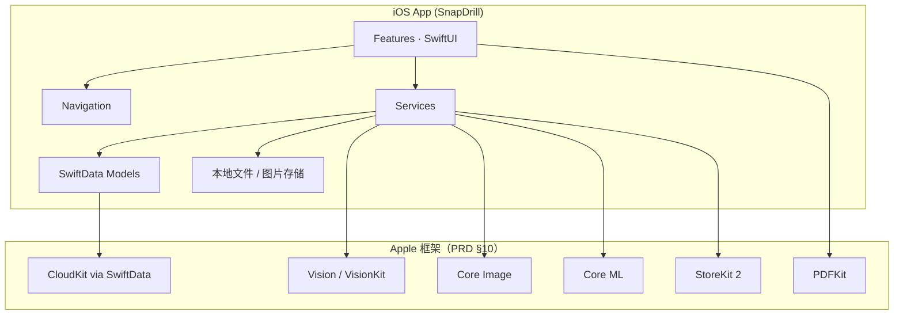

# SnapDrill · 架构与协作边界（greenfield）

> **目的**：让多人 / 多 Agent **并行开发**时有共同地图：能改哪里、不能改哪里、模块之间怎么接。  
> **权威顺序**：[`PRD.md`](PRD.md)（产品）> 本文（结构）> [`DEVELOPMENT_PRINCIPLES.md`](DEVELOPMENT_PRINCIPLES.md)（怎么做）> [`ENGINEERING.md`](ENGINEERING.md)（进度）> 代码。

| 文档版本 | 1.1 |
|---|---|
| 对应 PRD | v0.8 |
| 最后更新 | 2026-11-16 |

---

## 1. 设计原则（大白话版）

1. **产品规则只信 PRD**，需求争议回到 PRD 或 PO，不在代码里「偷偷改产品」。
2. **模块有边界**：Feature 负责界面与流程；Service 负责可测试能力；Model 负责数据结构；不跨层乱调。
3. **并行开发靠「合同」**：模块对外只暴露 Swift 类型 / protocol / 少量 `*Store` 入口；内部实现可换。
4. **阶段 0 与 MVP 并行**（方案 1）：去手写（轨道 B）与采集/UI（轨道 A）可不同人做，通过 `HandwritingRemovalService` 接口衔接。
5. **greenfield 不继承旧 `develop` 实现**；可参考，禁止整支 merge。

---

## 2. 系统一览



**部署形态**：纯端侧 App，无自建业务服务器（合规卖点见 PRD §9）。

---

## 3. 代码分层与目录（当前 + 目标）

| 层级 | 路径 | 职责 | 允许依赖 |
|---|---|---|---|
| **App 入口** | `SnapDrillApp.swift`, `Navigation/AppRootView.swift` | 生命周期、SwiftData 容器、启动 | Navigation, Services |
| **Navigation** | `Navigation/` | Tab、全屏流路由壳 | Features |
| **Features** | `Features/<Name>/` | 单屏/多步 UI、ViewModel（若需要） | Design, Models, Services |
| **Services** | `Services/` | 相机、增强、去手写、PDF、订阅、导出 | Models, Apple 框架 |
| **Models** | `Models/` | SwiftData `@Model`、枚举 | 仅 Foundation / SwiftData |
| **Design** | `Design/` | 颜色、字体 Token | SwiftUI |

**禁止**：

- Feature A 直接 `import` 并修改 Feature B 的私有 View 实现细节
- Model 里调 UIKit 相机
- Service 里塞 SwiftUI `View`（除 Preview）

**目标结构（Slice 推进时补齐，不提前过度拆分）**：

```text
Services/
  Capture/          # 相机、相册、透视、多页
  Image/            # 增强、GPS 剥离
  Handwriting/      # Core ML + 降级（阶段 0 产出接入点）
  Library/          # 错题 CRUD、筛选、撤销删
  Export/           # PDF、AirPrint
  Subscription/     # StoreKit 2、Pro 状态
```

Capture 合同已落于 `Services/Capture/CaptureContracts.swift`；其余领域随 Slice 补齐。

### 3.1 Capture：**强制 Protocol-First**（PO 2026-11-16）

适用于 **整个收录域**（`Features/Capture` + `Services/Capture`）。

| 顺序 | 谁做 | 做什么 |
|---|---|---|
| **① 合同** | 任意 Agent | 改 `CapturePipelineServing` + 类型；更新本文 §4.3；补 `SnapDrillTests/CapturePipelineContractTests` |
| **② 桩** | 同上 | `CapturePipelineStub` / `CapturePipelineLive` 可暂等同 Stub |
| **③ UI** | 另一 Agent | 只改 `Features/Capture/*`，经 `CapturePipelineFactory` 注入；**禁止** `import` Vision/AVFoundation 做业务 |
| **④ 真实现** | Slice 2+ | 填满 `CapturePipelineLive`，UI **不改**对外行为 |

**CI 守门（人工 + 评审）**：`CaptureFlowView`（及后续 Capture Views）不得出现 `VNDocumentCameraViewController`、`AVCaptureSession`、`CIFilter` 等；只能调用 `CapturePipelineServing`。

**实现入口文件**：

```text
Services/Capture/
  CaptureContracts.swift   # protocol + 值类型（权威）
  CapturePipelineStub.swift
  CapturePipelineLive.swift
  CapturePipelineFactory.swift
```

---

## 4. 核心领域与数据流（MVP）

### 4.1 收录主路径（PRD §8.2）

```text
Capture FAB → CaptureFlow（3 步）
  → ImageCaptureService     相机/相册 ≤10 张
  → DocumentScanService     透视 + 增强三档
  → CropBoxService          多框 / 多页
  → HandwritingRemovalService  去手写（或降级）
  → LibrarySaveService      写 SwiftData + 图片文件
```

### 4.2 持久化

| 内容 | 存储 | 说明 |
|---|---|---|
| 科目、错题元数据 | SwiftData | `Subject`, `MistakeItem`, … |
| 题干原图 / 去手写图 | App 沙盒文件 | Model 存相对路径；Pro 同步走 CloudKit |
| 未保存采集草稿 | `CaptureDraft` + 临时目录 | §8.6 |
| 用户偏好（上次科目等） | `UserDefaults` | 非敏感、非题库 |

### 4.3 关键接口（并行开发的「合同」）

实现可换，**签名与行为**变更须 PO + 本文更新。

| 接口（类型） | 所有者轨道 | 消费者 | 行为摘要 |
|---|---|---|---|
| **`CapturePipelineServing`** | A · Slice 2 | `CaptureFlowView` **唯一** | 见 `CaptureContracts.swift`；先合同后 UI |
| `PhotoDataSanitizing` / `ImageEnhancing` / `InkRemoving` | A/B | `CapturePipelineLive` 内部 | UI **不得**直接引用 |
| `HandwritingRemovalService` | B · 阶段 0 | Pipeline `InkRemoving` 适配 | 异步；失败 → 增强原图 + 不阻断保存 |
| `ImageEnhancementService` | A · Slice 2 | Pipeline 内部 | 三档；同步 |
| `SubjectCatalog` + `AppBootstrap` | A · Slice 1 | App 启动 | 地区科目种子 |
| `LibrarySaveService`（待建） | A · Slice 2/3 | Capture | 批量 N 题入库 |
| `PDFExportService`（待建） | A · Slice 6 | 列表/详情 | §8.5 版式 + 水印 |
| `ProEntitlementStore`（待建） | A · Slice 7 | PDF、同步、设置 | StoreKit + 降级 §8.6 |

---

## 5. 并行工作分轨（给 Agent / 人）

与 [`ROADMAP.md`](ROADMAP.md) 方案 1 一致。

| 轨道 | 可独立开发的 Slice | 主要目录 | 少碰 |
|---|---|---|---|
| **A · 产品壳** | 采集、列表、复习、PDF 壳、设置 | `Features/*`, `Services/Capture`, `Library`, `Export` | `Handwriting/` 内部模型 |
| **B · 去手写** | 阶段 0、Core ML 接入 | `Services/Handwriting*`, `Samples/` | Feature 大改、PRD |
| **C · 商业化** | 订阅、CloudKit | `Services/Subscription`, Model 配置 | Capture 交互 |
| **D · 横切** | 本地化、VoiceOver、a11y | `Features` 标注、`*.xcstrings` | 商业逻辑 |

**开工前必读**：PRD 相关章节 + 本文对应 § + `ENGINEERING.md` 进度表。

**完工定义（通用）**：

- 不改变未分配 AC 的行为
- `xcodebuild` 通过；若动到 Service 合同，补/改单元测试
- 不提交 `Samples/stage0/raw/`、密钥、`.xcuserdata`

---

## 6. Git 与任务切分（建议）

| 规则 | 说明 |
|---|---|
| 分支 | `feat/<领域>-<简述>`、`spike/<主题>`、`docs/<简述>`，从 `greenfield/rebuild-from-zero` 切 |
| PR 范围 | **一个 PR 一个边界**（例：仅 Capture 步骤 1，或仅 PDF 分页） |
| 合并后 | 删远端分支；更新 `ENGINEERING.md` 的 Slice 表 |
| 产品变更 | 先 PRD 或 PO 书面确认，再代码 |

**任务描述模板**（给 Agent）：

```markdown
轨道: A | B | C
目录: Features/Capture, Services/Image
PRD: §8.2 步骤 1, AC-02
合同: ImageEnhancementService（不变更签名）
不做: F-10, StoreKit
验收: [可粘贴 AC 子集]
```

---

## 7. 文档地图（谁写、谁读）

| 文档 | 维护者 | 内容 |
|---|---|---|
| `PRD.md` | PO | 做什么 |
| `ARCHITECTURE.md`（本文） | PO + 技术负责人 | 怎么拆、怎么并行 |
| `ROADMAP.md` | PO | 何时、里程碑 |
| `STAGE0_*.md` | PO + 轨道 B | 去手写验证 |
| `ENGINEERING.md` | 实现者 | 怎么编译、**当前做到哪** |

**没有 ADR 时**：架构级决策（换存储、改模块边界）在本文 **§8 决策记录** 追加一行，不必另起 20 页 ADR。

---

## 8. 决策记录

| 日期 | 决策 | 原因 |
|---|---|---|
| 2026-11-16 | SwiftUI + SwiftData 单体 App | PRD §10 |
| 2026-11-16 | Feature 按 Home/Capture/Review/Settings 分文件夹 | 对齐 §8.1 Tab |
| 2026-11-16 | 方案 1：`HandwritingRemovalService` 桩 + 阶段 0 后替换 | 并行 MVP 与验证 |
| 2026-11-16 | 无自建后端 | PRD Non-Goals |
| 2026-11-16 | Capture 强制 protocol-first | 多 Agent 并行收录 |

---

## 9. 修订记录

| 版本 | 日期 | 说明 |
|---|---|---|
| 1.0 | 2026-11-16 | 首版：分层、合同、并行轨道、Agent 任务模板 |
| 1.1 | 2026-11-16 | Capture 强制 Protocol-First + `CapturePipelineServing` |