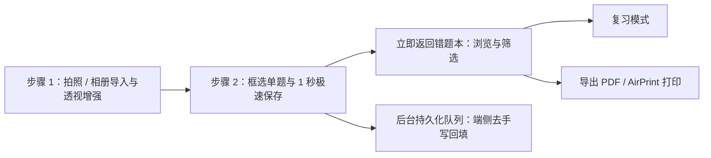
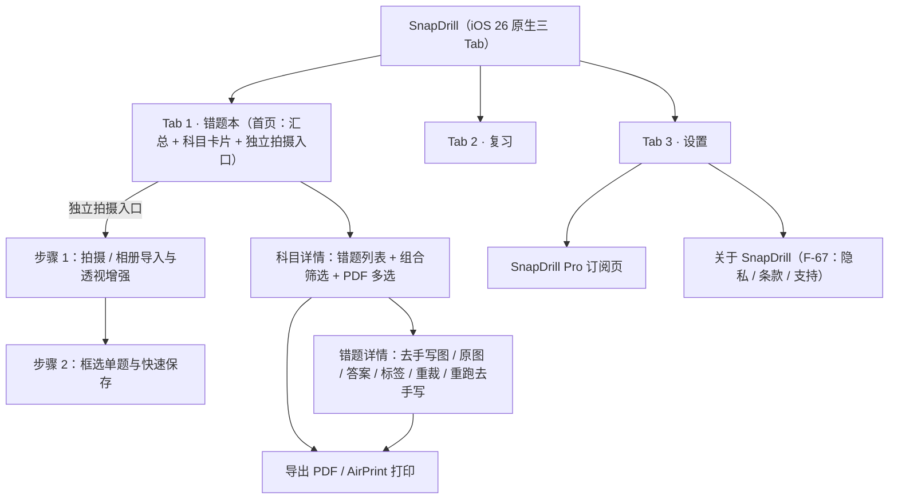
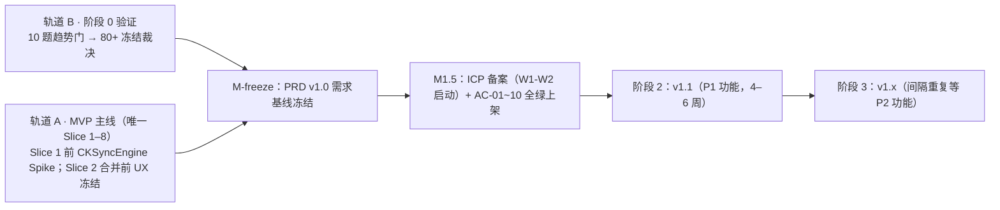

# SnapDrill 产品需求文档（PRD · 草案 v0.15）

> [!NOTE]
> 本文档是 NotBad Labs 旗下 SnapDrill 项目的**重构版 PRD**，取代此前所有旧版文档和草稿，是主开发分支（见 [`ROADMAP.md`](ROADMAP.md)）上的产品需求依据。当前为 **v0.15 草案**（2026-11-27 纳入状态机、采集不变量与同步闭环收口决议）。何时升版为 v1.0 正式定稿由 PO 依冻结检查表达成后决定。仍需技术验证后决定的地方标为 **【待定】**。

| 项目 | 内容 |
|---|---|
| 产品名 | SnapDrill |
| 开发者 | NotBad Labs |
| 文档版本 | v0.15（草案） |
| 更新日期 | 2026-11-27 |
| 平台 | iOS（仅 iPhone） |
| 状态 | 待冻结检查项齐备后升 v1.0 |

---

## 1. 产品概述

### 1.1 一句话定位
**Snap your mistakes. Drill them later.**
用 iPhone 摄像头代替手抄，让整理错题像拍照一样简单。

### 1.2 名称含义
- **Snap**：随手一拍，速度快。
- **Drill**：反复练习，把错题练到会。

### 1.3 背景
在中、日、韩、新加坡等东亚教育环境中，学生普遍习惯把作业、试卷里的错题和重点题抄到纸质错题本上（中文称“错题本”，日文称“間違いノート”，韩文称“오답노트”），用于复习和重做。手抄存在明显问题：

- **耗时**：抄一道带图的几何题或长阅读题，常常要 5–15 分钟。
- **易出错**：抄题时漏抄条件、画错图。
- **难检索**：纸质本按时间顺序记录，按科目或知识点查找很困难。
- **难重做**：原题上已经写了答案，没法干净地重新做一遍。

现有方案大多是教辅平台的附属功能，与题库、搜题和课程深度绑定，操作链路长，还夹带大量推广内容。

### 1.4 产品原则
1. **只做一件事**：把“抄错题”这件事数字化，并做到极致顺手。
2. **不做内容**：不提供题库、答案、讲解、课程，也不做搜题。
3. **工具感**：打开即用，无广告、无社区、无推送轰炸。
4. **隐私优先**：核心图像处理全部在手机端侧完成，无需注册账号，开发者不自建业务服务器收集或读取用户数据；免费版错题库仅存本机且不经开发者服务器上传（iOS 系统级整机 iCloud 加密备份由操作系统控制，不计为开发者主动上传或 `AC-09` 本 App 进程网络外连；未保存临时草稿 `Application Support/CaptureDrafts/` 仍显式标记 `isExcludedFromBackup = true`），开启 Pro 同步时仅通过 Apple 官方 `CKSyncEngine` 加密存放在用户个人私有 iCloud 中。

### 1.5 明确不做的事（Non-Goals）
| 不做 | 原因 |
|---|---|
| 拍照搜题 / 提供答案 | 偏离定位，涉及题库版权，助长抄作业 |
| 题库、教辅、课程 | 不做内容平台 |
| 社区、排行榜、打卡分享 | 不制造焦虑和社交压力 |
| AI 讲题 / 解题 | 首版不做 |
| 开发者云端处理或收集图片 | 坚持端侧处理，无自建服务器收集或读取用户图像 |
| iPad 专属适配 | 首版不做（仅保证 iPad 在 iPhone 兼容模式下可正常打开、浏览与退出，不承诺专属采集与排版验收） |
| Android / Web 版 | 首版专注 iOS |

---

## 2. 目标用户

### 2.1 用户画像
| 角色 | 描述 | 优先级 |
|---|---|---|
| **初高中学生**（12–18 岁） | 有自己的 iPhone，有整理错题的习惯，或被老师要求整理 | 主要用户 |
| 家长 | 可能替孩子付费（通过家人共享订阅） | 付费决策者之一，不作为界面设计对象 |
| 大学生 / 考证人群 | 有类似需求 | 潜在用户 |

### 2.2 核心场景
1. **晚上写完作业**：老师批改后的作业里有 3 道错题，学生在 2 分钟内全部收进对应科目。
2. **考试后整理试卷**：一张试卷上有 5 道错题，拍一次整页，分别框选出这 5 道题。
3. **考前复习**：按科目和错因筛选错题，在“隐藏答案”模式下逐题过一遍。
4. **重做 / 打印**：把某个单元的错题去掉手写痕迹，排版成 PDF 打印，在纸上重做。

---

## 3. 首发范围

| 决策项 | 结论 |
|---|---|
| 首发市场 | **全球同步上架** |
| 首发语言 | 英语、简体中文、繁体中文（含台湾 `zh-Hant-TW` 与香港 `zh-Hant-HK` 分片）、日语、韩语 |
| 重点市场 | 中国大陆、中国台湾、中国香港、日本、韩国、新加坡 |
| 设备 | 仅 iPhone |
| 账号 | **无需应用内注册**；**Pro 订阅**方通过 Apple ID 启用 `CKSyncEngine` 私人 iCloud 同步 |
| 商业模式 | 订阅制，参考 Bear（见第 6 节） |
| 去手写 | 端侧 Core ML 实现 |
| 数据存储与同步 | **单一本地 SwiftData 库（`cloudKitDatabase: .none`，`@Attribute(.externalStorage)` 存图片）+ Apple 原生 `CKSyncEngine`**（Pro 启停引擎，零双库搬家） |
| 系统版本 | **iOS 26+**（见 3.2 节） |

### 3.1 全球市场的本地化要点与完整 `presetKey` 6 语译名表

| 项目 | 说明 |
|---|---|
| 预置科目与错因矩阵（6 重点地区 + 全球默认） | 按系统**地区（优先）与首选语言**确定命中矩阵（**Free、未登录 iCloud 或首次私有库 Zone 拉取失败/超时时，直接按命中矩阵一次性播种并记本地「待对账」状态；Pro 且首次 Zone 拉取成功时须先拉取云端 `DeletedPresetKey` 再按剩余未墓碑键播种，具体见 §8.6**；**科目种子全集 = 当前命中矩阵 ∪ {`preset.subject.uncategorized`}**，`sortOrder` 按矩阵顺次从 `0` 递增，`preset.subject.uncategorized` 固定末位 `999`；**同时同事务一次性播种下表全部 6 个预置错因 `preset.reason.*`，`sortOrder` 按表顺次 `0..5`，与地区无关**）： • **中国大陆**（`CN` / `zh-Hans`，6 科）：语文、数学、英语、物理、化学、生物 • **中国台湾**（`TW` / `zh-Hant-TW`，6 科）：國文、數學、英文、物理、化學、生物 • **中国香港**（`HK` / `zh-Hant-HK`，6 科）：中國語文、英國語文、數學、物理、化學、生物 • **日本**（`JP` / `ja`，5 科）：国語、数学、英語、理科、社会 • **韩国**（`KR` / `ko`，5 科）：국어、수학、영어、과학、사회 • **新加坡**（`SG`，**4 科为结合当地通用学制的预期设计**）：English、Mathematics、Science、Chinese • **其他地区 / 全球默认**（含欧洲 / `en`，5 科）：Mathematics、English、Science、History、Geography **唯一匹配优先级（6 路语言有序回退 + 裸繁体兜底）**：① 先匹配重点地区码（`CN` / `TW` / `HK` / `JP` / `KR` / `SG`）；② 未命中重点地区码时按系统首选语言依次尝试：`zh-Hans` → CN 矩阵、`zh-Hant-HK` → HK 矩阵、`zh-Hant-TW` 或**任何其他 `zh-Hant*`（如裸 `zh-Hant` / `zh-Hant-MO`）** → TW 矩阵、`ja` → JP 矩阵、`ko` → KR 矩阵、`en` → 全球默认矩阵；③ 上述 6 路均未命中再回退全球默认 5 科 + `uncategorized`。 |
| 预置合并与本地化原则 | 所有预置科目与预置错因均持久化唯一 **`presetKey`** 与可选 `customName`（未改名前依当前系统语言按下方 6 语表实时渲染：**神谕列只认应用解析后的 `zh-Hans`、`zh-Hant-HK`、`zh-Hant-TW`（含其余 `zh-Hant*` 统一回退 `zh-Hant-TW` 列）、`ja`、`ko`、`en`，若解析语言不在上列 6 档中则统一回退显示 `en` 列**；改名后锁定 `customName`）。**`preset.subject.uncategorized` 固定 `sortOrder = 999` 不可被拖动重排；新建自建科目的初始 `sortOrder = 当前最大非 999 值 + 1`**。**所有带非空 `presetKey` 的预置条目（不论通用键或地区专属键）在同步合并时均按 `presetKey` 去重**：保留较早 `createdAt`（同早取字典序较小 `UUID`）作幸存主身份；**删除冗余副本前，使用 `(updatedAt 降序, editNonce.uuidString 降序)` 将 `customName`、`sortOrder` 与配色等可变展示字段合并入幸存记录（若字段发生变更则置幸存条 `needsCloudUpload = true` 并入队）**，并重指向错题外键；自建条目严格仅按 `UUID` 合并。 |
| 地区矩阵 → `presetKey` 播种全集 | 规范化集合如下（任意命中地区额外并入末位 **`preset.subject.uncategorized`（`sortOrder = 999`）** 及全部 6 条 **`preset.reason.*`（`sortOrder = 0..5`）**）： • **CN**（`0..5`）：`cn_chinese`, `math`, `english`, `physics`, `chemistry`, `biology` • **TW**（`0..5`）：`tw_guowen`, `math`, `english`, `physics`, `chemistry`, `biology` • **HK**（`0..5`）：`hk_chinese`, `english`, `math`, `physics`, `chemistry`, `biology` • **JP**（`0..4`）：`jp_kokugo`, `math`, `english`, `jp_rika`, `jp_shakai` • **KR**（`0..4`）：`kr_gukeo`, `math`, `english`, `kr_gwahak`, `kr_sahoe` • **SG**（`0..3`）：`english`, `math`, `science`, `sg_chinese` • **全球默认**（`0..4`）：`math`, `english`, `science`, `history`, `geography` （上列科目短名均以 `preset.subject.` 为前缀。） |
| App Store 副标题 | 产品名全球统一用 SnapDrill，副标题使用各地对“错题本”的习惯叫法： 简中：错题本 · 拍照整理错题 繁中：錯題本 · 拍照整理錯題 日语：間違いノート 韩语：오답노트 英语：Mistake Notebook |
| 识别语言（P1） | 题干文字识别需要支持中、日、韩、英混排（归属 **P1 `F-33` 文字搜索**，随 P1 同步上线；P0 不强制执行全文 OCR）。 |
| 纸张尺寸 | PDF 导出默认按系统地区自动匹配：**日本、韩国默认 B5**，中国大陆/中国台湾/中国香港/新加坡/其他地区（含欧洲）默认 **A4**，美国/加拿大默认 **Letter**；导出预览页均可手动切换 A4 / B5 / Letter。 |

**完整 `presetKey × 6 语/地区` 译名神谕表（`AC-10` 唯一译名依据）**：

| `presetKey` | `zh-Hans`（简中） | `zh-Hant-TW`（台湾） | `zh-Hant-HK`（香港） | `ja`（日语） | `ko`（韩语） | `en`（英语） |
|---|---|---|---|---|---|---|
| `preset.subject.cn_chinese` | 语文 | 語文 | 語文 | 中国語 | 중국어 | Chinese (CN) |
| `preset.subject.tw_guowen` | 国文 | 國文 | 國文 | 国文 | 국문 | Chinese (TW) |
| `preset.subject.hk_chinese` | 中国语文 | 中國語文 | 中國語文 | 中国語文 | 중국어문 | Chinese (HK) |
| `preset.subject.jp_kokugo` | 日语(国语) | 日語(國語) | 日語(國語) | 国語 | 국어(일본어) | Japanese (Kokugo) |
| `preset.subject.kr_gukeo` | 韩语(国语) | 韓語(國語) | 韓語(國語) | 韓国語(国語) | 국어 | Korean |
| `preset.subject.sg_chinese` | 华文 | 華文 | 華文 | 中国語(SG) | 중국어(SG) | Chinese |
| `preset.subject.jp_rika` | 理科 | 理科 | 理科 | 理科 | 이과 | Science (JP) |
| `preset.subject.jp_shakai` | 社会 | 社會 | 社會 | 社会 | 사회(일본) | Social Studies (JP) |
| `preset.subject.kr_gwahak` | 科学(韩国) | 科學(韓國) | 科學(韓國) | 科学(韓国) | 과학 | Science (KR) |
| `preset.subject.kr_sahoe` | 社会(韩国) | 社會(韓國) | 社會(韓國) | 社会(韓国) | 사회 | Social Studies (KR) |
| `preset.subject.math` | 数学 | 數學 | 數學 | 数学 | 수학 | Mathematics |
| `preset.subject.english` | 英语 | 英文 | **英國語文** | 英語 | 영어 | English |
| `preset.subject.physics` | 物理 | 物理 | 物理 | 物理 | 물리 | Physics |
| `preset.subject.chemistry` | 化学 | 化學 | 化學 | 化学 | 화학 | Chemistry |
| `preset.subject.biology` | 生物 | 生物 | 生物 | 生物 | 생물 | Biology |
| `preset.subject.science` | 科学 | 科學 | 科學 | 科学 | 과학(일반) | Science |
| `preset.subject.history` | 历史 | 歷史 | 歷史 | 歴史 | 역사 | History |
| `preset.subject.geography` | 地理 | 地理 | 地理 | 地理 | 지리 | Geography |
| `preset.subject.uncategorized` | 未分类 | 未分類 | 未分類 | 未分類 | 미분류 | Uncategorized |
| `preset.reason.careless` | 粗心 | 粗心 | 粗心大意 | ケアレスミス | 부주의 | Careless Mistake |
| `preset.reason.concept` | 概念不清 | 概念不清 | 概念不清 | 概念の理解不足 | 개념 부족 | Concept Gap |
| `preset.reason.method` | 方法不会 | 方法不會 | 不懂解題方法 | 解法がわからない | 풀이법 모름 | Method Unknown |
| `preset.reason.calculation` | 计算错误 | 計算錯誤 | 計算錯誤 | 計算ミス | 계산 실수 | Calculation Error |
| `preset.reason.misread` | 审题错误 | 審題錯誤 | 審題失誤 | 読み間違い | 문제 오독 | Misread Question |
| `preset.reason.other` | 其他 | 其他 | 其他 | その他 | 기타 | Other |

### 3.2 最低系统版本策略
| 项目 | 说明 |
|---|---|
| 当前 | 2026 年最低支持 **iOS 26**（当前最新 SDK 与模拟器目标见 [`ENGINEERING.md`](ENGINEERING.md)） |
| 调整节奏 | 每年 WWDC 之后研究新系统的能力和普及情况，再决定是否提高最低版本，不预先承诺固定节奏 |
| 判断依据 | 新系统带来的关键能力（如 Vision、SwiftData、Core ML、`CKSyncEngine` 的接口）、Apple 公布的系统普及率、仍在旧系统上的用户比例 |
| 性能验收基准机型 | **iPhone 17 标准版**（PO Dogfood 与 AC-04 性能抽测统一口径，2026-11-17 决议） |

---

## 4. 核心流程（异步入库、不阻塞浏览）

**体验目标**：从打开 App 到保存一道错题，熟练用户应在 **30 秒内**完成；点保存后立即返回浏览，绝不阻塞等待整批去手写推理。

---

## 5. 功能需求

> 优先级说明：**P0** = MVP 必须有；**P1** = 首版尽量有，或在 1.1 版本补上；**P2** = 以后再考虑
> “版本”一列说明这个功能属于免费版还是 Pro 版，详见第 6 节。

### 5.1 采集（拍照与导入）
| 编号 | 功能 | 说明 | 优先级 | 版本 |
|---|---|---|---|---|
| F-01 | 相机拍摄 | 打开 App 后一键进入相机，支持连拍多页（单批 ≤ 10 张） | P0 | 免费 |
| F-02 | 自动找边与透视校正 | 自动识别纸张边缘，矫正倾斜和透视；支持手动微调四个角与单页旋转 | P0 | 免费 |
| F-03 | 相册导入 | 从系统相册选择一张或多张图片（`PHPicker`，单批 ≤ 10 张） | P0 | 免费 |
| F-04 | 图像增强 | 去阴影、提高对比度，提供“增强（默认） / 原图 / 黑白”三种模式 | P0 | 免费 |
| F-05 | 框选单题 | 在整页图上手动框选一道或多道题（单页 ≤ 10 框，单批总题数 ≤ 30 题），每个框生成一条独立错题 | P0 | 免费 |
| F-06 | 智能分题 | 自动识别页面中的题目区域，给出框选建议 | P1 | Pro |
| F-07 | 多图合并 | 一道题跨栏或跨页时，可以把多张截图拼成一条错题 | P1 | 免费 |
| F-08 | 从分享菜单导入 | 从其他 App 分享图片或 PDF 进来 | P2 | 免费 |

### 5.2 处理（去手写，端侧）
| 编号 | 功能 | 说明 | 优先级 | 版本 |
|---|---|---|---|---|
| F-10 | 去除手写笔迹 | 端侧 Core ML 去掉手写答案和批改痕迹，保留印刷体原题（持久化 `MistakeItem.backfillState` + 并发 1–2 队列 + 单题 6 秒硬超时自动降级） | P0（阶段 0 裁决确认） | 免费，不限次数 |
| F-11 | 原图 / 去手写图对照 | 同时保留两个版本，可以随时无损切换查看 | P0 | 免费 |
| F-12 | 手动橡皮擦 | 自动去除效果不理想时，手动涂抹擦除或恢复误擦的部分（**当且仅当阶段 0 Q1 落入 B 档，或 Q1 C 档选择移出 `F-10`，或 Q2 C 档 / Q3 `> 120 MB` 且 PO 决定放弃当前自动模型发版时升格纳入首包；Q1 C 重训/缩范围与 Q2 B 档均不触发升格**，见 §8.7 与 §10） | P1（仅 §10 触发 Q1 B 档或移出/放弃自动方案时升 P0） | 免费 |
| F-13 | 只去除红笔批改 | 只去掉老师的红笔批注，保留学生自己的作答 | P2 | Pro |

> [!WARNING]
> 端侧去手写是本产品最大的技术风险，也是最核心的差异化功能。执行 **方案 1 双轨并行**：轨道 A（MVP 壳与非 ML 功能）可先行推进，未通过阶段 0 冻结门前 App 端以「增强原图 + 降级提示」占位运行；**正式对外主打「自动去手写」与宣称 AC-04 全量达标前，必须通过阶段 0 冻结门裁决（详见 `Docs/STAGE0_CHARTER.md`）**。

### 5.3 整理（错题信息）
| 编号 | 功能 | 说明 | 优先级 | 版本 |
|---|---|---|---|---|
| F-20 | 科目 | 按 6 地区+全球默认矩阵预置（存 `presetKey`）；**在拍摄保存页、首页与详情编辑页均可随时「+ 新建」个性化科目**，支持增删、排序、改名与配色 | P0 | 免费 |
| F-21 | 错因 | 预置错因（存 `presetKey`）：粗心、概念不清、方法不会、计算错误、审题错误、其他；支持自定义与动态本地化 | P0 | 免费 |
| F-22 | 自定义标签 | 例如单元、知识点、考试名称，可以给一道题打多个标签（单题 ≤ 10 个） | P0 | 免费 |
| F-23 | 正确答案 / 解析 | 可以拍照/相册添加（以独立 `AnswerImage` 存 ≤ 3 张，同样剥离 EXIF GPS），也可以输入文字（≤ 2,000 字） | P0 | 免费 |
| F-24 | 备注 | 自由文本，记录自己的思路和反思（≤ 1,000 字） | P0 | 免费 |
| F-25 | 自定义来源与手动日期 | 例如修改题目来源“期中考试”“练习册 P32”或手动补录日期（注：系统自动记录的 `MistakeItem.createdAt` 展示与日期筛选为 P0 已有能力） | P1 | 免费 |
| F-26 | 掌握程度 | 三档：未掌握、模糊、已掌握 | P1 | 免费 |
| F-27 | 快速收录 | 框选后确认/新建科目即可在 1 秒内提交已编码资产入库，其余选填信息后续补录 | P0 | 免费 |

### 5.4 浏览与检索
| 编号 | 功能 | 说明 | 优先级 | 版本 |
|---|---|---|---|---|
| F-30 | 首页按科目浏览 | 以科目卡片的形式展示，显示每科的错题数量 | P0 | 免费 |
| F-31 | 列表 / 网格视图 | 以缩略图浏览错题，支持双图切换预看 | P0 | 免费 |
| F-32 | 筛选 | 按科目、错因、标签、系统收录日期（`createdAt`）范围组合筛选（P1 增加按掌握程度筛选，与 F-26 同步上线） | P0 | 免费 |
| F-33 | 文字搜索 | 用系统文字识别（支持中日韩英混排）提取题干文字，支持按关键词搜索 | P1 | Pro |
| F-34 | 批量操作 | P0 阶段在列表页仅提供 **PDF 导出多选模式**；完整批量移动、打标签、删除归属 P1 | P1 | 免费 |

### 5.5 复习
| 编号 | 功能 | 说明 | 优先级 | 版本 |
|---|---|---|---|---|
| F-40 | 复习模式 | 卡片式逐题浏览，默认隐藏答案，点击后显示；支持双指放大与空答案快捷补录 | P0 | 免费 |
| F-41 | 复习后标记 | 复习完一道题后，标记“会了 / 还不会”，更新掌握程度 | P1 | 免费 |
| F-42 | 间隔重复提醒 | 根据遗忘曲线，安排需要再次复习的题目 | P2 | Pro |
| F-43 | 复习统计 | 简单统计各科错题数量和掌握比例，**不做排名和对比** | P2 | Pro |

### 5.6 导出与打印
| 编号 | 功能 | 说明 | 优先级 | 版本 |
|---|---|---|---|---|
| F-50 | 导出 PDF | 选中若干道错题，排版成 PDF；支持 A4、B5（日韩默认）、Letter | P0 | 免费版带页脚浅水印，Pro 版无水印 |
| F-51a | PDF 基础排版选项 | 切换是否附末段参考答案附页、选择作答留白档位（紧凑 18% / 标准 25% / 宽松 35%） | P0 | **Pro** |
| F-51b | PDF 高级排版选项 | 自定义每页题数、答案紧跟每道题后等精细排版 | P1 | Pro |
| F-52 | AirPrint 打印 | 直接调用系统打印（与 F-50 共用同份 PDF 文档与免费/Pro 水印规则） | P0 | 免费（免费版同带页脚浅水印） |
| F-53 | 导出图片 | 单题导出为图片，方便发给老师或同学 | P1 | 免费 |
| F-54 | 全量备份导出 | 常规结构化可恢复压缩包导出归属 P1 免费；**P0 阶段在数据库损坏故障恢复页（§8.6 / AC-09）提供原始数据与图片目录打包自救导出** | P1（故障导出为 P0） | 免费 |

### 5.7 设置与其他
| 编号 | 功能 | 说明 | 优先级 | 版本 |
|---|---|---|---|---|
| F-60 | iCloud 同步 | 通过 Apple 原生 `CKSyncEngine` 在同一 Apple ID 设备间同步全部元数据与 `@Attribute(.externalStorage)` 图片资产 | P0 | **Pro** |
| F-61 | 科目与错因管理 | 增删、排序、改名与配色 | P0 | 免费 |
| F-62 | 应用锁 | Face ID / 密码锁 | P1 | Pro |
| F-63 | 深色模式 | 跟随系统（与 `F-64a` 每套主题内置的浅/深变体联动） | P0 | 免费 |
| F-64a | 纸笔配色主题 | 全产品固定 **3 套**主题：免费永久用默认 **「米白手帐」**；Pro 另行解锁 **额外 2 套主题（「墨竹素笺」「暖灰护眼」）**，每套内置浅色与深色变体且全 6 组过 WCAG AA | P0 | 免费 1 套 + **Pro 额外 2 套** |
| F-64b | 备选 App 图标 | 多款桌面备选 App 图标 | P1 | Pro |
| F-65 | 订阅管理 | 订阅页、动态价格、试用资格检查、恢复购买、家人共享（含 Ask to Buy `.pending`）、宽限期与账单重试保持权益、系统管理订阅 | P0 | — |
| F-66 | 存储占用查看与缓存清理 | 设置页查看错题图库与缓存体积；**整目录清空 `tmp/pdf-export/`，并仅清理 `tmp/thumbnails/` 与 `Library/Caches/SnapDrillImageCache/` 中无对应在库 `UUID` 且 `mtime > 7 天` 的过期碎片**，**显式排除 `Application Support/CaptureDrafts/`、SwiftData external storage 目录与 `Application Support/CKAssetUploadStaging/`** | P0 | 免费 |
| F-67 | 关于与合规信息 | 设置 → 关于页展示中国大陆 ICP 备案号与查询链接，并提供 5 语隐私政策、使用条款（EULA）与技术支持页入口 | P0 | 免费 |

---

## 6. 商业模式：订阅制（参考 Bear）

### 6.1 Bear 的订阅模式拆解

| 维度 | Bear 的做法 |
|---|---|
| 免费版 | 核心写作和整理功能**永久免费、不限数量**，但只能在一台设备上使用（无同步） |
| Pro 版解锁 | iCloud 同步、高级导出（PDF / DOCX 等）、加密与应用锁、主题与图标、图片和 PDF 内的文字搜索 |
| 价格 | 月付 \$2.99，年付 \$29.99（2026-11-24 起新用户调整为 \$3.99 / \$39.99，老用户保持原价） |
| 试用 | 月付和年付都有 7 天免费试用 |
| 覆盖范围 | 一份订阅覆盖同一 Apple ID 下的全部设备 |

**值得学习的核心思路**：
1. **免费版不阉割核心价值**：用户不付费也能长期使用，靠口碑带来新用户。
2. **Pro 版卖的是“多设备 + 省事 + 好看”**：用户需要的时候自然会升级，不会觉得被要挟。
3. **价格低、档位少**：只有月付和年付两档，决策简单。
4. **老用户涨价不涨**：维护信任。

### 6.2 SnapDrill 的方案

**免费版（永久）**
- 拍照、裁剪、框选、**去手写**（仅当 §10 阶段 0 统一裁决矩阵触发且 PO 终局决定将 `F-10` 移出首包——含 Q1 C 档选择移出、Q2 C 档放弃自动模型或 Q3 `> 120 MB` 放弃/延后——时，此条按 §15 替换为「图像增强原图 + `F-12` 手动橡皮擦」；Q1 C 档选择重训或缩小首发范围重裁时不触发本条替换）、整理、随时新建个性化科目、浏览、复习、打印，**全部不限次数、不限数量**
- 默认纸笔主题：**「米白手帐」**（含浅色/深色系统自适应变体）
- 导出 PDF 与 AirPrint 打印：固定使用 **标准（25%）** 留白练习卷版式，页脚右下角带 8pt `#8E8E93`（35% 不透明度）浅灰水印 `SnapDrill`
- 数据库损坏时支持故障数据自救导出（完整结构化备份导出 `F-54` 随 P1 免费提供）
- 仅限当前设备，没有 iCloud 同步

> 去手写在免费版中不限次数：中国大陆已有同类 App 免费提供这项功能，限制次数会显得小气；而且端侧处理没有服务器成本，免费提供不会增加开销。

**SnapDrill Pro · MVP（v1.0 首版 Paywall 唯一可展示权益）**
> [!CAUTION]
> 为严防 App Store 审核因 Guideline 2.3 / 3.1.2 虚假宣传拒审，**首版（v1.0）Paywall 严禁宣传或列出任何尚未上线的 P1/P2 功能**，且权益文案必须与代码解锁边界 100% 一致。

1. **iCloud 多设备同步**（`F-60`：含错题元数据及题干/答案全部图片资产）
2. **无水印 PDF 导出与 AirPrint 打印**（`F-50` / `F-52`）
3. **PDF 基础排版选项**（`F-51a`：开关末段参考答案附页、选择紧凑 18% / 标准 25% / 宽松 35% 三档作答留白）
4. **额外 2 套纸笔配色主题（共 3 套可选）**（`F-64a`：在默认「米白手帐」外解锁「墨竹素笺」「暖灰护眼」，均自带浅/深变体）

> [!NOTE]
> **B/C 档条件文案防混边界**：完全遵循 **§10 阶段 0 统一裁决矩阵**——仅当触发 **`F-12` 手动橡皮擦** 升格进首包（**Q1 B 档，或 Q1 C 档选择移出 `F-10`，或 Q2 C 档 / Q3 `> 120 MB` 且 PO 决定放弃自动模型进入发版**）均**属于免费版权益，严禁列入上述 Pro Paywall 权益列表或暗示为付费功能**，此时首版 Paywall 仍仅展示上列 4 项既定 Pro 权益；若仅落入 Q2 B 档启用 `AC-04-B` 或移出 `F-10`，商店定位与免费版文案同步遵循 §10 表与 §15 弱化或移除自动去手写宣称。

**SnapDrill Pro · 后续版本规划（v1.1+，首版 Paywall 不展示）**
- 智能分题（`F-06`）、题干文字搜索（`F-33`）、PDF 高级排版（`F-51b`）、应用锁（`F-62`）、备选 App 图标（`F-64b`）、间隔重复提醒与复习统计（`F-42` / `F-43`）、只去红笔（`F-13`）

### 6.3 定价建议与 StoreKit 2 审核合规（Guideline 3.1.2）

| 档位 | 美国参考价格 | 说明 |
|---|---|---|
| 月付 | **\$1.99 / 月** | 比 Bear 低，适合学生的消费能力 |
| 年付 | **\$14.99 / 年** | 约等于 7.5 个月的月费，主推这一档 |
| 免费试用 | 7 天 | 首次符合资格的订阅用户提供 |
| 家人共享 | 开启 | 家长订阅后，孩子可以通过家人共享使用 |

**为什么比 Bear 便宜**：
- 主要用户是学生，可支配收入低，订阅往往要家长同意。
- 参考学生常用的同类工具：Goodnotes 基础版年付 \$11.99，Pro 版年付 \$35.99。\$14.99 处在学生能接受的区间。
- 先用低价获取用户和口碑；以后如果涨价，可以学 Bear 的做法：老用户保持原价。

**StoreKit 2 实施与 App Store 审核硬规则（必选）**：
1. **严禁硬编码价格 + 商品加载失败态**：订阅页与提示弹窗内展示的全部金额与周期文本，**必须实时读取 StoreKit 2 的 `Product.displayPrice` 与本地化周期单位**。若商品列表加载失败或网络不可达，**仅将价格与购买按钮区域替换为「加载失败 · 点击重试」占位界面，严禁退回展示任何本地写死的价格数字，同时保持自动续费说明、隐私政策与 EULA 链接及「恢复购买」按钮常驻可见**。
2. **试用资格动态校验**：展示“7 天免费试用”前，必须检查 `Product.SubscriptionInfo.isEligibleForIntroOffer`；若用户已不具备首期优惠资格，界面与购买按钮必须直接展示标准定期扣费价格，避免误导拒审。**若试用资格接口查询失败或超时（资格未知），按「不具备首期优惠资格」同等处理：仅展示标准 `displayPrice` 定期扣费价、绝不展示 7 天试用文案，且不影响已加载的价格与购买按钮正常交互**。
3. **Guideline 3.1.2 必选披露与双入口链接**：Paywall 页 **与 App Store Connect 商品描述区** 必须均包含清晰的自动续费说明、可至少提前 24 小时在 Apple ID 账户设置中取消续费的说明、可点击打开的**隐私政策（Privacy Policy）与标准使用条款（EULA）链接**，以及显眼的「恢复购买」按钮；设置页提供系统原生管理订阅入口（`AppStore.showManageSubscriptions`）。
4. **常驻监听、`RenewalState` 宽限与 Ask to Buy `.pending`**：App **自冷启动起即常驻监听 `Transaction.updates`**（不仅在打开订阅页后）。订阅处于 `RenewalState` **宽限期（`inGracePeriod`）或账单重试期（`inBillingRetryPeriod`）期间继续保持全部 Pro 权益**，严禁提前降级加水印或停同步。开启家人共享后，家长尚未批准时 StoreKit 返回 **`PurchaseResult.pending`**（Ask to Buy 挂起态）：**绝不向用户授予任何 Pro 权益**（`CKSyncEngine` 不启动、保持水印与免费默认主题），仅在界面展示温和的「已发送购买请求，待家长批准」提示，直到 `Transaction.updates` 收到已验证（`verified`）交易后再行解锁。
5. **退款与共享撤销处理**：当 StoreKit 交易返回 `revocationDate != nil`（退款或移出家庭组）时，立即按 §8.6 规则停止 `CKSyncEngine` 并执行无损降级，不锁死本地既有数据。

> [!TIP]
> 学生的使用有明显的季节性，考试季前后最活跃。可以在期末考试季、开学季做年付限时优惠，用 App Store 自带的“优惠代码”和“促销优惠”功能即可实现，不需要自己搭服务器。

---

## 7. 品牌风格

### 7.1 品牌性格
SnapDrill 是一个**安静、利落、让人安心的学习伙伴**，而不是又一个让学生焦虑的“提分神器”。

| 是 | 不是 |
|---|---|
| 安静、专注 | 吵闹、花哨 |
| 利落、高效 | 复杂、功能堆砌 |
| 温和、友好 | 制造焦虑（“别人都在努力”） |
| 亲切但不幼稚 | 低龄化、卡通堆砌 |
| 尊重隐私 | 收集数据、推送轰炸 |

### 7.2 已确定方向：纸与笔 + 熊猫

**界面是“纸与笔”，熊猫是住在本子里的伙伴。**

- **界面**：采用“纸与笔”风格，负责“安静、专注、像一本好用的笔记本”。
- **熊猫**：作为品牌吉祥物，负责“亲切、有记忆点”。

两者天然契合：熊猫本身就是**黑白两色**，和纸（白）与墨（黑）是同一种语言。

| 元素 | 规范 |
|---|---|
| 固定 3 套主题与系统深浅联动 | 全部主题由 `SnapDrillTheme` 集中定义，**每套主题均内置对应「浅色」与「深色（暖调深灰基底，不用纯黑）」两套调色板，自动随系统外观（`F-63`）切换**： 1. **米白手帐**（免费默认）； 2. **墨竹素笺**（Pro 额外主题 1）； 3. **暖灰护眼**（Pro 额外主题 2）。 |
| 主色 / 文字 / 点缀 | 主色墨蓝（按钮、选中态、链接）；文字墨黑/深浅高对比文本；点缀批改红、铅笔黄（**铅笔黄严禁直接作为浅底小号正文或按钮文字**） |
| 对比度硬底线 | **全部 3 套主题 × 2 种外观（共 6 组调色板）均须满足 WCAG AA**（正文文本 ≥ 4.5:1，大字号标题与核心图标 ≥ 3.0:1） |
| 熊猫出现的地方 | App 图标、引导页、空状态、保存成功、复习完成等少数时刻 |
| 熊猫不出现的地方 | 拍照、裁剪、错题列表、复习做题卡片等工作界面，保持干净 |

### 7.3 App 图标
现有图标（亮蓝背景、3D 卡通熊猫抱铅笔）辨识度高，**保留“熊猫 + 铅笔”这个核心形象**，但需要重绘，向“纸与笔”方向靠拢，并同时提供 **iOS 26 标准的 Default / Dark / Tinted（及清透模式兼容）图标变体**：

| 项目 | 现有图标 | 重绘方向 |
|---|---|---|
| 背景 | 高饱和亮蓝渐变 | 米白纸色，或带一点纸张纹理；也可保留蓝色但降低饱和度，改为墨蓝 |
| 熊猫造型 | 3D 立体、腮红、装饰元素多 | 扁平或轻微立体，线条更简洁，减少腮红和周围的装饰碎片 |
| 铅笔 | 黄色铅笔 | 保留，作为唯一的亮色点缀 |
| 小尺寸可读性 | 装饰元素在小尺寸下会糊成一片 | 只保留熊猫头部和铅笔，保证 29pt 也能看清 |

> 可选的创意：熊猫从一个取景框（相机对焦框）里探出头，同时表达“Snap”（拍）和“Drill”（练）。

### 7.4 其他细则
- **字体**：界面使用系统字体（SF Pro，以及系统自带的中日韩字体），保证多语言显示统一；Logo 字可以用略带手写感的字体。
- **插画**：熊猫和少量线条风格的文具元素（铅笔、便签、荧光笔），只用于空状态和引导页。
- **动效**：拍照后题目被“剪下来、贴进本子”的动画，强化“代替手抄”的核心价值；**必须响应系统 `Reduce Motion` 设置**（开启减弱动态效果时自动降级为轻柔淡入淡出）。
- **文案语气**：简短、平和、友好。例如完成整理后显示“已收好，下次再练”，而不是“又多了 5 道错题！”。

### 7.5 名称与对外信息

| 事项 | 状态 / 建议 |
|---|---|
| NotBad Labs 的 SnapDrill | 即本项目，不存在撞名问题 |
| 官网描述（上架硬前置） | `notbadhq.com` 上目前把 SnapDrill 描述为“收集文字片段及其来源”的应用，与重构后的定位不一致；**提交 App Store 审核及完成 `M-freeze` 第 5 项前必须同步更新官网产品页，并托管 5 语隐私政策、使用条款（EULA）与技术支持页** |
| 挪威 Snapdrill（管道开孔工具） | 行业不同，冲突风险较低；仍建议在 **美国、中国大陆、中国台湾、中国香港、新加坡、日本、韩国及欧盟** 查询软件类（第 9 类）商标 |

---

## 8. 信息架构、页面交互与业务规则

### 8.1 整体导航结构（对齐 iOS 26 HIG）

采用 **iOS 26 原生系统三 Tab（`TabView` + Liquid Glass 原生导航）+ 独立拍摄入口**（不采用非对称“1 左 + 居中大按钮 + 2 右”自定义底栏，不使用 `tabViewBottomAccessory`）；采集流程收口为 **2 步流畅路径（步骤 1：拍摄/导入与校正 → 步骤 2：框选单题与快速保存）**。横竖屏策略：主流程界面默认竖屏（Portrait），详情看图与 PDF 预览支持缩放查看；iPad 仅保兼容模式可正常打开、浏览与退出（不做专属排版与采集验收）。

### 8.2 核心采集与录入交互（2 步流畅路径：F-01 ~ F-27）

1. **步骤 1 · 拍摄 / 相册导入与校正（F-01 ~ F-04）**
   - 点击独立拍摄入口进入采集页，默认打开相机取景，同屏提供「相册导入（`PHPicker`）」入口；单批连拍或选图总页数硬上限为 **10 张**（尝试超选时轻提示“单次最多 10 张”并拦截）。**定义预留总题数 `N_reserved = N + 尚未物化默认框的页数`（步骤 1 每新拍/导入 1 页即令 `N_reserved += 1`）：当从步骤 2 返回步骤 1 时，当前可继续连拍或从 `PHPicker` 补充导入的最大页数严格收紧为 `min(10 − M, 30 − N_reserved)`（其中 $M$ 为当前保留页数、$N$ 为已物化题框总数）：`PHPicker` 选图上限与相机续拍触发均按该联合剩余配额拦截；若剩余配额为 0（如 $M = 10$ 或 $N_{reserved} = 30$），禁止在步骤 1 继续追加页面并提示“当前批已达页数或 30 题上限”；且进入步骤 2 为新页物化默认单框前再次断言校验 `N_reserved ≤ 30`（超出即拒绝进入步骤 2），绝不冲破 10 页与 30 题不变量**。
   - **唯一技术路线**：采用 **`AVFoundation` 预览流桥接容器 + `VNDetectDocumentSegmentationRequest`** 找边与透视拉平（不采用封闭系统扫描器 `VNDocumentCameraViewController`），用户可拖拽四角锚点微调。
   - 底部切换图像增强档位：`增强（默认，去阴影提对比）` / `原图` / `黑白`。
   - **单页操作、0 页闭环与多页切换**：支持单页 **90° 旋转、重拍当前页、删除当前页**；当 `M = 1` 删除最后 1 页导致页面数为 0 时，安全退出采集流返回错题本首页（并释放当前会话临时草稿，不进入无页步骤 2）；**若对已有页执行重拍、删除、90° 旋转或修改透视四角，自动作废该页已有裁框与在途 `auto` 推理（重拍/透视/旋转重置为默认单框，删页移除对应裁框）并在进入步骤 2 时实时重算整批总题数；若在步骤 1 仅变更某页图像增强档位（增强 / 原图 / 黑白），保留该页已有裁框坐标但立即作废该页已完成异步编码的旧缓存与该页全部在途 `auto` 推理，并重触发后台压缩（未完成走下述 300 ms / `isOriginalEncoded = false` 流程）**。当本批为多页（$1 < M \le 10$）时，底部显示页码缩略图条（`1 / M`），用户可左右切换逐页检查与微调校正结果，确认后点击「下一步：框选题干」。
   - **隐私剥离**：所有图片在进入本地草稿或正式入库前**自动剥离 EXIF GPS 位置信息**。

2. **步骤 2 · 框选单题、去手写与快速保存（F-05, F-10, F-11, F-20 ~ F-27）**
   - **单页单框 / 多框编排**：进入本页后，每张页面默认提供一个可拖拽四边的裁剪框（编号 `①`）；点击「+ 再框一题」可在同一页新增裁剪框（编号 `②`、`③`……单页最多 **10 个框**），**整批全页汇总总题数硬上限为 30 题**（到达 30 题时禁止继续加框并提示“单批最多收录 30 题，可先保存本批”）。
   - **删框与退回保护**：点击框体可调整或删除该框，每页至少保留 1 个有效框（删至最后 1 框时提示需通过上一步删除整页或保留该框）；若用户在多页切换条退回步骤 1 修改了某页透视四角、旋转角度或重拍了该页，系统自动重置该页裁剪框为默认单框并轻提示“页面已重新校正，请确认裁剪框”；若删除了某页，同步移除该页裁框并实时重算总题数；若变更了某页增强档位，按最新增强图异步重新压缩编码。
   - **批量科目与随时新建（F-20）**：下方保存区展示**科目必选栏**，默认选中的**回退顺序**严格为：**上次使用科目（若仍存在；若已被删除则跳过）→ 仍存在的预置科目（按 `sortOrder` 升序首个，不含未分类）→ 自建科目（按 `sortOrder` 升序首个）→ 系统内置「未分类」（`preset.subject.uncategorized`）**。点击 **「+ 新建」** 可在当前界面**当场创建个性化科目并立即选中**。切换顶部科目默认对本批全部 $N$ 道题生效（亦支持展开单题编辑时单独覆盖某题科目）。
   - **异步预览编码、持久化回填、1 秒保存与上云门槛（F-10, F-27）**：
     - 框选区域确定并切入预览后，图片降采样与压缩编码（JPEG/HEIC）**提前在后台异步完成**；端侧 Core ML 在**持久化状态驱动队列**（直接在 `MistakeItem` 上持久化 `backfillState = pending / completed / failed`、仅本地执行资格字段 `needsLocalBackfill: Bool` 与同步来源枚举 `cleanedImageSource = none | auto | manual`，无独立任务表；进程内队列按可见优先、并发 1–2）执行去手写，保留「去手写图 / 原图」一键只读切换对比（仅 UI 视图切换，不改变数据与同步标）。**全端统一渲染规则**：只要 `cleanedImageData == nil`（无论本地仍在 `pending` 回填中、推理或编码 `failed` 降级，或远端拉取的他人未回填 `pending` 记录），均直接展示增强后的 `originalImageData` 并置灰/隐藏双图切换按钮。单题推理硬超时 **6 秒**，超时或失败自动降级（轻提示「未能自动去除笔迹（已保留增强原图）」，不阻断保存）。
     - **编码 / 去手写 / 手涂 统一状态转移与不变量表**（§8.3 与 §8.7 严格引用本表，消除多口径分叉）：
       - **`failed` 子态不变量**：`backfillState == failed && isOriginalEncoded == false` = 10 秒补压编码失败终态（**明确保持 `needsLocalBackfill = false` 与 `needsCloudUpload = false`**，详情展示 **「重新编码」**，隐藏「重跑去手写」）；`backfillState == failed && isOriginalEncoded == true` = 端侧 ML 6 秒推理失败降级态（`cleanedImageData = nil`、`needsLocalBackfill = false`，详情展示 **「重跑去手写」**）。
       - **自动去手写完成（`auto`）**：写 `cleanedImageData`、置 `backfillState = completed`、`cleanedImageSource = auto`、`needsLocalBackfill = false`、刷新 `updatedAt` / `editNonce` 并置 `needsCloudUpload = true`（**全链路代际并发防覆盖**：无论预览期还是入库后，只要推理启动后发生裁框调整、增强档变更、旋转/透视调整，或原子保存新写 `editNonce`、`F-12` 手涂保存、非手动重跑、重裁导致完成时的代际/`editNonce` 与发起时不完全一致，迟到的 `auto` 推理结果必须直接丢弃，严禁回写）。
       - **自动推理失败/超时（6 秒）**：保持 `cleanedImageData = nil`、`cleanedImageSource = none`、`backfillState = failed`、`needsLocalBackfill = false`、保留 `isOriginalEncoded = true`、刷新 `updatedAt` / `editNonce` 并置 `needsCloudUpload = true` 通知引擎上行（清空旧云端去手写资产）。
       - **非手动「重跑去手写」**：若当前 `isOriginalEncoded == false`，须先走下方 **「重新编码」** 路径而严禁直入 Core ML；若 `isOriginalEncoded == true`（且若 `cleanedImageSource == manual` 须先过二次确认弹窗），立即置 `cleanedImageData = nil`、`cleanedImageSource = none`、`backfillState = pending`、`needsLocalBackfill = true`、刷新 `updatedAt` / `editNonce` 并置 `needsCloudUpload = true` 后重新入队。
       - **「重新裁剪题图」**：若当前 `cleanedImageSource == manual` 须先过二次确认弹窗；确认后以新裁剪块覆盖 `originalImageData`、置 `isOriginalEncoded = false`、`cleanedImageData = nil`、`cleanedImageSource = none`、`backfillState = pending`、`needsLocalBackfill = true`、`needsCloudUpload = false`（暂不上云）、刷新 `updatedAt` / `editNonce` 并按代际作废在途 `auto`，随后进入 10 秒补压队列（成功后置 `isOriginalEncoded = true`、`needsCloudUpload = true` 并入 Core ML；再次超时入编码失败终态）。
       - **「重新编码」（编码失败终态重试）**：立即切回 `isOriginalEncoded = false`、`needsCloudUpload = false`（若此前未保存 `F-12` 手涂则置 `backfillState = pending`、`needsLocalBackfill = true`；若已含 `cleanedImageSource == manual` 则**保持 `backfillState = completed`、`needsLocalBackfill = false`、`cleanedImageData` 完整留存**）重新进入 10 秒硬超时补压队列：**成功后**覆写正式 `originalImageData`、置 `isOriginalEncoded = true`、`needsCloudUpload = true`（若当前 `cleanedImageSource == manual` 则保持 `completed` 且严禁再入 Core ML 队列，否则顺延进入 Core ML 队列）；**再次超时**时，若 `cleanedImageSource != manual` 返回编码失败终态（`failed / isOriginalEncoded = false / needsLocalBackfill = false / needsCloudUpload = false`），**若 `cleanedImageSource == manual` 则必须维持 `cleanedImageData`、`completed`、`manual`、`needsLocalBackfill = false`，仅维持 `isOriginalEncoded = false` 与 `needsCloudUpload = false` 且详情继续展示「重新编码」，严禁抹除已保存手涂图**。
       - **手涂 `F-12` 与 300 ms / 补压优先级汇合**：① 若用户在步骤 2 预览卡片对某题完成了 `F-12` 手动涂抹并暂存草稿，点击「保存（N 题）」原子入库时**一律优先走手涂分支，随原图与手涂图在事务提交前执行独立预压缩阶段（整批含手涂分题共用 1 个 10 秒硬上限总预算，绝不无界阻塞保存）**——10 秒内压完则落库 `isOriginalEncoded = true`、`cleanedImageData = 手涂结果`、`cleanedImageSource = manual`、`backfillState = completed`、`needsLocalBackfill = false`、`editNonce = UUID()`、`needsCloudUpload = true`，并**作废该题任何在途 `auto` 推理**（若罕见极端大图超过整批 10 秒预算，同样依上条未编码手涂终态安全落库为 `isOriginalEncoded = false, needsCloudUpload = false, cleanedImageSource = manual, backfillState = completed, needsLocalBackfill = false` 且完整留存 `cleanedImageData`，绝不标 `.failed` 且严禁进入 `auto` 队列；仅无手涂题按 `needsLocalBackfill = true, cleanedImageSource = none, backfillState = pending` 入库）；② 详情页当 `isOriginalEncoded == false` 时保存 `F-12` 手涂：本地立即写入 `cleanedImageData = 手涂结果`、`cleanedImageSource = manual`、`backfillState = completed`、`needsLocalBackfill = false` 并保留 **`needsCloudUpload = false`**（遵循未编码禁上云规则），待 10 秒补压或手动「重新编码」成功置 `isOriginalEncoded = true` 时立即置 `needsCloudUpload = true` 上云且**绝不启动 `auto` 推理**（补压再超时仍按上条留存 `manual/completed`）。
     - **1 秒极速保存计时边界（含 300 ms 编码等待上界、10 秒补压硬超时与 `isOriginalEncoded` 状态位）**：点击底部 **「保存（N 题）」** 时，**1 秒内**对**非手涂且已完成压缩编码资产的 SwiftData 提交事务（不含步骤 2 `F-12` 提交前共用 10 秒预算的独立同步压缩阶段）**执行本地原子提交入库（仅本地字段 **`isOriginalEncoded = true`**、同步幂等随机标识 `editNonce = UUID()`、仅本地待上云脏标 **`needsCloudUpload = true`**）并立即返回错题本。若个别**未手涂且刚微调裁框（或重选增强档）**的图片尚未完成异步压缩，最多等待 **300 ms**；超 300 ms 则将原裁剪块立即安全落库为 `backfillState = pending`、**`isOriginalEncoded = false`**、**`needsLocalBackfill = true`** 与 **`needsCloudUpload = false`（暂不上云）**，由后台队列补完成正式压缩（设 **10 秒** 补压硬超时：按上表状态转移推进），**绝不无界阻塞保存、绝不等待全批 ML 推理**。
     - **后台、重启与上云三态映射**：待去手写任务（仅扫描 **`needsLocalBackfill == true && isOriginalEncoded == true && backfillState == pending`** 的本地记录）由进程内队列继续推进；切后台时申请 `UIApplication.beginBackgroundTask` 在系统允许窗口内尽力推进（不承诺系统无限后台运行）；未完成项保留 `backfillState = pending` 与 `needsLocalBackfill = true`，**下次回到前台或冷启动时自动按 `UUID` 幂等续跑**（若 `isOriginalEncoded == false && backfillState == pending` 先补正式压缩），且详情页显式提供 **「重跑去手写」** 或 **「重新编码」** 按钮。**上云门槛（`CKSyncEngine`）**：① **`isOriginalEncoded == false`（或 `originalImageData == nil`）的记录严禁上行**，杜绝未压缩图冲破 ≤ 1 MB；② **`isOriginalEncoded == true` 且 `backfillState == pending`** 时可先行推送 `originalImageData` 上云，后续去手写完成或失败时按转移表刷新 `updatedAt` / `editNonce` 并置 **`needsCloudUpload = true`** 补推；③ **`isOriginalEncoded == true` 且 `backfillState == failed / completed`** 凡 `needsCloudUpload == true` 必须入队上行；**另一台设备拉取到远端 `backfillState == pending` 记录时强制保持 `needsLocalBackfill = false`，绝不在本地触发二次自动 Core ML 回填，防止双端时钟漂移或竞态覆盖发起端结果**。
   - **单题选填字段（可展开，多题可切换单题设置）**：
     - **错因（F-21）**：胶囊多选（预置 + 自定义）。
     - **自定义标签（F-22）**：已有标签点选或当场新建（单题 ≤ 10 个）。
     - **正确答案 / 解析（F-23）**：支持拍照/相册选图添加解析图（使用独立 `AnswerImage` 实体，最多 3 张，**写入前同样强制剥离 EXIF GPS**）与文字输入（≤ 2,000 字）。
     - **备注（F-24）**：自由文本（≤ 1,000 字）。
     - 以上选填项均可留空，保存后可在「错题详情页」随时补填或修改。

### 8.3 浏览、筛选与错题详情（F-30 ~ F-34）

- **首页（错题本 Tab）**：顶部为「全部错题」汇总入口，下方以双列网格卡片展示各科目（含科目名、配色圆点、错题数量），提供便捷的 **「+ 新建科目」** 入口。空状态展示熊猫插画与「拍第一道错题」引导按钮。
- **错题列表页**：
  - 默认按收录时间（`MistakeItem.createdAt`）**从新到旧**排列；支持列表视图与缩略图网格视图切换。
  - 顶部筛选栏支持按「错因」「标签」「收录日期范围」（P1 增加「掌握程度」）组合筛选；右上角提供 **「多选导出 PDF」**（P0）与 **「复习当前列表」** 入口。
- **错题详情页**：
  - **题干区**：默认展示去手写图（**只要 `cleanedImageData == nil`——无论处于 §8.2 表中 `pending`、ML 降级还是编码失败终态——均直接展示增强后的 `originalImageData` 并置灰/隐藏双图切换按钮**），正常双图支持一键无损只读切换含手写原图（不修改 `editNonce` / `needsCloudUpload`），均支持双指放大查看细节；**按钮显隐严格遵循 §8.2 `failed` 子态不变量**：`isOriginalEncoded == false` 显示 **「重新编码」** 并隐藏「重跑去手写」，`isOriginalEncoded == true` 显示 **「重跑去手写」**。
  - **答案与解析区**：支持折叠/展开自测；展示答案图（`AnswerImage`，≤ 3 张）、答案文本、错因、标签、备注与收录日期。
  - **编辑、重跑去手写与重新裁剪**：支持更换或当场「+ 新建」科目、增改答案/错因/标签/备注（所有变更均刷新 `updatedAt` / `editNonce` 并置 `needsCloudUpload = true` 触发上云）；**「重跑去手写」**、**「重新编码」** 与 **「重新裁剪题图」** 状态转移统一遵循 **§8.2 统一状态转移表**——若 `cleanedImageSource == manual`，触发重跑或重裁前必须先弹窗二次确认「将覆盖已保存的手动涂抹结果，是否继续？」；「重新裁剪题图」基于该题已存的「原图」微调（不额外持久化整页原图以守住 ≤ 1 MB 预算），确认后覆盖 `originalImageData`、重置 `isOriginalEncoded = false`（待重新压缩完成后上云）、清除 `cleanedImageData = nil`（`cleanedImageSource = none`）并置 `backfillState = pending` 与 `needsLocalBackfill = true`。
  - **5 秒删除撤销精确状态机（持久化 `pendingDeletionAt` + 切离界定 + 冷启动最先清理 + 墓碑先落盘）**：
    - 无论在**科目错题列表、首页「全部错题」汇总列表**还是详情页点击删除单题，**两类错题列表均适用完全相同的 `pendingDeletionAt` 机制**：在本地写入**仅本地、不上云的 `MistakeItem.pendingDeletionAt = now`**，立即从全部列表视口、查询、复习候选集与 PDF 多选集中排除（详情页删后自动退回来源列表页，**不算切离**，由当前科目列表或「全部错题」汇总列表承接提示条），并在底部弹出 **单条最新 5 秒「已删除 · 撤销」提示条**（仅挂载于当前所在列表页，窗口期内点击撤销即清空 `pendingDeletionAt` 无损恢复）。
    - **立即触发实际提交的 4 种事件**：① 5 秒倒计时到期；② **5 秒内连续删除下一道题**（立刻提交前一条删除，提示条更新为最新被删题的 5 秒倒计时）；③ **导航切离当前列表**（切换底部 Tab、退出当前科目列表或「全部错题」列表返回首页、从顶部发起新采集、App 切入后台/锁屏，**以及兜底规则：任何离开当前所在列表导航栈且不在下方「非切离操作」白名单内的页面跳转，如进入导出预览、AirPrint、`F-12` 画布或重裁全屏，均按切离立即提交**）；④ 上次强杀残留后**下次冷启动优先提交**。
    - **非切离操作（保留撤销条不提前提交）**：列表内上下滚动、点击撤销、**点进其他错题详情、开启多选模式、点击「复习当前列表」** 及不引发导航跳转的筛选微调（从科目列表或「全部错题」列表进入「复习当前列表」或详情页期间可暂隐列表底部撤销条，但 **`pendingDeletionAt` 5 秒计时器继续后台按前/冷启动规则运行**；若在到期前返回同一列表页且尚未提交，恢复展示同一条撤销条及剩余倒计时）。
    - **冷启动清理序、提交时刻快照与先写墓碑事务（三态投递，绝不在引擎已停后发 RPC）**：**App 冷启动时须最先同步完成 `pendingDeletionAt != nil` 补提交，之后再启动 Pro 态 `CKSyncEngine`**。所有提交均**以实际执行提交隔离时刻的 `ProEntitlementStore` 快照为准**，**凡已提交删除，均在本地 SwiftData 事务内删除该错题及其关联 `AnswerImage` 与外部资产，并在同事务内为被删 `MistakeItem` 与每一条实际被删子 `AnswerImage` 逐一写入 `DeleteTombstone`**（含 `targetUUID: UUID?`，若删除预置科目/错因一并记录 `presetKey`）：① **提交时刻为 Pro 且 `CKSyncEngine` 运行中**：随后异步调 `enqueueDeletion` 投递云端删除（含子图 `AnswerImage` UUID 与预置 `DeletedPresetKey`）并在确认后标 `syncedToCloud = true`（严禁把 SwiftData 事务与引擎队列强绑成假同事务）；② **提交时刻为正常 Pro 冷启动但 `CKSyncEngine` 尚未拉起**：先写本地 `syncedToCloud = false` 墓碑不发 RPC，随即在同一冷启动流程紧随启动 `CKSyncEngine` 时立即入队清理云端（**绝不推迟至下次购买**）；③ **提交时刻为 Free 或 Pro 降级态（引擎已停/未启）**：仅留本地 `DeleteTombstone`（绝不向已释放引擎发起 CloudKit 删除 RPC），待下次开通或续费重建引擎时入队清理云端对应记录。

### 8.4 复习模式交互流转（F-40 ~ F-41）

- **如何开始复习**：
  - **入口 1（复习 Tab）**：选择要复习的科目（默认全选）、错因或标签筛选条件，实时显示匹配题数（自动排除 `pendingDeletionAt != nil` 的待删记录），点击「开始复习（共 N 题）」；若匹配为 **0 题**，禁用开始按钮并展示温和引导提示。
  - **入口 2（错题列表页）**：点击右上角「复习当前列表」，直接继承当前列表已生效的科目、错因、标签及日期范围筛选结果（同样排除 `pendingDeletionAt != nil`）；**若筛选或排除待删项后有效可复习题数为 0 题，禁用该入口（或点击后不进入空白会话，展示与入口 1 一致的温和空态提示）**。
  - **出题顺序**：默认沿用列表顺序（按 `createdAt` 从新到旧），支持开关切换为「随机乱序」。
- **复习卡片过程**：
  - 顶部显示当前进度（如 `3 / 15`）与退出按钮（点击退出随时结束本轮，绝不改写任何错题记录）。
  - 卡片上半区展示去手写后的干净题干图（**只要 `cleanedImageData == nil`——含 `pending`、`failed` 与编码异常——均直接展示增强后 `originalImageData` 并隐藏切换按钮**；正常双图支持一键看原图，均支持**双指放大查看**）；下半区默认遮挡正确答案、错因与备注，显示「点击查看答案」。
  - 展开答案区后，若该题为快速收录且尚未填写答案/备注，显示温和提示“暂未录入答案”并提供快捷按钮「去补录答案」直达编辑；P0 阶段底部提供「上一题 / 下一题」（P1 `F-41` 替换为「还不会 / 会了」并更新掌握程度）。
  - **完成态**：本轮最后一题完成后，展示温和完成页（熊猫插画 + “本轮 N 道错题已练完”），提供「再练一遍」或「返回」。

### 8.5 导出 PDF 与打印规范（F-50 ~ F-52）

- **选择范围**：在错题列表页多选题目（自动排除 `pendingDeletionAt != nil` 记录），或在错题详情页针对单题发起导出/打印；所有入口均统一遵循下述版式与免费/Pro 水印规则。
- **纸张尺寸**：默认按系统地区自动匹配（中国大陆/台湾/香港/新加坡/其他地区含欧洲默认 **A4**；**日本、韩国默认 B5**；美国/加拿大默认 **Letter**），导出预览页可手动切换。
- **版式与统一留白公式**：
  - 页眉显示标题（单科目导出默认「科目名 + 导出日期」，跨科目导出默认「错题练习卷 + 导出日期」）与题数；
  - 题干默认采用**去手写图**（**只要 `cleanedImageData == nil` 则直接采用增强后 `originalImageData`**，带题号 `1.` `2.`……），每道题下方自动留出作答空白区，统一按 **`档位高度 = max(单页固定版心可用高度 × 档位比例, 100pt)`** 计算（其中“单页固定版心可用高度”指所选纸张扣除页边距、页眉与页脚安全区后的固定单页高度，不随当前页剩余高度缩小）：**紧凑 18% / 标准 25%（免费版固定默认档）/ 宽松 35%**；Pro 用户通过 **`F-51a`** 切换三档及是否附末段参考答案页。
  - **分页防截断与双超长图等比缩放规则**：当剩余高度不足以放下下一道题图 + 对应档位留白高度时自动换页；若遇到单道超长**题干图**自身高度 + 对应档位留白高度超过单页固定版心可用高度，按宽高比**等比缩小该题干图至适配单页上限**；**末段参考答案附页中的单张超高答案图同样适用该单页等比缩小兜底规则**，严禁跨页截断且杜绝分页死循环。
  - **末段参考答案附页**：默认将选中题目的答案图（`AnswerImage` ≤ 3 张）、答案文本、错因与备注集中排在题目之后的**末段参考答案附页（题目较多时自动跨多页排布）**，按题号对应；若本批题目全部无答案、错因与备注，则自动省略答案附页。
- **水印规范（PDF 与打印一致）**：
  - **免费版**：PDF 导出与 AirPrint 打印共用同份生成文档，仅在每页页脚右下角安全区内印一行 **8pt 浅灰色 `#8E8E93`（不透明度 35%）** 文字 `SnapDrill`，绝不遮挡题目与作答区。
  - **Pro 版**：无任何页脚水印。
- **输出动作与临时文件清理**：预览页底部同时提供「导出 / 分享 PDF 文件」与「AirPrint 直接打印」；生成的临时 PDF 统一存放在独立临时子目录 `tmp/pdf-export/`，遵循 **4 个确定性全目录清空时机**（与 §8.6 / `AC-07` / `AC-09` 完全一致）：① **每次发起新导出前**；② **分享完成或取消关闭分享弹窗时立即**；③ **App 每次冷启动时**；④ **设置页计算存储空间或手动触发一键清理时**（注：`F-66` 的「无对应在库 `UUID` 且 `mtime > 7 天`」规则仅针对 `tmp/thumbnails/` 与 `Library/Caches/SnapDrillImageCache/`，不适用于 `tmp/pdf-export/`）。

### 8.6 数据字段上限、单库同步冲突与异常边界规则（Edge Cases）

| 场景 | 执行规则 |
|---|---|
| **单题图片与字段上限** | P0 阶段每道题含 **1 张题干图**（`MistakeItem` 存 `originalImageData` 与 `cleanedImageData` 两个 `@Attribute(.externalStorage)` 资产，**仅本地字段 `isOriginalEncoded: Bool`、`needsLocalBackfill: Bool`、`needsCloudUpload: Bool`、`pendingDeletionAt: Date?`（均严禁编码上云）**，同步状态 **`cleanedImageSource`（`none \| auto \| manual`）**、**`editNonce: UUID`**（同 `UUID` 并发破平）及 `createdAt` / `updatedAt`；同步实体 `MistakeReason` 含 `sortOrder: Int`）；P1 多图合并（F-07）上限为 **5 张**。「正确答案/解析」通过最多 **3 条独立 `AnswerImage` 实体（含 `uuid`、`index`、`createdAt`、`updatedAt`、`editNonce` 与仅本地 `needsCloudUpload`）+ 2,000 字文本**存储；「备注」上限 **1,000 字**；单题标签上限 **10 个**；科目/错因/标签名称上限 **30 字**（去首尾空白且不可为空；单机 UI 层提示禁止重名，跨机同步若产生同名自建条目允许共存并以唯一 **`UUID`** 严格区分）。 |
| **图片编码与 1 MB 预算** | 题干双图按长边上限（≤ 2048px）与渐进压缩（HEIC/JPEG）编码，答案图按长边 ≤ 1600px 压缩，确保典型单题全量资产平均 **≤ 1 MB**；写入前均由公共脱敏服务剥离 EXIF GPS。 |
| **删除非空科目（禁 `.cascade`）** | 严禁模型层使用 `.cascade` 级联删除！删除已有错题的科目时，弹窗提供两个明确选项： 1. **仅删除科目**：由 `LibraryServing` 先显式将其下 N 道错题外键迁移至系统保底 **「未分类」（`preset.subject.uncategorized`）**（仅当受影响错题 `isOriginalEncoded == true` 时刷新 `updatedAt` / `editNonce` 并置 `needsCloudUpload = true` 调 `enqueueUpsert`；处于 `isOriginalEncoded == false` 未编码窗口时仅改本地关系并保持 `needsCloudUpload = false`，待编码完成一并上行）后再删该科目（并记录该科目的 `DeleteTombstone`，含可选 `targetUUID: UUID?`，若为预置科目含 `presetKey`）； 2. **连同其下 N 道错题一并彻底删除**（红色警示，二次确认）：由 `LibraryServing` 在同一本地事务内**逐题与科目本身均写入 `DeleteTombstone`**，严防云端恢复出被批量删除的错题。 「未分类」科目不可删除（其中无错题时不在首页展示）。 |
| **删除错因或标签** | 删除某个错因或自定义标签时，仅从已关联错题的 `reasonUUIDs` / `tagUUIDs` 数组中解除引用（对 `isOriginalEncoded == true` 受影响错题刷新 `updatedAt` / `editNonce` 并置 **`needsCloudUpload = true`** 上云，处于 `isOriginalEncoded == false` 未编码窗口时仅改本地引用保持 `false`；同事务写入被删错因/标签 `DeleteTombstone`，含 `presetKey` 若适用），**绝不删除错题本身**。 |
| **首次空库播种与跨设备预置防复活** | `SubjectCatalog` **仅在首次空库初始化时执行一次播种**（种子集 = **科目 `当前地区/语言矩阵 ∪ {preset.subject.uncategorized}`（`sortOrder` `0..k`、`uncategorized` 末位恒为 `999`）+ 6 条预置错因 `preset.reason.*`（`sortOrder = 0..5`）**；本地新播预置置 `needsCloudUpload = true`）。 • **带 `presetKey != nil` 的 `DeleteTombstone` 必须随私有库同步（CloudKit Record `DeletedPresetKey`）**；他机拉取到该预置删除时在本地落盘 `DeleteTombstone(presetKey)`（因空库无本地 UUID，**`DeleteTombstone.targetUUID: UUID?` 允许为 `nil`**）。 • **Pro 新设备/重装空库初始化**：须优先尝试首次私有库 Zone 拉取后再播种（**插入条件须同时跳过本地因首拉已存在及远端已墓碑的 `presetKey`**，引擎运行中紧随调用 `enqueueUpsert`）；**若首次启动处于完全断网、未登录 iCloud 或首次 Zone 拉取失败/超时**，则立即按命中矩阵本地播种并标记「待对账」，并在**其后首次成功拉取到私有库 Zone（`DeletedPresetKey`）时立即执行幂等对账**（写或补全 `DeletedPresetKey` 墓碑 + **凡删除本地多余 `UUID_local` 无论 0 错题或已挂题均无条件写 `syncedToCloud = false` 墓碑触发 `enqueueDeletion`**；0 错题的本地空预置记录同时从 pending save 撤消并物理删除，不上行该预置本身；若已在待对账期挂接本地错题，则科目迁移至 `preset.subject.uncategorized` 或从 `reasonUUIDs` 剔除失效键——仅对 `isOriginalEncoded == true` 错题刷新 `updatedAt`/`editNonce` 置 `needsCloudUpload = true` 调 `enqueueUpsert`，未编码保持 `false`——并物理删副本与写墓碑云删 `UUID_local`），确保已删预置项跨设备永不复活。 • **唯一例外**：Free 纯单机用户卸载 App 重装因无任何云端历史，空库按地区重播默认预置属预期行为。 |
| **单本地库 + `CKSyncEngine` 启停、冲突解决与降级无损** | **全生命周期仅维护唯一本地 SwiftData 库（`cloudKitDatabase: .none`）**，全实体采用自生成稳定 **`UUID`** + 独立同步状态（Change Token 与 `DeleteTombstone`）： 1. **Free 态 / `.pending` 挂起态**：绝不启动 `CKSyncEngine`，零 CloudKit 请求； 2. **首次升 Pro / 恢复购买 / Pro 冷启动**：**App 冷启动先完成 `pendingDeletionAt != nil` 补提交再启动 `CKSyncEngine`**。因 `CKSyncEngine` 网络层面会交错回调发送与拉取事件，引擎每次启动须先将本地全部 `syncedToCloud == false` 的 `DeleteTombstone`（非空 `targetUUID` 删除与 `DeletedPresetKey`）及通过上云门槛的 **`needsCloudUpload == true`** 记录批量入队至 `CKSyncEngine.State`；**引擎运行中凡任何事务对过门记录置 `needsCloudUpload = true` 或新写 `syncedToCloud == false` 墓碑，同提交后必须立即调用 `enqueueUpsert`/`enqueueDeletion` 入队**；**所有入站拉取落地必先经过本地墓碑过滤网关**；`sentRecordZoneChanges` 成功确认（且期间无更新 `editNonce`）后清零 `needsCloudUpload = false`；**`CKAsset` 临时上传文件保留至 `sentRecordZoneChanges` 回调结束再物理清理**；    • **`presetKey` 优先检查与预置去重**：入站 `Subject` / `MistakeReason` **先检 `presetKey` 是否命中本地 `DeleteTombstone(presetKey)`（严格优先于 `targetUUID` 检查）**，命中则丢弃、清理本地同名副本并排队云删远端 `UUID`；其余**所有非空 `presetKey` 预置科目与错因按 `presetKey` 去重合并**（保留较早 `createdAt` 主身份、同早取字典序较小 `UUID`，**删除冗余副本前按 `(updatedAt 降序, editNonce.uuidString 降序)` 将 `customName` / `sortOrder` / 配色等可变展示字段合并入主记录（若字段变更置主记录 `needsCloudUpload = true` 并入队）**，改指错题外键并**仅对 `isOriginalEncoded == true` 受影响错题置 `needsCloudUpload = true` 调 `enqueueUpsert`（未编码仅改本地关系保持 `false`）**后删除冗余副本并写 `syncedToCloud = false` 墓碑排队云删冗余 `UUID`）；    • **同 `UUID` 冲突、入站派生、未编码窗口保护、`needsCloudUpload` 胜负拆分、`AnswerImage` 与外键自愈**：自建条目、错题与 `AnswerImage` 严格按 **`UUID`** 合并；同一 `UUID` 并发修改按 **`(updatedAt 降序, editNonce.uuidString 降序)`** 整记录可同步字段 LWW。**远端入站规则**：① **全新插入任意带题干资产的远端 `MistakeItem`（无论 `completed` / `failed` / `pending`）一律在本地派生 `isOriginalEncoded = true`、`needsLocalBackfill = false`、`needsCloudUpload = false`**；② **未编码窗口保护（防死锁铁律）**：**当本地已存在记录仍处于 `isOriginalEncoded == false`（300 ms 兜底、重裁或补压未完成窗口）时，远端 LWW 严禁覆写本机 `originalImageData`、`cleanedImageData`、`backfillState` 与 `cleanedImageSource`**（仅合并答案文本、备注、科目、错因、标签等非题干图像属性），待本地完成编码或落入终态后再按后续 LWW 正常合并；③ **其余已编码记录由远端 LWW 获胜覆盖时**：采用远端可同步字段并置 **`needsCloudUpload = false`**，**严禁覆写既有仅本地字段（`needsLocalBackfill`、`pendingDeletionAt`；若远端为 `pending` 维持 `needsLocalBackfill = false`）；凡本轮将远端非空 `originalImageAsset` 写入本地 `originalImageData` 时同步置 `isOriginalEncoded = true`（绝不把本地 `true` 改回 `false`）**；④ **本地 LWW 获胜时保持本地可同步字段与既有 `needsCloudUpload` 状态**；**落库前命中 `DeleteTombstone.targetUUID` 直接丢弃并重申云删**；**外键自愈仅在目标 `targetUUID` 或 `presetKey` 已命中本地 `DeleteTombstone`（已确认删除）时才在同一事务内确定性将悬空 `subjectUUID` 改指 `uncategorized` 并清理已墓碑 `reasonUUIDs`/`tagUUIDs`（且仅对 `isOriginalEncoded == true` 错题置 `needsCloudUpload = true` 调 `enqueueUpsert`，未编码保持 `false`）；若父记录仅因分批到达尚未落地而暂未在本批次看见，严禁误改指针或清空引用，保留原引用 UUID 且不翻脏待后续批次到达挂接**；同一 `MistakeItem` 合并后若 **`AnswerImage` > 3 条**，同事务按 `(updatedAt 降序, editNonce.uuidString 降序, uuid.uuidString 降序)` 保留前 3 条、余项写墓碑清理本地与云端，幸存条按 `(index 升序, updatedAt 降序, editNonce.uuidString 降序, uuid.uuidString 降序)` 重排 `0..<n`，**仅 `index` 改变的幸存条刷新 `updatedAt` / `editNonce` 并置 `needsCloudUpload = true` 调 `enqueueUpsert`**；    • **网络重试**：上传失败自动退避重试，**零本地数据损失**； 3. **Pro 到期或 `revocationDate != nil` 撤销降级**：**立即停止并释放 `CKSyncEngine` 实例**，原地继续读写同一份本地 SwiftData 库，既有错题与图片 **100% 可看可改可导**；PDF/打印恢复水印且 `F-51a`、`F-64a` 回退免费默认态； 4. **再次续费**：重建 `CKSyncEngine` 同上将 `syncedToCloud == false` 与 `needsCloudUpload == true` 优先入队同步增量。 |
| **双机接收 `backfillState == pending` 展示规则** | B 机（Pro 同账户另一台设备）拉取到 `backfillState == pending` 且 `cleanedImageData == nil` 的错题时，**依上条规则派生 `isOriginalEncoded = true` 且强制维持 `needsLocalBackfill = false`**，**立即可见增强前/原图 `originalImageData`**（并隐藏双图切换按钮）附轻提示标签「云端等待去手写同步」，**绝不自动重复运行本机 Core ML 队列覆盖发起端**；若用户在 B 机主动点击「重跑去手写」或「重新裁剪」，则重设 `needsLocalBackfill = true` 并随新 `updatedAt` / `editNonce` / `needsCloudUpload = true` 参与 LWW 同步。 |
| **相机 / 相册权限被拒** | 拒绝相机权限时，采集页展示温和说明与「前往系统设置」按钮，并同屏提供「从相册导入」按钮（系统 `PHPicker` 无需完整相册读写权限即可选图），保证录入不中断。 |
| **端侧去手写失败或超时** | 单题端侧推理硬超时 **6 秒**；若因模糊、光线、非基准机超时或模型异常失败，置 **`backfillState = failed`、`needsLocalBackfill = false` 且 `cleanedImageData = nil`**，展示图像增强后的 `originalImageData`（详情页隐藏/置灰双图切换），轻提示“未能自动去除笔迹，已为你保留原图”，**绝不阻塞保存**。 |
| **采集中途退出 / 崩溃保护与单草稿约束** | 进入步骤 1（已有拍好/选好图片）或步骤 2（框选/填信息）后，若 App 切后台被回收或闪退，未保存草稿连同压缩图持久化在 **`Application Support/CaptureDrafts/`**（标记 `isExcludedFromBackup = true`；**草稿快照完整持久化页序、增强档、透视四角、旋转角度、每页裁剪框、每题已暂存的 `F-12` 手涂位图/笔画与草稿级 `manual` 标记，以及已填错因/标签/答案/备注；恢复后已标 `manual` 分题点击保存仍走 §8.2 手涂分支并禁止进入 `auto`，若发现任一页 0 框则在进入步骤 2 前自动补默认单框并严格执行 `N_reserved ≤ 30` 校验（超出禁止进入）**）。**全应用同时仅保留唯一一份未决草稿：再次进入拍摄入口前若存在未丢弃草稿，须先提示「继续上次未完成的错题整理」或「丢弃」，严禁直接覆盖；步骤 1 `0 页` 安全退出仅释放当前会话草稿**。**用户预期**：未保存草稿不随整机 iCloud 备份迁往新机；**用户点击「丢弃」即立刻物理删除该草稿释放空间**；`F-66` 仅按双正交规则清理白名单缓存（`tmp/thumbnails/` 与 `Library/Caches/SnapDrillImageCache/` 无 UUID 且 `mtime > 7 天` 碎片；`tmp/pdf-export/` 按 §8.5 4 时机全清空），**显式排除 `CaptureDrafts/`、SwiftData external storage 与 `Application Support/CKAssetUploadStaging/`**。 |
| **存储不足 / 原子落盘 / 数据库损坏** | 写入前检查磁盘可用空间（保留安全余量 ≥ 50 MB）；保存采用写入前检查与两阶段落盘回滚，**不产生半条损坏记录或孤儿文件**。若本地 SwiftData 数据库损坏无法打开，路由至专门的故障恢复与数据导出引导页，支持一键打包导出原始图片与可抢救数据，**严禁渲染成首次使用的空错题本**。 |

### 8.7 退路方案最小规格：`F-12 手动橡皮擦`（阶段 0 裁决 B/C 档触发）

> [!NOTE]
> 当且仅当 [STAGE0_CHARTER.md](STAGE0_CHARTER.md) §6 裁决与 §10 阶段 0 统一裁决矩阵触发时（**Q1 落入 B 档，或 Q1 C 档选择移出 `F-10`，或 Q2 C 档 / Q3 `> 120 MB` 且 PO 决定放弃当前自动模型进入发版**），以下 `F-12` 最小规格自动升格为 **MVP P0 首包必选范围**（且属免费版权益，严禁列入 Pro Paywall）：

1. **入口**：错题详情页题干区「手动擦除」按钮（及采集步骤 2 预览卡片快捷按钮）。
2. **核心画布能力**：
   - 支持 **3 档画笔粗细**（细 / 中 / 粗）涂抹遮盖手写笔迹（基于周围纸底色/背景自适应填充或干净白色覆盖）；
   - 支持双指缩放与平移画布以便精确擦除公式/小字旁手写；
   - 支持至少 **20 步撤销 / 重做（Undo / Redo）**；
   - 提供 **「恢复原图刷」** 模式，允许局部还原误擦除的印刷体原图像素。
3. **存储与验收**：按 **§8.2 统一状态转移表** 写入与同步（详情页保存时写入 `cleanedImageData`、置 **`cleanedImageSource = manual`**、**`backfillState = completed`**、**`needsLocalBackfill = false`**，刷新 `updatedAt` / `editNonce`；若 `isOriginalEncoded == true` 立即置 `needsCloudUpload = true` 上云，若仍处于 **`isOriginalEncoded == false`** 补压窗口则保持 **`needsCloudUpload = false`** 待补压成功后随 `isOriginalEncoded = true` 触发上云且**补压再超时仍维持 `completed/manual` 不抹除**；同时按代际/`editNonce` 丢弃在途 `auto` 回写且绝不因补压重启自动去手写，无损保留 `originalImageData`；步骤 2 预览画布则先存草稿并在点击保存时优先走手涂终态、作废在途自动推理）；若最终暂缓自动去手写，`AC-04` 按“增强原图可用 + `F-12` 手动橡皮擦流畅可用且原图切换无损”执行有条件验收。

---

## 9. 非功能需求

| 类别 | 要求 |
|---|---|
| 性能 | **冷启动口径**：非首装冷启动至首页可交互 **≤ 1.0 秒**，点击拍摄入口至相机首帧取景 **≤ 0.5 秒**（累计 **≤ 1.5 秒**）；**去手写模型必须首次推理懒加载，严禁放入冷启动 1.0 秒路径**。 **去手写速度与内存（iPhone 17 标准版，见 3.2 节）**：① **首题冷加载延迟（含模型加载+首帧推理）单独计为 ≤ 3.5 秒**（不计入稳态集）；② **稳态连续推理（预锁定 30 题 `nearest-rank`）**：A 档 **P50 ≤ 1.5 秒 且 P95 ≤ 2.0 秒**（若阶段 0 Q2 判为 B 档则启用 **`AC-04-B`** 放宽至 **P95 ≤ 3.0 秒**）；③ **两种上线档均须同时满足：6 秒硬超时率 ≤ 10%（预锁定 30 题中 ≤ 3 题）且 App 内 30 题连续会话 `phys_footprint` 最大增量 ≤ 350 MB**（任一超标不得签 A/B）。 **其他 iOS 26 设备**：未在非基准机做强制性能抽测；运行时由 6 秒硬超时自动降级、ImageIO 降采样及并发 1–2 限流提供保护逻辑。 |
| 离线与网络边界 | 除 Pro 开启时的 Apple `CKSyncEngine` 同步与 StoreKit 2 购买/恢复外，**全部核心功能（含模型去手写、PDF 生成、复习）100% 离线可用**。 |
| 隐私与零自建服务器 | **无自建业务服务器，不接入广告和第三方行为追踪 SDK**；核心图像处理全部在端侧完成，**开发者不收集亦无法读取用户错题与个人数据**；免费版若用户开启设备系统级整机 iCloud 加密备份由操作系统控制（不经开发者服务器、不计入 `AC-09` 本进程网络外连；未保存临时草稿 `CaptureDrafts/` 仍标记 `isExcludedFromBackup = true`）；Pro 同步数据仅存于用户个人私有 iCloud（由 Apple / 中国大陆云上贵州依法运营）。 |
| 存储 | 图片压缩存储，每道题全量资产平均 **≤ 1 MB**；设置页提供 **存储占用查看与缓存清理（`F-66`）** |
| 安装包大小 | 含去手写模型后（以 **`xcodebuild -exportArchive` 导出针对 iPhone 17 `arm64` App Thinning 变体包大小** 为准）目标 **≤ 80 MB 【待定】**；若落入 **80–120 MB**，PO 优先放宽上限至 **≤ 120 MB** 保纯离线；**若 > 120 MB 判为不通过**（严禁改为联网下载模型，须经减重重测或按 §10 阶段 0 统一裁决矩阵书面拍板放弃/延后 `F-10` 并升格 `F-12`） |
| 可靠性 | 保存操作能承受 App 被杀掉、断电等异常；支持故障期原始数据导出与 P1 全量结构化备份 |
| 本地化 | **5 个 App 语言包（`en` / `zh-Hans` / `zh-Hant` / `ja` / `ko`）**同步上线，其中繁中按地区解析为 `zh-Hant-TW` 与 `zh-Hant-HK` 两套 `presetKey` 显示列（全部 25 `presetKey` 按 §3.1 6 语神谕表动态切换；`F-67` 法律页对应 5 语文档） |
| 无障碍 | 支持动态字体缩放、VoiceOver（含框选页替代步进/全图快捷操控标注）、全 3 套主题 × 2 外观（6 组调色板）WCAG AA 对比度与 Reduce Motion |

### 9.1 全球上架的合规要点

| 地区 / 事项 | 要求 |
|---|---|
| 中国大陆 | **ICP 备案（App 备案）**：审核周期约 4–8 周，**MVP W1–W2 即锁定生产 Bundle ID/证书启动办理**；设置 → **关于页（`F-67`）** 展示备案号与查询链接，并同页提供 5 语隐私政策、EULA 与技术支持联系方式。遵循 **中国《个人信息保护法（PIPL）》及《儿童个人信息网络保护规定》（未满 14 岁）**：本 App 无账号注册、无自建业务服务器且开发者不主动收集任何个人身份或生物特征信息；在首次启动隐私告知及中文隐私政策中明确提示“未满 14 岁未成年人须在监护人知情同意下使用，拍题时请遮挡姓名与学号”，并**如实披露开启 Pro 同步时作业图像将存储于由云上贵州依法运营的 Apple 个人私有 iCloud**。 |
| 美国 / 欧盟 / 英国 | 受 COPPA（< 13 岁）与 GDPR 儿童规范约束：明确无账号、无开发者服务器收集与第三方追踪，同时如实披露 Pro iCloud 私有同步及购买校验。 |
| 韩国、日本 | 在 App 内与 App Store 商店页同步提供当地语言的订阅说明、EULA、隐私政策与支持页面。 |
| App Store | 年龄分级 4+；**不进入“儿童”分类**；**App Privacy（隐私营养标签）严格按 Apple 官方问卷定义如实填报**（含 `User ID / Apple ID` 不收集说明与 Free 整机系统备份口径，映射对照表见 [`ENGINEERING.md`](ENGINEERING.md)）；5 语隐私政策与 EULA 同步挂载于 **ASC 商品描述区**、App 内 Paywall 与设置 → 关于页（`F-67`）。 |

> [!IMPORTANT]
> “无自建服务器 + 端侧核心处理 + 开发者不读取用户数据”是核心合规基石；同时对 Pro iCloud（Apple 私有云 / 云上贵州）保持 100% 事实透明，避免因与真机同步行为不符导致拒审。

---

## 10. 技术方向与风险

| 模块 | 确定 / 评估方案 | 风险 |
|---|---|---|
| 扫描与校正 | **唯一锁定**：`AVFoundation` 预览流桥接容器 + `VNDetectDocumentSegmentationRequest` 找边（隔离在 `Services/Capture` 合同后） | 低 |
| 图像增强 | Core Image（`async` 后台执行 + ImageIO 降采样与提前异步编码） | 低 |
| 文字识别（P1） | Vision 文字识别（支持中日韩英混排，`F-33`） | 低 |
| 数据存储与同步 | **单一本地 SwiftData 库（`cloudKitDatabase: .none`，全实体 UUID + 仅本地 `isOriginalEncoded` / `needsLocalBackfill` / `needsCloudUpload` / `pendingDeletionAt` + 同步 `editNonce` / `cleanedImageSource` / `MistakeReason.sortOrder` + 独立 `AnswerImage` + `DeleteTombstone(targetUUID: UUID?, presetKey)` / `DeletedPresetKey` + 禁 `.cascade`/`.deny` + `@Attribute(.externalStorage)`）+ Apple 原生 `CKSyncEngine`（Pro 启停）** | 中：须在 **Slice 1 建库前** 完成 `CKSyncEngine` 6 条 Spike 验证映射与合并 |
| **去手写** | 端侧 Core ML 图像分割模型（懒加载不入启动路径）；直接在 `MistakeItem` 持久化 `backfillState`、`needsLocalBackfill` 与 `cleanedImageSource` + 限流队列并发 1–2 + `beginBackgroundTask` + 6 秒硬超时降级 | **高**：模型效果、速度、体积；须使用只读 Hold-out 评估集与独立训练集 |
| 智能分题（P1） | 先评估 iOS 26 起 Vision 新增的文档结构识别接口（`RecognizeDocumentsRequest`）；不够用再训练端侧目标检测模型 | 中高：自训模型需要标注数据 |
| 订阅 | StoreKit 2（启动即监听 `Transaction.updates`、动态 `displayPrice`、加载失败占位重试、宽限期/账单重试保权益、`isEligibleForIntroOffer`、`PurchaseResult.pending` 零权益、`revocationDate`） | 低 |
| PDF 排版 | PDFKit / `UIGraphicsPDFRenderer`（显式注入 `ExportLayoutOptions`、独立后台渲染与 `tmp/pdf-export/` 4 时机全清空） | 低 |

> [!IMPORTANT]
> **阶段 0 统一裁决矩阵（方案 1 · 与 MVP 双轨并行，`§6.2`、`§8.7`、`§15` 与 `AC-04` 均以本表与 [`STAGE0_CHARTER.md`](STAGE0_CHARTER.md) §4–§6 严格同构为准）**：渐进收集 ≥ 100 道真实作业/试卷 **单题裁剪块** 作为 **只读 Hold-out 测试集**（覆盖简中/繁中/日/韩/英与铅笔/黑笔/红笔批改），以届时满足下方构成的 **Hold-out 全池有效样本 $N \ge 80$ 为冻结门计算分母（若收集至 100 题目标则全部合格样本悉数入分母，严禁只截取前 80 题）**，在 **iPhone 17 标准版** 上评估：
>
> | 评估维度与档位 | 触发条件（精确口径） | 结果动作与对应条款 |
> |---|---|---|
> | **Q1 效果 · A 档** | 全池合格 $N \ge 80$ 且五语各 ≥ 10（**每语红笔批改或困难样本合计 ≥ 2**）、全池**红笔批改占比 `红笔数 / N ≥ 18.75%`（精确比值单一门槛，`N = 80` 时即 ≥ 15 题）**、全池**困难样本占比 `困难数 / N ≥ 20.0%`（精确比值单一门槛，`N = 80` 时即 ≥ 16 题）**；总分 ≥ 85% 且五语及红笔子切片均 ≥ 60%（不四舍五入，分歧计 N） | 维持 `F-10` 免费核心不限次，无条件继续；不需 `F-12` |
> | **Q1 效果 · B 档** | 满足样本构成，总分 `70%–<85%`（或总体 ≥ 85% 但有子切片 `50%–<60%`）且全部子切片均 ≥ 50% | 保留 `F-10`，**同步升格 §8.7 `F-12` 手动橡皮擦纳入免费 P0 首包**（严禁进 Pro Paywall） |
> | **Q1 效果 · C 档** | 总分 `< 70%` 或任一语种/红笔子切片 `< 50%` | 严禁直接发版自动去手写：或先重训/触发 [`STAGE0_CHARTER.md`](STAGE0_CHARTER.md) §8 缩小首发范围重裁（必须改 PRD PR + 重跑分级盲审并把移出语种全部样本整段移出分母），或将 **`F-10` 移出首包、升格 §8.7 `F-12` 至免费首包并按 §15 更新 §6.2 免费版文案** |
> | **Q2 性能与内存 · A / B / C 档** | 独立冷加载 ≤ 3.5s；预锁定 30 题稳态 `nearest-rank`：**A 档** `P50 ≤ 1.5s & P95 ≤ 2.0s`；**B 档** `P95 ≤ 3.0s`；A/B 两档均须 `6s 超时 ≤ 10%（≤ 3/30）` 且 App 内 30 题会话 `phys_footprint` 最大增量 `≤ 350 MB`；任一超限判 **C 档** | A 档常规验收；**B 档仅启用 `AC-04-B`（P95 ≤ 3.0s 且商店禁主打“极速去手写”，不单独升格 `F-12`）**；C 档须先量化/剪枝/换模重测，**仅当 PO 终局决定放弃当前自动模型进入发版时移出 `F-10`、升格 `F-12` 并更新 §6.2** |
> | **Q3 变体包体积（≤ 80 / 80–120 / > 120 MB）** | 以 `xcodebuild -exportArchive` 导出针对 `iPhone 17 arm64` App Thinning 后变体包为准 | **`≤ 80 MB`** 按默认目标通过；**`80–120 MB`** PO 优先放宽上限至 ≤ 120 MB 保纯离线；**`> 120 MB`** 判为不通过——严禁改为联网下载模型，须减重重测或放弃/延后 `F-10` 并按 C 档处置 |

---

## 11. 成功指标（上线后 3 个月）

**A · 生产环境业务指标（仅基于 App Store Connect 分析与订阅报表，严禁接入远端行为追踪 SDK）**：

| 指标 | 目标 |
|---|---|
| 次周留存 | ≥ 30% |
| App Store 评分 | ≥ 4.6 |
| 开启免费试用的比例 | ≥ 8% |
| 试用转为付费的比例 | ≥ 40% |
| 年付占付费用户的比例 | ≥ 60% |

**B · 研发与内测验收指标（仅在 Dogfood / TestFlight 真机验收期线下测量，绝不进生产遥测）**：

| 指标 | 目标 |
|---|---|
| 收录一道题的平均耗时 | ≤ 30 秒 |
| 内测用户 7 日内收录 ≥ 5 道题的比例 | ≥ 40% |

---

## 12. 版本规划（方案 1 · 双轨并行）

---

## 13. MVP（P0）验收标准（Acceptance Criteria）

> 以下 10 条验收标准是阶段 1（MVP）交付与发版测试的直接依据，每条均须在真机（含 3.2 节指定性能基准机型）上可复现通过。

| 编号 | 对应功能 | 验收条件与预期结果 | 不通过判定（Fail） |
|---|---|---|---|
| **AC-01** | 零门槛启动、地区矩阵与随时新建科目（F-20） | 全新安装启动后无注册/登录弹窗；按 **§3.1《地区矩阵 → `presetKey` 播种全集》子表**（含非重点地区裸 `zh-Hant*` 归 `zh-Hant-TW` 矩阵）∪ `preset.subject.uncategorized`（`sortOrder` 从 0 递增、未分类固定 999）及 6 条 `preset.reason.*`（`sortOrder` 0–5）播种（**Free/断网/未登录 iCloud 或首次 Zone 拉取失败/超时直接播种并标待对账；Pro 首次 Zone 拉取成功则先拉 `DeletedPresetKey` 再播剩余未墓碑键**；**新加坡 4 科为预期设计**，存 `presetKey`）；支持在拍摄保存页、首页、详情编辑页随时「+ 新建」个性化科目；**默认选科遵循 §8.2 回退顺序（上次科目被删即跳过），科目的重命名、排序与删除遵循 §8.6 保护规则**。 | 出现账号登录墙；预置科目 `presetKey` 集合或错因集合偏离 §3.1 子表/`uncategorized`/`sortOrder`/先拉后播及失败对账规则；无法随时新建个性化科目；默认选科或删除行为违反对应规则。 |
| **AC-02** | 唯一采集路线、校正增强与全入口隐私剥离（F-01~04, F-23） | 点击独立拍摄入口打开唯一 `AVFoundation` 预览流+`VNDetectDocumentSegmentationRequest` 采集页或 `PHPicker`（≤ 10 张，超选拦截）；自动透视并支持四角微调、三档增强、单页旋转/重拍/删页及多页缩略图切换；**采集题干图与 `AnswerImage` 答案图入库均不含 EXIF GPS**。 | 透视校正崩溃；多页丢图或顺序错乱；题干图或答案图残留 GPS 位置信息。 |
| **AC-03** | 多框、30 题批上限、0 页闭环与 1 秒已编码提交入库（F-05, F-27） | 单页多框（≤ 10 框）且整批硬上限 30 题；退回步骤 1 按 **`min(10 − M, 30 − N_reserved)`**（`N_reserved = N + 尚未物化默认框页数`）拦截增页（0 配额禁增，进入步骤 2 再次断言校验 `N_reserved ≤ 30`），删除末页导致 0 页安全退回首页，重拍/旋转/调透视/删页自动作废旧框并实时重算总题数，**变更单页增强档保留裁框并作废该页旧编码缓存重压**；选/建科目后点「保存（N 题）」，对**非手涂且已完成压缩编码资产的 SwiftData 提交事务**在 **1 秒内**原子入库（严格遵循 §8.2 统一状态转移表：无手涂时置 `isOriginalEncoded = true`、`needsLocalBackfill = true`、`cleanedImageSource = none`、`editNonce = UUID()`、`needsCloudUpload = true`；已有步骤 2 `F-12` 草稿先走提交前共用 10 秒整批预算的独立预压缩阶段再优先走手涂终态，严禁落入 300 ms 未编码或 `auto` 队列；无手涂未编码完等待 ≤ 300 ms 即安全落库并标 `isOriginalEncoded = false`、`needsCloudUpload = false`，设 **10 秒** 补压硬超时，超时落编码失败终态留详情页 **「重新编码」** 重试，严格遵循 §8.2 上云三态门槛；在 `MistakeItem` 持久化 `backfillState = pending`、并发 1–2 队列+`beginBackgroundTask`+回前台/重启续跑）；**单题标准路径（单题单框，不含连拍 10 页批处理摊销）耗时 ≤ 30 秒**。 | 多框错合并或顺序错乱；0 页滞留步骤 2 或退回增页冲破 10 页/30 题；切换增强档仍存旧图；非手涂等待超 300 ms 仍不落库、步骤 2 手涂预压缩超 10 秒仍不落库、提交事务无界或等待全批 ML；补压超时无「重新编码」闭环；步骤 2 `F-12` 走 300 ms 降级或被后写/补压 `auto` 覆盖；强杀丢失已入库题干图；单题标准路径超 30 秒。 |
| **AC-04** | 端侧去手写、冷加载分离、6 秒降级与 `AC-04-B`（F-10, F-11, F-12） | 严格遵循 §10 阶段 0 统一裁决矩阵（`> 120 MB` 严禁超限上线）：飞行模式下端侧懒加载并去手写（不占启动时间）：**iPhone 17 标准版首题冷加载 ≤ 3.5 秒**；**稳态连续推理（预锁定 30 题）A 档 P50 ≤ 1.5 秒 且 P95 ≤ 2.0 秒，且两种上线档均须 6s 超时率 ≤ 10%（≤ 3/30）与 App 内 30 题连续会话 `phys_footprint` 最大增量 ≤ 350 MB**；单题 > **6 秒**或异常时自动降级（`backfillState = failed`、`needsLocalBackfill = false` 且 **`cleanedImageData = nil`**）；**全端凡 `cleanedImageData == nil` 均直接展示增强后的 `originalImageData` 并隐藏/置灰双图切换**；正常双图（`cleanedImageSource = auto / manual`）在详情页与收录预览页均可**一键只读切换查看（不修改 `editNonce` 与 `needsCloudUpload`）**，**仅当 §8.2 统一状态转移表该行允许上云（`isOriginalEncoded == true`）时置 `needsCloudUpload = true` 上云（重裁当拍及 `isOriginalEncoded == false` 未编码窗口内 `F-12` 保存均保持 `needsCloudUpload = false`，待编码压缩置 `isOriginalEncoded = true` 后再上云；已编码态下「重跑」与 `auto` 完成置 `true`）**。 **有条件条款 `AC-04-B`**：仅当阶段 0 Q2 裁决落入 B 档（首题 ≤ 3.5s、稳态 P95 ≤ 3.0s、超时 ≤ 10% 且会话增量 ≤ 350 MB）时启用——稳态按 **P95 ≤ 3.0 秒** 验收，商店禁止主打“极速去手写”。**仅当 Q1 判 B 档，或 Q1 C 档选择移出 `F-10`，或 Q2 C 档 / Q3 `> 120 MB` 且 PO 决定放弃自动去手写进入发版时，才按 §8.7 `F-12` 补充/替代验收（Q2 B 档仅启用 `AC-04-B`、Q1 C 档重训/缩范围均不触发 `F-12`）**。 | 断网无法去手写；模型加载拖慢 App 冷启动 > 1.0 秒；任一延迟/超时率/350 MB 内存/`> 120 MB` 体积门超标；`cleanedImageData == nil` 未统一显示原图；查看切换误触发上云与修改 `editNonce`；重裁当拍或未编码窗口违例置 `needsCloudUpload = true`；Q2 B 档误绑 `F-12` 或超时阻塞保存。 |
| **AC-05** | 编辑、重跑/重裁、筛选与持久化 5 秒撤销状态机（F-21~24, F-30~32） | 可修改错因、标签、答案、备注并刷新 `editNonce` 置 `needsCloudUpload = true`；详情页 **「重跑去手写」**、**「重新编码」** 与 **「重新裁剪」**（仅对单题原图微调保 ≤ 1 MB；**若当前 `cleanedImageSource == manual`，点击重跑或重裁均须先弹窗二次确认覆盖手动涂抹**）状态转移严格遵循 §8.2 统一转移表；列表按科目/错因/标签/`createdAt` 筛选；删除单题写 **`MistakeItem.pendingDeletionAt`**（立即从列表查询、复习候选与 PDF 多选排除；进其他详情/多选/点复习不提前提交；其余离开当前科目列表导航栈推送均立即提交；按**提交时刻**权益快照先写 `DeleteTombstone`；**强杀后冷启动须最先提交 `pendingDeletionAt != nil` 再启动 `CKSyncEngine`**）；连删非空科目逐题落墓碑、无 `.cascade` 漏洞且无云端删而复生。 | 编辑/重裁状态转移偏离 §8.2 表；重跑或重裁静默覆盖 `F-12`；非白名单导航离开未提交或窗口待删题漏进复习/PDF；强杀未在引擎启动前补提交或降级连删后云端复生。 |
| **AC-06** | 复习模式闭环（F-40） | 复习 Tab（0 题禁用提示）或列表页（**「复习当前列表」继承筛选、排除 `pendingDeletionAt != nil` 且有效 0 题时同样禁用或提示一致空态**）发起复习（`cleanedImageData == nil` 统一展原图），支持顺序/乱序切换；默认隐藏答案，支持双指放大题干图；展开无答案题提供「补录答案」入口；逐题翻阅至完成页；中途退出不改写数据。 | 直接露出答案；未继承筛选范围；列表 0 题仍进入空会话；出现窗口待删题；空答案无提示或中途退出改写数据。 |
| **AC-07** | PDF 导出、B5 默认、统一留白公式、双超页缩放与打印（F-50, F-51a, F-52） | 生成 PDF（日韩默认 **B5**，其余重点与欧洲地区默认 A4，美加默认 Letter）；留白严格按 `max(单页固定版心可用高度 × 档位比例, 100pt)`（**紧凑 18% / 标准 25% / 宽松 35%**），免费版固定标准 25%；`cleanedImageData == nil` 统一展原图；**单张超高题干图与单张超高答案图均等比缩入单页**；无答案时省略附页；免费版 PDF 与 AirPrint 共用页脚 8pt `#8E8E93` 35% 水印；**`tmp/pdf-export/` 在新导出前、分享完成/取消即时、冷启动与设置清理/重算时整目录自动清空**。 | 跨页截断或死循环；答案图超页卡死；水印遮挡或打印漏水印；留白比例退化错乱；任一清理时机未清空 `tmp/pdf-export/`。 |
| **AC-08** | StoreKit 2 合规、`CKSyncEngine` 单库同步、冲突解决与无损降级（F-60, F-65） | 实时 `displayPrice`（加载失败显示重试 UI 禁写死价格）、按 `isEligibleForIntroOffer` 显隐试用（查询失败/超时同按标准价展示且不阻断购买）、ASC 描述区、Paywall 与 **设置 → 关于页（`F-67`）** 均具隐私/EULA 链接、启动即监听 `Transaction.updates`、宽限期/账单重试保权益、**`PurchaseResult.pending` 仅提示等待且零 Pro 权益授权**；升 Pro 与 Pro 常规冷启动先清理待删再启动引擎（事件交错下启动批量入队 `syncedToCloud == false` 与过门 `needsCloudUpload == true`、引擎运行中变更当场调 `enqueue*` 且对每次入站拉取过墓碑网关；**删除错题须同时为每个被删子 `AnswerImage` 逐条落本地墓碑并上云删；`sentRecordZoneChanges` 且 `editNonce` 未变后清零 `needsCloudUpload` 并清理 `CKAsset` 暂存文件；仅 `isOriginalEncoded == true` 允许上行；同 `UUID` 按 `(updatedAt, editNonce)` 并发 LWW，远端插入含题干图一律派生 `isOriginalEncoded = true`、`needsLocalBackfill = false`、`needsCloudUpload = false`，本地未编码窗口严禁被远端 LWW 覆写题干双图/`backfillState`/`cleanedImageSource`，远端 LWW 胜置 `needsCloudUpload = false` 且不覆写既有本地独占字段、本地胜保留 `needsCloudUpload`；LWW 后仅对已命中墓碑的悬空外键归 `uncategorized` 或剔除；`presetKey` 先于 `targetUUID` 过墓碑且全部非空预置科目/错因按较早 `createdAt` 合并主身份并 LWW 合并展示字段后上云；`DeletedPresetKey` 允许 `targetUUID: UUID? = nil` 空库落地并支持断网/无账号/Zone 拉取失败后首次成功拉取无条件写多余 `UUID_local` 墓碑对账；`AnswerImage` 合并 > 3 截断并按需重排置 `needsCloudUpload = true`；拉取命中 `DeleteTombstone` 丢弃并重排云删；接收远端 `pending` 置 `needsLocalBackfill = false` 不自动重跑仅展原图并轻提示**）；到期/`revocationDate` 立即停止并释放引擎，继续本地读写。 | 价格硬编码或加载失败显示假价格；宽限期误降级；`.pending` 提前给权益；未编码图上云/运行时变更未入队/本地 `isOriginalEncoded == false` 期间远端 LWW 改写题干双图或 `backfillState` 或 `cleanedImageSource`/删题漏删云端子图 `AnswerImage`/`CKAsset` 提前删文件断链/LWW 胜负弄错 `needsCloudUpload` 或第二台设备入站完成态未置 `isOriginalEncoded = true`/已删预置在 Zone 失败重连或 `presetKey` 漏检复活/远端 `pending` 被 B 机自动 ML 覆写；Paywall 出现 4 项以外权益或误列 `F-12`；关于页缺 ICP 备案号或查询链接；中文隐私告知缺未满 14 岁监护人提示或云上贵州披露；降级后仍发起 CloudKit 上行写。 |
| **AC-09** | 异常保护、防误删草稿、故障导出与无线电开启按进程网络验证（§8.6, F-66） | 删除非空科目迁移至 `preset.subject.uncategorized`（对 `isOriginalEncoded == true` 错题刷新并置 `needsCloudUpload = true`）或二次确认连删（禁 `.cascade`）；删标签/错因仅解除外键并按编码态上云不删题；拒相机可用 `PHPicker`；步骤 1/2 强杀从 `Application Support/CaptureDrafts/` 恢复；磁盘 ≥ 50 MB 预检与原子回滚；库损坏路由故障导出页；**点丢弃即删，`F-66` 仅清 `tmp/thumbnails/` 与 `Library/Caches/SnapDrillImageCache/` 无 UUID 且 `mtime > 7 天` 碎片，及 `tmp/pdf-export/` 按 4 时机全清空，严禁触碰 `CaptureDrafts/`、external storage 与活跃 `CKAsset` 上传暂存**；**无线电开启态下仅监测本 App 进程流量（系统进程不计，OS 整机备份不计入 App 进程外连）**：① Free / `.pending` / 已停引擎态零 CloudKit 私有库请求；② Pro 同步/购买态仅允许 Apple 官方域名集合（`*.icloud.com`、`*.icloud-content.com`、`*.apple-cloudkit.com`、`*.apple.com`、`*.cdn-apple.com`、中国大陆云上贵州 `*.icloud.com.cn` 及 Apple 现行企业网络清单公布的 CloudKit 资产主机），零自建/第三方域名。 | 删标签或级联误删题；杀进程丢草稿；损坏库显示空库；`F-66` 误删未决草稿、入库资产或活跃 `CKAsset` 暂存；Free/降级态出现 CloudKit 请求，或任意态发现上述 Apple 官方允许域名集之外的任何第三方/自建域名外连。 |
| **AC-10** | 五语动态切换、iOS 26 外观与 5 界面无障碍（F-63, §7, §9） | 简中/繁中（含 `zh-Hant-TW`、`zh-Hant-HK` 与裸 `zh-Hant*` 落台湾列）/日/韩/英无硬编码，切换系统语言时全部 25 个 `presetKey` 严格按 §3.1 6 语神谕表随动翻译（**`jp_shakai` 韩语 `사회(일본)` 与 `kr_sahoe` `사회` 不重名**；改名锁定 `customName`）；原生三 Tab 符合 iOS 26 规范，固定 **3 套主题 × 2 种系统外观（全 6 组调色板）均过 WCAG AA**；支持动态字体与 Reduce Motion；**5 个必测核心界面（① 首页错题本页、② 采集与框选页、③ 保存信息/详情编辑页、④ 复习卡片页、⑤ Pro 订阅页）** VoiceOver 焦点顺序与标签完整。 | 切换语言 `presetKey` 译名（含裸 `zh-Hant` / `jp_shakai` 韩语区分）与 §3.1 表不符或截断；铅笔黄叠浅底不可读；6 组调色板任一不满足 WCAG AA；5 个核心界面存在未标注控件。 |

---

## 14. 已确认的决策

| 事项 | 结论 |
|---|---|
| 产品名称 | SnapDrill（NotBad Labs 自有项目，本 PRD 为重构版） |
| 最低系统版本 | iOS 26+，每年 WWDC 后重新评估是否上调（见 3.2 节） |
| 品牌方向与主题 | 纸与笔 + 熊猫；iOS 26 三态图标；固定 3 套主题（免费 1 套 + Pro 额外 2 套）均含浅/深变体且全 6 组过 WCAG AA |
| 定价与合规 | \$1.99 / 月，\$14.99 / 年（美国参考基准；**应用内及 Paywall 一律以 StoreKit 2 实时 `displayPrice` 为准**）；`.pending` 零权益、宽限期保权益 |
| 导航与采集 | 去手写免费不限次；**iOS 26 原生三 Tab + 独立拍摄入口 + 唯一 `AVFoundation`+Vision 2 步采集（含 0 页安全退出与 30 题退回增页拦截）+ 批上限 30 题 + 300 ms 编码等待上界 1 秒入库（`isOriginalEncoded` + 10 秒补压超时终态「重新编码」+ 步骤 2 `F-12` 草稿覆盖）+ §8.2 统一状态转移表（`MistakeItem.backfillState` / `needsLocalBackfill` / `cleanedImageSource`，`cleanedImageData == nil` 统一展原图）** |
| 同步与存储 | **单一本地 SwiftData 库（`cloudKitDatabase: .none`，全实体 UUID + 仅本地 `isOriginalEncoded` / `needsLocalBackfill` / `needsCloudUpload` / `pendingDeletionAt` + 同步 `editNonce` / `cleanedImageSource` / `MistakeReason.sortOrder` + 独立 `AnswerImage` 含 `updatedAt` 与合并 ≤ 3 重排 + `DeleteTombstone(targetUUID: UUID?, presetKey)` 上云 `DeletedPresetKey` + 禁 `.cascade`/`.deny`）+ Apple 原生 `CKSyncEngine`（冷启动待删先提交再启引擎、事件交错入队、`CKAsset` 暂存留至 `sentRecordZoneChanges`、`presetKey` 优先过墓碑、LWW 本地字段隔离与悬空外键自愈）**；详情重裁基于单题原图微调（确认覆盖手涂并重置 `isOriginalEncoded = false`）保 ≤ 1 MB |
| 首版 Pro 与水印 | 首版 Paywall 仅列已做权益（CloudKit 同步 + 无水印 + `F-51a` 留白/答案开关 + `F-64a` 额外 2 套主题，B/C 档免费的 `F-12` 不进 Paywall）；免费 PDF 与打印共用 8pt `#8E8E93` 35% 透明度页脚水印 |
| 阶段 0、性能与离线 | 单题裁剪统一评估 + Hold-out 隔离 + 五语底线；以 **§10 阶段 0 统一裁决矩阵** 为准（App Thinning 变体 ≤ 80 MB 或放宽 ≤ 120 MB 保纯离线，**`> 120 MB` 不通过**；冷加载 ≤ 3.5s 懒加载不进启动路径，稳态 `nearest-rank` + `≤ 10% 超时 / ≤ 350 MB 增量` 划分 A/B/C，B 档对应 `AC-04-B`） |
| 地区矩阵与纸张 | 6 重点地区（含新加坡 4 科，**仅当未命中重点地区码后，`zh-Hans` 落 CN 矩阵、非 HK 的 `zh-Hant*` 落 TW 矩阵**）+ 全球英语预置矩阵 ∪ `uncategorized`（`sortOrder` 0 递增/末位 `999`）+ 6 条 `preset.reason.*`（`sortOrder = 0..5`）+ 25 `presetKey` × 6 语神谕表 + 随时新建；**日韩默认 B5**，其余及欧洲默认 A4 |
| 合规与透明披露 | W1–W2 提前启动 ICP 备案与 PIPL(<14 岁) 告知；**设置 → 关于页（`F-67`）** 与 Paywall 挂载隐私/EULA/备案/支持链接；如实披露 Pro iCloud 私有同步（含云上贵州）、Free 系统整机备份口径及 Apple 隐私问卷（含 `User ID` 不收集） |
| AC-04 性能基准机型 | **iPhone 17 标准版**（PO 2026-11-17：不再强制老旧机型手工抽测） |

> [!WARNING]
> 去手写免费之后，Pro 版的核心卖点主要是 **iCloud 多端同步（含全量图片）**、无水印 PDF 打印、`F-51a` 排版选项与 `F-64a` 额外 2 套主题。只用一台 iPhone 的学生可能长期不需要付费，所以第 11 节的“开启免费试用的比例 ≥ 8%”可能偏乐观，需要上线后根据实际数据调整。好处是免费版更好用，口碑传播会更强。

## 15. 仍待确认的问题（阶段 0 技术验证后决定）

1. **端侧去手写模型体积与性能/效果终审**：严格按 **§10 阶段 0 统一裁决矩阵** 与 [`STAGE0_CHARTER.md`](STAGE0_CHARTER.md) §6 评估模型在 iPhone 17 标准版上的三项指标（Q1 A/B/C，**Q2 A（P50 ≤ 1.5s & P95 ≤ 2.0s）/ B（P95 ≤ 3.0s 对应 `AC-04-B`）/ C 档**，Q3 ≤ 80 MB / 80–120 MB / `> 120 MB` 不通过），全部完成后由 PO 签收 `M-freeze`。
2. **B/C 档与体积超限商业及商店文案拍板（条件项）**：**仅当按 §10 阶段 0 统一裁决矩阵最终决定将 `F-10` 移出首包**（含 Q1 C 档决定移出、Q2 C 档放弃自动模型进入发版或 Q3 `> 120 MB` 放弃/延后）时，PO 同步确认 `PRD.md` §6.2 免费版核心权益说明替换文案（移除“去手写不限次”，改为“图像增强原图 + `F-12` 手动橡皮擦不限次”）与 App Store 主定位文案；若仅落入 Q2 B 档，确认启用 `AC-04-B` 并限制商店文案；若 Q1 C 档选择重训或触发缩小首发范围重裁（严格先走 PRD PR 与样本分母重算），均不触发本条文案替换。

---

## 修订记录

| 版本 | 日期 | 修改内容 |
|---|---|---|
| v0.1–v0.9 | 2026-11-16–17 | 初稿重构、定价、地区矩阵、品牌、第 8 节、AC-01~10 与 iPhone 17 基准统一（详见仓库早期修订） |
| v0.10 | 2026-11-27 | 基线重构补全：2 步采集、批上限 30 题、StoreKit 2 3.1.2/PIPL/ICP 前移、PDF 超页/水印/`F-12`/`F-66`/§11 分层 |
| v0.11 | 2026-11-27 | 隐私/问卷/CloudKit 透明对齐；唯一采集路线；StoreKit 宽限期与失败占位 |
| v0.12 | 2026-11-27 | 切换至 **单一本地 SwiftData 库（`cloudKitDatabase: .none`）+ Apple 原生 `CKSyncEngine`**；独立 `AnswerImage`、全非空 `presetKey` 去重与禁 `.cascade` |
| v0.13 | 2026-11-27 | 持久化与状态机闭环：新增仅本地 `MistakeItem.pendingDeletionAt` 强杀续跑、窗口排除复习/PDF、提交时刻先写 `DeleteTombstone`；补全 `AnswerImage.updatedAt`、同 UUID `updatedAt` LWW 规则、上云三态门槛；补齐 25 键 × 6 语神谕表、`F-66` 白名单路径、§3 账号行、§6.2 B/C 档脚注、`AC-03` 单题口径与无线电按进程抓包神谕 |
| v0.14 | 2026-11-27 | 跨设备预置墓碑与同步边界收口：`DeleteTombstone(presetKey)` 同步至私有库 `DeletedPresetKey` 并实行 Pro 空库首拉/离线首拉对账防复活；新增仅本地 `isOriginalEncoded: Bool` 严格隔离未压缩临时原图；明确冷启动优先冲刷墓碑与回灌命中墓碑重排云删；确立 `AnswerImage > 3` 按 `updatedAt` 截断重排、`failed` 保持 `cleanedImageData = nil`、双机 `pending` 展示、`F-12` 保存与重跑二次确认、`sortOrder` 与 `uncategorized` 播种、Free 整机备份口径、§9/`AC-04` 350 MB/10% 阈值以及 §10 Q1 切片完整约束 |
| v0.15 | 2026-11-27 | 全链状态机与规格精确闭环：补齐关于页 **`F-67`**、6 路语言有序回退及裸 `zh-Hant*` 归台湾列、`jp_shakai` 韩语区隔与 Pro 空库先拉后播语义、6 条 `preset.reason.*`（`sortOrder = 0..5`）播种；采集流补齐 `N_reserved` 配额防超 30 题、0 页退出、增强档重压失效、10 秒补压超时终态「重新编码」、步骤 2 `F-12` 10 秒批压缩预算与非手涂 1 秒事务提交边界划分及 §8.2 统一状态转移表；全端统一 `cleanedImageData == nil` 展原图并严禁双图查看切换上云；同步层引入 `needsLocalBackfill`、`needsCloudUpload`、`cleanedImageSource`（`none\|auto\|manual`）、`editNonce`、`MistakeReason.sortOrder`、`targetUUID: UUID?` 可选、`presetKey` 优先过墓碑、预置去重展示字段 LWW 合并与未分类 `999` 不可重排、事件交错入队、`CKAsset` 留存至 `sentRecordZoneChanges`、LWW 本地独占与未编码优先序、多批次分批外键仅对已墓碑自愈及对账无条件墓碑；收口「全部错题」列表撤销对等、非白名单推栈兜底、列表 0 题复习空态、`tmp/pdf-export/` 4 时机清空、单草稿 `F-12` 快照持久化、5 语言包与 6 语列口径及 §10/§6.2/§15/`AC-04`/`AC-09` Apple 主机白名单精确同构 |
