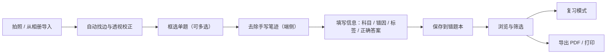
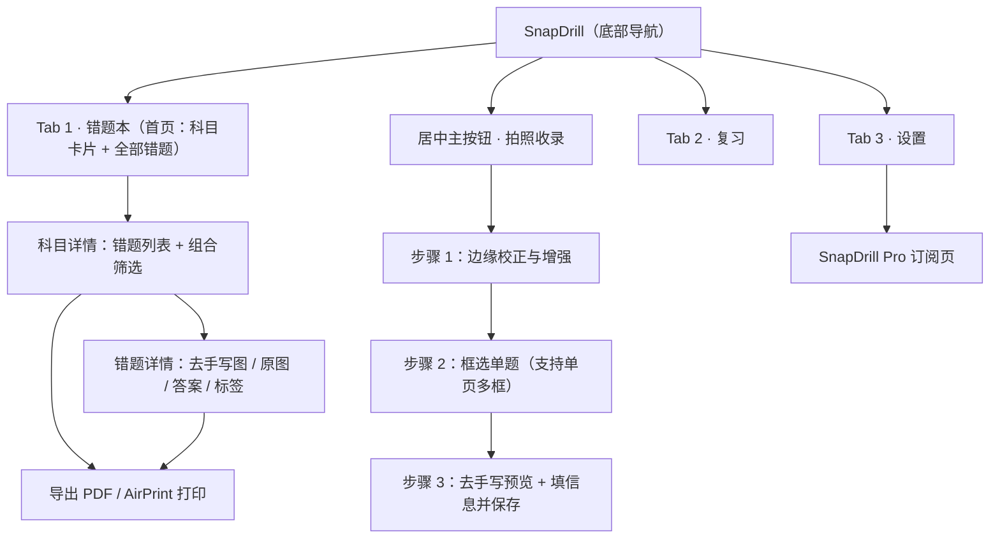
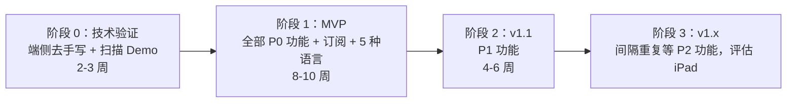

# SnapDrill 产品需求文档（PRD · 草案 v0.7）

> [!NOTE]
> 本文档是 NotBad Labs 旗下 SnapDrill 项目的**重构版 PRD**，取代此前所有旧版文档和草稿，是 `greenfield/rebuild-from-zero` 分支上的产品需求依据。当前为 **v0.7 草案**（所有产品与交互规则已确认，何时升版为 v1.0 正式定稿由 PO 决定）。仍需技术验证后决定的地方标为 **【待定】**。

| 项目 | 内容 |
|---|---|
| 产品名 | SnapDrill |
| 开发者 | NotBad Labs |
| 文档版本 | v0.7（草案） |
| 更新日期 | 2026-11-16 |
| 平台 | iOS（仅 iPhone） |
| 状态 | 待评审 |

---

## 1. 产品概述

### 1.1 一句话定位
**Snap your mistakes. Drill them later.**
用 iPhone 摄像头代替手抄，让整理错题像拍照一样简单。

### 1.2 名称含义
- **Snap**：随手一拍，速度快。
- **Drill**：反复练习，把错题练到会。

### 1.3 背景
在中、日、韩、新加坡等东亚教育环境中，学生普遍习惯把作业、试卷里的错题和重点题抄到纸质错题本上（中文称“错题本”，日文称“間違いノート”，韩文称“오답노트”），用于复习和重做。手抄存在明显问题：

- **耗时**：抄一道带图的几何题或长阅读题，常常要 5–15 分钟。
- **易出错**：抄题时漏抄条件、画错图。
- **难检索**：纸质本按时间顺序记录，按科目或知识点查找很困难。
- **难重做**：原题上已经写了答案，没法干净地重新做一遍。

现有方案大多是教辅平台的附属功能，与题库、搜题和课程深度绑定，操作链路长，还夹带大量推广内容。

### 1.4 产品原则
1. **只做一件事**：把“抄错题”这件事数字化，并做到极致顺手。
2. **不做内容**：不提供题库、答案、讲解、课程，也不做搜题。
3. **工具感**：打开即用，无广告、无社区、无推送轰炸。
4. **隐私优先**：所有处理都在手机上完成，无需注册账号，数据只存在用户自己的设备和 iCloud 中。

### 1.5 明确不做的事（Non-Goals）
| 不做 | 原因 |
|---|---|
| 拍照搜题 / 提供答案 | 偏离定位，涉及题库版权，助长抄作业 |
| 题库、教辅、课程 | 不做内容平台 |
| 社区、排行榜、打卡分享 | 不制造焦虑和社交压力 |
| AI 讲题 / 解题 | 首版不做 |
| 云端处理图片 | 坚持端侧处理，保护隐私 |
| iPad 专属适配 | 首版不做（iPhone 版可以在 iPad 上以兼容模式运行） |
| Android / Web 版 | 首版专注 iOS |

---

## 2. 目标用户

### 2.1 用户画像
| 角色 | 描述 | 优先级 |
|---|---|---|
| **初高中学生**（12–18 岁） | 有自己的 iPhone，有整理错题的习惯，或被老师要求整理 | 主要用户 |
| 家长 | 可能替孩子付费（通过家人共享订阅） | 付费决策者之一，不作为界面设计对象 |
| 大学生 / 考证人群 | 有类似需求 | 潜在用户 |

### 2.2 核心场景
1. **晚上写完作业**：老师批改后的作业里有 3 道错题，学生在 2 分钟内全部收进对应科目。
2. **考试后整理试卷**：一张试卷上有 5 道错题，拍一次整页，分别框选出这 5 道题。
3. **考前复习**：按科目和错因筛选错题，在“隐藏答案”模式下逐题过一遍。
4. **重做 / 打印**：把某个单元的错题去掉手写痕迹，排版成 PDF 打印，在纸上重做。

---

## 3. 首发范围

| 决策项 | 结论 |
|---|---|
| 首发市场 | **全球同步上架** |
| 首发语言 | 英语、简体中文、繁体中文、日语、韩语 |
| 重点市场 | 中国大陆、中国台湾、中国香港、日本、韩国、新加坡 |
| 设备 | 仅 iPhone |
| 账号 | 无需注册，使用 iCloud 同步 |
| 商业模式 | 订阅制，参考 Bear（见第 6 节） |
| 去手写 | 端侧 Core ML 实现 |
| 系统版本 | **iOS 26+**（见 3.2 节） |

### 3.1 全球市场的本地化要点
| 项目 | 说明 |
|---|---|
| 预置科目 | 按系统语言和地区预置不同的科目列表（例如日本有“国語、数学、英語、理科、社会”，韩国有“국어、수학、영어、과학、사회”） |
| App Store 副标题 | 产品名全球统一用 SnapDrill，副标题使用各地对“错题本”的习惯叫法，方便搜索： 简中：错题本 · 拍照整理错题 繁中：錯題本 · 拍照整理錯題 日语：間違いノート 韩语：오답노트 英语：Mistake Notebook |
| 识别语言 | 文字识别需要支持中、日、韩、英混排 |
| 纸张尺寸 | PDF 导出支持 A4、B5（日韩常用）、Letter（美国） |

### 3.2 最低系统版本策略
| 项目 | 说明 |
|---|---|
| 当前 | 2026 年最低支持 **iOS 26**（目前最新系统为 iOS 27.2.1） |
| 调整节奏 | 每年 WWDC 之后研究新系统的能力和普及情况，再决定是否提高最低版本，不预先承诺固定节奏 |
| 判断依据 | 新系统带来的关键能力（如 Vision、SwiftData、Core ML 的新接口）、Apple 公布的系统普及率、仍在旧系统上的用户比例 |
| 最老机型 | iOS 26 支持的最老 iPhone（iPhone 11、iPhone SE 第二代）作为性能测试的基准机型 |

---

## 4. 核心流程

**体验目标**：从打开 App 到保存一道错题，熟练用户应在 **30 秒内**完成。

---

## 5. 功能需求

> 优先级说明：**P0** = MVP 必须有；**P1** = 首版尽量有，或在 1.1 版本补上；**P2** = 以后再考虑
> “版本”一列说明这个功能属于免费版还是 Pro 版，详见第 6 节。

### 5.1 采集（拍照与导入）
| 编号 | 功能 | 说明 | 优先级 | 版本 |
|---|---|---|---|---|
| F-01 | 相机拍摄 | 打开 App 后一键进入相机，支持连拍多页 | P0 | 免费 |
| F-02 | 自动找边与透视校正 | 自动识别纸张边缘，矫正倾斜和透视；支持手动微调四个角 | P0 | 免费 |
| F-03 | 相册导入 | 从系统相册选择一张或多张图片 | P0 | 免费 |
| F-04 | 图像增强 | 去阴影、提高对比度，提供“原图 / 增强 / 黑白”三种模式 | P0 | 免费 |
| F-05 | 框选单题 | 在整页图上手动框选一道或多道题，每个框生成一条独立错题 | P0 | 免费 |
| F-06 | 智能分题 | 自动识别页面中的题目区域，给出框选建议 | P1 | Pro |
| F-07 | 多图合并 | 一道题跨栏或跨页时，可以把多张截图拼成一条错题 | P1 | 免费 |
| F-08 | 从分享菜单导入 | 从其他 App 分享图片或 PDF 进来 | P2 | 免费 |

### 5.2 处理（去手写，端侧）
| 编号 | 功能 | 说明 | 优先级 | 版本 |
|---|---|---|---|---|
| F-10 | 去除手写笔迹 | 在手机上用 Core ML 模型去掉手写答案和批改痕迹，保留印刷体原题 | P0（技术验证通过后确认） | 免费，不限次数 |
| F-11 | 原图 / 去手写图对照 | 同时保留两个版本，可以随时切换查看 | P0 | 免费 |
| F-12 | 手动橡皮擦 | 自动去除效果不理想时，手动涂抹擦除，或恢复误擦的部分 | P1 | 免费 |
| F-13 | 只去除红笔批改 | 只去掉老师的红笔批注，保留学生自己的作答 | P2 | Pro |

> [!WARNING]
> 端侧去手写是本产品最大的技术风险，也是最核心的差异化功能。必须在正式开发前做技术验证（见第 9 节）。

### 5.3 整理（错题信息）
| 编号 | 功能 | 说明 | 优先级 | 版本 |
|---|---|---|---|---|
| F-20 | 科目 | 按地区预置常用科目，可以自定义增删、排序和配色 | P0 | 免费 |
| F-21 | 错因 | 预置错因：粗心、概念不清、方法不会、计算错误、审题错误、其他；可以自定义 | P0 | 免费 |
| F-22 | 自定义标签 | 例如单元、知识点、考试名称，可以给一道题打多个标签 | P0 | 免费 |
| F-23 | 正确答案 / 解析 | 可以拍照添加，也可以输入文字 | P0 | 免费 |
| F-24 | 备注 | 自由文本，记录自己的思路和反思 | P0 | 免费 |
| F-25 | 来源与日期 | 例如“期中考试”“练习册 P32”，日期默认取当天 | P1 | 免费 |
| F-26 | 掌握程度 | 三档：未掌握、模糊、已掌握 | P1 | 免费 |
| F-27 | 快速收录 | 拍完照只选科目就能保存，其他信息以后再补 | P0 | 免费 |

### 5.4 浏览与检索
| 编号 | 功能 | 说明 | 优先级 | 版本 |
|---|---|---|---|---|
| F-30 | 首页按科目浏览 | 以科目卡片的形式展示，显示每科的错题数量 | P0 | 免费 |
| F-31 | 列表 / 网格视图 | 以缩略图浏览错题 | P0 | 免费 |
| F-32 | 筛选 | 按科目、错因、标签、掌握程度、日期范围组合筛选 | P0 | 免费 |
| F-33 | 文字搜索 | 用系统文字识别提取题干文字，支持按关键词搜索 | P1 | Pro |
| F-34 | 批量操作 | 批量移动、打标签、删除、导出 | P1 | 免费 |

### 5.5 复习
| 编号 | 功能 | 说明 | 优先级 | 版本 |
|---|---|---|---|---|
| F-40 | 复习模式 | 卡片式逐题浏览，默认隐藏答案，点击后显示 | P0 | 免费 |
| F-41 | 复习后标记 | 复习完一道题后，标记“会了 / 还不会”，更新掌握程度 | P1 | 免费 |
| F-42 | 间隔重复提醒 | 根据遗忘曲线，安排需要再次复习的题目 | P2 | Pro |
| F-43 | 复习统计 | 简单统计各科错题数量和掌握比例，**不做排名和对比** | P2 | Pro |

### 5.6 导出与打印
| 编号 | 功能 | 说明 | 优先级 | 版本 |
|---|---|---|---|---|
| F-50 | 导出 PDF | 选中若干道错题，排版成 PDF；支持 A4、B5、Letter | P0 | 免费版带浅水印，Pro 版无水印 |
| F-51 | 排版选项 | 每页题数、是否留作答空白、是否附上答案（附在末尾或紧跟题目） | P1 | Pro |
| F-52 | AirPrint 打印 | 直接调用系统打印 | P0 | 免费 |
| F-53 | 导出图片 | 单题导出为图片，方便发给老师或同学 | P1 | 免费 |
| F-54 | 全量备份导出 | 把全部数据导出为压缩包，**免费版也提供**，不把用户数据锁在 App 里 | P1 | 免费 |

### 5.7 设置与其他
| 编号 | 功能 | 说明 | 优先级 | 版本 |
|---|---|---|---|---|
| F-60 | iCloud 同步 | 在同一 Apple ID 的设备之间自动同步 | P0 | **Pro** |
| F-61 | 科目与错因管理 | 增删、排序、改名 | P0 | 免费 |
| F-62 | 应用锁 | Face ID / 密码锁 | P1 | Pro |
| F-63 | 深色模式 | 跟随系统 | P0 | 免费 |
| F-64 | 主题与 App 图标 | 多套配色主题和备选 App 图标 | P1 | Pro |
| F-65 | 订阅管理 | 订阅页、7 天免费试用、恢复购买、家人共享 | P0 | — |

---

## 6. 商业模式：订阅制（参考 Bear）

### 6.1 Bear 的订阅模式拆解

| 维度 | Bear 的做法 |
|---|---|
| 免费版 | 核心写作和整理功能**永久免费、不限数量**，但只能在一台设备上使用（无同步） |
| Pro 版解锁 | iCloud 同步、高级导出（PDF / DOCX 等）、加密与应用锁、主题与图标、图片和 PDF 内的文字搜索 |
| 价格 | 月付 \$2.99，年付 \$29.99（2026-11-24 起新用户调整为 \$3.99 / \$39.99，老用户保持原价） |
| 试用 | 月付和年付都有 7 天免费试用 |
| 覆盖范围 | 一份订阅覆盖同一 Apple ID 下的全部设备 |

**值得学习的核心思路**：
1. **免费版不阉割核心价值**：用户不付费也能长期使用，靠口碑带来新用户。
2. **Pro 版卖的是“多设备 + 省事 + 好看”**：用户需要的时候自然会升级，不会觉得被要挟。
3. **价格低、档位少**：只有月付和年付两档，决策简单。
4. **老用户涨价不涨**：维护信任。

### 6.2 SnapDrill 的方案

**免费版（永久）**
- 拍照、裁剪、框选、**去手写**、整理、浏览、复习、打印，**全部不限次数、不限数量**
- 导出 PDF：带浅水印
- 全量备份导出
- 仅限当前设备，没有 iCloud 同步

> 去手写在免费版中不限次数：中国大陆已有同类 App 免费提供这项功能，限制次数会显得小气；而且端侧处理没有服务器成本，免费提供不会增加开销。

**SnapDrill Pro**
- iCloud 同步
- 智能分题、文字搜索
- PDF 无水印，全部排版选项
- 应用锁、主题、备选 App 图标
- 以后新增的 Pro 功能（如间隔重复、复习统计）

### 6.3 定价建议

| 档位 | 美国价格 | 说明 |
|---|---|---|
| 月付 | **\$1.99 / 月** | 比 Bear 低，适合学生的消费能力 |
| 年付 | **\$14.99 / 年** | 约等于 7.5 个月的月费，主推这一档 |
| 免费试用 | 7 天 | 首次订阅时提供 |
| 家人共享 | 开启 | 家长订阅后，孩子可以通过家人共享使用 |

**为什么比 Bear 便宜**：
- 主要用户是学生，可支配收入低，订阅往往要家长同意。
- 参考学生常用的同类工具：Goodnotes 基础版年付 \$11.99，Pro 版年付 \$35.99。\$14.99 处在学生能接受的区间。
- 先用低价获取用户和口碑；以后如果涨价，可以学 Bear 的做法：老用户保持原价。

**各地区价格**：在 App Store Connect 中以**美国**为基准地区，设置 \$1.99 / \$14.99，其他国家和地区使用 Apple 自动生成的等值价格。Apple 会根据汇率和当地税费自动调整这些价格，不需要手动维护。各地区的具体金额以 App Store Connect 中显示的为准；上线初期不做手动调价，等有了各地转化数据后再考虑。

> [!TIP]
> 学生的使用有明显的季节性，考试季前后最活跃。可以在期末考试季、开学季做年付限时优惠，用 App Store 自带的“优惠代码”和“促销优惠”功能即可实现，不需要自己搭服务器。

---

## 7. 品牌风格

### 7.1 品牌性格
SnapDrill 是一个**安静、利落、让人安心的学习伙伴**，而不是又一个让学生焦虑的“提分神器”。

| 是 | 不是 |
|---|---|
| 安静、专注 | 吵闹、花哨 |
| 利落、高效 | 复杂、功能堆砌 |
| 温和、友好 | 制造焦虑（“别人都在努力”） |
| 亲切但不幼稚 | 低龄化、卡通堆砌 |
| 尊重隐私 | 收集数据、推送轰炸 |

### 7.2 已确定方向：纸与笔 + 熊猫

**界面是“纸与笔”，熊猫是住在本子里的伙伴。**

- **界面**：采用“纸与笔”风格，负责“安静、专注、像一本好用的笔记本”。
- **熊猫**：作为品牌吉祥物，负责“亲切、有记忆点”。

两者天然契合：熊猫本身就是**黑白两色**，和纸（白）与墨（黑）是同一种语言。

| 元素 | 规范 |
|---|---|
| 主背景 | 米白纸色（浅色模式）；深色模式用暖调深灰，不用纯黑 |
| 主色 | 墨蓝，用于按钮、选中态、链接 |
| 文字 | 墨黑，接近熊猫的黑色 |
| 点缀色 | 批改红（少量，用于错因、强调）；铅笔黄（少量，用于高亮、熊猫手里的铅笔） |
| 熊猫出现的地方 | App 图标、引导页、空状态、保存成功等少数时刻 |
| 熊猫不出现的地方 | 拍照、裁剪、错题列表、复习等工作界面，保持干净 |

### 7.3 App 图标
现有图标（亮蓝背景、3D 卡通熊猫抱铅笔）辨识度高，**保留“熊猫 + 铅笔”这个核心形象**，但需要重绘，向“纸与笔”方向靠拢：

| 项目 | 现有图标 | 重绘方向 |
|---|---|---|
| 背景 | 高饱和亮蓝渐变 | 米白纸色，或带一点纸张纹理；也可保留蓝色但降低饱和度，改为墨蓝 |
| 熊猫造型 | 3D 立体、腮红、装饰元素多 | 扁平或轻微立体，线条更简洁，减少腮红和周围的装饰碎片 |
| 铅笔 | 黄色铅笔 | 保留，作为唯一的亮色点缀 |
| 小尺寸可读性 | 装饰元素在小尺寸下会糊成一片 | 只保留熊猫头部和铅笔，保证 29pt 也能看清 |

> 可选的创意：熊猫从一个取景框（相机对焦框）里探出头，同时表达“Snap”（拍）和“Drill”（练）。

### 7.4 其他细则
- **字体**：界面使用系统字体（SF Pro，以及系统自带的中日韩字体），保证多语言显示统一；Logo 字可以用略带手写感的字体。
- **插画**：熊猫和少量线条风格的文具元素（铅笔、便签、荧光笔），只用于空状态和引导页。
- **动效**：拍照后题目被“剪下来、贴进本子”的动画，强化“代替手抄”的核心价值。
- **文案语气**：简短、平和、友好。例如完成整理后显示“已收好，下次再练”，而不是“又多了 5 道错题！”。

### 7.5 名称与对外信息

| 事项 | 状态 / 建议 |
|---|---|
| NotBad Labs 的 SnapDrill | 即本项目，不存在撞名问题 |
| 官网描述 | notbadhq.com 上目前把 SnapDrill 描述为“收集文字片段及其来源”的应用，与重构后的定位不一致，建议同步更新为错题本定位 |
| 挪威 Snapdrill（管道开孔工具） | 行业不同，冲突风险较低；仍建议在美国、中国、日本、韩国查询软件类（第 9 类）商标 |

---

## 8. 信息架构、页面交互与业务规则

### 8.1 整体导航结构

### 8.2 核心采集与录入交互（F-01 ~ F-27）

1. **步骤 1 · 拍摄/导入与校正（F-01 ~ F-04）**
   - 点击底部居中主按钮直接打开相机，同屏提供「相册导入」入口；单次连拍或选图上限为 **10 张**。
   - 拍摄后自动识别纸张四边并做透视拉平；用户可拖拽四角锚点微调。
   - 底部切换图像增强档位：`增强（默认，去阴影提对比）` / `原图` / `黑白`。
   - 照片在写入本地前自动剥离 EXIF GPS 位置信息。

2. **步骤 2 · 框选单题：单框与一页多框规则（F-05）**
   - 进入框选页后，画面默认提供一个可拖拽四边的裁剪框（编号 `①`）。
   - **单题场景**：直接调整该框覆盖目标错题，点击「下一步」。
   - **一页多题场景**：点击底部「+ 再框一题」，可在同一页试卷上新增裁剪框（编号 `②`、`③`……单页最多 **10 个框**）。每个框代表一道独立的错题，点击框体可调整大小或删除该框。

3. **步骤 3 · 去手写预览与信息填写（F-10、F-11、F-20 ~ F-27）**
   - 进入本页时，端侧 Core ML 模型立即对框选出的题图执行去手写处理，默认展示**去手写后的干净题图**；图角提供「按住看原图 / 切换原图」按钮（原图与去手写图双版本同时保留）。
   - **批量共性字段（顶部固定）**：
     - **科目（必选）**：默认自动选中**上一次保存时使用的科目**（首次使用默认选中第一个预置科目），降低重复点击。若本批框选了多道题，切换顶部科目默认对本批全部题目生效。
   - **快速收录主路径（F-27）**：
     - 确认科目后，无需填写任何其他字段，直接点击底部主按钮「保存（N 题）」即可在 1 秒内完成入库。
   - **单题选填字段（可展开，多题时可左右滑动逐题设置）**：
     - **错因（F-21）**：胶囊标签多选（粗心、概念不清、方法不会、计算错误、审题错误、其他，或自定义）。
     - **自定义标签（F-22）**：支持选择已有标签或当场新建。
     - **正确答案 / 解析（F-23）**：支持拍照/选图添加解析图，或输入文字解析。
     - **备注（F-24）**：自由文本输入。
     - 以上选填项均可留空，保存后在「错题详情页」随时补填或修改。

### 8.3 浏览、筛选与错题详情（F-30 ~ F-34）

- **首页（错题本 Tab）**：顶部为「全部错题」汇总入口，下方以双列网格卡片展示各科目（含科目名、配色圆点、错题数量）。空状态展示熊猫插画与「拍第一道错题」引导按钮。
- **错题列表页**：
  - 默认按收录时间**从新到旧**排列；支持列表视图与缩略图网格视图切换。
  - 顶部筛选栏支持按「错因」「标签」「日期范围」（P1 增加「掌握程度」）组合筛选。
- **错题详情页**：
  - **题干区**：展示去手写图，支持一键切换查看含手写的原图，支持双指放大查看细节。
  - **答案与解析区**：支持折叠/展开，方便用户在详情页直接自测；展示错因、标签、备注与收录日期。
  - **操作项**：编辑（更换科目、增改答案/错因/标签/备注，或重新裁剪题图）、导出/打印本题、删除本题。
  - **删除保护**：点击删除后直接移出列表，同时底部弹出 **5 秒「已删除 · 撤销」提示条**；5 秒内点击撤销可无损恢复。

### 8.4 复习模式交互流转（F-40 ~ F-41）

- **如何开始复习**：
  - **入口 1（复习 Tab）**：选择要复习的科目（默认全选）、错因或标签筛选条件，显示匹配题数，点击「开始复习（共 N 题）」。
  - **入口 2（错题列表页）**：在任意科目或筛选结果下，点击右上角「复习当前列表」。
- **复习卡片过程**：
  - 顶部显示当前进度（如 `3 / 15`）与退出按钮。
  - 卡片上半区展示**去手写后的干净题干图**（可临时切换看原图）；下半区**默认遮挡正确答案、错因与备注**，显示「点击查看答案」区域。
  - 用户作答或思考完毕后，点击展开答案与解析：
    - **P0 阶段**：底部提供「上一题 / 下一题」切换，直至完成本轮全部题目。
    - **P1 阶段（F-41）**：底部提供「还不会」与「会了」两个按钮，点击后自动更新该题的掌握程度并进入下一题。
  - **完成态**：本轮最后一题完成后，显示简短温和的完成页（熊猫插画 + “本轮 N 道错题已练完”），提供「再练一遍」或「返回」按钮。

### 8.5 导出 PDF 与打印规范（F-50 ~ F-52）

- **选择范围**：可在错题列表页多选题目（或全选当前筛选结果），也可在错题详情页针对单题发起导出/打印。
- **纸张尺寸**：默认按系统地区自动匹配（中国大陆/香港/台湾/新加坡/欧洲默认 **A4**，日本/韩国默认可选 **B5 / A4**，美国/加拿大默认 **Letter**），导出预览页可手动切换。
- **P0 默认版式（练习卷模式）**：
  - 页眉显示标题（默认「科目名 + 导出日期」）与题数；
  - 题干默认采用**去手写图**（带题号 `1.` `2.`……），每道题下方自动留出适合作答的空白区；
  - **分页防截断规则**：按图片实际宽高比流式排版，当剩余页面高度不足以放下下一道题图 + 最小作答区时，自动换到下一页，**严禁把同一道题的题干图截断在两页**；
  - **答案附页**：P0 默认将所有题目的正确答案、错因与备注集中排在 PDF **最后一页（参考答案附页）**，按题号对应，避免做题时直接看到答案（P1 解锁自定义每页题数、留白大小、无答案或答案紧跟题后等排版选项）。
- **水印规范**：
  - **免费版**：仅在每页页脚右下角印一行 8pt 浅灰色小字 `SnapDrill`，**绝不覆盖或遮挡任何题目与作答区域**。
  - **Pro 版**：无任何页脚水印。
- **输出动作**：预览页底部同时提供「导出 / 分享 PDF 文件」与「AirPrint 直接打印」两个独立按钮。

### 8.6 数据字段上限与异常边界规则（Edge Cases）

| 场景 | 执行规则 |
|---|---|
| **单题图片与字数上限** | P0 阶段每道题含 **1 张题干图**（底层同时存「原图」与「去手写图」）；P1 多图合并（F-07）上限为 **5 张**。「正确答案/解析」支持最多 **3 张图片 + 2,000 字文本**；「备注」上限 **1,000 字**；单题标签上限 **10 个**。 |
| **删除非空科目** | 当用户删除已有错题的科目时，弹窗提供两个明确选项： 1. **仅删除科目，将其下 N 道错题移入「未分类」**（默认推荐）； 2. **连同其下 N 道错题一并彻底删除**（红色警示，需二次确认）。 系统内置保底的「未分类」科目不可删除（当其中无错题时不在首页展示）。 |
| **删除错因或标签** | 删除某个错因或自定义标签时，仅从已关联的错题记录中移除该标记，**绝不删除错题本身**。 |
| **Pro 订阅到期降级** | **绝不锁死或删除用户已有数据**：本地已存储及已从 iCloud 同步到本地的所有错题、图片、标签均可正常查看、编辑、复习、打印和备份导出。 仅暂停增量 iCloud 同步，PDF 导出恢复页脚浅水印，主题与图标恢复默认款，智能分题与 OCR 搜索入口恢复 Pro 锁标识。 |
| **相机 / 相册权限被拒** | 拒绝相机权限时，拍摄页展示温和说明与「前往系统设置」按钮，并同屏提供「从相册导入」按钮（使用系统 `PHPicker`，无需授予完整相册读写权限即可选图），保证录入不中断。 |
| **端侧去手写失败或超时** | 若某张图因模糊、光线或模型异常导致去手写失败/超时，自动降级将「去手写图」回退为图像增强后的原图，并轻提示“未能自动去除笔迹，已为你保留原图”，**绝不阻塞保存**。 |
| **采集中途退出 / 崩溃保护** | 进入步骤 2（框选）或步骤 3（填信息）后，若 App 切后台被系统回收或意外退出，当前未保存的裁剪草稿保留在本机临时区，下次打开 App 时提示「继续上次未完成的错题整理」或「丢弃」。 |
| **存储空间不足 / 数据库异常** | 保存前检查本机可用空间；写入失败时明确提示并回滚，**不产生半条损坏记录**。若本地数据库损坏无法打开，展示专门的故障提示与数据导出引导页，**严禁显示成首次使用的空状态**误导用户以为数据被清空。 |

---

## 9. 非功能需求

| 类别 | 要求 |
|---|---|
| 性能 | 冷启动后 1.5 秒内进入相机；单题去手写在 iPhone 11 / SE 第二代（iOS 26 支持的最老机型）上 ≤ 2 秒 |
| 离线 | 除 iCloud 同步外，所有功能都能离线使用 |
| 隐私 | 所有图片处理都在手机上完成，**不上传任何服务器**；不需要账号；不接入广告和第三方行为追踪 SDK |
| 存储 | 图片压缩存储，每道题平均 ≤ 1 MB；提供存储占用查看和清理 |
| 安装包大小 | 包含去手写模型后，安装包 ≤ 80 MB 【待定：取决于模型大小】 |
| 可靠性 | 保存操作要能承受 App 被杀掉、断电等异常；支持全量导出 |
| 本地化 | 5 种语言同步上线；界面要能容纳不同语言的文字长度 |
| 无障碍 | 支持动态字体和 VoiceOver 基础标注 |

### 9.1 全球上架的合规要点

| 地区 / 事项 | 要求 |
|---|---|
| 中国大陆 | 需要完成 **App 备案**（ICP 备案）后才能在中国区上架；订阅和隐私政策需要提供中文版本 |
| 美国 | 13 岁以下用户受 COPPA 约束。由于不收集任何个人信息，风险较低，但隐私政策需写清楚 |
| 欧盟 / 英国 | GDPR 和英国的儿童隐私规范；同样因为不收集数据，风险较低 |
| 韩国、日本 | 需提供当地语言的订阅说明和隐私政策 |
| App Store | 年龄分级 4+；**不进入“儿童”分类**（进入后限制较多）；隐私标签填写“不收集数据” |

> [!IMPORTANT]
> “全部端侧处理 + 不收集数据”是全球上架时最大的合规优势，应该作为硬性原则保持下去。

---

## 10. 技术方向与风险

| 模块 | 初步方案 | 风险 |
|---|---|---|
| 扫描与校正 | VisionKit 文档扫描，或基于 Vision 矩形检测自建相机 | 低 |
| 图像增强 | Core Image | 低 |
| 文字识别 | Vision 文字识别（支持中日韩英） | 低 |
| 数据存储 | SwiftData + CloudKit 同步 | 中：需要验证同步大图片的稳定性 |
| **去手写** | 端侧 Core ML 图像分割模型（区分手写和印刷体），用 Neural Engine 加速 | **高**：模型效果、速度、体积；需要准备中日韩英各类试卷的训练数据 |
| 智能分题 | 先评估 iOS 26 起 Vision 新增的文档结构识别接口（`RecognizeDocumentsRequest`）；不够用再训练端侧目标检测模型 | 中高：自训模型需要标注数据 |
| 订阅 | StoreKit 2 | 低 |
| PDF 排版 | PDFKit / UIGraphicsPDFRenderer | 低 |

> [!IMPORTANT]
> **阶段 0 技术验证**：收集 100 张真实作业和试卷照片（中日韩英各一部分，包括铅笔、黑笔、红笔批改等情况），在 2–3 周内验证：
> 1. 去手写的效果是否“可以直接拿来重做”；
> 2. 在 iPhone 11、SE 第二代等 iOS 26 支持的最老机型上的处理速度；
> 3. 模型体积对安装包的影响。
>
> 如果效果不达标，退而求其次的方案是：首版只提供手动橡皮擦（F-12），自动去手写在后续版本推出。

---

## 11. 成功指标（上线后 3 个月）

| 指标 | 目标 |
|---|---|
| 收录一道题的平均耗时 | ≤ 30 秒 |
| 新用户 7 日内收录 ≥ 5 道题的比例 | ≥ 40% |
| 次周留存 | ≥ 30% |
| App Store 评分 | ≥ 4.6 |
| 开启免费试用的比例 | ≥ 8% |
| 试用转为付费的比例 | ≥ 40% |
| 年付占付费用户的比例 | ≥ 60% |

> 数据只来自 App Store Connect 的分析和订阅报表，不做个人行为追踪。

---

## 12. 版本规划

---

## 13. MVP（P0）验收标准（Acceptance Criteria）

> 以下 10 条验收标准是阶段 1（MVP）交付与测试的直接依据，每条均须在真机（含 iOS 26 基准机型）上可复现通过。

| 编号 | 对应功能 | 验收条件与预期结果 | 不通过判定（Fail） |
|---|---|---|---|
| **AC-01** | 零门槛启动与地区科目预置（F-20） | 全新安装启动后无注册/登录弹窗；根据系统语言/地区自动预置对应科目列表；支持新增、重命名、排序和删除科目。 | 出现账号登录墙；预置科目为空或与语言地区不符。 |
| **AC-02** | 拍摄/相册导入与校正增强（F-01~04） | 可从相机连拍或从相册导入（单次最多 10 张）；自动找边与透视校正可用，支持四角手动微调；「增强 / 原图 / 黑白」三档切换即時生效；入库图片不含 EXIF GPS 坐标。 | 透视校正崩溃；入库图片仍残留 GPS 位置信息。 |
| **AC-03** | 单页单框与一页多框收录（F-05, F-27） | 在同一张试卷图上框选 3 道题，选择科目后点击「保存（3 题）」，科目列表下新增 3 条独立错题记录，题干图与各自框选区域一致；熟练操作单题从拍摄到保存 ≤ 30 秒。 | 3 个框被合成 1 条记录，或顺序错乱、裁剪区域偏移。 |
| **AC-04** | 端侧去手写与双图切换（F-10, F-11） | 飞行模式下框选题图，端侧自动完成去手写（基准机型单题 ≤ 2 秒）；详情页和录入页均可一键在「去手写图」与「原图」之间无损切换；当推理异常时自动降级保留原图，不阻断保存。 | 断网无法去手写；切换后原图丢失；推理失败导致无法保存。 |
| **AC-05** | 错题信息编辑、筛选与删除撤销（F-21~24, F-30~32） | 可为错题添加/修改错因、自定义标签、图片/文字答案和备注；列表页支持按科目、错因、标签、日期范围组合筛选；删除单题后底部出现 5 秒撤销条，点击撤销可完整恢复。 | 编辑后未持久化；组合筛选结果不准；删除一条导致其他错题丢失或无法撤销。 |
| **AC-06** | 复习模式闭环（F-40） | 从复习 Tab 或列表页发起复习，卡片默认只展示题干、遮挡答案与错因；点击后展开答案；可逐题翻阅直至完成本轮并展示完成页。 | 进入复习直接露出答案；中途退出导致崩溃或数据改写。 |
| **AC-07** | PDF 导出与 AirPrint 打印（F-50, F-52） | 选中多道错题生成 PDF（支持 A4 / B5 / Letter 切换），题干图不被跨页截断，答案集中附在末页；免费版仅在页脚右下角有浅灰 `SnapDrill` 字样且不遮挡题目，Pro 版无水印；AirPrint 可正常拉起系统打印面板。 | 同一道题图被截断在两页；水印遮挡题干；取消导出残留临时垃圾文件。 |
| **AC-08** | 订阅、iCloud 同步与到期无损降级（F-60, F-65） | StoreKit 2 月付/年付、7 天试用、恢复购买、家人共享均可走通；Pro 状态下同 Apple ID 的两台 iPhone 可自动同步新增/修改/删除的错题与图片；订阅过期后，本地数据全部保留可读可改可导出，仅暂停增量同步并恢复免费版限制。 | 订阅过期后锁死或清空本地错题；同步丢失题干图或答案图。 |
| **AC-09** | 异常与破坏性边界保护（8.6 节） | 删除非空科目时弹窗提示转入「未分类」或二次确认连题删除；删除标签/错因不删错题；拒绝相机权限可平滑改用相册；采集中途杀进程重启可恢复草稿；数据库异常打不开时展示故障恢复页而非空错题本；全程零外部服务器上传。 | 删除标签连带删题；杀进程丢草稿；把损坏数据库渲染为空库；抓包发现未授权外部请求。 |
| **AC-10** | 5 国语言、深色模式与无障碍（F-63, 第 9 节） | 简中、繁中、日、韩、英 5 种语言界面完整无硬编码漏翻；深浅色模式切换符合“纸与笔”配色规范；支持系统动态字体缩放与基础 VoiceOver 朗读。 | 切换语言出现乱码/截断不可点；深色模式下文字与背景对比度不可读。 |

---

## 14. 已确认的决策

| 事项 | 结论 |
|---|---|
| 产品名称 | SnapDrill（NotBad Labs 自有项目，本 PRD 为重构版） |
| 最低系统版本 | iOS 26+，每年 WWDC 后重新评估是否上调（见 3.2 节） |
| 品牌方向与图标 | 纸与笔 + 熊猫：界面采用纸与笔风格，熊猫作为吉祥物；保留“熊猫 + 铅笔”形象并重绘图标（由 PO、设计师或借助 AI 完成，见第 7 节） |
| 定价 | \$1.99 / 月，\$14.99 / 年，7 天免费试用；其他地区使用 Apple 自动换算的等值价格 |
| 去手写 | 免费版也不限次数 |
| iCloud 同步 | 放在 Pro 版 |
| 中国大陆备案 | 有国内主体，可以办理 |
| 核心交互与边界规则 | 确认采用第 8 节全部规则（一页多框录入流转、复习模式入口与流转、PDF 默认版式与页脚浅水印、非空科目删除保护与 Pro 退订无损降级等） |
| MVP 验收标准 | 确认采用第 13 节全部 10 条验收标准（`AC-01` ~ `AC-10`）作为阶段 1 交付依据 |

> [!WARNING]
> 去手写免费之后，Pro 版的核心卖点主要是 **iCloud 同步**，其次是无水印 PDF、智能分题和文字搜索。只用一台 iPhone 的学生可能长期不需要付费，所以第 11 节的“开启免费试用的比例 ≥ 8%”可能偏乐观，需要上线后根据实际数据调整。好处是免费版更好用，口碑传播会更强。

## 15. 仍待确认的问题（阶段 0 技术验证后决定）

1. **端侧去手写模型体积与安装包上限**：去手写模型能接受多大的体积（目前暂定包含模型后安装包 ≤ 80 MB）、以及 F-10 最终效果是否达到 P0 上线标准，等待阶段 0 技术验证完成后拍板。

---

## 修订记录

| 版本 | 日期 | 修改内容 |
|---|---|---|
| v0.1 | 2026-11-16 | 按默认假设起草初稿 |
| v0.2 | 2026-11-16 | 确定全球首发和 5 种语言；主要用户为学生；端侧去手写；改为参考 Bear 的订阅制并给出定价；iPad 不提前；产品名定为 SnapDrill；新增品牌风格建议和全球合规要点 |
| v0.3 | 2026-11-16 | 明确为 NotBad Labs SnapDrill 的重构版 PRD；确定品牌方向 A 并沿用已有图标；确认定价，地区价格改用 Apple 自动换算；去手写在免费版不限次数；确认 iCloud 同步为 Pro 功能；确认有国内主体办理备案 |
| v0.4 | 2026-11-16 | 取代仓库中此前的 PRODUCT.md / PRD.md 草稿；品牌确定为“纸与笔 + 熊猫”，给出配色规范和图标重绘方向 |
| v0.5 | 2026-11-16 | 最低系统版本定为 iOS 26，并约定每年 WWDC 后重新评估；性能基准机型改为 iOS 26 支持的最老机型；智能分题优先评估系统接口；明确图标重绘的执行方式 |
| v0.6 | 2026-11-16 | 补齐执行细节：扩展第 8 节（采集与一页多框交互、浏览与详情、复习模式流转、PDF 导出默认版式与水印规范、数据字段上限与删除/退订/异常降级边界规则）；新增第 13 节 MVP（P0）10 条可执行验收标准（AC-01 ~ AC-10） |
| v0.7 | 2026-11-16 | PO 确认第 8 节全部交互与边界规则及第 13 节 10 条 MVP 验收标准；仅保留“去手写模型体积与安装包上限”留待阶段 0 技术验证后决定 |
