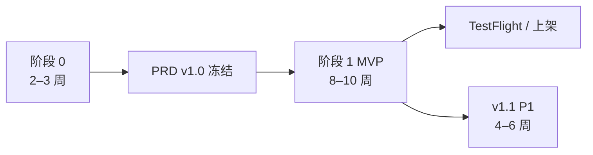

# SnapDrill · 产品路线图（PO 视图）

> 给 **产品负责人** 用的里程碑表：每月看 **状态灯** 和 **要你拍板的事**，不必跟每个技术分支。  
> 细节以 [`PRD.md`](PRD.md) v0.8 为准；阶段 0 流程见 [`STAGE0_CHARTER.md`](STAGE0_CHARTER.md)。

---

## 总览

| 阶段 | PRD 对应 | 你需要盯的产出 |
|---|---|---|
| **阶段 0** | §10、§15 | Demo 录屏 + **裁决 A/B/C** |
| **冻结点** | v0.8 → v1.0 | 签字 §6，小 diff PRD |
| **阶段 1 MVP** | §5 P0、§13 AC-01~10 | 每月 **AC 通过率** |
| **上架前** | §9.1 合规 | 备案、隐私、商店素材 |
| **v1.1** | §5 P1 | 掌握程度、橡皮擦等 |

---

## 当前状态（2026-11-16）

| 项目 | 状态 |
|---|---|
| PRD | **v0.8**（#985 已合并） |
| 仓库分支 | **greenfield** 为主线；旧线 `develop` + tag `legacy/pre-greenfield-2026-11` |
| 阶段 0 | **未启动** — 下一步：收集样张 + 指派执行人 |
| App 代码 | 仅文档线；工程 Slice 建议在 **冻结后** 或 **与阶段 0 并行最小壳** |

---

## 里程碑明细

### M0 · 阶段 0 技术验证（现在）

| 周 | 目标 | PO 动作 |
|---|---|---|
| W1 | 样张 ≥50 张到位；扫描 Demo | 确认样张来源（学生脱敏/自拍模拟） |
| W2 | 去手写原型；首版指标 | 参加 1 次盲评（30 min） |
| W3 | 填满指标表；**裁决 A/B/C** | 填 `STAGE0_CHARTER.md` §6；决定是否 v1.0 |

**退出标准**：§6 有日期和 A/B/C 勾选。

---

### M-freeze · PRD v1.0 冻结

| 检查项 | 说明 |
|---|---|
| 阶段 0 裁决 | A 或 B（C 须先改 PRD 退路） |
| §15 闭合 | 模型体积 / F-10 是否 P0 |
| 无开放产品矛盾 | Free/Pro、§8、§13 无待讨论项 |
| 文案 | 若 B/C 档，商店一句话与 §1.1 对齐 |

冻结后：**需求变更 = PR + PO 确认**，不口头加功能。

---

### M1 · MVP（阶段 1，建议 8–10 周）

按 **§13 十条 AC** 交付，推荐实现顺序（与工程无关，只看验收风险）：

| 顺序 | 切片 | AC | 说明 |
|---|---|---|---|
| 1 | 壳 + 科目 + 数据 | AC-01 | 地区预置 |
| 2 | 采集 三步 + 多页 | AC-02, AC-03 | 不依赖去手写可先测框选 |
| 3 | 去手写双图 | AC-04 | 依赖 M0 结论 |
| 4 | 列表 / 筛选 / 撤销删 | AC-05 | |
| 5 | 复习 | AC-06 | |
| 6 | PDF + 打印 | AC-07 | |
| 7 | 订阅 + iCloud + 降级 | AC-08 | CloudKit Spike 建议 W4–5 |
| 8 | 边界 + 五语 + a11y | AC-09, AC-10 | |

**PO 月度例会建议看**：AC 累计 **通过几条 / 10**；阻塞项是否需削 P0（仅冻结后严重变更时）。

---

### M1.5 · 上架准备（与 MVP 尾盘重叠）

| 事项 | PRD | 典型提前量 |
|---|---|---|
| App 备案（大陆） | §9.1 | 4–8 周 |
| 隐私政策 / 订阅说明 5 语 | §6、§9.1 | MVP 前 2 周定稿 |
| 图标重绘 | §7.3 | TestFlight 前 |
| TestFlight 内测 | — | MVP AC 达 **8/10** 可开 |

---

### M2 · v1.1（P1）

PRD 已标 P1、首包不做：掌握程度（F-26/F-32）、手动橡皮擦（F-12）、批量操作（F-34）等 — **不在冻结讨论除非 PO 明确插入 MVP**。

---

## 仍需 PO 讨论（会议清单）

| # | 议题 | 建议时机 |
|---|---|---|
| 1 | 阶段 0 通过线：是否采用 Charter **85% / 70%** 草案 | **启动 M0 前** |
| 2 | 样张与标注谁负责 | 启动 M0 前 |
| 3 | 裁决 **C** 时商店定位是否仍强调去手写 | M0 结束当天 |
| 4 | CloudKit 大图同步是否单独立项 Spike | 冻结后 MVP W1 |
| 5 | §11 试用转化率假设是否下调 | 可延后到上架前 |
| 6 | #984 Xcode 27：合入 greenfield 或关闭 | 任意（环境项） |

---

## 成功怎么看（PO 版）

| 时间点 | 你看什么 |
|---|---|
| 阶段 0 结束 | A/B/C + 3 分钟 Demo 录屏 |
| 冻结 | PRD 版本号 **v1.0**、无【待定】阻塞 F-10（或已写退路） |
| MVP 中期 | AC ≥ 5/10 真机通过 |
| 上架前 | AC 10/10 + 备案/隐私就绪 |

技术 KPI（留存、评分）见 PRD §11 — **上架后再看**，不作为 MVP 停工条件。

---

## 文档索引

| 文件 | 读者 |
|---|---|
| [`PRD.md`](PRD.md) | 全员产品权威 |
| [`STAGE0_CHARTER.md`](STAGE0_CHARTER.md) | PO + 阶段 0 执行人 |
| [`ROADMAP.md`](ROADMAP.md) | PO 日程与里程碑 |
| [`../README.md`](../README.md) | 分支与仓库入口 |

---

## 修订记录

| 版本 | 日期 | 说明 |
|---|---|---|
| 1.0 | 2026-11-16 | 首版：M0–M2、冻结条件、PO 会议清单 |