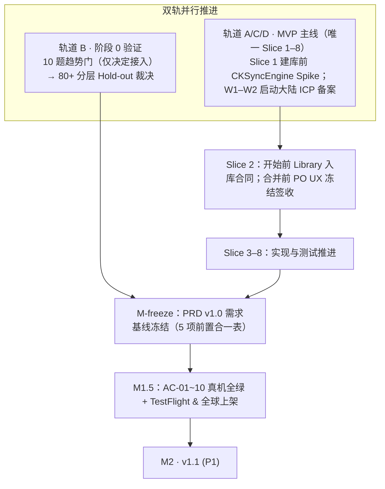

# SnapDrill · 产品路线图（PO 视图）

> 给 **产品负责人** 用的里程碑视图：掌握 **状态灯**、**关键前置门禁** 和 **全仓唯一 `Slice 1–8` 进度序列**。  
> 需求细节以 [`PRD.md`](PRD.md) 文内当前版为准；阶段 0 见 [`STAGE0_CHARTER.md`](STAGE0_CHARTER.md)；实时实现进度见 [`ENGINEERING.md`](ENGINEERING.md)；全仓文档导航见唯一索引 [`GOVERNANCE.md`](GOVERNANCE.md) §3。

| 文档版本 | 2.5 |
|---|---|
| 对应 PRD | 见 [`PRD.md`](PRD.md) 文内当前版 |
| 最后更新 | 2026-11-27 |

---

## 总览（方案 1 · 双轨并行）

> **PO 决议 · 方案 1 — 并行推进**  
> **MVP（轨道 A）与阶段 0（轨道 B）并行开工**，MVP 不阻塞于 100 题样张收齐；  
> **F-10 真模型合入 App 主线前**：需通过 **10 题趋势门（≥ 7/10）**；  
> **PRD 正式冻结为 v1.0 需求基线（`M-freeze`）前**：需同时完成 `STAGE0_CHARTER.md` §7 合一冻结表全部 **5 项前置**。

| 阶段 | `PRD.md` 对应 | PO 重点盯控产出 |
|---|---|---|
| **轨道 B · 阶段 0** | §10、§15、§8.7 | Hold-out 样张补全 → **10 题趋势门** → **§6 裁决（精确比值不四舍五入，统一引用 PRD §10 决策表）** |
| **合规提前项（MVP W1–W2 启动）** | §7.5、§9.1 | **锁定生产 Bundle ID / 发布证书公钥指纹启动大陆 ICP 备案（4–8 周）**；启动 `notbadhq.com` 更新 |
| **轨道 A/C/D · MVP** | §5 P0、§8、§13 | 按下方 **唯一 `Slice 1–8`** 交付；**Slice 1 建库前过 `CKSyncEngine` 6 条 Spike**，**Slice 2 开始前落 `LibraryServing` 入库合同，合并前签 UX 冻结** |
| **M-freeze（需求基线冻结）** | 全文 | 与 `STAGE0_CHARTER.md` §7 合一的 **5 项冻结检查表** 全部签收（≠ 上架发版） |
| **M1.5 · 上架交付** | §6.3、§9.1、§13 | **AC-01~10 真机全绿**、ASC 描述区隐私/EULA、`PrivacyInfo.xcprivacy`、5 语托管页、iOS 26 图标、备案号入设置→关于页（`F-67`） |
| **M2 · v1.1** | §5 P1 | 掌握程度（F-26/F-32/F-41）、文字搜索（F-33）、批量操作（F-34）等 |

---

## 当前状态入口

> 更新 **Slice 完成态 / 已合并 PR** 时只改 [`ENGINEERING.md`](ENGINEERING.md)。

| 项目 | 指向 |
|---|---|
| PRD 版本 | 见 [`PRD.md`](PRD.md) 文内版本表 |
| 执行策略 | **方案 1 并行** + **唯一 `Slice 1–8`** |
| 主开发参考分支 | `greenfield/rebuild-from-zero` |
| 实时工程进度 | [`ENGINEERING.md`](ENGINEERING.md) |

---

## 里程碑明细

### M0 · 阶段 0 技术验证（轨道 B，与 MVP 并行）

| 时点 | Hold-out 单题目标 | 工程 / PO 动作 |
|---|---|---|
| **启动期** | 见 `STAGE0_SAMPLES.md`（已确认为 **0 题**，1 条 `S001-Q1` 待确认；同卷/同人规则上限 ≤ 5 题） | 扫描分割 + 去手写基线对比 |
| **趋势门** | **≥ 10 题**（≥ 2 语种 + 含红笔） | PO 盲评 **≥ 7/10** 方可继续投入并允许接入 Slice 3（**绝不用于商店主打**） |
| **渐进加码** | 10 → 80 → 100+（**无硬性周历**） | 按 [`STAGE0_COLLECTION.md`](STAGE0_COLLECTION.md) 补齐，同卷/同书写人 ≤ 5 题（每语切片 ≥ 2 红笔/困难题）；**Q2 30 题测前锁定 ID 禁重抽** |
| **冻结门** | **≥ 80 题**（5 语各 ≥ 10 且含 ≥ 2 红笔/困难、红笔 ≥ 15、困难 ≥ 20% 精确比值） | 填 [`STAGE0_CHARTER.md`](STAGE0_CHARTER.md) **§6 A/B/C**（精确比值不四舍五入、分歧计 N）→ 满足 `M-freeze` |

**退出标准**：Charter §6 有日期、签名和 A/B/C 勾选（不卡住 Slice 1–2/4–8，但**必须早于对外宣称 AC-04 达标及触发 B/C 档条件发版**）。

---

### M1 · MVP（阶段 1，建议 8–10 周 · 全仓唯一 `Slice 1–8`）

> 本表为全仓唯一权威 Slice 编号；[`ARCHITECTURE.md`](ARCHITECTURE.md)、[`DEVELOPMENT_PRINCIPLES.md`](DEVELOPMENT_PRINCIPLES.md)、[`ENGINEERING.md`](ENGINEERING.md) 与 [`PR_SCOPE_ESTIMATE.md`](PR_SCOPE_ESTIMATE.md) 严格对齐本编号：

| 唯一编号 | 切片范围 | 对应 AC | 前置依赖与强制门禁 |
|---|---|---|---|
| **Slice 1** | 工程壳（iOS 26 原生三 Tab + 独立拍摄入口 + 设置关于页 `F-67`）+ 6 地区（含新加坡 4 科）`presetKey` 科目（含 `uncategorized` / `sortOrder`）与全 6 预置错因播种 + SwiftData 单库 UUID 模型（含 `isOriginalEncoded`、`needsLocalBackfill`、`needsCloudUpload`、`pendingDeletionAt`、`cleanedImageSourceRaw`、`editNonce`、`SyncCursorState.presetSeedReconciliationPending`、`AnswerImage` 带 `updatedAt`、`DeleteTombstone(presetKey)` / 云端 `DeletedPresetKey`、禁 `.cascade`） | `AC-01` | **🔒 正式建库落盘前必过「`CKSyncEngine` Spike」**：真机验证 `ARCHITECTURE.md` §4.2③ **6 条标准**与预设计 `CKRecord` 映射表（未过走 Plan B 含 PRD PR + 重跑盲审 checklist），结论写入 §8；**且 Slice 1 开始前先落 `CloudKitSyncEngine` 协议与内存 No-Op/Stub（Slice 1–6 零 CloudKit I/O，供 `SubjectCatalog`/`AsyncEncodingQueue`/`HandwritingRemovalService`/`LibraryServing` 编译注入）** |
| **Slice 2** | **2 步流畅采集**（唯一 `AVFoundation`+Vision/`PHPicker`/async 增强 + 30 题/0 页闭集保护/随时新建/≤300 ms 等待编码 1 秒提交含 `isOriginalEncoded` 与 `needsLocalBackfill` + `Services/Image/AsyncEncodingQueue` 10 秒补压 + `Application Support` 草稿） | `AC-02`, `AC-03`, `AC-09`(草稿部分) | **🔒 强制两道门禁**： 1. **Slice 2 开始前**：`CapturePipelineServing` + **`LibraryServing` 核心入库与 ≥ 50 MB 磁盘预检子集**（写 `isOriginalEncoded`/`needsLocalBackfill`/`needsCloudUpload` 与 `backfillStateRaw`）先建合同与单测； 2. **Slice 2 合并前**：PO 对 `PRD §8` 主路径 UX 书面签收（按 `PRD.md` 本身版本）并记入 `ARCHITECTURE §8` |
| **Slice 3** | 端侧 Core ML 去手写接入（懒加载不入启动路径 + `needsLocalBackfill` 驱动队列 + `beginBackgroundTask` + 6 秒超时降级置 `cleanedImageData = nil` + 双图/未就绪展示增强原图；若按 `PRD §10` 升格含 `F-12`） | `AC-04` / `AC-04-B` | 需过阶段 0 **10 题趋势门**（正式对外验收依赖 **80 题冻结门**）；**Slice 3 开始前先落 `HandwritingRemovalService` 协议 + Stub 与单测（复用 Slice 1 前已落地的 No-Op/Stub `CloudKitSyncEngine`）** |
| **Slice 4** | **`LibraryServing` 完整扩展** + 错题列表/网格 + 组合筛选 + 详情「重跑去手写」（按 `cleanedImageSource == manual` 二次确认，重裁一并确认并重编码）+ **持久化 `pendingDeletionAt` 5 秒三态撤销、连删与 `AnswerImage` 逐条墓碑与 Stub 权益/同步窄接口** | `AC-05` | Slice 4 开始前扩展既有 `LibraryServing` 合同与单测，并先落只读 `ProEntitlementStore` 恒 Free Stub（复用 Slice 1–6 并行注入的 No-Op/Stub `CloudKitSyncEngine` 零 CloudKit I/O） |
| **Slice 5** | **`ReviewServing`** + 复习模式（继承筛选并排除待删/顺序乱序/Tab 与列表双入口 0 题禁用/双指缩放/无答案补录） | `AC-06` | **Slice 5 开始前先落 `ReviewServing` 协议与契约测试** |
| **Slice 6** | **`PDFExportService` 合同**（Feature 读取 `ProEntitlementStore` 快照后构造 4 字段 `ExportLayoutOptions` 显式注入）+ PDF 导出与 AirPrint（排除待删/B5 默认/公式留白 18%/25%/35%/双超页缩放/多页答案附页/`#8E8E93` 35% 水印一致/`tmp/pdf-export/` 四触发器整目录全清） | `AC-07` | Slice 6 开始前须先落地 `PDFExportService` protocol 与测试 |
| **Slice 7** | **`ProEntitlementStore` Live + `CloudKitSyncEngine` Live** + StoreKit 2（启动监听/失败重试/宽限期/`.pending` 零权益/`revocationDate`/`F-64a` 额外 2 套主题）+ `CKSyncEngine` 启停（冷启动先按 State 清孤儿暂存、提交待删再冲墓碑与 `needsCloudUpload`/回灌重删/`DeletedPresetKey` 防复活、`editNonce` 平局 LWW、`AnswerImage ≤ 3` 重排、`needsLocalBackfill` 隔离远端 `pending`） | `AC-08` | Slice 7 开始前无缝切换 Live `ProEntitlementStore` 与 Live 同步引擎；严格遵循 Slice 1 `CKSyncEngine` 6 条 Spike 结论与 `CKRecord` 映射表 |
| **Slice 8** | 库损坏故障自救导出 + `F-66` 清理（P0 发版前必闭环：整清 `tmp/pdf-export/`，仅按 7 天无 `UUID` 清理 `thumbnails` 与 `SnapDrillImageCache`、**排除 `CaptureDrafts/`、SwiftData 外部存储与 `Application Support/CKAssetUploadStaging/`**）+ `F-67` 关于页备案/法务链接 + 25 键 × 6 语动态切换 + 5 界面 VoiceOver / 6 组调色板 WCAG AA / Reduce Motion | `AC-09`, `AC-10` | — |

---

### M-freeze · PRD v1.0 需求基线冻结门（与 `STAGE0_CHARTER.md` §7 逐项合一）

> **明确区分**：**`M-freeze` = 需求与架构文本基线冻结**（可早于所有 AC 编码完成）；**`M1.5 发版` = `AC-01`~`AC-10` 真机全绿**。

| # | `M-freeze` 冻结检查项（与 [`STAGE0_CHARTER.md`](STAGE0_CHARTER.md) §7 逐项合一） | 当前状态 |
|---|---|---|
| 1 | **Slice 1 建库前 `CKSyncEngine` Spike**（[`ARCHITECTURE.md`](ARCHITECTURE.md) §4.2③ **6 条标准**或 Plan B 含重跑盲审）已通过并在 §8 签收 | ☐ |
| 2 | **Slice 2 合并前 PO UX 冻结**已签收并写入 `ARCHITECTURE.md` §8 | ☐ |
| 3 | **阶段 0 §6 裁决表**已完成并签字（全池有效样本 $N \ge 80$，且满足 [`STAGE0_CHARTER.md`](STAGE0_CHARTER.md) **§2 五语各 ≥ 10、每语含红笔或困难合计 ≥ 2、全池红笔占比 ≥ 18.75%（`N=80` 即 ≥ 15）、困难占比 ≥ 20.0%（`N=80` 即 ≥ 16）精确比值**；未达构成不得进入 §6 划档；同步确定 B/C 档条件补丁） | ☐ |
| 4 | **`PRD.md` §15【待定】** 已全部闭合（模型体积上限 + 条件商业文案拍板） | ☐ |
| 5 | **5 语隐私政策**（含 Pro iCloud / 云上贵州披露与 PIPL <14 岁告知）、**EULA**、**App Privacy 问卷口径**与商店定位文案已对齐 `PRD.md` §6、§9.1（核对表见 `ENGINEERING.md`），**且 `notbadhq.com` SnapDrill 产品页已按错题本定位五语改版上线** | ☐ |

冻结后：**产品需求变更 = PRD PR + PO 书面确认**，禁止口头加减功能。

---

### M1.5 · 合规前置与上架准备（关键项 W1–W2 提前启动）

| 事项 | 时机 | `PRD.md` 依据 | 核心内容 |
|---|---|---|---|
| **中国大陆 ICP 备案（App 备案）** | **MVP W1–W2 启动**（审批 4–8 周，严禁拖到尾盘！） | §9.1 | 锁定生产 Bundle ID 与正式发布证书公钥指纹，走国内主体提审 |
| **官网与法务托管页** | 配合 **`M-freeze` #5** 定稿，**上架前 2–3 周全上线** | §7.5、§9.1、§6.3 | 更新 **`notbadhq.com`** 并托管 5 语隐私政策、EULA、技术支持页；对照 [`ENGINEERING.md`](ENGINEERING.md) 交付核对表并挂载至 ASC |
| **隐私清单与营养标签** | Slice 7–8 / 提审前 | §9.1、`ENGINEERING` | 核验 `PrivacyInfo.xcprivacy`（Required Reason API）与 **ASC App Privacy 问卷** 100% 事实一致 |
| **设置关于页备案号与订阅入口** | Slice 7–8 | §9.1、§6.3、`F-67` | 设置→关于页展示 ICP 备案号、查询链接与法务链接；`AppStore.showManageSubscriptions` |
| **iOS 26 图标三变体** | TestFlight 前 | §7.3 | 重绘 Default / Dark / Tinted 三套图标并确认 29pt 可读性 |
| **TestFlight 与真机验收** | 推进中 → 达 **10/10** 发版 | §11、§13 | 启动真机 Dogfood 与内测期 30s/7日收录观察；**上架必须 `AC-01`~`AC-10` 全部真机通过** |

---

### M2 · v1.1（P1）

[`PRD.md`](PRD.md) 已标 P1、首包不做（除非阶段 0 B/C 档依法升格 `F-12`）：掌握程度（F-26/F-32/F-41）、题干全文搜索（F-33）、完整批量操作（F-34）、自定义来源/日期（F-25）、智能分题（F-06）、多图合并（F-07）、PDF 高级排版（F-51b）、应用锁（F-62）、常规结构化全量备份（F-54）、备选图标（F-64b）。

---

## PO 跟进事项清单（实时状态）

| # | 议题 | 当前状态与建议时机 |
|---|---|---|
| 1 | 阶段 0 默认阈值（`[70%,85%)` 精确比值、单题、Hold-out、≤120 MB 保离线、分歧计 N、Q2 完整划分） | ✅ **已于 2026-11-27 拍板写入 `STAGE0_CHARTER.md` v2.4** |
| 2 | **Slice 1 建库前 `CKSyncEngine` 启停、LWW、`DeletedPresetKey` 防复活与 `presetKey` 合并 Spike** | 🟡 **待执行（阻塞 Slice 1 正式建库与 M-freeze，6 条标准见 `ARCHITECTURE.md` §4.2③）** |
| 3 | 生产 Bundle ID 锁定与中国大陆 ICP 备案启动 | 🟡 **MVP W1–W2 立即启动** |
| 4 | 阶段 0 样张五语缺口补齐 | 🔴 **当前已确认有效计分：0 题（1 条 `S001-Q1` 待切分确认；同卷/同人规则上限 ≤ 5 题），尚未达 10 题趋势门** |
| 5 | 阶段 0 终审裁决（及 B 档 `AC-04-B` / C 档免费版文案确认） | 🔵 M0 冻结门达成当天拍板 |
| 6 | §11 试用转化率（≥8%）真实评估 | 🔵 上架后基于 App Store Connect 数据复盘 |

---

## 文档索引

全仓文档索引统一见 [`GOVERNANCE.md`](GOVERNANCE.md) §3（本文不再重复维护局部列表）。

---

## 修订记录

| 版本 | 日期 | 说明 |
|---|---|---|
| 1.0–1.1 | 2026-11-16 | 首版路线图与方案 1 并行 |
| 2.0–2.2 | 2026-11-27 | 确立唯一 `Slice 1–8`、前移 ICP 备案、对齐 `CKSyncEngine` Spike 与 Slice 2 合并前 UX 冻结 |
| 2.3 | 2026-11-27 | `M-freeze` 第 5 项并入 `notbadhq.com` 五语改版上线与 `ENGINEERING.md` 法务核对表（与 `STAGE0_CHARTER` §7 一致）；PO 清单 #4 趋势门计分修正为客观实态 `0 题（1 条待确认）` |
| 2.4 | 2026-11-27 | 门禁与合同对齐：① Slice 5 前置补齐「先落 `ReviewServing` 协议与契约测试」；② `M-freeze` #1/#3 与 `STAGE0_CHARTER.md` §7 同步至 `CKSyncEngine` 6 条 Spike 及完整 §2 分层构成前置；③ Slice 1–8 摘要同步 `isOriginalEncoded`、`DeletedPresetKey` 与 `AnswerImage ≤ 3` 重排 |
| 2.5 | 2026-11-27 | 上下游同步收口：Slice 1–8 摘要对齐 `needsLocalBackfill`、`needsCloudUpload`、`cleanedImageSource`、`editNonce`、`SyncCursorState.presetSeedReconciliationPending`、全 6 预置错因播种、`F-67` 关于页、Slice 1 开始前先落 No-Op/Stub `CloudKitSyncEngine`（Slice 1–6）、Slice 3 前落 `HandwritingRemovalService` 协议、Slice 4 前只读恒 Free `ProEntitlementStore` Stub、Slice 6 由 Feature 构造 4 字段 `ExportLayoutOptions` 注入 `PDFExportService`、`AnswerImage` 逐条墓碑、`tmp/pdf-export/` 四触发器整清及 `CKAssetUploadStaging/` 排除 |
