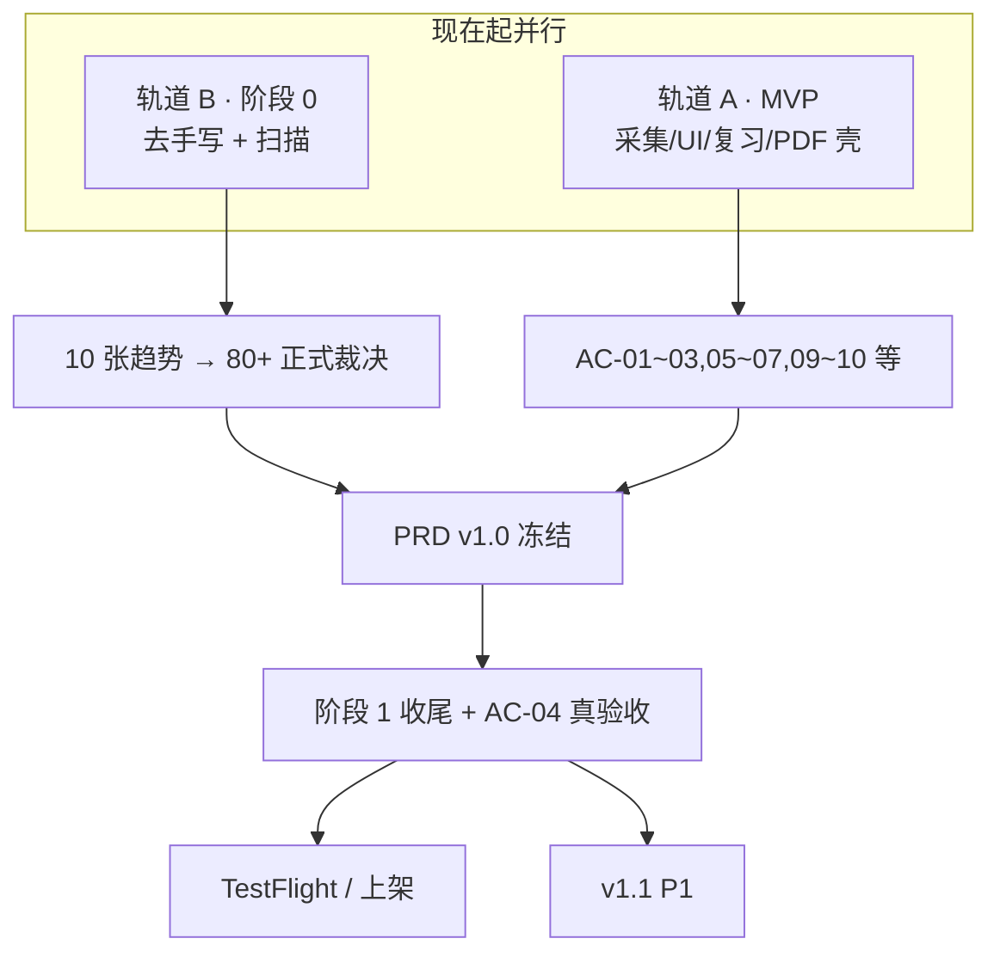

# SnapDrill · 产品路线图（PO 视图）

> 给 **产品负责人** 用的里程碑表：每月看 **状态灯** 和 **要你拍板的事**，不必跟每个技术分支。  
> 细节以 [`PRD.md`](PRD.md) **当前版**为准；阶段 0 见 [`STAGE0_CHARTER.md`](STAGE0_CHARTER.md)。**实时进度**见 [`ENGINEERING.md`](ENGINEERING.md)，勿重复维护本文件下的旧日快照表。

---

## 总览

> **PO 决议（2026-11-16）· 方案 1 — 并行**  
> **MVP 立即开工**；样张 **100 张可渐进收集**（不必作为编码前置条件）。  
> **F-10 真模型接入 App 前**：至少 **10 张趋势评审**；**PRD v1.0 冻结前**：**≥80 张**可评样张 + Charter **§6 A/B/C**。

| 阶段 | PRD 对应 | 你需要盯的产出 |
|---|---|---|
| **轨道 B · 阶段 0** | §10、§15 | 渐进补样；**10 张趋势** → **§6 裁决** |
| **轨道 A · MVP** | §5 P0、§13 | **现在起** Slice 进度；F-10 先用占位/增强降级 |
| **冻结点** | v0.8 → v1.0 | §6 完成 + 小 diff PRD |
| **上架前** | §9.1 合规 | 备案、隐私、商店素材 |
| **v1.1** | §5 P1 | 掌握程度、橡皮擦等 |

---

## 当前状态

> 更新 **Slice / 已合并 PR** 时只改 [`ENGINEERING.md`](ENGINEERING.md)。下表为路线图语境，非每日维护。

| 项目 | 指向 |
|---|---|
| PRD 版本 | `PRD.md` 文内表（v0.9 草案） |
| 执行策略 | **方案 1 并行**（见上） |
| 分支 | `greenfield/rebuild-from-zero` |
| App / Slice | [`ENGINEERING.md`](ENGINEERING.md) |

---

## 里程碑明细

### M0 · 阶段 0 技术验证（轨道 B，与 MVP 并行）

| 时点 | 样张目标 | 工程 / PO |
|---|---|---|
| **现在** | S001–S003 + 管线 Demo | 扫描 + 去手写基线对比 |
| **趋势门** | **≥10 张** 可评 | PO 30 min 盲评：继续投 ML / 改走退路 B |
| **加码期** | 30 → 70 → 100（**无硬性周历**） | 你随缘收卷即可 |
| **冻结门** | **≥80 张** 带手写计入 Q1 | 填 Charter **§6 A/B/C** → **v1.0** |

**退出标准**：§6 有日期和 A/B/C 勾选（可在 MVP 进行中完成，但须早于宣称 AC-04 达标与商店主打去手写）。

### M1-start · MVP（轨道 A，**现在即可开**）

| 顺序 | 切片 | 依赖样张 100？ |
|---|---|---|
| 1 | 工程壳 + 科目 + Tab（AC-01） | 否 |
| 2 | 采集三步 + 多页框选（AC-02/03） | 否 |
| 3 | 列表 / 复习 / PDF 壳（AC-05~07 大部分） | 否 |
| 4 | F-10 真接入 + AC-04 全量 | **是**（≥10 趋势 + 工程就绪；正式靠 §6） |

---

### M-freeze · PRD v1.0 冻结

| 检查项 | 说明 |
|---|---|
| 阶段 0 裁决 | A 或 B（C 须先改 PRD 退路） |
| §15 闭合 | 模型体积 / F-10 是否 P0 |
| 无开放产品矛盾 | Free/Pro、§8、§13 无待讨论项 |
| 文案 | 若 B/C 档，商店一句话与 §1.1 对齐 |

冻结后：**需求变更 = PR + PO 确认**，不口头加功能。

---

### M1 · MVP（阶段 1，建议 8–10 周）

按 **§13 十条 AC** 交付，推荐实现顺序（与工程无关，只看验收风险）：

| 顺序 | 切片 | AC | 说明 |
|---|---|---|---|
| 1 | 壳 + 科目 + 数据 | AC-01 | 地区预置 |
| 2 | 采集 三步 + 多页 | AC-02, AC-03 | 不依赖去手写可先测框选 |
| 3 | 去手写双图 | AC-04 | 依赖 M0 结论 |
| 4 | 列表 / 筛选 / 撤销删 | AC-05 | |
| 5 | 复习 | AC-06 | |
| 6 | PDF + 打印 | AC-07 | |
| 7 | 订阅 + iCloud + 降级 | AC-08 | CloudKit Spike 建议 W4–5 |
| 8 | 边界 + 五语 + a11y | AC-09, AC-10 | |

**PO 月度例会建议看**：AC 累计 **通过几条 / 10**；阻塞项是否需削 P0（仅冻结后严重变更时）。

---

### M1.5 · 上架准备（与 MVP 尾盘重叠）

| 事项 | PRD | 典型提前量 |
|---|---|---|
| App 备案（大陆） | §9.1 | 4–8 周 |
| 隐私政策 / 订阅说明 5 语 | §6、§9.1 | MVP 前 2 周定稿 |
| 图标重绘 | §7.3 | TestFlight 前 |
| TestFlight 内测 | — | MVP AC 达 **8/10** 可开 |

---

### M2 · v1.1（P1）

PRD 已标 P1、首包不做：掌握程度（F-26/F-32）、手动橡皮擦（F-12）、批量操作（F-34）等 — **不在冻结讨论除非 PO 明确插入 MVP**。

---

## 仍需 PO 讨论（会议清单）

| # | 议题 | 建议时机 |
|---|---|---|
| 1 | 阶段 0 通过线：是否采用 Charter **85% / 70%** 草案 | **启动 M0 前** |
| 2 | 样张与标注谁负责 | 启动 M0 前 |
| 3 | 裁决 **C** 时商店定位是否仍强调去手写 | M0 结束当天 |
| 4 | CloudKit 大图同步是否单独立项 Spike | 冻结后 MVP W1 |
| 5 | §11 试用转化率假设是否下调 | 可延后到上架前 |
| 6 | #984 Xcode 27：合入 greenfield 或关闭 | 任意（环境项） |

---

## 成功怎么看（PO 版）

| 时间点 | 你看什么 |
|---|---|
| 阶段 0 结束 | A/B/C + 3 分钟 Demo 录屏 |
| 冻结 | PRD 版本号 **v1.0**、无【待定】阻塞 F-10（或已写退路） |
| MVP 中期 | AC ≥ 5/10 真机通过 |
| 上架前 | AC 10/10 + 备案/隐私就绪 |

技术 KPI（留存、评分）见 PRD §11 — **上架后再看**，不作为 MVP 停工条件。

---

## 文档索引

| 文件 | 读者 |
|---|---|
| [`PRD.md`](PRD.md) | 全员产品权威 |
| [`STAGE0_CHARTER.md`](STAGE0_CHARTER.md) | PO + 阶段 0 执行人 |
| [`ROADMAP.md`](ROADMAP.md) | PO 日程与里程碑 |
| [`../README.md`](../README.md) | 分支与仓库入口 |

---

## 修订记录

| 版本 | 日期 | 说明 |
|---|---|---|
| 1.0 | 2026-11-16 | 首版：M0–M2、冻结条件、PO 会议清单 |
| 1.1 | 2026-11-16 | PO 方案 1：MVP 与阶段 0 双轨并行；样张后置 |