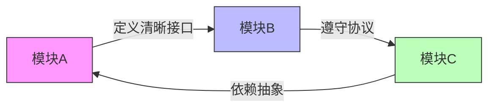
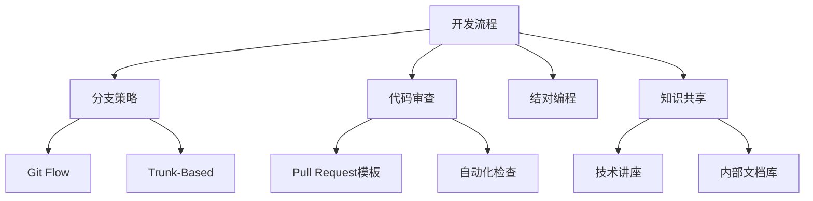
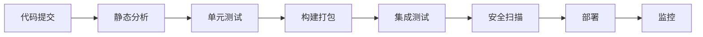
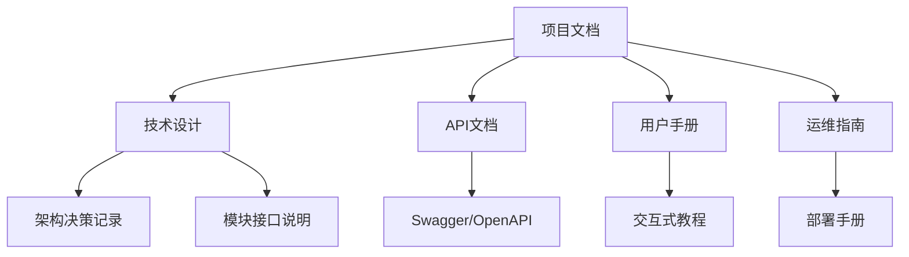
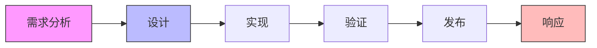

# 团队开发项目初始标准建设指南

在团队开发项目中，建立完善的标准体系是项目成功的基石。以下是您需要建立的核心标准方案：

## 一、架构与设计标准

### 1. 模块化接口协议


**关键要素**：
- 接口定义规范（Protocol-First Development）
- 版本控制策略（Semantic Versioning）
- 依赖管理规则（Dependency Inversion Principle）
- 通信协议标准化（REST/GraphQL/gRPC）

**示例接口定义**：
```swift
// 用户认证模块接口协议
protocol AuthService {
    // 异步方法标记
    @MainActor func login(username: String, password: String) async throws -> User
    
    // 错误类型定义
    enum AuthError: Error {
        case invalidCredentials
        case accountLocked
        case networkFailure
    }
    
    // 事件通知
    var authStatusChanged: AsyncStream<AuthStatus> { get }
}
```

## 二、开发协作标准

### 1. 团队协作开发指南


**核心内容**：
- **分支策略**：
  - 功能分支：`feature/feature-name`
  - 修复分支：`hotfix/issue-#`
  - 发布分支：`release/v1.0.0`
  
- **提交规范**：
  ```
  <类型>(<作用域>): <简短描述>
  
  <详细描述>
  
  Refs: #<问题编号>
  ```
  类型示例：feat, fix, docs, style, refactor, test, chore

- **代码审查清单**：
  1. 功能实现是否符合需求
  2. 代码是否符合规范
  3. 是否有足够的测试覆盖
  4. 是否存在潜在安全问题
  5. 文档是否更新

## 三、代码质量标准

### 1. 代码规范与静态检查


**实施标准**：
- **代码风格指南**：
  - 命名规范（变量、函数、类）
  - 格式标准（缩进、空格、括号）
  - 注释要求（文档注释、TODO标记）
  
- **静态分析工具**：
  ```yaml
  # .swiftlint.yml
  disabled_rules:
    - force_cast
    - function_body_length
  
  opt_in_rules:
    - empty_count
    - closure_spacing
  
  line_length: 120
  type_body_length: 400
  ```

- **测试标准**：
  - 单元测试覆盖率 ≥ 80%
  - 关键路径集成测试
  - 性能基准测试

## 四、DevOps 标准

### 1. CI/CD 流水线设计


**关键流程**：
- **持续集成**：
  - 每次提交触发自动化构建
  - 快速反馈机制（<10分钟）
  - 自动化测试套件
  
- **持续部署**：
  - 分级发布策略（开发 → 测试 → 预发 → 生产）
  - 蓝绿部署/金丝雀发布
  - 一键回滚机制

- **环境管理**：
  ```bash
  # 环境配置示例
  ENVIRONMENTS = {
    "dev": {
      "api_url": "https://dev.api.example.com",
      "database": "app_dev"
    },
    "prod": {
      "api_url": "https://api.example.com",
      "database": "app_prod"
    }
  }
  ```

## 五、文档标准

### 文档体系结构


**文档要求**：
- 代码即文档（DocC 集成）
- 架构决策记录（ADR）
- 变更日志（Keep a Changelog）
- 知识库（Confluence/Wiki）

**架构决策示例**：
```
# ADR 001: 微服务 vs 单体架构

## 状态
已接受

## 背景
需要选择适合团队规模的技术架构

## 决策
选择微服务架构，因为：
- 团队规模扩大后可分团队负责
- 技术栈灵活性更高
- 独立部署能力

## 后果
- 需要服务发现机制
- 增加分布式系统复杂性
- 需要完善监控系统
```

## 六、安全与合规标准

### 安全开发生命周期（SDL）


**核心标准**：
- **安全编码规范**：
  - OWASP Top 10 防护
  - 输入验证和输出编码
  - 最小权限原则
  
- **合规要求**：
  - GDPR/CCPA 数据隐私
  - 行业特定法规（HIPAA，PCI-DSS）
  - 开源许可证合规（SCA 扫描）

- **安全测试**：
  ```bash
  # 安全扫描流水线
  npm audit # NPM 依赖检查
  snyk test # 漏洞扫描
  zap baseline -t https://app.example.com # 渗透测试
  ```

## 七、项目管理标准

### 1. 敏捷开发框架
```mermaid
gantt
    title 敏捷冲刺周期
    dateFormat  YYYY-MM-DD
    section 冲刺准备
    需求梳理     ：2023-10-01, 3d
    任务拆分     ：2023-10-04, 2d
    
    section 冲刺执行
    开发迭代     ：2023-10-06, 10d
    每日站会     ：2023-10-06, 10d
    
    section 冲刺结束
    评审会议     ：2023-10-16, 1d
    回顾会议     ：2023-10-17, 1d
```

**关键实践**：
- **冲刺规划**：
  - 用户故事地图
  - 故事点估算
  - 任务分解（WBS）
  
- **进度跟踪**：
  - 燃尽图
  - 累积流图
  - 代码提交热图

- **风险管理**：
  ```markdown
  | 风险描述 | 概率 | 影响 | 应对措施 | 负责人 |
  |----------|------|------|----------|--------|
  | 关键技术依赖延迟 | 中 | 高 | 准备备用方案 | 技术主管 |
  | 核心成员离职 | 低 | 极高 | 交叉培训，文档完善 | 项目经理 |
  ```

## 实施路线建议

1. **初始阶段（1-2周）**：
   - 建立核心架构标准
   - 配置基础工具链（Git, CI, 文档）
   - 制定基本编码规范

2. **扩展阶段（3-4周）**：
   - 完善模块接口定义
   - 建立自动化测试框架
   - 配置完整CI/CD流水线

3. **成熟阶段（持续改进）**：
   - 定期审查和更新标准
   - 引入更高级质量门禁
   - 优化团队协作流程

**关键成功因素**：
- 自动化检查 > 人工监督
- 渐进式改进 > 一次性完美
- 团队共识 > 强制推行
- 持续培训 > 静态文档

> 建议使用工具：
> - 代码仓库：GitHub/GitLab
> - CI/CD：Jenkins/GitHub Actions
> - 文档：Confluence/Docusaurus
> - 项目管理：Jira/ClickUp
> - 沟通：Slack/Discord
> - 监控：Datadog/New Relic

建立这些标准不是终点而是起点，随着项目演进，您需要定期审查和调整这些规范，确保它们始终服务于团队效率和产品质量提升。
