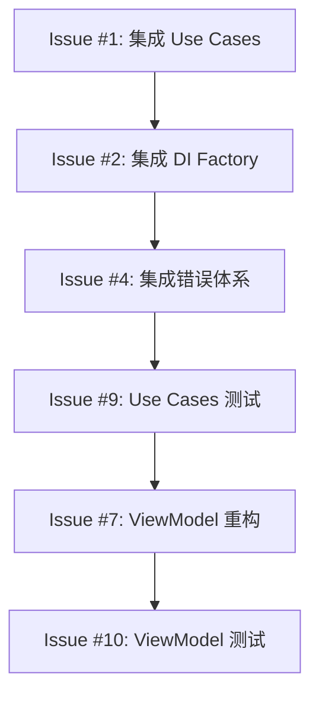

# NotBad 重构任务清单

> 基于 CODE_REVIEW_GUIDELINES.md v4.0 生成的系统性重构任务
> 
> 生成时间：2025-01-XX  
> 优先级：P0（阻塞）> P1（高）> P2（中）> P3（低）

---

## 🏗️ 架构层级任务

### Issue #1: [P0] 集成 Use Cases 层到现有 ViewModel
**Labels**: `architecture`, `refactoring`, `priority-critical`

**Description**:
将已创建的 Use Cases 层集成到现有 ViewModel 中，替换直接的 Repository 调用。

**Tasks**:
- [ ] 重构 `LibraryViewModel` 使用 `CreateReviewItemUseCase`
- [ ] 重构 `LibraryViewModel` 使用 `FetchReviewItemsUseCase`
- [ ] 重构 `LibraryViewModel` 使用 `DeleteReviewItemUseCase`
- [ ] 重构 `ReviewSessionViewModel` 使用 `StartReviewSessionUseCase`
- [ ] 重构 `ReviewSessionViewModel` 使用 `RecordReviewResultUseCase`
- [ ] 重构 `ReviewSessionViewModel` 使用 `CompleteReviewSessionUseCase`
- [ ] 重构 `StatisticsViewModel` 使用 `GetStatisticsUseCase`
- [ ] 移除 ViewModel 中对 Repository 的直接依赖

**Affected Files**:
```
Presentation/ViewModels/LibraryViewModel.swift
Presentation/ViewModels/ReviewSessionViewModel.swift
Presentation/ViewModels/StatisticsViewModel.swift
```

**Acceptance Criteria**:
- ViewModel 只依赖 Use Case protocols
- ViewModel 不直接导入 Data 层
- 所有业务逻辑封装在 Use Cases 中

---

### Issue #2: [P0] 集成 DI Factory 到应用入口
**Labels**: `architecture`, `dependency-injection`, `priority-critical`

**Description**:
将新的 `DependencyFactory` 模式集成到应用入口，替换现有的 `Dependencies` 单例。

**Tasks**:
- [ ] 在 `NotBadApp.swift` 中初始化 `ProductionDependencyFactory`
- [ ] 通过 `@Environment` 注入依赖工厂
- [ ] 更新所有 View 使用注入的依赖
- [ ] 迁移完成后废弃旧的 `Dependencies.swift`
- [ ] 添加 `@MainActor` 标记确保主线程安全

**Migration Example**:
```swift
// Before
@Environment(Dependencies.self) private var dependencies

// After
@Environment(\.dependencyFactory) private var factory
let useCase = factory.makeCreateReviewItemUseCase()
```

**Affected Files**:
```
NotBadApp.swift
Infrastructure/DI/Dependencies.swift (废弃)
Infrastructure/DI/DependencyFactory.swift
所有使用 Dependencies 的 View
```

---

### Issue #3: [P1] 实现剩余 Use Case 实现
**Labels**: `architecture`, `use-cases`, `priority-high`

**Description**:
完成所有 Use Case protocol 的具体实现。

**Tasks**:
- [ ] 实现 `UpdateReviewItemUseCase`
- [ ] 实现 `DeleteReviewItemUseCase`
- [ ] 添加完整的输入验证
- [ ] 添加业务规则检查
- [ ] 添加错误转换逻辑

**Template**:
```swift
final class UpdateReviewItemUseCase: UpdateReviewItemUseCaseProtocol {
    private let repository: ReviewItemRepositoryProtocol
    
    init(repository: ReviewItemRepositoryProtocol) {
        self.repository = repository
    }
    
    func execute(_ request: UpdateReviewItemRequest) async throws -> ReviewItem {
        // 1. 验证输入
        // 2. 获取现有实体
        // 3. 应用业务规则
        // 4. 调用仓储
        // 5. 返回结果
    }
}
```

---

### Issue #4: [P1] 集成分层错误体系
**Labels**: `error-handling`, `architecture`, `priority-high`

**Description**:
将新的分层错误体系集成到现有代码中。

**Tasks**:
- [ ] 更新 Repository 实现使用 `RepositoryError`
- [ ] 更新 Use Cases 抛出 `DomainError`
- [ ] 更新 Infrastructure 服务使用 `InfrastructureError`
- [ ] 实现 ViewModel 中的错误转换逻辑
- [ ] 添加用户友好的错误消息本地化

**Error Flow**:
```
Infrastructure → RepositoryError → DomainError → ViewModel → 用户提示
```

**Affected Files**:
```
Data/Repositories/*.swift
Application/UseCases/**/*.swift
Infrastructure/**/*.swift
Presentation/ViewModels/*.swift
```

---

## 📦 数据层任务

### Issue #5: [P1] 实现 SwiftData 迁移策略
**Labels**: `swiftdata`, `migration`, `priority-high`

**Description**:
按照 §6.5 规范实现完整的 SwiftData 迁移策略。

**Tasks**:
- [ ] 创建 `MigrationManager` 类
- [ ] 定义 Schema 版本枚举
- [ ] 实现 V1 → V2 迁移计划
- [ ] 添加迁移前数据备份
- [ ] 添加迁移失败回滚机制
- [ ] 添加迁移进度回调

**Migration Manager Template**:
```swift
final class MigrationManager {
    enum SchemaVersion: Int, CaseIterable {
        case v1 = 1
        case v2 = 2
        
        static var current: SchemaVersion { .v2 }
    }
    
    func migrate(from: SchemaVersion, to: SchemaVersion) async throws {
        // 实现迁移逻辑
    }
}
```

**Files to Create**:
```
Data/Migration/MigrationManager.swift
Data/Migration/MigrationPlan.swift
Data/Migration/SchemaVersion.swift
```

---

### Issue #6: [P2] Repository 层错误处理增强
**Labels**: `error-handling`, `data-layer`, `priority-medium`

**Description**:
增强 Repository 层的错误处理，使用新的 `RepositoryError` 类型。

**Tasks**:
- [ ] 更新 `SwiftDataReviewItemRepository` 错误处理
- [ ] 添加数据库连接失败处理
- [ ] 添加数据冲突解决逻辑
- [ ] 实现乐观锁冲突重试
- [ ] 添加详细的错误日志

---

## 🎨 表现层任务

### Issue #7: [P1] ViewModel 状态机重构
**Labels**: `presentation`, `state-management`, `priority-high`

**Description**:
将 ViewModel 重构为显式状态机模式。

**Tasks**:
- [ ] 为每个 ViewModel 定义状态枚举
- [ ] 实现状态转换验证
- [ ] 添加 `reduce(state:action:)` 方法
- [ ] 移除分散的状态变量
- [ ] 添加状态快照用于调试

**State Machine Template**:
```swift
@Observable
final class LibraryViewModel {
    enum State {
        case idle
        case loading
        case loaded([ReviewItem])
        case error(DomainError)
    }
    
    enum Action {
        case loadItems
        case createItem(CreateReviewItemRequest)
        case deleteItem(UUID)
    }
    
    private(set) var state: State = .idle
    
    func send(_ action: Action) async {
        state = reduce(state: state, action: action)
    }
}
```

---

### Issue #8: [P2] 抽取可复用 UI 组件
**Labels**: `ui`, `components`, `priority-medium`

**Description**:
将重复的 UI 模式抽取为可复用组件。

**Tasks**:
- [ ] 创建 `LoadingStateView` 组件
- [ ] 创建 `ErrorStateView` 组件
- [ ] 创建 `EmptyStateView` 组件
- [ ] 创建 `ReviewItemCard` 组件
- [ ] 统一按钮样式到 `ButtonStyles.swift`
- [ ] 统一颜色到 `ColorPalette.swift`

**Files to Create**:
```
Presentation/Components/States/LoadingStateView.swift
Presentation/Components/States/ErrorStateView.swift
Presentation/Components/States/EmptyStateView.swift
Presentation/Components/Cards/ReviewItemCard.swift
Presentation/Styles/ButtonStyles.swift
Presentation/Styles/ColorPalette.swift
```

---

## 🧪 测试任务

### Issue #9: [P1] Use Cases 单元测试
**Labels**: `testing`, `unit-tests`, `priority-high`

**Description**:
为所有 Use Cases 添加完整的单元测试。

**Tasks**:
- [ ] 创建 Mock Repository 实现
- [ ] 测试 `StartReviewSessionUseCase`
- [ ] 测试 `RecordReviewResultUseCase`
- [ ] 测试 `CompleteReviewSessionUseCase`
- [ ] 测试 `CreateReviewItemUseCase`
- [ ] 测试 `FetchReviewItemsUseCase`
- [ ] 测试 `GetStatisticsUseCase`
- [ ] 测试边界条件和错误情况
- [ ] 目标覆盖率 > 80%

**Test Template**:
```swift
final class CreateReviewItemUseCaseTests: XCTestCase {
    var sut: CreateReviewItemUseCase!
    var mockRepository: MockReviewItemRepository!
    
    override func setUp() {
        mockRepository = MockReviewItemRepository()
        sut = CreateReviewItemUseCase(repository: mockRepository)
    }
    
    func test_execute_withValidRequest_shouldCreateItem() async throws {
        // Given
        let request = CreateReviewItemRequest(...)
        
        // When
        let result = try await sut.execute(request)
        
        // Then
        XCTAssertEqual(result.title, request.title)
    }
}
```

**Files to Create**:
```
NotBadTests/Application/UseCases/Review/StartReviewSessionUseCaseTests.swift
NotBadTests/Application/UseCases/Review/RecordReviewResultUseCaseTests.swift
NotBadTests/Application/UseCases/Library/CreateReviewItemUseCaseTests.swift
NotBadTests/Application/UseCases/Library/FetchReviewItemsUseCaseTests.swift
NotBadTests/Mocks/MockReviewItemRepository.swift
```

---

### Issue #10: [P1] ViewModel 集成测试
**Labels**: `testing`, `integration-tests`, `priority-high`

**Description**:
使用 `TestDependencyFactory` 进行 ViewModel 集成测试。

**Tasks**:
- [ ] 配置 `TestDependencyFactory` 使用内存存储
- [ ] 测试 `LibraryViewModel` 完整流程
- [ ] 测试 `ReviewSessionViewModel` 完整流程
- [ ] 测试状态转换正确性
- [ ] 测试错误处理流程

---

### Issue #11: [P2] UI 快照测试
**Labels**: `testing`, `ui-tests`, `priority-medium`

**Description**:
添加关键界面的快照测试。

**Tasks**:
- [ ] 集成 swift-snapshot-testing
- [ ] 添加首页快照测试
- [ ] 添加错题列表快照测试
- [ ] 添加复习界面快照测试
- [ ] 添加深色模式快照测试
- [ ] 添加动态字体快照测试

---

## 📱 基础设施任务

### Issue #12: [P2] 网络层实现
**Labels**: `infrastructure`, `networking`, `priority-medium`

**Description**:
按照 §15 规范实现网络层（预留）。

**Tasks**:
- [ ] 创建 `APIClient` 协议
- [ ] 实现 `URLSessionAPIClient`
- [ ] 添加请求/响应拦截器
- [ ] 添加认证令牌管理
- [ ] 添加网络状态监控
- [ ] 实现指数退避重试

**Files to Create**:
```
Infrastructure/Network/APIClient.swift
Infrastructure/Network/URLSessionAPIClient.swift
Infrastructure/Network/Interceptors/AuthInterceptor.swift
Infrastructure/Network/Interceptors/LoggingInterceptor.swift
Infrastructure/Network/NetworkMonitor.swift
```

---

### Issue #13: [P2] 日志与分析系统
**Labels**: `infrastructure`, `logging`, `priority-medium`

**Description**:
实现统一的日志和分析系统。

**Tasks**:
- [ ] 创建 `Logger` 协议和实现
- [ ] 添加日志级别 (debug/info/warning/error)
- [ ] 添加结构化日志
- [ ] 添加隐私数据脱敏
- [ ] 集成分析事件追踪

**Files to Create**:
```
Infrastructure/Logging/Logger.swift
Infrastructure/Logging/OSLogLogger.swift
Infrastructure/Analytics/AnalyticsTracker.swift
Infrastructure/Analytics/AnalyticsEvent.swift
```

---

### Issue #14: [P3] 性能监控
**Labels**: `infrastructure`, `performance`, `priority-low`

**Description**:
添加性能监控基础设施。

**Tasks**:
- [ ] 添加启动时间追踪
- [ ] 添加 View 渲染时间追踪
- [ ] 添加内存使用监控
- [ ] 添加数据库查询性能日志

---

## 📚 文档任务

### Issue #15: [P2] 架构决策记录 (ADR)
**Labels**: `documentation`, `architecture`, `priority-medium`

**Description**:
创建架构决策记录文档。

**Tasks**:
- [ ] ADR-001: 选择 Clean Architecture
- [ ] ADR-002: 选择 SwiftData 而非 Core Data
- [ ] ADR-003: Use Cases 模式采用
- [ ] ADR-004: 分层错误体系设计
- [ ] ADR-005: DI Factory 模式选择

**Template**:
```markdown
# ADR-001: 选择 Clean Architecture

## 状态
已采纳

## 上下文
需要一个可测试、可维护的架构...

## 决策
采用 Clean Architecture...

## 后果
- 正面：...
- 负面：...
```

**Files to Create**:
```
docs/adr/ADR-001-clean-architecture.md
docs/adr/ADR-002-swiftdata.md
docs/adr/ADR-003-use-cases.md
docs/adr/ADR-004-error-system.md
docs/adr/ADR-005-di-factory.md
```

---

### Issue #16: [P3] API 文档生成
**Labels**: `documentation`, `api`, `priority-low`

**Description**:
配置 DocC 生成 API 文档。

**Tasks**:
- [ ] 配置 DocC 目录
- [ ] 为公共 API 添加文档注释
- [ ] 添加代码示例
- [ ] 配置 CI 自动生成文档

---

## 🔧 工具链任务

### Issue #17: [P2] SwiftLint 规则增强
**Labels**: `tooling`, `linting`, `priority-medium`

**Description**:
增强 SwiftLint 规则以匹配代码评审指南。

**Tasks**:
- [ ] 添加架构层级导入规则
- [ ] 添加强制 `@MainActor` 规则
- [ ] 添加禁止 Force Unwrap 规则
- [ ] 添加文档覆盖率规则
- [ ] 添加命名规范规则

---

### Issue #18: [P3] CI/CD 流水线
**Labels**: `tooling`, `ci-cd`, `priority-low`

**Description**:
配置 GitHub Actions CI/CD。

**Tasks**:
- [ ] 配置 PR 自动构建
- [ ] 配置单元测试运行
- [ ] 配置代码覆盖率报告
- [ ] 配置 SwiftLint 检查
- [ ] 配置 TestFlight 自动发布

---

## 📊 任务汇总

| 优先级 | 任务数 | 预估工时 |
|--------|--------|----------|
| P0（阻塞） | 2 | 8h |
| P1（高） | 6 | 24h |
| P2（中） | 7 | 28h |
| P3（低） | 3 | 12h |
| **总计** | **18** | **72h** |

## 🚀 推荐执行顺序



**第一周**: Issue #1, #2, #3, #4  
**第二周**: Issue #5, #7, #9  
**第三周**: Issue #6, #8, #10, #11  
**第四周**: Issue #12-18（可选）

---

> 📝 此文档由 AI 辅助生成，请根据实际情况调整优先级和工时估算。
