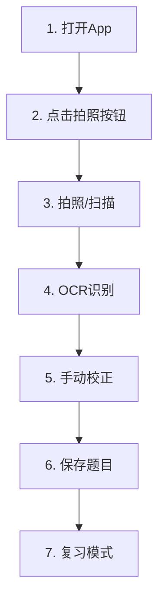

# NotBad 错题本 - 用户工作流程设计

## 🎯 核心用户工作流程

### 📱 主要使用流程

```text
1. 打开App (启动到首页)
2. 点击拍照按钮 (进入Capture模块)
3. 拍照/扫描题目 (Camera/PhotoLibrary)
4. OCR自动识别 (系统处理)
5. 手动校正文字 (用户编辑确认)
6. 设置元数据并保存 (分类、标签、难度)
7. 选择下一步操作 (查看题库/立即练习/继续添加)



1. 打开App (启动到首页)
2. 点击拍照按钮 (进入Capture模块)
3. 拍照/扫描题目 (Camera/PhotoLibrary)
4. OCR自动识别 (系统处理)
5. 手动校正文字 (用户编辑确认)
6. 设置元数据并保存 (分类、标签、难度)
7. 选择下一步操作 (查看题库/立即练习/继续添加)
```

## 🏗️ 技术架构支持

### 路由系统设计

#### 核心路由 (Coordinator.swift)

```swift
// Tab级路由
case home, capture, library, discovery, profile

// Capture模块路由
case camera                    // 打开相机
case photoLibrary             // 打开相册
case ocrResult(image: String) // OCR识别结果
case ocrEdit(result: String)  // 编辑校正页面
case saveReviewItem(content: String) // 保存确认页面

// Library模块路由
case practiceMode             // 练习模式
case reviewItem(id: String)   // 查看具体错题
```

#### 工作流状态管理 (CaptureCoordinator)

```swift
enum CaptureWorkflowState {
    case idle                // 空闲状态
    case camera             // 相机拍照中
    case photoLibrary       // 相册选择中
    case ocrProcessing      // OCR处理中
    case ocrResult(String)  // 显示识别结果
    case editing(String)    // 用户编辑中
    case saving(String)     // 保存处理中
    case completed          // 流程完成
}
```

#### 完成后操作选项

```swift
enum CaptureCompletionAction {
    case returnToLibrary    // 返回题库查看
    case startPractice      // 立即开始练习
    case addAnother         // 添加另一题
}
```

## 🔄 详细流程说明

### 1. 应用启动

- **入口**: MainTabView → HomeView
- **状态**: MainCoordinator.selectedTab = 0
- **用户体验**: 快速概览学习状态，引导用户开始

### 2. 进入拍照模块

- **触发**: 用户点击拍照按钮 → Route.capture
- **导航**: MainCoordinator → CaptureCoordinator
- **状态**: workflowState = .idle

### 3. 拍照/选择图片

- **相机路径**: Route.camera → workflowState = .camera
- **相册路径**: Route.photoLibrary → workflowState = .photoLibrary
- **UI处理**: showCamera/showPhotoLibrary 控制模态展示

### 4. OCR识别处理

- **触发**: 图片选择完成
- **状态**: workflowState = .ocrProcessing
- **导航**: Route.ocrResult(image) → OCR结果页面
- **技术**: iOS 26 Enhanced Vision Framework

### 5. 文字校正编辑

- **触发**: 用户点击编辑OCR结果
- **导航**: Route.ocrEdit(result) → 编辑页面
- **状态**: workflowState = .editing(result)
- **功能**: 富文本编辑、手动校正

### 6. 保存确认

- **触发**: 用户确认编辑完成
- **导航**: Route.saveReviewItem(content) → 保存页面
- **状态**: workflowState = .saving(content)
- **功能**: 分类选择、标签添加、难度设置

### 7. 完成流程

- **触发**: 用户确认保存
- **方法**: coordinator.completeWorkflow(nextAction:)
- **选项**:
  - `.returnToLibrary`: 跳转到Library查看保存的错题
  - `.startPractice`: 立即开始练习刚保存的错题
  - `.addAnother`: 重置流程，继续添加新错题

## 🎨 用户体验设计原则

### 1. 流程连贯性

- **无缝衔接**: 每个步骤自然过渡，减少用户认知负担
- **状态保持**: 工作流状态持续跟踪，支持中断恢复
- **快速反馈**: 每个操作都有即时视觉反馈

### 2. 错误处理

- **草稿保存**: 任意节点中断都会自动保存草稿
- **重试机制**: OCR失败可重新处理
- **回退支持**: 任意步骤都可以返回上一步

### 3. 效率优化

- **批量处理**: 支持连续添加多个错题
- **智能预填**: 基于历史数据智能推荐分类和标签
- **快捷操作**: 常用操作提供快捷路径

## 🔄 扩展性考虑

### 1. 多媒体支持

- 未来可扩展支持视频、音频错题
- 工作流状态机可轻松添加新状态

### 2. AI增强

- OCR结果可集成更强大的AI模型
- 智能分类可基于内容自动推荐

### 3. 协作功能

- 工作流可扩展支持分享和协作
- 状态管理支持多用户场景

## 📊 成功指标

### 用户体验指标

- **完成率**: >90%用户能完成完整录入流程
- **效率**: 单题录入时间 <60秒
- **准确性**: OCR识别准确率 >95%(中文), >90%(数学公式)

### 技术性能指标

- **响应时间**: 每步操作响应 <300ms
- **稳定性**: 工作流程错误率 <1%
- **资源使用**: 内存占用 <100MB，电量消耗优化

---

*本文档描述了NotBad错题本App的核心用户工作流程设计，为产品开发和用户体验优化提供指导。*
