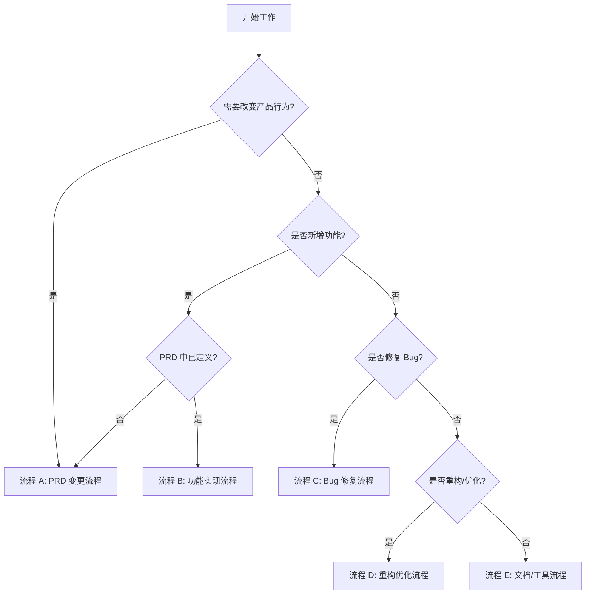

# NotBad 工作流规范 - PRD 驱动闭环系统

**版本**：1.0  
**生效日期**：2025-11-19  
**适用对象**：所有开发者（人类 & AI）

---

## 🎯 核心原则

### PRD 为宪法（Constitutional PRD）

```
┌─────────────────────────────────────────────┐
│                   PRD v6.2                  │
│           (单一事实来源 SSoT)                │
└─────────────┬───────────────────────────────┘
              │
              ├──► 文档派生（RTM/TDD/测试规范）
              ├──► 代码实现（严格对齐）
              ├──► 测试验证（基于 AC）
              └──► 指标采集（可度量）
              
❌ 禁止：代码/文档反向要求修改 PRD
✅ 允许：基于实践反馈提议更新 PRD（需审批）
```

---

## 📋 决策树：我该走哪个流程？



---

## 🔄 流程 A：PRD 变更流程（最高优先级）

**触发条件**：需要新增/修改/删除产品功能、NFR、指标、合规要求

### Step 1：创建 PRD 变更请求
```bash
# 使用 GitHub Issue 模板
# 选择："PRD 变更请求"
```

**必填内容**：
- [ ] 当前 PRD 条款（小节编号 + 行号范围）
- [ ] 变更动机（用户痛点/技术约束/合规要求）
- [ ] 提议内容（具体的 PRD 条款文本）
- [ ] 影响范围（功能/NFR/指标/合规/风险）
- [ ] 验收标准（AC-* 编号）
- [ ] 测试策略（Unit/UI/Perf/Integration）
- [ ] 风险评估与缓解

### Step 2：PRD 变更评审
**评审人**：产品负责人 / 架构师 / 合规专家

**评审清单**：
- [ ] 是否符合产品愿景（本地优先/隐私优先/免费无广告）
- [ ] 是否与现有 PRD 条款冲突
- [ ] 验收标准是否可测（SMART 原则）
- [ ] 性能/合规/安全影响是否可控
- [ ] 是否需要更新路线图（ROADMAP.md）

**决策**：
- ✅ **批准**：合并 PRD 变更，进入 Step 3
- 🔄 **需修改**：返回 Step 1
- ❌ **拒绝**：关闭 Issue，说明理由

### Step 3：更新 PRD 及派生文档
```bash
# 1. 更新 PRD
vim docs/prd/NotBad\ 错题本\ App\ -\ 产品需求文档\ \(PRD\)\ v6.2.md

# 2. 更新版本历史（在 PRD 末尾追加）
# 格式：[YYYY-MM-DD] vX.Y - 变更摘要 (Issue #N)

# 3. 如影响路线图，更新 ROADMAP.md
vim docs/ROADMAP.md

# 4. 提交 PRD 变更 PR
git checkout -b prd/issue-N-brief-description
git add docs/prd/*.md docs/ROADMAP.md
git commit -m "PRD: [模块] 变更描述 (fixes #N)"
git push origin prd/issue-N-brief-description
```

**PR 检查清单**（必须全部通过）：
- [ ] CI 检查通过（Markdown lint、PRD 完整性检查）
- [ ] 至少 1 位评审人批准
- [ ] 关联的 Issue 已引用
- [ ] 版本历史已更新

### Step 4：合并后通知
- 在 Issue 中标注："✅ PRD 已更新，可开始实现"
- 相关实现 PR 必须引用此 Issue

---

## 🛠 流程 B：功能实现流程

**前置条件**：功能已在 PRD 中明确定义

### Step 1：创建功能分支
```bash
# 分支命名规范：feature/{phase}-{module}-{brief-desc}
git checkout -b feature/phase2-capture-ocr-service

# 检查 PRD 对齐
echo "本功能对应 PRD:"
echo "- 章节：§4.3.1 错题捕获"
echo "- 验收标准：AC-UC-OCR-01"
echo "- 性能要求：§5.1 OCR P90 ≤ 2.5s"
```

### Step 2：编写代码（TDD 优先）
```bash
# 1. 先写测试（基于 PRD 的验收标准）
# NotBadTests/Infrastructure/OCR/OCRServiceTests.swift

# 2. 实现功能
# NotBad/Infrastructure/OCR/OCRService.swift

# 3. 本地验证
xcodebuild test -scheme NotBad -destination 'platform=iOS Simulator,name=iPhone 17 Pro'
```

**编码规范**：
- 每个文件顶部必须注释 PRD 溯源（章节 + 验收标准）
- 关键算法/决策必须引用 PRD 条款
- 性能敏感代码必须标注 NFR 要求

**示例**：
```swift
//
//  OCRService.swift
//  NotBad
//
//  PRD 章节：§4.3.1 错题捕获 - OCR 识别
//  验收标准：AC-UC-OCR-01（P90 ≤ 2.5s）
//  性能要求：§5.1 Baseline OCR
//

import Vision

/// OCR 服务：使用 Vision Framework 识别中文文本与数学公式
class OCRService {
    // ...implementation
}
```

### Step 3：提交 PR
```bash
git add .
git commit -m "feat(capture): 实现 OCR 服务 (PRD §4.3.1, AC-UC-OCR-01)"
git push origin feature/phase2-capture-ocr-service
```

**PR 模板必填**：
- [ ] PRD 章节：`§4.3.1`
- [ ] 验收标准：`AC-UC-OCR-01`
- [ ] 测试覆盖：`✅ Unit: OCRServiceTests（12 cases）`
- [ ] 性能验证：`✅ P90 = 2.1s（满足 ≤2.5s 要求）`
- [ ] 合规检查：`N/A（无个人数据处理）`

### Step 4：自动化 CI 检查
**GitHub Actions 自动运行**：
- [ ] 编译检查（Swift 6.2, iOS 26.0）
- [ ] 单元测试（覆盖率 ≥ 60%）
- [ ] UI 测试（关键流程）
- [ ] 性能测试（启动/OCR/交互）
- [ ] PRD 对齐检查（验证 PR 描述包含 PRD 引用）
- [ ] 代码规范检查（SwiftLint）

### Step 5：人工评审
**评审清单**：
- [ ] 代码实现与 PRD 描述一致
- [ ] 测试覆盖验收标准（AC）
- [ ] 性能满足 NFR 要求
- [ ] 无反向约束 PRD 的注释/TODO
- [ ] 错误处理与边界条件完整

### Step 6：合并与部署
```bash
# 合并到主分支
# CI 自动触发完整测试套件
# 通过后自动部署到 TestFlight（如配置）
```

---

## 🐛 流程 C：Bug 修复流程

**触发条件**：现有功能与 PRD 预期不符

### Step 1：验证是否为 Bug
```bash
# 判断标准：
# 1. 实现与 PRD 条款不一致 → Bug（走流程 C）
# 2. PRD 条款本身有问题 → PRD 变更（走流程 A）
# 3. PRD 未定义的行为 → PRD 补充（走流程 A）
```

### Step 2：创建 Bug Issue
```bash
# 使用 GitHub Issue 模板："Bug Report"
```

**必填内容**：
- [ ] 预期行为（引用 PRD 章节 + 验收标准）
- [ ] 实际行为（截图/日志/复现步骤）
- [ ] 环境（iOS 版本/设备型号）
- [ ] 影响范围（用户数/功能模块）
- [ ] 严重程度（P0-阻断/P1-严重/P2-一般/P3-轻微）

### Step 3：修复与测试
```bash
git checkout -b bugfix/issue-N-brief-description

# 1. 修复代码
# 2. 新增/修改测试（避免回归）
# 3. 验证修复（手动 + 自动）

git commit -m "fix(module): 修复问题描述 (fixes #N, PRD §X.Y.Z)"
```

### Step 4：提交 PR
**PR 必填**：
- [ ] 关联 Bug Issue：`fixes #N`
- [ ] PRD 条款：验证修复后行为符合 PRD
- [ ] 回归测试：确保未引入新问题
- [ ] 根因分析：说明为何未能及早发现

---

## 🔧 流程 D：重构/优化流程

**触发条件**：改进代码质量但不改变外部行为

### Step 1：创建重构提议
**必须证明**：
- [ ] 不改变任何 PRD 定义的功能行为
- [ ] 不影响性能/合规/安全要求
- [ ] 有明确的技术收益（可维护性/性能/可测试性）

### Step 2：实施重构
```bash
git checkout -b refactor/module-improvement

# 1. 重构前：确保现有测试全部通过
# 2. 重构中：保持测试通过（TDD）
# 3. 重构后：验证性能无退化

git commit -m "refactor(module): 改进描述（不改变行为）"
```

**PR 必填**：
- [ ] 声明：不改变 PRD 定义的行为
- [ ] 测试：所有现有测试通过
- [ ] 性能：基线指标无退化
- [ ] 收益：说明技术改进点

---

## 📄 流程 E：文档/工具流程

**触发条件**：更新非 PRD 文档、工具脚本、配置

### 允许的文档更新（无需 PRD 变更）
- README.md（项目说明）
- CONTRIBUTING.md（贡献指南）
- ROADMAP.md（实施计划）
- .github/workflows（CI 配置）
- SwiftLint 配置
- Xcode 项目配置（不改变目标平台）

### 禁止的文档更新（必须走流程 A）
- PRD v6.2（必须走流程 A）
- 任何声称"覆盖 PRD"的文档
- 技术设计文档（TDD）如与 PRD 冲突

---

## 🤖 AI 协作指南

### 给 AI 的明确指令（复制粘贴使用）

```markdown
你是 NotBad 项目的 AI 协作者。必须严格遵守以下规则：

1. **PRD 为宪法**
   - 单一事实来源：`docs/prd/NotBad 错题本 App - 产品需求文档 (PRD) v6.2.md`
   - 任何功能实现前，先阅读并引用 PRD 对应章节
   - 如 PRD 未定义或不清晰，停止并提示："需要先更新 PRD"

2. **工作流强制执行**
   - 查阅 `docs/WORKFLOW.md` 决策树，确认当前任务走哪个流程
   - 新功能：必须走"流程 B：功能实现流程"
   - PRD 变更：必须走"流程 A：PRD 变更流程"
   - Bug 修复：必须走"流程 C：Bug 修复流程"

3. **代码溯源要求**
   - 每个新文件顶部必须注释：
     ```swift
     //  PRD 章节：§X.Y.Z
     //  验收标准：AC-XXX-YYY-NN
     //  性能要求：§5.1 [具体指标]
     ```
   - PR 描述必须包含 PRD 章节编号

4. **禁止行为**
   - ❌ 实现 PRD 未定义的功能
   - ❌ 创建与 PRD 冲突的 TDD/架构文档
   - ❌ 绕过测试要求
   - ❌ 修改 PRD 而不走流程 A

5. **检查清单（每次提交前自查）**
   - [ ] PRD 章节引用完整
   - [ ] 验收标准已覆盖
   - [ ] 测试已编写并通过
   - [ ] 性能满足 NFR 要求
   - [ ] 合规要求已满足（如涉及）
```

### AI 工作流示例

#### 场景 1：实现新功能
```bash
用户："实现 OCR 功能"

AI 步骤：
1. 读取 PRD §4.3.1 错题捕获
2. 确认验收标准：AC-UC-OCR-01
3. 检查 ROADMAP.md：Phase 3 - OCR 集成
4. 创建分支：feature/phase3-capture-ocr
5. 先写测试（TDD）
6. 实现功能
7. 验证性能（P90 ≤ 2.5s）
8. 提交 PR（包含 PRD 引用）
```

#### 场景 2：用户要求不明确
```bash
用户："添加一个社交分享功能"

AI 响应：
"我查阅了 PRD v6.2：
- §4.3.5 定义了社区分享功能
- 当前状态：Phase 11（Future，未来功能）
- 前置依赖：需先完成 Phase 1-10

建议：
1. 如需提前实现，请先走【流程 A：PRD 变更流程】调整优先级
2. 或按照 ROADMAP 先完成 Phase 1-10 的基础功能

是否需要我帮你创建 PRD 变更请求 Issue？"
```

#### 场景 3：发现 PRD 不清晰
```bash
AI 工作时发现："PRD §4.3.3 未明确遗忘曲线的具体参数"

AI 行为：
1. 停止实现
2. 提示用户：
   "发现 PRD 不清晰：
   - 位置：§4.3.3 复习系统
   - 问题：未定义遗忘曲线算法（SM-2/SM-15/Anki）和初始间隔参数
   - 建议：先走【流程 A：PRD 变更流程】补充这些定义
   
   我已准备好 PRD 变更请求草稿，是否立即创建 Issue？"
3. 等待用户确认，不擅自决策
```

---

## 🔍 质量门禁（CI 自动检查）

### 强制检查项（PR 无法合并直到通过）

#### 1. PRD 对齐检查
```yaml
# .github/workflows/prd-alignment-check.yml
# 检查 PR 描述是否包含 PRD 引用
if: contains(github.event.pull_request.body, 'PRD 章节') == false
  fail: "❌ PR 必须在描述中引用 PRD 章节（格式：§X.Y.Z）"
```

#### 2. 测试覆盖率检查
```yaml
# 单元测试覆盖率 ≥ 60%
# 关键模块（Capture/Bank/Review）≥ 80%
if: coverage < 60%
  fail: "❌ 测试覆盖率不足（当前：XX%，要求：≥60%）"
```

#### 3. 性能基线检查
```yaml
# 验证性能指标（PRD §5.1）
if: launch_time_p90 > 1.2s
  fail: "❌ 启动时间超标（P90: XXs，要求：≤1.2s）"
```

#### 4. 合规检查
```yaml
# 检查是否处理个人数据
if: contains(diff, 'UserProfile') or contains(diff, 'dateOfBirth')
  require: "⚠️ 涉及个人数据，需验证 PRD §8.2 合规要求"
```

#### 5. 反向约束检查
```yaml
# 检查代码注释中是否有"应该修改 PRD"等反向约束
if: grep -r "TODO.*PRD.*应该\|需要\|必须" NotBad/
  fail: "❌ 发现反向约束 PRD 的注释，请走【流程 A：PRD 变更流程】"
```

---

## 📊 工作流健康度指标

### 团队/AI 协作健康度仪表盘

| 指标 | 目标 | 计算方式 |
|------|------|----------|
| PRD 对齐率 | ≥95% | 包含 PRD 引用的 PR 数 / 总 PR 数 |
| 流程遵守率 | 100% | 正确走流程的 PR 数 / 总 PR 数 |
| 反向约束次数 | 0 | CI 检测到的反向约束提交数 |
| PRD 变更频率 | ≤1 次/周 | PRD 变更 PR 数 / 周 |
| 测试覆盖率 | ≥60% | 单元测试覆盖的代码行数 / 总代码行数 |
| 性能达标率 | 100% | 满足 NFR 的功能数 / 总功能数 |

### 每周自动生成报告
```bash
# .github/workflows/weekly-metrics.yml
# 每周一生成并发送工作流健康度报告
```

---

## 🚨 违规处理

### 自动拒绝的 PR（CI 直接失败）
- ❌ 无 PRD 引用
- ❌ 测试覆盖率不足
- ❌ 性能不达标
- ❌ 包含反向约束注释

### 需要重新走流程的 PR
- 🔄 实现了 PRD 未定义的功能 → 先走流程 A
- 🔄 改变了产品行为但未更新 PRD → 先走流程 A
- 🔄 Bug 修复改变了 PRD 预期行为 → 先走流程 A

### 例外情况（需产品负责人批准）
- 紧急安全漏洞修复（修复后 24 小时内补 PRD）
- 编译错误阻断（修复后立即补流程）
- 第三方库强制升级（评估影响后补 PRD）

---

## 📚 快速参考

### 常用命令

```bash
# 检查 PRD 对齐
grep -n "§4.3" docs/prd/*.md

# 查看当前 Phase
cat docs/ROADMAP.md | grep "^\- \[ \]" | head -5

# 运行完整测试套件
xcodebuild test -scheme NotBad -testPlan UnitTestPlan
xcodebuild test -scheme NotBad -testPlan UITestPlan
xcodebuild test -scheme NotBad -testPlan PerformanceTestPlan

# 检查测试覆盖率
xcodebuild test -scheme NotBad -enableCodeCoverage YES

# 验证性能基线
xcodebuild test -scheme NotBad -testPlan PerformanceTestPlan
```

### 重要链接

- 📄 [PRD v6.2](../docs/prd/NotBad%20错题本%20App%20-%20产品需求文档%20(PRD)%20v6.2.md)
- 🗺️ [ROADMAP](../docs/ROADMAP.md)
- 📋 [CONTRIBUTING](../CONTRIBUTING.md)
- 🔄 [PR 模板](../.github/PULL_REQUEST_TEMPLATE.md)
- 📝 [Issue 模板](../.github/ISSUE_TEMPLATE/)

---

## ✅ 工作流自查清单

### 开始工作前
- [ ] 我已阅读 PRD v6.2 对应章节
- [ ] 我已确认走哪个流程（A/B/C/D/E）
- [ ] 我已查阅 ROADMAP 确认优先级
- [ ] 我已准备验收标准（AC）

### 提交 PR 前
- [ ] PR 标题包含类型（feat/fix/refactor/docs）
- [ ] PR 描述包含 PRD 章节引用
- [ ] PR 描述包含验收标准
- [ ] 所有测试通过
- [ ] 性能满足 NFR 要求
- [ ] 代码包含 PRD 溯源注释
- [ ] 无反向约束 PRD 的内容

### 合并后
- [ ] 如有文档更新（RTM/测试计划），已同步
- [ ] 如影响其他功能，已通知相关人员
- [ ] 如影响路线图，已更新 ROADMAP.md

---

**本工作流由 PRD v6.2 派生，确保多人/AI 协作时的一致性与可追溯性。**

*最后更新：2025-11-19*
*维护者：PRD Constitutional Committee*
