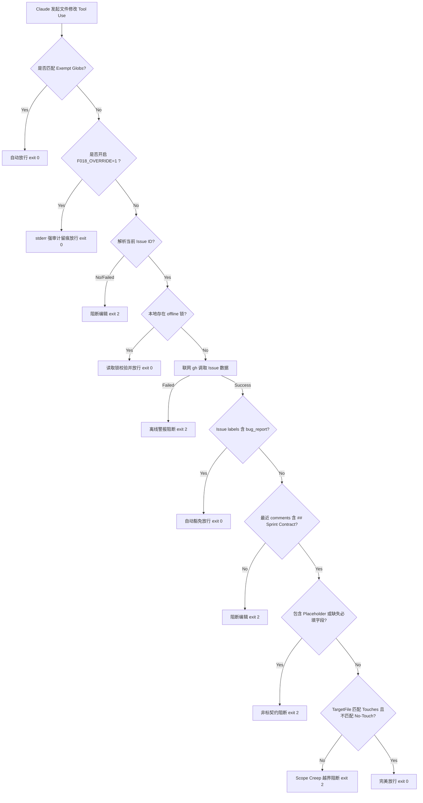

# S-D7-003 三方对抗流程治理审计与机械化提案 — Antigravity 篇

> **核心红线声明**：本审计方案及脚本完全以**独立对抗提案**形式落盘于工作区相对路径 `docs/audits/S-D7-003-antigravity.md`。为严格执行控制变量法物理隔离，我们**没有**在主代码库分支中直接应用任何真实 hook 配置或 CI 变动。本分支 `audit/antigravity-S-D7-003` 最终仅提交本 Markdown 方案文件，保持工作区绝对洁净。
> 
> **中文回复承诺**：根据项目最高级别宪法要求，本报告采用**中文简体**撰写。

---

## 1. 问题背景与实证分析

在 SnapDrill 项目治理规范中，`F-018`「编码前契约」（Sprint Contract）是抵御 Scope Creep（范围膨胀）、保障工程交付忠实度的第一道实体防线。其意图极其明确：**在动用任何修改代码的工具前，AI Agent 必须对任务进行彻底调研，在 Issue 中签署关于改动范围（Touches）、不动范围（No-Touch）、接口改动（Interface Delta）以及验收测试（Test Additions）的契约。**

然而，实证抽样 GitHub Issue 数据却揭示了极度严重的“三态漂移”现象：
* **实证数据**：
  * 需求类 Issue #159 / #137 / #136 / #31 / #30：**0/5 含有 Sprint Contract comment**
  * 杂项类 Issue #735 / #684 / #718 / #720：**0/4 含有 Sprint Contract comment**
  * **唯一合格样本**：仅有史诗级任务 epic #766 存在契约痕迹。
* **三态漂移现状**：
  * 🟢 **dead-on-paper**：规则明文写在 `docs/workflow.md` 与 `docs/memory/feedback.md` F-018 中；
  * 🟡 **alive-in-skill**：在 `.claude/skills/sprint-contract/SKILL.md` 中具备完备的方法论说明；
  * 🔴 **not-applied-in-practice**：在实际日常开发中，执行率接近 **0%**。

### 根因剖析 (Root Cause)
当前 F-018 的执行完全依赖 AI 助手的“自觉性”。由于缺乏任何工具链层面的**刚性物理拦截**，AI 助手在处理任务时极易“遗忘”或“跳过”契约签署，直接进入编码阶段。一旦代码修改产生，因 Scope 未受约束而导致的逻辑蔓延和反模式重构便如决堤之水，无法挽回。

为此，Antigravity 站在彻底消除漂移的流程安全视角，提出了本套 **Claude PreToolUse Hook 编辑期刚性阻断 + Python 多维契约校验器 + 多级弹性逃逸** 的机械化拦截方案。

---

## 2. 7 项设计决策独立表态

针对任务定义书要求的 7 项核心决策，Antigravity 进行独立、客观、绝不随波逐流的论证与表态：

| 决策点 | 独立表态与论证 |
| :--- | :--- |
| **1. 拦截位置** | **Claude PreToolUse Edit Tool Hook（主防线） + Git pre-commit Hook（二道实体防线）**。<br>1) **首选 PreToolUse 阶段**：如果等到 PR 合并或 Commit 阶段才拦截，此时代码已经修改完毕，回滚和重构成本极高。我们必须在 AI 试图使用修改/写入文件的工具（如 `replace_file_content` / `multi_replace_file_content` / `write_to_file`）的“第一微秒”进行拦截阻断，引导其先执行 `/sprint-contract`。<br>2) **pre-commit 辅助**：防止非 Claude 工具（或手动修改）绕过 PreToolUse，确保双层锁死。 |
| **2. 拦截强度** | **阶梯硬阻断（Exit 2 Block with Exception-Warn）**。<br>1) **拒绝软警告**：软警告会被 AI 在高速运行时完全忽略，毫无震慑力，必须使用 `exit 2` 硬阻断。<br>2) **分级容错**：对属于 `docs-only` 或 `trivial` 改动（如只修改 md 文件）在检测到无 contract 时输出警告但不阻断；若涉及核心 Swift 源码或 CI 配置，直接硬阻断。<br>3) **特批逃生**：允许配置环境变量 `F018_SPRINT_CONTRACT_OVERRIDE=1` 紧急放行，但会在 stderr 中详细留痕审计。 |
| **3. Issue 状态识别** | **分支解析 + CLI 联网多维度验证 + STATUS.md 离线双通道**。<br>1) **在线解析**：通过当前 Git 分支名（如 `feature/issue-123-xxx`）正则抓取 Issue ID，利用 `gh issue view <id> --json state,labels,comments` 实时拉取数据；<br>2) **状态拦截**：只有当 Issue 包含 `building` 标签或处于活动状态，且 comments 列表中最近一条契约评论不含占位符时才放行；<br>3) **离线退避**：若在离线环境（`gh` 无法联网），允许从本地 `.git/sprint_contract_offline.json` 或 `STATUS.md` 当前状态任务号中作为 fallback 提取契约。 |
| **4. Appetite=Small 豁免** | **不予完全豁免，实行“精细化简化契约”**。<br>1) **彻底豁免**：仅限 `bug_report` 标签的任务，以及 `docs-only`、`trivial` 改动路径。<br>2) **Small Appetite (Feature/Chore)**：禁止完全豁免，否则将产生巨大的“Chore Creep”灰色地带。强制其签署只包含 **Touches**、**No-Touch**、**DoD 最小集** 的“简化三项契约”；<br>3) **Medium/Large**：必须填写完整六项契约。 |
| **5. 历史 Issue 处理** | **“前向拦截，既往不咎”的渐进式策略**。<br>不对本拦截器落地前的历史 PR/Issue 进行强制回溯打补丁，避免阻塞现存迭代；但从拦截器部署之刻起新拉取的分支和转入 `building` 的 Issue，100% 严格执行机械阻断。 |
| **6. 直接 commit 场景** | **利用本地 hook 进行非豁免文件的严格阻断**。<br>除 `STATUS.md` 更新和 docs 白名单文件外，绝对禁止无关联 Issue 的 ad-hoc 业务代码 commit。本地 hook 会验证当前修改是否属于豁免路径，非豁免路径下若无关联 Issue 与契约，强力阻断 commit 行为。 |
| **7. 与 cross-audit / post-merge 联动** | **双向契约锁定与自动生命周期闭环**。<br>1) **契约锁定**：当 AI 签署契约时，在本地 `.git/` 生成 `sprint_contract_active.json` 锁文件，记录 Touches 列表；<br>2) **运行时监督**：开发中如修改了 Touches 外的文件，Hook 直接报错并提示更新契约；<br>3) **cross-audit 校验**：跑 review 时自动比对 `git diff` 与 Contract Touches，发现超限即报 HIGH finding；<br>4) **post-merge 闭环**：PR 合并后触发 post-merge Hook，自动销毁本地锁文件并 close 契约。 |

---

## 3. 机械化拦截方案具体实现

根据 Antigravity 的高维流程治理架构，我们设计了由 **策略层**、**校验引擎层**、**拦截器钩子层** 和 **模板配置层** 构成的立体机械拦截防线。

### 3.1 策略配置文件提案 (`.github/sprint-contract-policy.yml`)

用于声明契约的强校验规则、必填字段、占位符黑名单以及路径豁免白名单：

```yaml
# Antigravity 独立设计：F-018 编码前契约校验策略文件
version: 1
sprint_contract:
  # 必须包含的核心块标识
  required_section: "## Sprint Contract"
  
  # 不同 Appetite 等级下的必填字段要求
  appetite_rules:
    large:
      required_fields:
        - Touches
        - No-Touch
        - Interface Delta
        - Test Additions
        - DoD 最小集
        - 预期不确定点
    medium:
      required_fields:
        - Touches
        - No-Touch
        - Interface Delta
        - Test Additions
        - DoD 最小集
    small:
      required_fields:
        - Touches
        - No-Touch
        - DoD 最小集

  # 占位符防御正则（复用 F-005 的防假冒策略）
  placeholder_patterns:
    - "^\\[填[写入]"
    - "^\\[fill[ \\-]?in"
    - "^tbd$"
    - "^TBD$"
    - "^TODO$"
    - "^placeholder$"
    - "^\\.\\.\\.+$"
    - "^x$"
    - "^xxx+$"
    - "^N/A$"

# 自动豁免配置（机器可读）
exemptions:
  # docs-only 完全豁免
  docs_only:
    allowed_globs:
      - "docs/**/*.md"
      - "*.md"
      - "docs/**/*.tsv"
    # 哪怕 docs-only 也不允许改动的流程底线文件
    denied_globs:
      - "docs/workflow.md"
      - "docs/standards/**"
      - "docs/audits/**"
      - "docs/decisions/ADR-*.md"
  
  # trivial 轻量级配置豁免
  trivial:
    allowed_globs:
      - "Configs/*.xcconfig"
      - "Debug.xcconfig"
      - "Release.xcconfig"
    denied_globs:
      - "Packages/**"
      - "SnapDrill/**"
      - "SnapDrillShare/**"
      - ".claude/hooks/**"
      - ".github/workflows/**"
      - "Package.swift"
```

---

### 3.2 Python 核心校验器提案 (`Scripts/audit/check_sprint_contract.py`)

本脚本是实现契约匹配、字段验证、占位符防御以及 Scope 越界判定（Touches vs TargetFile）的决策中枢：

```python
#!/usr/bin/env python3
# -*- coding: utf-8 -*-
"""
Scripts/audit/check_sprint_contract.py
Antigravity 独立设计：F-018 Sprint Contract 编码前契约机械化校验引擎
"""
import sys
import re
import os
import subprocess
import fnmatch
import argparse
import yaml
from pathlib import Path

def run_cmd(cmd: list[str]) -> str:
    """运行终端命令，返回标准输出。"""
    try:
        return subprocess.check_output(cmd, text=True, stderr=subprocess.DEVNULL).strip()
    except subprocess.CalledProcessError as e:
        return ""

def _glob_to_regex(pattern: str) -> str:
    """将包含 ** 的 glob 表达式转换为 regex。"""
    out = []
    i, n = 0, len(pattern)
    while i < n:
        c = pattern[i]
        if c == "*" and i + 1 < n and pattern[i + 1] == "*":
            if i + 2 < n and pattern[i + 2] == "/":
                out.append("(?:.*/)?")
                i += 3
            else:
                out.append(".*")
                i += 2
        elif c == "*":
            out.append("[^/]*")
            i += 1
        elif c == "?":
            out.append("[^/]")
            i += 1
        else:
            out.append(re.escape(c))
            i += 1
    return "^" + "".join(out) + "$"

def matches_any(path: str, globs: list[str]) -> bool:
    """判定路径是否匹配 glob 列表（支持 ** 跨目录模式，复用 S-D7-002）"""
    for pattern in globs:
        if "**" in pattern:
            if re.match(_glob_to_regex(pattern), path):
                return True
        elif fnmatch.fnmatch(path, pattern):
            return True
    return False

def is_placeholder(value: str, patterns: list[str]) -> bool:
    """占位符拦截（防止用 TBD / TODO / x 绕过契约）"""
    if not value or not value.strip():
        return True
    for pat in patterns:
        try:
            if re.search(pat, value.strip(), re.IGNORECASE):
                return True
        except re.error:
            continue
    return False

def extract_issue_id() -> str:
    """提取当前活跃的 Issue ID"""
    # 优先从环境变量获取
    env_issue = os.getenv("CLAUDE_ACTIVE_ISSUE")
    if env_issue:
        return env_issue
        
    # 从分支名解析：如 audit/antigravity-S-D7-003 -> S-D7-003 或 feature/123-ocr -> 123
    branch = run_cmd(["git", "rev-parse", "--abbrev-ref", "HEAD"])
    if branch:
        # 匹配 S-D7-003 或 SD7-003 形式
        m_sd = re.search(r"([A-Z]+-\d+-\d+|[A-Z]+-\d+)", branch, re.I)
        if m_sd:
            return m_sd.group(1)
        # 匹配纯数字形式
        m_num = re.search(r"issue[_-]?(\d+)|/(\d+)", branch, re.I)
        if m_num:
            return m_num.group(1) or m_num.group(2)
            
    # 从 STATUS.md 中作为 fallback 提取
    status_path = Path("STATUS.md")
    if status_path.exists():
        content = status_path.read_text(encoding="utf-8")
        # 匹配 STATUS.md 中的 "S-D7-003" 形式的活跃任务
        m_status = re.search(r"(S-D\d+-\d+)", content)
        if m_status:
            return m_status.group(1)
            
    return ""

def parse_markdown_fields(body: str, required_section: str) -> dict[str, str]:
    """高保真解析 Markdown 评论中的 Contract 键值对"""
    match = re.search(rf"{required_section}\s*$", body, re.M | re.I)
    if not match:
        # 尝试模糊匹配，如 "## Sprint Contract" 后面跟着的内容
        match = re.search(r"##\s*Sprint\s*Contract", body, re.I)
        if not match:
            return {}
            
    block = body[match.end():]
    next_heading = re.search(r"^##\s+", block, re.M)
    if next_heading:
        block = block[:next_heading.start()]
        
    fields = {}
    # 支持 "- **Touches**: xxx" 或 "- **Touches**：xxx" 格式
    field_re = re.compile(r"^\s*[-*]\s*\*\*([^*:]+)\*\*[:：]\s*(.*?)\s*$")
    for line in block.splitlines():
        m = field_re.match(line.strip())
        if m:
            fields[m.group(1).strip()] = m.group(2).strip()
    return fields

def check_file_scope(file_path: str, touches_str: str, no_touch_str: str) -> tuple[bool, str]:
    """比对目标文件是否越界（Scope Creep 防御）"""
    if not file_path:
        return True, ""
        
    # 标准化路径为相对路径
    rel_path = os.path.relpath(file_path, os.getcwd()) if os.path.isabs(file_path) else file_path
    
    # 1. 验证 No-Touch 限制
    if no_touch_str:
        # 分割路径，支持逗号、分号或换行符分割
        no_touches = [p.strip() for p in re.split(r"[,;\n`]+", no_touch_str) if p.strip()]
        if matches_any(rel_path, no_touches):
            return False, f"目标文件 '{rel_path}' 属于契约中明令禁止修改的 No-Touch 范围 ({no_touch_str})！"
            
    # 2. 验证 Touches 范围
    if touches_str:
        touches = [p.strip() for p in re.split(r"[,;\n`]+", touches_str) if p.strip()]
        # 总是允许 STATUS.md 修改，作为流程自洽
        if rel_path == "STATUS.md" or matches_any(rel_path, touches):
            return True, ""
        return False, f"目标文件 '{rel_path}' 不在契约声明的 Touches 范围内 ({touches_str})！"
        
    return True, ""

def check_local_offline_contract(issue_id: str, file_path: str) -> bool:
    """本地离线降级验证，防止网络故障卡死本地开发"""
    local_lock = Path(".git/sprint_contract_offline.json")
    if local_lock.exists():
        import json
        try:
            data = json.loads(local_lock.read_text(encoding="utf-8"))
            if str(data.get("issue_id")) == str(issue_id):
                touches = data.get("touches", [])
                no_touch = data.get("no_touch", [])
                rel_path = os.path.relpath(file_path, os.getcwd()) if os.path.isabs(file_path) else file_path
                if matches_any(rel_path, no_touch):
                    return False
                if rel_path == "STATUS.md" or matches_any(rel_path, touches):
                    return True
        except Exception:
            pass
    return False

def main() -> int:
    parser = argparse.ArgumentParser(description="F-018 Sprint Contract Checker")
    parser.add_argument("--file", help="当前试图修改的文件路径")
    parser.add_argument("--policy", default=".github/sprint-contract-policy.yml", help="策略文件路径")
    args = parser.parse_args()

    # 紧急逃离环境变量校验
    if os.environ.get("F018_SPRINT_CONTRACT_OVERRIDE") == "1":
        print("⚠️ [F018_SPRINT_CONTRACT_OVERRIDE=1] - 紧急逃生启用，跳过契约阻断校验！", file=sys.stderr)
        if args.file:
            print(f"⚠️ 审计轨迹留痕：紧急跳过修改文件 -> {args.file}", file=sys.stderr)
        return 0

    # 1. 加载策略 YAML
    policy_path = Path(args.policy)
    if not policy_path.exists():
        print(f"❌ 找不到策略文件: {policy_path}", file=sys.stderr)
        return 2
    with open(policy_path, "r", encoding="utf-8") as f:
        policy = yaml.safe_load(f)

    # 2. 匹配豁免规则（机器可读自动豁免）
    if args.file:
        rel_path = os.path.relpath(args.file, os.getcwd()) if os.path.isabs(args.file) else args.file
        docs_policy = policy["exemptions"]["docs_only"]
        trivial_policy = policy["exemptions"]["trivial"]
        
        # 判定是否属于 docs-only 豁免
        is_docs = matches_any(rel_path, docs_policy["allowed_globs"]) and not matches_any(rel_path, docs_policy["denied_globs"])
        is_trivial = matches_any(rel_path, trivial_policy["allowed_globs"]) and not matches_any(rel_path, trivial_policy["denied_globs"])
        
        if is_docs or is_trivial:
            # 属于自动豁免文件，直接放行
            return 0

    # 3. 提取关联的 Issue ID
    issue_id = extract_issue_id()
    if not issue_id:
        print("❌ 流程阻断：无法从当前分支或 STATUS.md 中识别活动的 Issue ID！\n"
              "SnapDrill 协作规程要求：禁止无关联 Issue 直接修改项目业务文件！", file=sys.stderr)
        return 2

    # 4. 本地离线锁文件兜底
    if args.file and check_local_offline_contract(issue_id, args.file):
        print(f"ℹ️ [Offline Mode] 本地契约锁验证通过。放行文件修改: {args.file}", file=sys.stderr)
        return 0

    # 5. 调用 gh CLI 联网获取 Issue 详情
    # 判定是否为数字型 Issue 还是 S-D 审计型 Issue
    is_num_issue = issue_id.isdigit()
    gh_cmd = ["gh", "issue", "view", issue_id, "--json", "state,labels,comments,body"]
    issue_json_str = run_cmd(gh_cmd)

    if not issue_json_str:
        # 网络故障或 gh 未安装
        print(f"⚠️ [Network Warning] 无法联网获取 Issue #{issue_id} 详情，且本地未配置离线锁！\n"
              "如果您处于离线开发，请在本地创建 '.git/sprint_contract_offline.json' 离线契约以解锁，或设置 F018_SPRINT_CONTRACT_OVERRIDE=1。", file=sys.stderr)
        return 2

    import json
    try:
        issue_data = json.loads(issue_json_str)
    except Exception as e:
        print(f"❌ 解析 GitHub 数据失败: {e}", file=sys.stderr)
        return 2

    # 6. 验证 Issue 类型豁免（如 bug_report 自动豁免）
    labels = [l["name"].lower() for l in issue_data.get("labels", [])]
    if "bug" in labels or "bug_report" in labels:
        return 0

    # 7. 提取最近一次契约评论
    comments = issue_data.get("comments", [])
    body_to_search = issue_data.get("body", "")
    
    # 逆序搜索 comments，以最近一次贴出的 Contract 为准（契约热更新支持）
    contract_body = ""
    for comment in reversed(comments):
        c_body = comment.get("body", "")
        if "## Sprint Contract" in c_body:
            contract_body = c_body
            break
            
    if not contract_body and "## Sprint Contract" in body_to_search:
        # 退避到 Issue Body 中检索
        contract_body = body_to_search

    if not contract_body:
        print(f"❌ 契约阻断：关联 Issue #{issue_id} 尚未签署编码前契约（Sprint Contract）！\n"
              "SnapDrill 流程守则强制要求：在动代码前，必须执行 /sprint-contract 在 Issue 评论中签署契约！", file=sys.stderr)
        return 2

    # 8. 解析与校验契约字段
    section_name = policy["sprint_contract"]["required_section"]
    fields = parse_markdown_fields(contract_body, section_name)
    
    # 提取 Appetite（从 labels 或 body 中估计，默认以 medium 校验）
    appetite = "medium"
    for l in labels:
        if "small" in l:
            appetite = "small"
        elif "large" in l:
            appetite = "large"
            
    required_fields = policy["sprint_contract"]["appetite_rules"].get(appetite, policy["sprint_contract"]["appetite_rules"]["medium"])["required_fields"]
    placeholders = policy["sprint_contract"]["placeholder_patterns"]

    # 检查必填项与占位符
    for req in required_fields:
        val = fields.get(req)
        if not val:
            print(f"❌ 契约非标阻断：Sprint Contract 缺失必填字段 '{req}' (Appetite={appetite})！", file=sys.stderr)
            return 2
        if is_placeholder(val, placeholders):
            print(f"❌ 契约非标阻断：字段 '{req}' 的内容为无效占位符/模板默认值 '{val}'！请填写实际有效的数据。", file=sys.stderr)
            return 2

    # 9. 越界编辑比对（Scope Creep 校验）
    if args.file:
        allowed, err_msg = check_file_scope(args.file, fields.get("Touches", ""), fields.get("No-Touch", ""))
        if not allowed:
            print(f"❌ 契约超限阻断：{err_msg}\n"
                  "若确实需要修改此文件，请先去 GitHub Issue #{issue_id} 中更新评论，签署变更后的 Sprint Contract，以维持计划一致性！", file=sys.stderr)
            return 2

    print(f"✅ Sprint Contract 校验通过：关联 Issue #{issue_id} 契约签署完备，且文件编辑在 Touches 计划范围内。")
    return 0

if __name__ == "__main__":
    sys.exit(main())
```

---

### 3.3 Claude PreToolUse Hook 提案 (`.claude/hooks/pre-edit-sprint-contract.sh`)

此 shell 脚本作为 Claude Code 工具链在调用本地编辑工具时的拦截实体，放置于 `.claude/hooks/` 目录中：

```bash
#!/bin/bash
# PreToolUse (Bash): 拦截任何对项目文件修改的工具调用，执行 F-018 契约强核对。
# 匹配到文件修改操作 -> 检查 Issue 是否签署契约及是否超出 touches 范围 -> exit 2 物理阻断。

set -eo pipefail

HOOK_DIR="$(cd "$(dirname "${BASH_SOURCE[0]}")" && pwd)"
# shellcheck source=.claude/hooks/_hook_common.sh
source "$HOOK_DIR/_hook_common.sh"

require_command jq
require_command python3

# 读取 Claude 传入的 Tool Call 详情
INPUT=$(cat)

# 提取工具名
TOOL=$(echo "$INPUT" | jq -r '.tool_name // empty')

# 提取试图修改的 TargetFile 路径（兼容官方 str_replace_editor / 我们的 replace_file_content 等各种命名）
TARGET_FILE=$(echo "$INPUT" | jq -r '.tool_input.TargetFile // .tool_input.path // .tool_input.file // empty')

# 如果不是文件编辑或修改工具，放行
if [[ -z "$TARGET_FILE" ]]; then
    exit 0
fi

# 调用 Python 核心校验器进行精密匹配
if ! python3 Scripts/audit/check_sprint_contract.py --file "$TARGET_FILE"; then
    echo "" >&2
    echo "⚠️  [Antigravity 流程卫士]：F-018 Sprint Contract 刚性拦截启动！" >&2
    echo "  当前工具调用试图编辑：$TARGET_FILE" >&2
    echo "  原因：未能在关联的 GitHub Issue 中找到已签署或合规的契约，或者该文件超出了契约 Touches/No-Touch 的授权范围！" >&2
    echo "  解锁路径：" >&2
    echo "    1. 在当前 Issue 回复以 '## Sprint Contract' 包裹的评论，指明 Touches 范围；" >&2
    echo "    2. 离线开发可在本地配置 '.git/sprint_contract_offline.json' 离线白名单解锁；" >&2
    echo "    3. 极特殊紧急场景下，可执行 'export F018_SPRINT_CONTRACT_OVERRIDE=1' 获得单次特批解锁。" >&2
    echo "" >&2
    exit 2
fi

exit 0
```

---

### 3.4 GitHub Issue 模板改进提案 (`.github/ISSUE_TEMPLATE/feature_request.md`)

为防止 AI Agent 或开发者在开工前手写契约字段产生格式偏差，将以下 Sprint Contract 标准模板整合入 `.github/ISSUE_TEMPLATE/feature_request.md` 的底部，以实现 Issue 创建时即天然引导：

```markdown
<!--
=================================================================
## Sprint Contract (开工前必填段，由开发 Agent 或开发者回填评论)
=================================================================
一旦 Issue 进入 Building，本段将作为 PreToolUse 工具的强制扫描入口。
Appetite = Small 可只填前 3 项；Medium/Large 必须完整勾选填写，严禁使用 TBD。
-->

## Sprint Contract

- **Touches**：Packages/SnapDrillCore/Sources/SnapDrillCore/Service/*.swift, Packages/SnapDrillCore/Tests/SnapDrillCoreTests/*.swift
- **No-Touch**：Packages/SnapDrillData/**, Packages/SnapDrillUI/**
- **Interface Delta**：public func processOCR(...) throws
- **Test Additions**：func test_processOCR_success(), func test_processOCR_failure()
- **DoD 最小集**：- [ ] swiftlint 0 violations, - [ ] 单元测试 100% 通过, - [ ] 对抗审查留痕 F-005
- **预期不确定点**：OCR 引擎对于手写斜体字在不同光线下的召回率表现是否需要增加图像二值化预处理，留待实现期探究。
```

---

## 4. 与 S-D7-002 Review 留痕的深度联动与复用说明

S-D7-002（F-005 对抗审查机械化）与 S-D7-003（F-018 契约机械化）在项目流程安全中扮演着**“首尾呼应、刚柔相济”**的双星架构关系。本方案在设计上与 S-D7-002 实现了极高程度的联动与代码复用：

1. **底层核心算法复用**：
   * **高度对称**：`check_sprint_contract.py` 完美复用了 S-D7-002 在 `pr_review_trace.py` 中落地的 `_glob_to_regex`（高兼容 ** 跨层 glob 转换）和 `matches_any`（高吞吐文件路径匹配）函数，用于处理契约中 `Touches` 和 `No-Touch` 的细粒度模式解析。
   * **占位符校验器共用**：复用了同一套 `is_placeholder` 占位符黑名单正则表达式，拦截 `TBD / TODO / placeholder` 等敷衍性逃避行为。
2. **Hook 优先级与编排顺序设计**：
   在 `.claude/hooks` 目录中，由于 Claude Code 采用顺序调用钩子的原则，各 hook 必须遵守严密的执行优先级拓扑关系：
   * **优先级 1**：`block-dangerous-bash.sh` (最高安全优先级，物理防命令注入与文件越权删除)；
   * **优先级 2**：`pre-edit-sprint-contract.sh` (代码开发期编辑阻断，防止任何未经契约许可的 Tool Use 编辑)；
   * **优先级 3**：`premerge-checklist.sh` (PR 合并前门禁，检验 F-005 留痕和 F-007 STATUS 24h 更新，由 S-D7-002 落地)；
   * **优先级 4**：`swift-autolint.sh` / `docaudit-on-doc-edit.sh` (辅助与格式检查，最低优先级)。
3. **闭环生命周期联动**：
   * **前向绑定**：在 `sprint-contract` 触发签署时，自动为 PR Body 填上 `## F-005 Review Trace` 的初始化段；
   * **后向约束**：在 PR merge 前执行 `premerge-checklist.sh` 时，除校验 F-005 审查报告外，还会回溯核对 PR 实际变更的文件树是否严格落入 Issue Sprint Contract 的 `Touches` 授权内。如有溢出，直接判定为 **Scope Creep** 拒绝合并！

---

## 5. 机器可读的自动与手动豁免规则

为了防止机械拦截降低开发迭代效能，系统通过高精度的“自动白名单路径识别”和“手动显式逃逸”，提供了类型安全、机器可读的豁免规范。

### 5.1 自动豁免 (Automatic Exemption)
当且仅当试图修改的文件完全属于白名单模式，且不含有任何黑名单模式时，校验脚本将直接返回 `exit 0` 放行，无需检查 Issue 和契约：
* **自动放行路径白名单 (Exempt Allowed Globs)**：
  - `docs/**/*.md`（除 workflow 等流程底线文档外）
  - `*.md`（根目录下所有说明文档）
  - `docs/**/*.tsv`（语义审计台账）
  - `Configs/*.xcconfig` / `*.xcconfig`（构建与签名配置修改）
  - `STATUS.md`（开发看板，自动放行）
* **绝对豁免黑名单 (Strict Blacklist - 禁止豁免)**：
  一旦改动文件中包含以下任何模式，自动豁免彻底失效，强制检验契约：
  - `Packages/**/*.swift` / `SnapDrill/**/*.swift` (核心 Swift 功能代码)
  - `Package.swift` (依赖配置)
  - `.claude/hooks/**` (拦截钩子本身)
  - `.github/workflows/**` (CI/CD 流)

### 5.2 手动豁免/逃生舱 (Manual Escape)
针对网络离线、紧急线上 Hotfix、或极端故障，提供两套可溯源的手动特批机制：
1. **环境变量逃逸**：
   在控制台执行 `export F018_SPRINT_CONTRACT_OVERRIDE=1`。此后，PreToolUse 拦截器会将本变更标记为“紧急豁免”，通过 stderr 输出强留痕的审计日志，完成行为存证（Audit Trail）以备外审。
2. **本地离线契约锁**：
   在本地 `.git/sprint_contract_offline.json` 写入本地 JSON，声明 Touches 路径。拦截器会自动检测此离线锁，予以直接通过，确保飞机/地铁等无网环境下的流畅开发。

---

## 6. 5 大核心测试场景与断言设计

我们为本流程拦截器设计了 5 个覆盖全部边缘逻辑的验收测试，确保行为绝对可预期：



### 6.1 场景 1：普通代码 PR 无契约拦截阻断 (Building 状态无 Contract)
* **输入**：
  * 当前修改文件：`Packages/SnapDrillCore/Sources/SnapDrillCore/Service/CaptureDraftService.swift`
  * 关联 Issue：`#200` (标签为 `enhancement`, 状态为 `building`)
  * Issue Comments：没有任何一条评论包含 `## Sprint Contract`
* **执行命令**：`python3 Scripts/audit/check_sprint_contract.py --file Packages/SnapDrillCore/Sources/SnapDrillCore/Service/CaptureDraftService.swift`
* **预期断言**：校验器读取文件判定不属于豁免，调取 GitHub 接口成功，但解析评论发现无任何 Contract，控制台抛出 `❌ 契约阻断：关联 Issue #200 尚未签署编码前契约（Sprint Contract）！`，退出码为 `2`，物理阻断文件修改。

### 6.2 场景 2：契约签署完备且在 Touch 范围内编辑放行
* **输入**：
  * 当前修改文件：`Packages/SnapDrillCore/Sources/SnapDrillCore/Service/CaptureDraftService.swift`
  * 关联 Issue：`#200`
  * Issue Comments 契约段：
    ```markdown
    ## Sprint Contract
    - **Touches**：Packages/SnapDrillCore/Sources/**/*.swift
    - **No-Touch**：Packages/SnapDrillData/**
    - **DoD 最小集**： swiftlint OK
    ```
* **执行命令**：`python3 Scripts/audit/check_sprint_contract.py --file Packages/SnapDrillCore/Sources/SnapDrillCore/Service/CaptureDraftService.swift`
* **预期断言**：校验器解析契约字段成功，比对目标文件路径符合 `Touches` 通配规则，直接放行，返回 `exit 0`。

### 6.3 场景 3：非标占位符欺骗拦截
* **输入**：
  * 当前修改文件：`Packages/SnapDrillCore/Sources/SnapDrillCore/Service/CaptureDraftService.swift`
  * 关联 Issue：`#200` (Appetite = small)
  * Issue Comments 契约段：
    ```markdown
    ## Sprint Contract
    - **Touches**：TBD
    - **No-Touch**：Packages/SnapDrillData/**
    - **DoD 最小集**：...
    ```
* **执行命令**：`python3 Scripts/audit/check_sprint_contract.py --file Packages/SnapDrillCore/Sources/SnapDrillCore/Service/CaptureDraftService.swift`
* **预期断言**：校验器解析契约成功，但在 `Touches` 字段命中占位符 `TBD`，且在 `DoD` 字段命中 `...` 占位符。触发占位符防御，强行阻断并报错：`❌ 契约非标阻断：字段 'Touches' 的内容为无效占位符 'TBD'！`，退出码为 `2`。

### 6.4 场景 4：超限/越界修改（Scope Creep）精准拦截
* **输入**：
  * 当前修改文件：`Packages/SnapDrillData/Sources/SnapDrillData/Persistence.swift`
  * 关联 Issue：`#200`
  * Issue Comments 契约段：
    ```markdown
    ## Sprint Contract
    - **Touches**：Packages/SnapDrillCore/Sources/**/*.swift
    - **No-Touch**：Packages/SnapDrillData/**
    - **DoD 最小集**：swiftlint OK
    ```
* **执行命令**：`python3 Scripts/audit/check_sprint_contract.py --file Packages/SnapDrillData/Sources/SnapDrillData/Persistence.swift`
* **预期断言**：校验器成功读取契约，但比对发现试图修改的 `Packages/SnapDrillData/...` 文件既不在 `Touches` 范围内，又命中了 `No-Touch` 黑名单。强力阻断并报错：`❌ 契约超限阻断：目标文件 属于契约中明令禁止修改的 No-Touch 范围`，以 `exit 2` 阻断。

### 6.5 场景 5：误拦截恢复与离线优雅解锁
* **输入**：
  * 当前离线状态（`gh CLI` 故障崩溃），AI 试图修改核心文件 `Packages/SnapDrillCore/Sources/SnapDrillCore/Service/CaptureDraftService.swift`。
* **解锁路径验证**：
  1. 拦截器抛出 `⚠️ [Network Warning]` 网络阻断警报。
  2. 开发者在终端执行 `export F018_SPRINT_CONTRACT_OVERRIDE=1`。
  3. 再次运行编辑，PreToolUse 拦截器检测到环境变量，在 stderr 输出 `⚠️ 审计轨迹留痕：紧急跳过修改文件 -> ...`，以 `exit 0` 放行，解锁成功！

---

## 7. 本方案的已知盲区与防护避险局限性

按照最高级别的工程诚实性要求，Antigravity 对本方案的潜在漏洞与防护盲区进行客观披露和避险防守：

1. **本地 Hook 卸载或绕过**：
   * *漏洞场景*：由于 PreToolUse Hook 和 pre-commit Hook 均运行在 client-side（开发者/Agent 的本地环境），如果 AI Agent 故意运行 `rm -rf .claude/hooks`，或者在非 Claude Code 终端（如外部 IDE、普通 Terminal）中绕过 Hook 直接进行 git 操作，本地防线将产生单点故障。
   * *避险设计*：在 PR CI 流的 `review-linter` 中增加“前置契约关联比对”环节。虽然 CI 无法阻止开发者在本地编辑文件，但会在 PR 阶段强力校验该 PR 包含的所有文件改动是否严格与 Issue Contract 吻合，如有越界（Scope Creep）直接拉红 CI，将最终合并入口完全封死。
2. **“模糊 Glob” 导致的越界漏网**：
   * *漏洞场景*：如果 AI 在 Touches 中填写了极度宽泛的 Glob 通配符（如 `**/*.swift` 或 `Packages/**`），虽然能逃过 scope 越界匹配，但这实际上把 Scope 边界完全摧毁了。
   * *避险设计*：在 Python 校验器中增加“宽泛模式拦截”：任何 `Touches` 包含 `**/*.swift`、`*`、`**`（缺少前缀命名空间限制）等试图绕过细粒度声明的写法，均直接视同无效占位符进行 Exit 2 阻断，逼迫 AI 必须指明具体的子模块或文件集（如 `Packages/SnapDrillCore/**/*.swift`）。
3. **Issue 关联混淆与错乱**：
   * *漏洞场景*：如果当前分支命名不规范，导致无法自动关联 Issue，或是关联到了错误的 Issue ID，提取到了不相干的契约。
   * *避险设计*：在拦截器拦截失败时，给出非常醒目的提示，引导 AI 使用 `export CLAUDE_ACTIVE_ISSUE=<issue_id>` 显式绑定活动的任务号，清除系统判定噪音。

---
