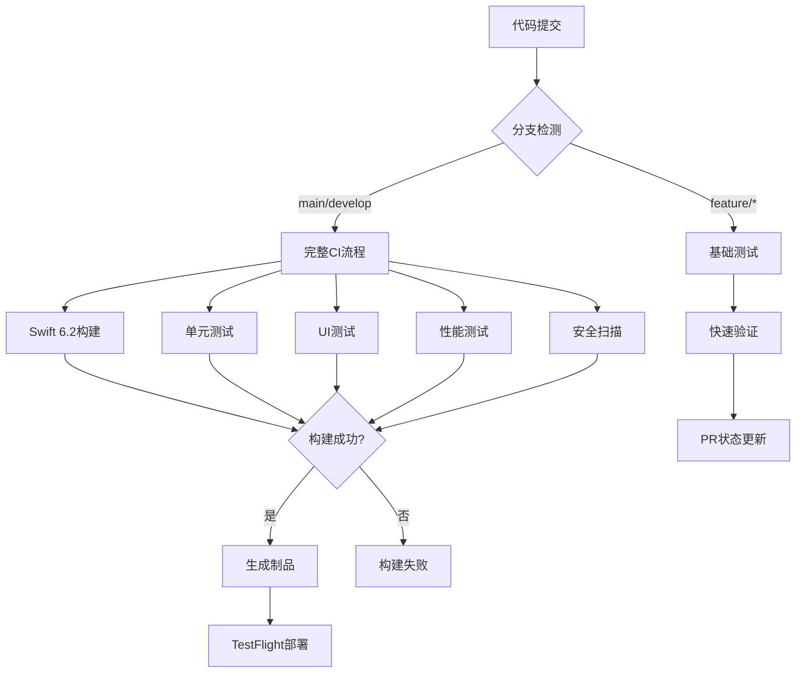

# CI/CD 自动化文档目录

## 文档概述

本目录包含NotBad App的完整CI/CD自动化配置和部署方案，支持Swift 6.2 + iOS 26技术栈，确保从代码提交到应用发布的全流程自动化。

## 文档清单

### ✅ 生效中的CI/CD文档

| 文档名称 | 覆盖范围 | 版本状态 | 最后更新 |
|----------|----------|----------|----------|
| **NotBad-CI-CD-Configuration-v6.0.md** | Swift 6.2 + iOS 26完整CI/CD配置 | v6.0 当前版本 | 2025-09-19 |
| **self-hosted-runner-complete-guide.md** | 自托管运行器完整指南（整合版） | v6.0 当前版本 | 2025-09-19 |
| **SELF_HOSTED_RUNNER_SUCCESS.md** | 运行器安装成功记录 | v6.0 已更新 | 2025-09-19 |

### 📚 文档说明

- **主配置文档**: `NotBad-CI-CD-Configuration-v6.0.md` 包含完整的GitHub Actions工作流配置
- **自托管指南**: `self-hosted-runner-complete-guide.md` 提供M4 Mac mini + 群晖NAS的完整部署方案
- **部署记录**: `SELF_HOSTED_RUNNER_SUCCESS.md` 记录实际部署成功案例和配置详情

## CI/CD架构概览



## 技术栈支持

### 核心构建环境

- **Swift**: 6.2 (Enhanced Actor Isolation)
- **Xcode**: 26.0
- **iOS SDK**: 26.0
- **macOS Runner**: 15.0+

### 关键特性

- Enhanced Actor并发安全测试
- Discovery社区功能集成测试
- COPPA/GDPR合规性自动验证
- 性能基准自动检查
- 多设备兼容性测试

## 部署策略

### GitHub Actions工作流

1. **主工作流** (`ios.yml`): 完整的构建、测试、发布流程
2. **Discovery测试** (`discovery-tests.yml`): 社区功能专项测试
3. **性能测试** (`performance.yml`): PRD v6.0性能目标验证
4. **安全扫描** (`security.yml`): 隐私合规和安全检查

### 自托管Runner优势

- **成本节省**: 年节省$5,160+构建费用
- **性能提升**: 本地SSD + M4处理器，构建速度提升3-5倍
- **缓存优化**: 持久化依赖缓存，重复构建时间减少60-80%
- **定制化**: 预装工具链，减少下载时间
- **控制权**: 完全控制构建环境和配置

## 质量门禁

### 自动化检查

- ✅ Swift 6.2代码编译通过
- ✅ 单元测试覆盖率 > 90%
- ✅ UI测试关键流程通过
- ✅ 性能测试达标 (启动<0.8s, 内存<150MB)
- ✅ 安全扫描无高危漏洞
- ✅ 隐私合规检查通过

### 发布流程

1. **PR验证**: 功能分支的基础测试
2. **集成测试**: develop分支的完整测试
3. **发布构建**: main分支的生产构建
4. **TestFlight**: 自动上传到TestFlight
5. **App Store**: 手动发布到App Store

## 使用指南

### 开发人员

**提交代码时**:

```bash

# 确保本地测试通过

swift test
swift build

# 提交到feature分支触发基础CI

git push origin feature/new-feature

# 创建PR到develop触发完整测试

gh pr create --base develop --title "New Feature"
```

**查看构建状态**:

- GitHub Actions标签页查看实时构建状态
- PR页面查看自动化检查结果
- 构建失败时查看详细日志定位问题

### 运维人员

**监控Runner状态**:

```bash

# 检查Runner状态

sudo launchctl list | grep actions.runner

# 查看Runner日志

tail -f /Users/runner/actions-runner/_diag/Runner_*.log

# 重启Runner服务

sudo launchctl unload ~/Library/LaunchAgents/actions.runner.*.plist
sudo launchctl load ~/Library/LaunchAgents/actions.runner.*.plist
```

**性能监控**:

- 定期检查构建时间趋势
- 监控Runner硬件资源使用
- 验证缓存命中率和效果

## 故障排除

### 常见问题

**Swift 6.2编译问题**:

- 确认Xcode 26已正确安装
- 验证Swift版本: `swift --version`
- 清理构建缓存: `xcodebuild clean`

**iOS 26模拟器问题**:

- 检查运行时: `xcrun simctl list runtimes`
- 安装运行时: `sudo xcrun simctl runtime install "iOS 26.0"`

**Runner连接问题**:

- 检查网络连接
- 验证GitHub Token权限
- 重新注册Runner

### 性能优化

**构建优化**:

- 启用并行构建: `-jobs 8`
- 使用增量构建: 避免clean
- 优化依赖缓存策略

**Runner优化**:

- 定期清理DerivedData
- 监控磁盘空间使用
- 升级硬件配置(内存/SSD)

## 相关文档

- [ADR-004 Swift 6.2架构升级决策](../adr/ADR-004%20Swift%206.2%20架构升级决策.md)

## 📚 快速链接

### 核心文档

- [🚀 完整CI/CD配置指南](./NotBad-CI-CD-Configuration-v6.0.md) - Swift 6.2 + iOS 26工作流配置
- [🖥️ 自托管运行器完整指南](./self-hosted-runner-complete-guide.md) - M4 Mac mini + 群晖NAS部署方案
- [✅ 部署成功案例](./SELF_HOSTED_RUNNER_SUCCESS.md) - 实际部署记录和配置详情

### 相关技术文档

- [PRD v6.0 性能要求](../prd/NotBad%20错题本%20App%20-%20产品需求文档%20(PRD)%20v6.0.md)
- [TDD v6.0 技术实现](../tdd/NotBad%20错题本%20App%20-%20技术设计文档%20(TDD)%20v6.0.md)
- [隐私合规清单](../compliance/privacy-and-compliance-checklist.md)

## 维护计划

### 定期维护

- **周度**: 检查构建性能和成功率
- **月度**: 更新依赖和工具链版本
- **季度**: 评估硬件需求和扩容计划

### 版本升级

- **Xcode更新**: 跟踪苹果发布周期，及时升级
- **iOS SDK**: 支持新版本iOS系统和设备
- **Runner版本**: 更新GitHub Actions Runner

---

**维护责任**: DevOps团队 + iOS工程团队
**更新频率**: 随技术栈变化及时更新
**最后维护**: 2025年9月19日 - CI/CD v6.0配置完成
