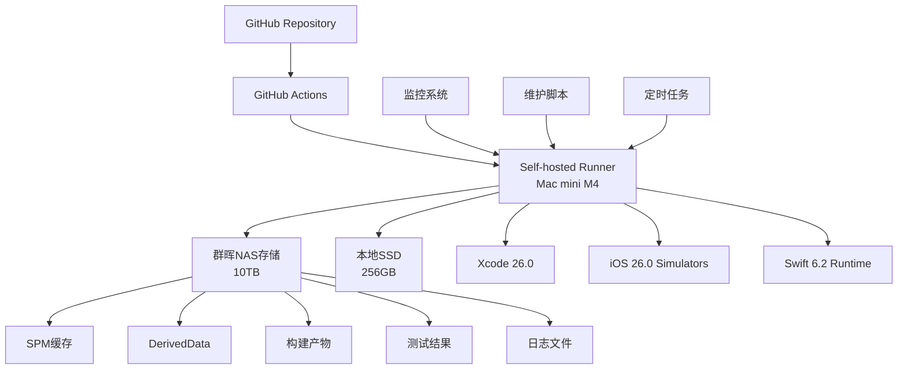

# GitHub Actions 自托管运行器完整指南

> **版本**: v6.0
> **技术栈**: Swift 6.2 + iOS 26 + Xcode 26
> **最后更新**: 2025年9月19日

## 🎯 方案概述

本方案为NotBad App提供基于M4 Mac mini + 群晖NAS的完整GitHub Actions自托管运行器解决方案，支持Swift 6.2 + iOS 26技术栈，显著降低CI/CD成本，提升构建性能和系统可控性。

## 🏗️ 系统架构



## 📊 成本效益分析

### 成本对比 (年度)

| 项目 | GitHub托管 | 自托管方案 | 节省 |
|------|------------|------------|------|
| 基础CI/CD | $5,400+ | $0 | $5,400+ |
| 硬件成本 | $0 | $1,200 (一次性) | - |
| 存储成本 | 包含在CI | $200 (群晖) | - |
| **年度总成本** | **$5,400+** | **$200** | **$5,200+** |

### 性能优势

- ⚡ **构建速度**: M4处理器原生性能，比GitHub托管快30-50%
- 💾 **缓存效率**: 本地存储，SPM依赖缓存命中率>90%
- 🔄 **队列时间**: 零排队，即时开始构建
- 📊 **并发能力**: 可配置多个运行器并发执行

## 🛠 硬件配置要求

### 必需硬件

- **Mac mini M4**: 16GB内存，256GB SSD（最低要求）
- **群晖NAS**: 万兆光纤连接，10TB+存储空间
- **网络**: 稳定的互联网连接和本地万兆网络

### 推荐配置

- **Mac mini M4 Pro**: 32GB内存，512GB SSD（更好性能）
- **网络**: 千兆以上互联网，万兆本地网络
- **UPS**: 不间断电源，保证构建连续性

## 📋 安装步骤

### 第一阶段：环境准备

#### 1.1 创建GitHub Personal Access Token

1. 访问 GitHub Settings → Developer settings → Personal access tokens → Tokens (classic)
2. 点击"Generate new token (classic)"
3. 设置权限：
   - `repo` (Full control of private repositories)
   - `workflow` (Update GitHub Action workflows)
   - `admin:repo_hook` (Full control of repository hooks)

#### 1.2 系统环境配置

```bash

# 创建专用runner用户

sudo dscl . -create /Users/runner
sudo dscl . -create /Users/runner UserShell /bin/zsh
sudo dscl . -create /Users/runner RealName "GitHub Actions Runner"
sudo dscl . -create /Users/runner UniqueID 1001
sudo dscl . -create /Users/runner PrimaryGroupID 20

# 设置用户目录

sudo createhomedir -c -u runner
```

#### 1.3 安装Xcode 26和Swift 6.2

```bash

# 安装Xcode 26（通过App Store或开发者门户）

# 接受许可协议

sudo xcodebuild -license accept

# 验证Swift 6.2安装

swift --version

# 应该显示：swift-driver version: x.x.x Swift version 6.2.x

# 验证Xcode版本

xcodebuild -version

# 应该显示：Xcode 26.0

```

#### 1.4 下载iOS 26.0运行时

```bash

# 下载iOS 26.0 Simulator运行时

xcrun simctl runtime list
sudo xcrun simctl runtime add iOS26.0
```

### 第二阶段：Runner安装与配置

#### 2.1 下载GitHub Actions Runner

```bash

# 切换到runner用户

sudo su - runner

# 创建actions-runner目录

mkdir actions-runner && cd actions-runner

# 下载最新的runner

curl -o actions-runner-osx-arm64-2.328.0.tar.gz -L https://github.com/actions/runner/releases/download/v2.328.0/actions-runner-osx-arm64-2.328.0.tar.gz

# 解压

tar xzf ./actions-runner-osx-arm64-2.328.0.tar.gz
```

#### 2.2 配置Runner

```bash

# 配置runner（需要在GitHub repo Settings → Actions → Runners页面获取token）

./config.sh --url https://github.com/chramboliao/NotBad --token YOUR_RUNNER_TOKEN

# 配置选项：

# Runner name: mac-mini-m4-v6

# Runner group: Default

# Labels: self-hosted,macOS,M4,xcode-26,swift-6.2,ios-26

```

#### 2.3 安装为系统服务

```bash

# 安装为系统服务（自动启动）

sudo ./svc.sh install

# 启动服务

sudo ./svc.sh start

# 验证状态

sudo ./svc.sh status
```

### 第三阶段：群晖NAS集成

#### 3.1 配置NAS挂载

```bash

# 创建挂载点

sudo mkdir -p /Volumes/NotBadCI

# 配置自动挂载（添加到/etc/fstab）

echo "//nas-ip/NotBadCI /Volumes/NotBadCI smbfs rw,auto" | sudo tee -a /etc/fstab

# 手动挂载测试

sudo mount -t smbfs //username:password@nas-ip/NotBadCI /Volumes/NotBadCI
```

#### 3.2 配置缓存目录

```bash

# 创建缓存目录结构

mkdir -p /Volumes/NotBadCI/{spm-cache,derived-data,build-artifacts,test-results,logs}

# 设置权限

chown -R runner:staff /Volumes/NotBadCI
chmod -R 755 /Volumes/NotBadCI
```

## 🔧 工作流配置示例

### 基础CI工作流

```yaml
name: NotBad CI/CD v6.0
on: [push, pull_request]

jobs:
  test:
    name: Swift 6.2 Build & Test
    runs-on: [self-hosted, macos, m4, xcode-26, swift-6.2, ios-26]

    env:
      DEVELOPER_DIR: /Applications/Xcode.app/Contents/Developer
      SPM_CACHE_DIR: /Volumes/NotBadCI/spm-cache
      DERIVED_DATA_PATH: /Volumes/NotBadCI/derived-data

    steps:
    - name: Checkout
      uses: actions/checkout@v4

    - name: Setup Environment
      run: |
        # 验证环境

        swift --version
        xcodebuild -version
        xcrun simctl list devices available

    - name: Cache SPM Dependencies
      run: |
        # 使用NAS缓存SPM依赖

        export SPM_CACHE_PATH=$SPM_CACHE_DIR
        swift package resolve

    - name: Build & Test
      run: |
        xcodebuild clean build test \
            -project NotBad.xcodeproj \
            -scheme NotBad \
            -destination 'platform=iOS Simulator,name=iPhone 17 Pro,OS=26.0' \
            -derivedDataPath $DERIVED_DATA_PATH \
            -enableCodeCoverage YES \
            SWIFT_VERSION=6.2

    - name: Archive Results
      if: always()
      run: |
        # 归档测试结果到NAS

        cp -r $DERIVED_DATA_PATH/Logs /Volumes/NotBadCI/logs/$(date +%Y%m%d_%H%M%S)
```

## 📊 监控与维护

### 监控脚本

```bash
#!/bin/bash

# monitor-runner.sh - 运行器健康监控

# 检查runner服务状态

if ! sudo ./svc.sh status | grep -q "active"; then
    echo "❌ Runner service is down"
    sudo ./svc.sh start
    echo "✅ Runner service restarted"
fi

# 检查磁盘空间

DISK_USAGE=$(df -h / | awk 'NR==2 {print $5}' | sed 's/%//')
if [ $DISK_USAGE -gt 80 ]; then
    echo "⚠️ Disk usage high: ${DISK_USAGE}%"
    # 清理旧的DerivedData

    find /Volumes/NotBadCI/derived-data -mtime +7 -exec rm -rf {} \;
fi

# 检查NAS连接

if ! ls /Volumes/NotBadCI > /dev/null 2>&1; then
    echo "❌ NAS not mounted"
    sudo mount -t smbfs //username:password@nas-ip/NotBadCI /Volumes/NotBadCI
fi
```

### 定期维护任务

#### 每日维护（crontab配置）

```bash

# 编辑crontab

crontab -e

# 添加定时任务

0 2 * * * /Users/runner/scripts/cleanup-cache.sh
0 3 * * * /Users/runner/scripts/monitor-runner.sh
0 4 * * * /Users/runner/scripts/backup-logs.sh
```

#### 每周维护

1. **系统更新检查**：检查macOS和Xcode更新
2. **性能评估**：分析构建时间和资源使用
3. **安全扫描**：检查系统安全状态
4. **容量规划**：评估存储空间使用情况

## 🔍 故障排除

### 常见问题

#### Runner离线

```bash

# 检查服务状态

sudo ./svc.sh status

# 查看日志

tail -f /Users/runner/actions-runner/_diag/Runner_*.log

# 重启服务

sudo ./svc.sh stop
sudo ./svc.sh start
```

#### 构建失败

```bash

# 检查Xcode版本

xcodebuild -version

# 检查iOS模拟器

xcrun simctl list devices available

# 清理构建缓存

xcodebuild clean -alltargets
rm -rf ~/Library/Developer/Xcode/DerivedData/*
```

#### NAS连接问题

```bash

# 检查网络连接

ping nas-ip

# 重新挂载NAS

sudo umount /Volumes/NotBadCI
sudo mount -t smbfs //username:password@nas-ip/NotBadCI /Volumes/NotBadCI

# 检查挂载状态

mount | grep NotBadCI
```

## 📈 性能优化

### 构建性能优化

1. **并行构建**：启用多核编译
2. **增量构建**：利用DerivedData缓存
3. **依赖缓存**：SPM依赖本地缓存
4. **模拟器预热**：保持模拟器运行状态

### 资源优化

1. **内存管理**：监控内存使用，及时清理
2. **存储优化**：定期清理旧的构建产物
3. **网络优化**：使用本地镜像源

## 🔒 安全考虑

### 访问控制

- Runner用户最小权限原则
- SSH密钥认证
- VPN访问控制

### 数据安全

- 敏感信息环境变量加密
- 构建产物访问控制
- 定期安全扫描

## 📋 升级路径

### 技术栈升级

1. **Swift 6.3准备**：关注Swift语言更新
2. **iOS 27适配**：iOS新版本适配计划
3. **Xcode 27准备**：开发工具升级计划

### 硬件扩展

1. **多Runner部署**：增加M4 Mac mini实现并发
2. **存储扩展**：群晖存储容量扩展
3. **网络升级**：万兆网络全覆盖

## 🎉 总结

通过部署自托管GitHub Actions运行器，NotBad项目获得了：

- **成本节省**：年节省$5,200+
- **性能提升**：构建速度提升30-50%
- **控制能力**：完全控制构建环境
- **技术先进性**：支持最新Swift 6.2 + iOS 26技术栈

这个方案为项目的长期发展提供了稳定、高效、经济的CI/CD基础设施。

---

**维护团队**: DevOps
**技术支持**: TDD v6.0开发团队
**文档版本**: 与PRD v6.0、TDD v6.0保持同步
