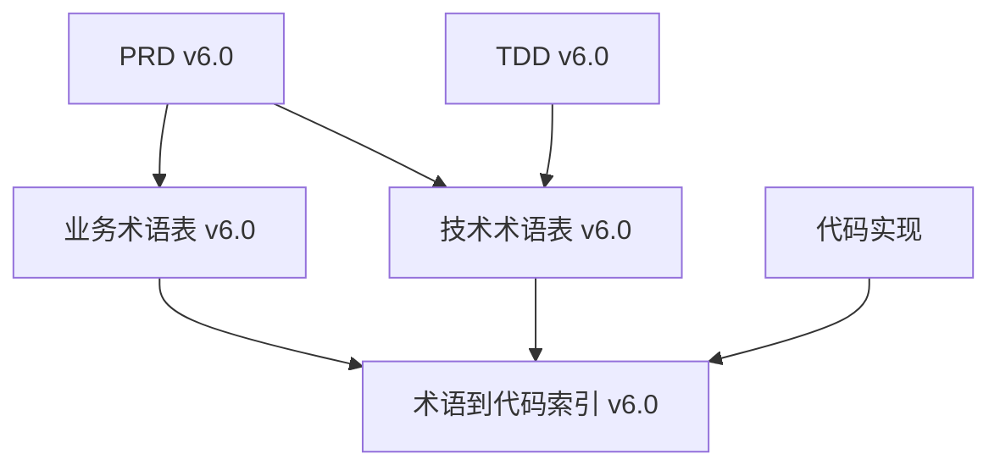

# 术语表目录 (Glossary Directory)

## 文档概述

本目录包含NotBad App v6.0版本的完整术语体系，基于Swift 6.2 + iOS 26技术栈，确保从产品设计到技术实现的术语一致性。

## 术语体系架构

## 文档清单

### ✅ 生效中的术语文档 (v6.0)

| 文档名称 | 文件路径 | 覆盖范围 | 最后更新 |
|----------|----------|----------|----------|
| **业务术语表** | `NotBad App - 业务术语表 v6.0.md` | 产品功能、用户角色、商业模式、Discovery社区 | 2025-09-19 |
| **技术术语表** | `NotBad App - 技术术语表 v6.0.md` | Swift 6.2架构、iOS 26特性、安全隐私、性能优化 | 2025-09-19 |
| **术语到代码索引** | `NotBad App - 术语到代码索引 v6.0.md` | 术语→代码映射、文件路径、开发指南 | 2025-09-19 |

## 使用指南

### 开发人员

1. **新功能开发前**: 先查阅业务术语表理解需求概念
2. **技术实现时**: 参考技术术语表选择合适的架构模式
3. **编码阶段**: 使用术语到代码索引确保命名一致性
4. **代码评审**: 确保代码符号与术语表保持一致

### 产品团队

1. **需求分析**: 使用业务术语表确保概念准确性
2. **功能设计**: 参考Discovery社区、隐私保护等专业术语
3. **沟通协作**: 使用标准术语与技术团队对接

### 测试团队

1. **测试用例编写**: 使用标准术语描述功能点
2. **缺陷报告**: 使用技术术语准确描述问题
3. **验收标准**: 基于术语表建立验收准则

## 术语管理流程

### 新增术语流程

1. **需求发起**: 识别新概念或功能需要标准术语
2. **术语设计**: 设计中英文对照的标准术语
3. **跨文档验证**: 确保新术语在PRD/TDD中的一致性
4. **代码映射**: 在代码索引中建立术语→代码映射
5. **团队同步**: 通过文档更新通知全团队

### 术语修改流程

1. **变更评估**: 评估术语修改的影响范围
2. **版本控制**: 保持术语表版本与主要文档版本一致
3. **批量更新**: 同步更新所有相关文档和代码注释
4. **团队培训**: 确保团队理解术语变更

## 版本历史

| 版本 | 发布日期 | 主要变更 | 状态 |
|------|----------|----------|------|
| **v6.0** | **2025-09-19** | **Swift 6.2 + iOS 26完整术语体系重建** | ✅ **当前版本** |
| v1.1 | 2025-09-04 | PRD v4.0配套术语更新 | 🗑️ 已清理 |
| v1.0 | 2025-08-15 | 基础术语体系建立 | 🗑️ 已清理 |

## 相关文档链接

- [PRD v6.0](../prd/NotBad%20错题本%20App%20-%20产品需求文档%20(PRD)%20v6.0.md)
- [TDD v6.0](../tdd/NotBad%20错题本%20App%20-%20技术设计文档%20(TDD)%20v6.0.md)
- [RTM v6.0](../rtm/NotBad%20App%20-%20需求追踪矩阵%20(RTM)%20v6.0.md)
- [文档目录](../README.md)

## 反馈与维护

如发现术语不一致或缺失，请通过以下方式反馈：

1. **新增术语需求**: 在对应功能的需求文档中标注
2. **术语修正**: 提交包含具体修正建议的反馈
3. **映射更新**: 代码结构变更时及时更新代码索引

---

**维护责任**: 产品负责人 + 技术负责人共同维护
**更新频率**: 随主要版本发布同步更新
**最后维护**: 2025年9月19日 - 术语体系v6.0完整建立
