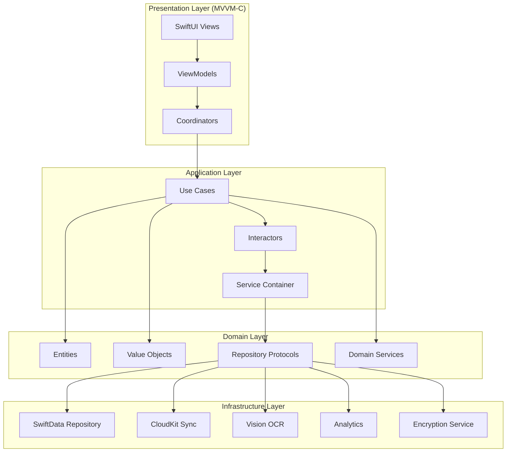
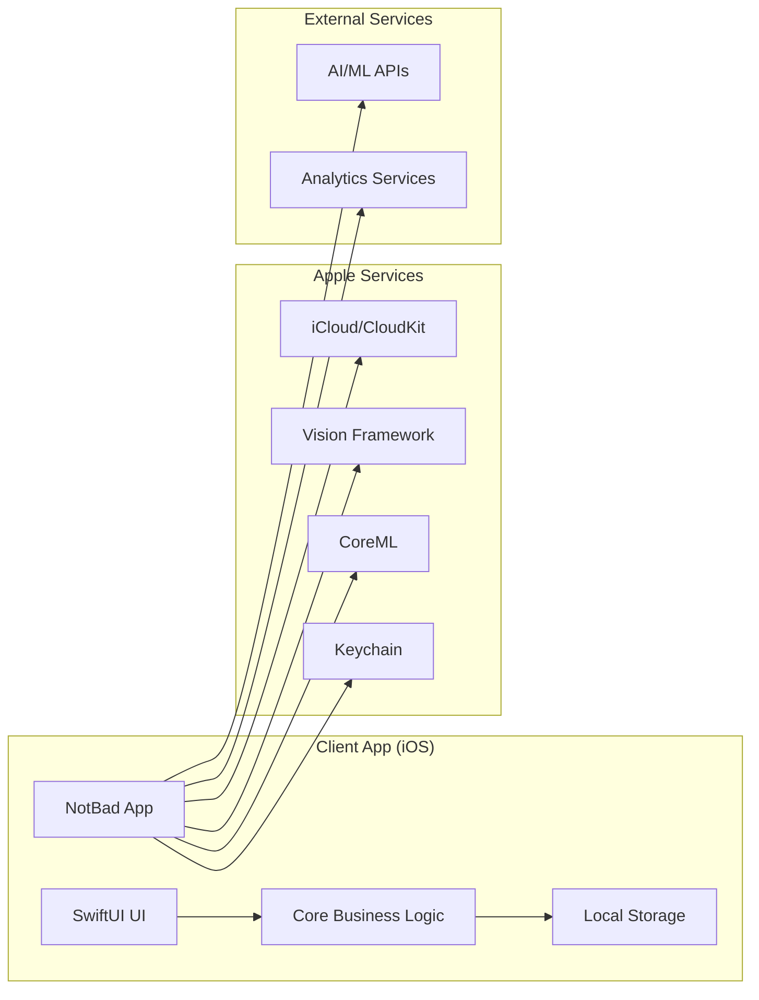
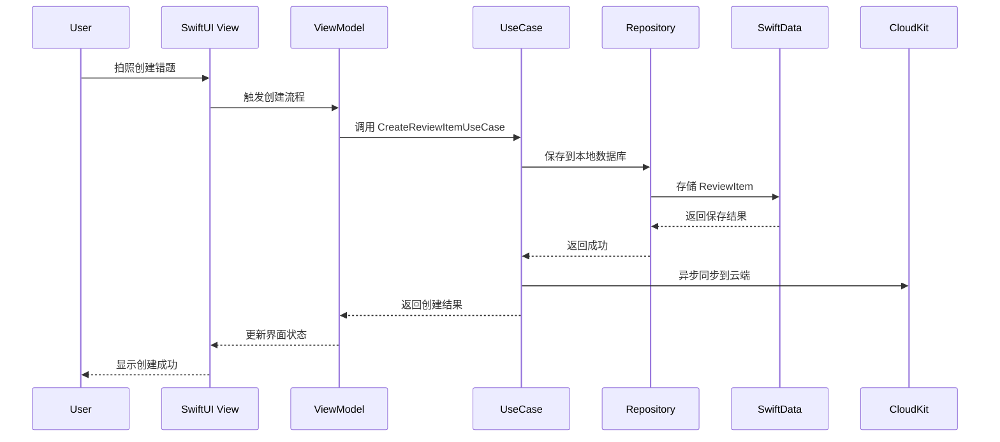
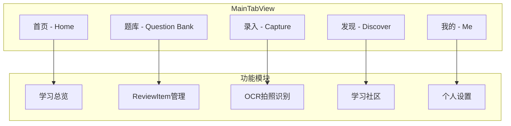
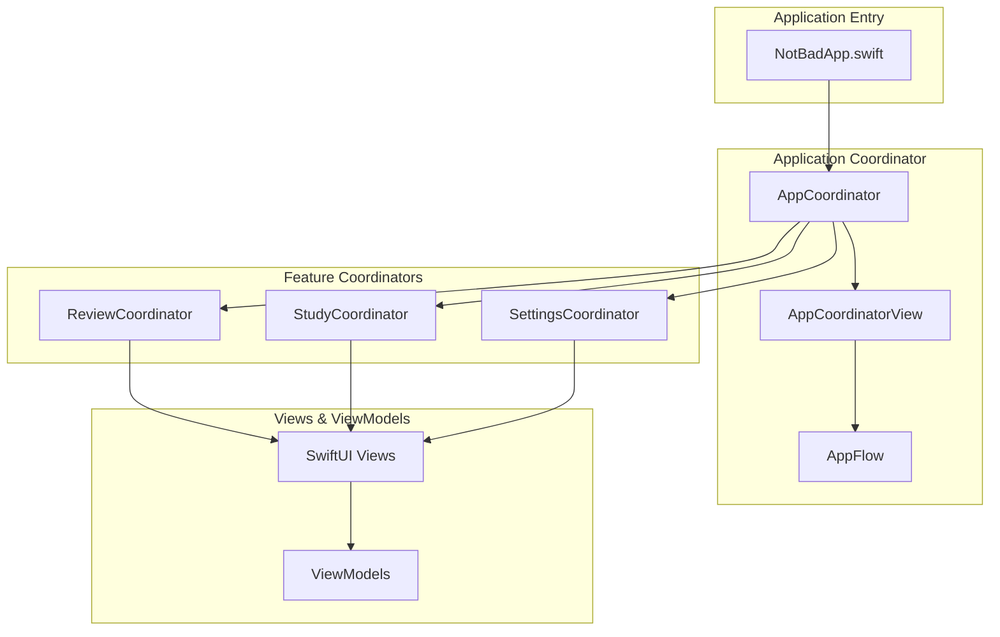
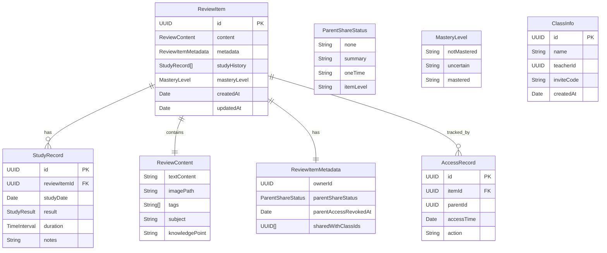
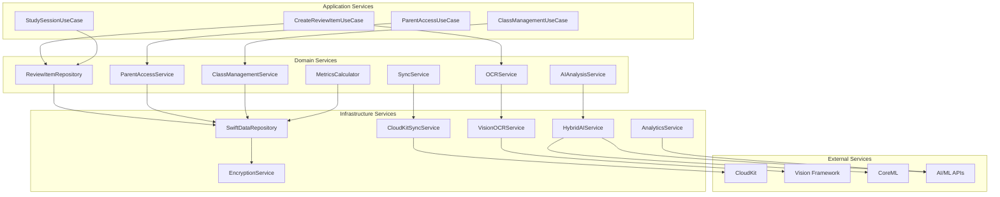
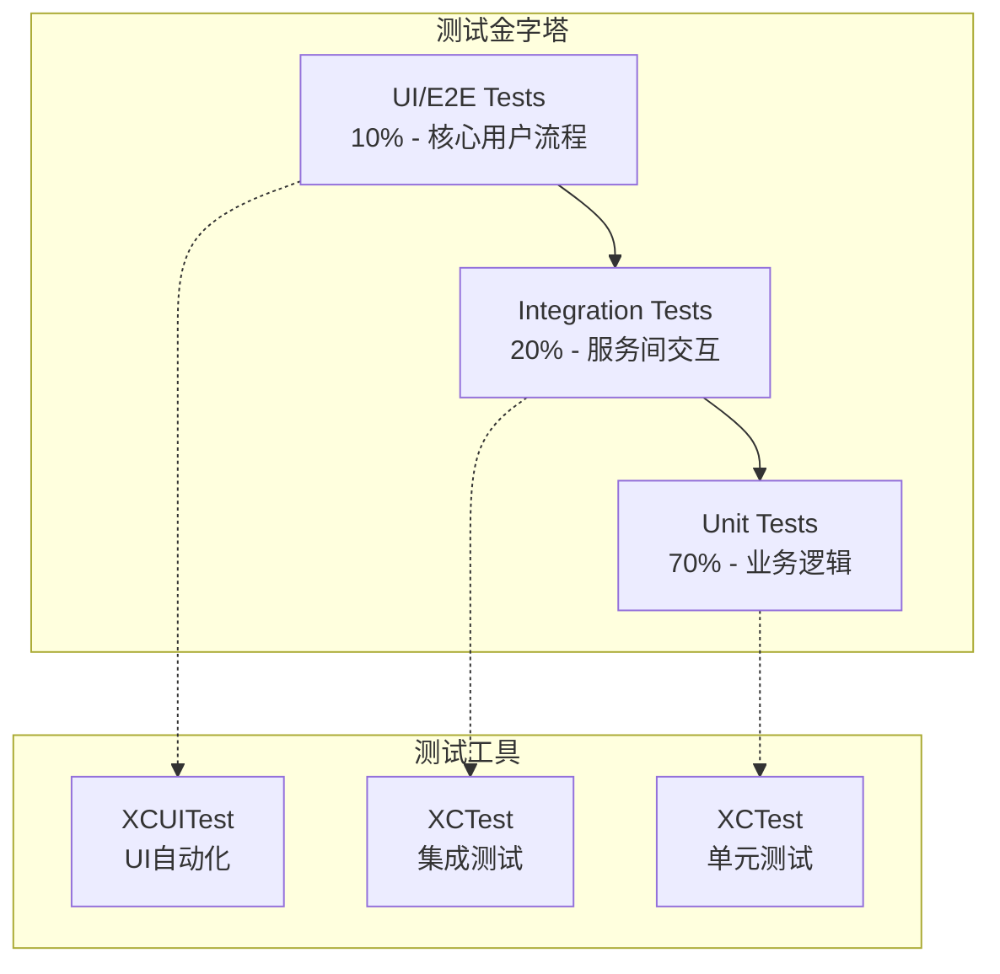
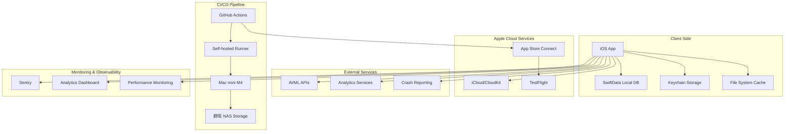

# **NotBad 错题本 App \- 技术设计文档 (TDD) v4.2 (Swift6 + iOS18)**

**文档定位：技术实现单一事实来源 (Single Source of Truth for Implementation)**

本文档基于 [**PRD v4.2**](../prd/NotBad%20错题本%20App%20-%20产品需求文档%20(PRD)%20v4.2%20(Swift6%20+%20iOS18).md) 的产品需求，为NotBad App的技术实现提供了唯一的、权威的、详尽的蓝图。它是开发、测试及运维团队的**核心行动纲领**，定义了应用的架构设计、模块职责、接口契約、数据结构和非功能性实现方案。

## 速查：相关文档（快速跳转）

- 文档索引: [docs/README.md](../README.md)
- PRD: [docs/prd/NotBad 错题本 App - 产品需求文档 (PRD) v4.2 (Swift6 + iOS18).md](../prd/NotBad%20错题本%20App%20-%20产品需求文档%20(PRD)%20v4.2%20(Swift6%20+%20iOS18).md)
- RTM: [docs/rtm/NotBad App - 需求追踪矩阵 (RTM) v4.2 (Swift6 + iOS18).md](../rtm/NotBad%20App%20-%20需求追踪矩阵%20(RTM)%20v4.2%20(Swift6%20+%20iOS18).md)
- 业务术语表: [docs/glossary/NotBad App - 业务术语表 v4.2 (Swift6 + iOS18).md](../glossary/NotBad%20App%20-%20业务术语表%20v4.2%20(Swift6%20+%20iOS18).md)
- 技术术语表: [docs/glossary/NotBad App - 技术术语表 v4.2 (Swift6 + iOS18).md](../glossary/NotBad%20App%20-%20技术术语表%20v4.2%20(Swift6%20+%20iOS18).md)
- 术语→代码索引: [docs/glossary/NotBad App - 术语到代码索引 v4.2 (Swift6 + iOS18).md](../glossary/NotBad%20App%20-%20术语到代码索引%20v4.2%20(Swift6%20+%20iOS18).md)
- ADR 索引: [docs/adr/README.md](../adr/README.md)

| 版本 | 日期 | 作者 | 变更说明 | 状态 |
| :---- | :---- | :---- | :---- | :---- |
| v3.1 | 2025-09-02 | Tech Team | 基于初步评审意见进行优化 | 已归档 |
| v4.0 | 2025-09-03 | Tech Team | 综合全部评审意见，扩展所有章节，升级为技术实现"单一事实来源"版本 | 已归档 |
| v4.1 | 2025-09-13 | Tech Team | 基于Swift 6 + iOS 18现代化，全面更新并发模型和架构设计 | 已归档 |
| **v4.2** | **2025-09-13** | **Tech Team** | **新增导航协调器模式架构设计，更新ADR索引和实现细节** | ✅ **生效中** |

## **1\. 技术概述 (Technical Overview)**

### **1.1 技术目标 (Technical Goals)**

构建一个基于Swift 6 + iOS 18的现代化、高性能、高可靠、可扩展且易于维护的iOS原生应用，严格承接PRD v4.2中定义的所有功能性及非功能性需求，确保：

* **性能卓越**: 满足Swift 6优化后的性能指标（启动<1.5s, 核心响应<1s, 列表滚动>60fps）。  
* **并发安全**: 100%编译时保证并发安全，运行时零开销，利用Swift 6 Actor模型。  
* **数据安全**: 实现端到端加密，完全符合COPPA和GDPR隐私合规要求。  
* **极致可靠**: 核心功能100%离线可用，崩溃率低于0.1%。  
* **架构现代化**: 通过Clean Architecture + Swift 6并发模型实现高度的可测试性和可维护性。

### **1.3 与 PRD v4.2 的技术影响 (PRD sync notes)**

以下为最近 PRD v4.2 更新中涉及到的要点及对本技术设计的直接影响：

- 订阅定价调整（月 ¥10 / 年 ¥99 / 永久 ¥688）本身为产品/商业层面的变更，对客户端实现影响有限，但会影响我们对“Pro”特性的优先级与云端资源分配策略。
- PRD 明确将“基础 iCloud 同步”对所有用户免费开放——因此本版本的同步实现以 **CloudKit/ iCloud 为基础方案**（无额外自建后端成本），并在 TDD 中保留对“高级同步”（多平台、历史版本、实时协同）需要自建后端的说明与扩展接口。 
  - 注意：CloudKit 在私有/公共容器上都有存储与请求配额限制（例如每用户存储、每秒写入/读取速率等），TDD 需明确对应的监控与降级措施。
    - 建议在 SyncService 中增加配额监控点（dailyStorageBytes、apiCallsPerMinute），并在接近阈值时优雅降级（如压缩/去重、限制上云、提示用户）。
    - 若教师/班级或历史版本需求导致配额压力，需评估自建后端或 BaaS 替代方案，并在 ADR-002 中明确成本/运维责任分界。
- PRD 中关于 AI 与家长协同的增加，意味着 **云端 AI 调用（例如 Gemini 或第三方模型）应当视为增值能力**：若决定将部分 AI 能力作为 Pro 权益，需要在后端或第三方API上实现配额/鉴权与计费，并在本地实现健壮的脱网降级策略（CoreML）。
- PRD 明确了 MVP 的 Must Have 功能集，TDD 将这些功能列为实现与测试优先级（见第6章测试策略）。

技术团队需与产品/运营沟通：确认哪些 Pro-only 的AI/分析能力将调用云端服务、预估调用量与成本，以便在CI/CD 和成本模型中反映这些依赖。

### **1.2 架构决策记录 (ADR)**

本项目的关键技术决策均通过**架构决策记录 (ADR)** 进行系统性存档。ADR旨在理解决策背景、评估备选方案并追踪决策后果。

* [**ADR-005: 导航协调器模式**](../adr/ADR-005-导航协调器模式.md)  
* [**ADR-006: 底部Tab导航架构设计**](../adr/ADR-006-底部Tab导航架构设计.md)

## **2\. 系统架构设计 (System Architecture)**

### **2.1 架构原则 (Architecture Principles)**

* **Clean Architecture**: 严格分层，依赖倒置。领域层是核心，不依赖任何外部实现。  
* **接口驱动设计 (Protocol-Oriented)**: 模块间通过协议（Protocol）通信，而非具体实现，实现高度解耦。  
* **本地优先 (Local-First)**: 用户数据首先在设备本地进行处理和存储，网络仅用于同步，确保离线可用性和响应速度。  
* **SOLID原则**: 遵循单一职责、开闭、里氏替换、接口隔离和依赖倒置原则。

### **2.2 分层架构图 (Layered Architecture)**



### **2.3 系统组件图 (System Components)**



### **2.4 数据流图 (Data Flow)**



### **2.5 导航架构设计 (Navigation Architecture)**

#### **2.5.1 底部Tab导航架构**

基于 [**ADR-006: 底部Tab导航架构设计**](../adr/ADR-006-底部Tab导航架构设计.md) 的决策，应用采用5个Tab的底部导航架构：



**Tab功能定位**：
- **首页**: 学习总览、进度概览、快速入口
- **题库**: ReviewItem管理、分类筛选、复习跟踪
- **录入**: OCR拍照识别、批量导入、智能分类
- **发现**: 轻度社交、学习资源、AI助手
- **我的**: 个人设置、账户管理、Pro订阅

#### **2.5.2 导航协调器架构 (Navigation Coordinator Architecture)**

基于 [**ADR-005: 导航协调器模式**](../adr/ADR-005-导航协调器模式.md) 的架构决策，我们采用协调器模式来管理应用的导航流程和依赖注入，实现高度解耦和可测试的架构。

#### **2.5.1 协调器层次结构**



#### **2.5.2 核心组件职责**

| 组件 | 职责 | 关键特性 |
|------|------|----------|
| **AppCoordinator** | 应用级导航管理和依赖注入容器 | `@MainActor`, `ObservableObject`, 管理应用生命周期 |
| **AppCoordinatorView** | 根据协调器状态展示相应界面 | SwiftUI视图，响应状态变化 |
| **AppFlow** | 定义应用的主要流程和状态 | 枚举类型，支持动画过渡 |
| **FeatureCoordinator** | 特定功能区域的导航管理 | 可嵌套，独立测试 |

#### **2.5.3 实现示例**

```swift
// 应用流程定义
enum AppFlow {
    case splash      // 启动画面
    case main        // 主界面  
    case onboarding  // 引导流程
    case settings    // 设置界面
}

// 应用协调器
@MainActor
class AppCoordinator: ObservableObject {
    @Published var isLoading = true
    @Published var currentFlow: AppFlow = .splash
    
    // 依赖注入容器
    private let reviewRepository: ReviewItemRepository
    private let syncService: CloudSyncService
    private let ocrService: OCRService
    
    init() {
        // 依赖注入和服务初始化
        self.reviewRepository = SwiftDataReviewRepository()
        self.syncService = CloudKitSyncService()
        self.ocrService = VisionOCRService()
        setupApplication()
    }
    
    func navigateToFlow(_ flow: AppFlow) {
        withAnimation(.easeInOut) {
            currentFlow = flow
        }
    }
}

// 协调器视图
struct AppCoordinatorView: View {
    @ObservedObject var coordinator: AppCoordinator
    
    var body: some View {
        Group {
            if coordinator.isLoading {
                SplashView()
            } else {
                switch coordinator.currentFlow {
                case .main:
                    MainTabView()
                case .onboarding:
                    OnboardingView()
                case .settings:
                    SettingsView()
                }
            }
        }
        .animation(.easeInOut, value: coordinator.currentFlow)
    }
}
```

#### **2.5.4 与Clean Architecture的集成**

协调器模式完美支持Clean Architecture的分层设计：

- **表现层 (Presentation)**: 协调器和SwiftUI视图
- **应用层 (Application)**: 协调器调用用例和交互器  
- **领域层 (Domain)**: 纯业务逻辑，不依赖具体实现
- **基础设施层 (Infrastructure)**: 具体实现通过协调器注入

这种架构确保了：
- **依赖倒置**: 高层模块不依赖低层模块
- **单一职责**: 每个组件职责明确
- **开闭原则**: 对扩展开放，对修改关闭
- **可测试性**: 所有依赖都可以在测试时替换

## **3\. 数据设计 (Data Design)**

### **3.1 核心数据模型 (Core Data Models)**

领域层的核心实体定义如下，它们是纯粹的Swift结构体，不包含任何持久化逻辑。

#### **3.1.1 数据模型图 (Data Model Diagram)**



#### **3.1.2 核心实体定义**

```swift
// Domain/Entities/ReviewItem.swift  
struct ReviewItem {  
    let id: UUID  
    var content: ReviewContent  
    var metadata: ReviewItemMetadata  
    var studyHistory: [StudyRecord]  
    var masteryLevel: MasteryLevel  
    let createdAt: Date
    var updatedAt: Date
}  

// 建议扩展字段以支持家长/教师/授权场景
struct ReviewItemMetadata {
  var ownerId: UUID
  var parentShareStatus: ParentShareStatus // .none / .summary / .oneTime / .itemLevel
  var parentAccessRevokedAt: Date? // 最近一次撤销时间
  var sharedWithClassIds: [UUID]
}

enum ParentShareStatus {
  case none
  case summary
  case oneTime
  case itemLevel
}

// 指标计算器接口（L1/L2/L3）
protocol MetricsCalculator {
  func calculateMARU(for period: DateRange) async throws -> Int // L1
  func calculateMRU(for period: DateRange) async throws -> Int  // L2
  func calculateMMU(for period: DateRange) async throws -> Int  // L3
}
```

### **3.2 数据持久化 (Data Persistence)**

* **本地存储**: 采用**SwiftData**实现本地持久化。具体实现封装在Infrastructure层，遵循Domain层定义的ReviewItemRepository协议。  
* **数据加密**: 所有存储在SwiftData中的用户内容字段，在写入前必须通过EncryptionService进行AES-256加密。图片等二进制文件在保存到文件系统前也需加密。

### **3.3 数据迁移与回滚 (Data Migration & Rollback)**

* **迁移策略**:  
  1. **版本控制**: 使用SchemaMigrationPlan管理SwiftData模型版本。  
  2. **轻量级迁移**: 优先使用自动迁移。  
  3. **重量级迁移**: 复杂的数据模型变更（如字段拆分、合并），需编写自定义迁移逻辑，并进行充分测试。  
* **回滚方案**:  
  1. **强制备份**: 在执行任何重量级迁移前，App必须自动为用户的本地数据库创建一个加密备份。  
  2. **失败处理**: 若迁移过程失败，App应能引导用户从备份中恢复数据，并将失败日志上传至监控系统。  
  3. **版本兼容**: 新版本App必须能兼容至少前两个主版本的数据库模型。

## **4\. 接口契约规范 (API Contracts)**

所有模块间及与外部服务的交互，均需遵循以下接口契约。

### **4.0 服务架构图 (Service Architecture)**



### **4.1 内部服务接口 (Internal Service Contracts)**

#### **4.1.1 OCR服务接口**

* **协议**: OCRService  
* **实现**: VisionOCRService (位于Infrastructure层)  
* **性能约束**: P95（95%的请求）响应时间 \< 2秒。  

**完整接口定义**:
```swift
protocol OCRService {
    /// 识别图像中的文字内容
    /// - Parameter image: 输入图像数据
    /// - Returns: OCR识别结果
    /// - Throws: OCRError 当识别失败时
    func recognizeText(from image: Data) async throws -> OCRResult
    
    /// 重新识别图像（支持多种算法）
    /// - Parameter image: 输入图像数据
    /// - Parameter algorithm: 指定识别算法
    /// - Returns: OCR识别结果
    /// - Throws: OCRError 当识别失败时
    func reprocessImage(_ image: Data, using algorithm: OCRAlgorithm) async throws -> OCRResult
    
    /// 获取支持的识别算法列表
    /// - Returns: 可用的算法列表
    func getAvailableAlgorithms() async -> [OCRAlgorithm]
}

// 数据结构定义
struct OCRResult {
    let text: String
    let confidence: Double
    let boundingBoxes: [BoundingBox]
    let processingTime: TimeInterval
    let algorithm: OCRAlgorithm
}

struct BoundingBox {
    let text: String
    let confidence: Double
    let rect: CGRect
}

enum OCRAlgorithm: String, CaseIterable {
    case vision = "apple_vision"
    case tesseract = "tesseract"
    case cloud = "cloud_ocr"
}

// 错误定义
enum OCRError: LocalizedError {
    case invalidImage
    case lowConfidence(confidence: Double)
    case unsupportedFormat
    case processingTimeout
    case algorithmNotAvailable(OCRAlgorithm)
    case quotaExceeded
    case networkError(Error)
    
    var errorDescription: String? {
        switch self {
        case .invalidImage:
            return "图像格式无效或损坏"
        case .lowConfidence(let confidence):
            return "识别置信度过低: \(String(format: "%.1f", confidence * 100))%"
        case .unsupportedFormat:
            return "不支持的图像格式"
        case .processingTimeout:
            return "图像处理超时"
        case .algorithmNotAvailable(let algorithm):
            return "算法不可用: \(algorithm.rawValue)"
        case .quotaExceeded:
            return "OCR使用次数已达上限"
        case .networkError(let error):
            return "网络错误: \(error.localizedDescription)"
        }
    }
}
```

#### **4.1.2 AI分析服务接口**

* **协议**: AIAnalysisService  
* **实现**: HybridAIService (根据用户类型和网络状态，动态选择本地CoreML或云端Gemini)  
* **业务规则**:  
  * Pro用户优先使用云端API，有每日调用配额。  
  * 云端服务失败或免费用户，自动降级至本地模型。  
* **性能约束**: P95响应时间 \< 1秒 (本地), \< 5秒 (云端)。

**完整接口定义**:
```swift
protocol AIAnalysisService {
    /// 分析题目内容并推荐知识点标签
    /// - Parameter content: 题目内容
    /// - Returns: 分析结果
    /// - Throws: AIAnalysisError 当分析失败时
    func analyzeContent(_ content: String) async throws -> ContentAnalysisResult
    
    /// 诊断学习薄弱点
    /// - Parameter studyHistory: 学习历史记录
    /// - Returns: 薄弱点诊断结果
    /// - Throws: AIAnalysisError 当分析失败时
    func diagnoseWeakPoints(from studyHistory: [StudyRecord]) async throws -> WeakPointDiagnosis
    
    /// 生成个性化学习建议
    /// - Parameter profile: 用户学习档案
    /// - Returns: 学习建议
    /// - Throws: AIAnalysisError 当分析失败时
    func generateLearningSuggestions(for profile: UserLearningProfile) async throws -> LearningSuggestions
    
    /// 检查服务可用性
    /// - Returns: 服务状态
    func checkServiceAvailability() async -> ServiceAvailability
}

// 数据结构定义
struct ContentAnalysisResult {
    let subject: String
    let knowledgePoints: [String]
    let difficulty: DifficultyLevel
    let confidence: Double
    let processingTime: TimeInterval
    let model: AIModel
}

struct WeakPointDiagnosis {
    let weakPoints: [WeakPoint]
    let recommendations: [String]
    let overallScore: Double
    let analysisDate: Date
}

struct WeakPoint {
    let knowledgePoint: String
    let weaknessLevel: Double
    let affectedItems: [UUID]
    let suggestions: [String]
}

struct LearningSuggestions {
    let priority: [String]
    let studyPlan: [StudyPlanItem]
    let estimatedTime: TimeInterval
    let difficulty: DifficultyLevel
}

struct StudyPlanItem {
    let knowledgePoint: String
    let estimatedDuration: TimeInterval
    let priority: Int
    let resources: [String]
}

enum DifficultyLevel: String, CaseIterable {
    case easy = "easy"
    case medium = "medium"
    case hard = "hard"
}

enum AIModel: String {
    case coreML = "coreml_local"
    case gemini = "gemini_cloud"
    case hybrid = "hybrid"
}

struct ServiceAvailability {
    let isAvailable: Bool
    let model: AIModel
    let quotaRemaining: Int?
    let estimatedResponseTime: TimeInterval
}

// 错误定义
enum AIAnalysisError: LocalizedError {
    case quotaExceeded
    case modelNotAvailable(AIModel)
    case networkError(Error)
    case processingTimeout
    case invalidInput(String)
    case analysisFailed(String)
    case serviceUnavailable
    
    var errorDescription: String? {
        switch self {
        case .quotaExceeded:
            return "AI分析使用次数已达上限，请升级Pro版本"
        case .modelNotAvailable(let model):
            return "AI模型不可用: \(model.rawValue)"
        case .networkError(let error):
            return "网络错误: \(error.localizedDescription)"
        case .processingTimeout:
            return "AI分析处理超时"
        case .invalidInput(let reason):
            return "输入数据无效: \(reason)"
        case .analysisFailed(let reason):
            return "分析失败: \(reason)"
        case .serviceUnavailable:
            return "AI分析服务暂时不可用"
        }
    }
}
```

#### **4.1.3 教师/班级服务接口 (Teacher / Class Service)**

* **协议**: ClassManagementService
* **职责**: 支持教师创建班级、邀请学生/家长加入、布置作业、回收统计与匿名聚合视图。

**完整接口定义**:
```swift
protocol ClassManagementService {
    /// 创建新班级
    /// - Parameters:
    ///   - name: 班级名称
    ///   - teacherId: 教师ID
    ///   - description: 班级描述（可选）
    /// - Returns: 班级ID
    /// - Throws: ClassManagementError 当创建失败时
    func createClass(name: String, teacherId: UUID, description: String?) async throws -> UUID
    
    /// 生成班级邀请码
    /// - Parameter classId: 班级ID
    /// - Returns: 邀请码
    /// - Throws: ClassManagementError 当生成失败时
    func generateInviteCode(classId: UUID) async throws -> String
    
    /// 验证并加入班级
    /// - Parameters:
    ///   - inviteCode: 邀请码
    ///   - studentId: 学生ID
    /// - Returns: 班级信息
    /// - Throws: ClassManagementError 当加入失败时
    func joinClass(inviteCode: String, studentId: UUID) async throws -> ClassInfo
    
    /// 布置作业
    /// - Parameters:
    ///   - classId: 班级ID
    ///   - items: 题目ID列表
    ///   - dueDate: 截止日期
    ///   - title: 作业标题
    ///   - description: 作业描述（可选）
    /// - Returns: 作业ID
    /// - Throws: ClassManagementError 当布置失败时
    func assignHomework(classId: UUID, items: [UUID], dueDate: Date, title: String, description: String?) async throws -> UUID
    
    /// 获取班级匿名统计
    /// - Parameter classId: 班级ID
    /// - Returns: 匿名统计数据
    /// - Throws: ClassManagementError 当获取失败时
    func getAnonymizedStats(classId: UUID) async throws -> ClassStats
    
    /// 获取作业完成情况
    /// - Parameter assignmentId: 作业ID
    /// - Returns: 完成情况统计
    /// - Throws: ClassManagementError 当获取失败时
    func getAssignmentProgress(assignmentId: UUID) async throws -> AssignmentProgress
    
    /// 删除班级
    /// - Parameter classId: 班级ID
    /// - Throws: ClassManagementError 当删除失败时
    func deleteClass(classId: UUID) async throws
}

// 数据结构定义
struct ClassInfo {
    let id: UUID
    let name: String
    let description: String?
    let teacherId: UUID
    let createdAt: Date
    let studentCount: Int
    let isActive: Bool
}

struct ClassStats {
    let classId: UUID
    let totalStudents: Int
    let activeStudents: Int
    let subjectDistribution: [String: Int]
    let difficultyDistribution: [DifficultyLevel: Int]
    let averageMasteryRate: Double
    let weakPoints: [String]
    let lastUpdated: Date
}

struct AssignmentProgress {
    let assignmentId: UUID
    let title: String
    let totalItems: Int
    let completedItems: Int
    let completionRate: Double
    let averageScore: Double
    let difficultyBreakdown: [DifficultyLevel: Int]
    let commonMistakes: [String]
    let dueDate: Date
    let isOverdue: Bool
}

// 错误定义
enum ClassManagementError: LocalizedError {
    case classNotFound
    case invalidInviteCode
    case classFull
    case alreadyJoined
    case permissionDenied
    case networkError(Error)
    case quotaExceeded
    case invalidAssignment
    case assignmentNotFound
    case studentNotFound
    case teacherNotFound
    
    var errorDescription: String? {
        switch self {
        case .classNotFound:
            return "班级不存在"
        case .invalidInviteCode:
            return "邀请码无效或已过期"
        case .classFull:
            return "班级人数已满"
        case .alreadyJoined:
            return "您已经加入该班级"
        case .permissionDenied:
            return "权限不足"
        case .networkError(let error):
            return "网络错误: \(error.localizedDescription)"
        case .quotaExceeded:
            return "班级功能使用次数已达上限"
        case .invalidAssignment:
            return "作业配置无效"
        case .assignmentNotFound:
            return "作业不存在"
        case .studentNotFound:
            return "学生不存在"
        case .teacherNotFound:
            return "教师不存在"
        }
    }
}
```

* **实现说明**: 该服务在 CloudKit-only 场景下可实现基本的匿名统计（聚合数）但难以支持复杂的作业管理与权限回溯；建议把教师相关的持久化设计为可替换的 Repository（CloudKitRepository 或 ServerRepository），并在 ADR 明确支持边界。

#### **4.1.4 家长授权服务 (Parent Access Service)**

* **协议**: ParentAccessService
* **职责**: 管理家长的查看申请、按题目授权、撤销授权与访问审计。

**完整接口定义**:
```swift
protocol ParentAccessService {
    /// 家长申请查看特定题目
    /// - Parameters:
    ///   - itemId: 题目ID
    ///   - parentId: 家长ID
    ///   - reason: 申请原因（可选）
    /// - Throws: ParentAccessError 当申请失败时
    func requestAccess(itemId: UUID, parentId: UUID, reason: String?) async throws
    
    /// 学生批准家长查看申请
    /// - Parameters:
    ///   - itemId: 题目ID
    ///   - parentId: 家长ID
    ///   - duration: 授权时长（可选，默认永久）
    /// - Throws: ParentAccessError 当批准失败时
    func approveAccess(itemId: UUID, parentId: UUID, duration: TimeInterval?) async throws
    
    /// 撤销家长访问权限
    /// - Parameters:
    ///   - itemId: 题目ID
    ///   - parentId: 家长ID
    ///   - reason: 撤销原因（可选）
    /// - Throws: ParentAccessError 当撤销失败时
    func revokeAccess(itemId: UUID, parentId: UUID, reason: String?) async throws
    
    /// 获取题目访问日志
    /// - Parameter itemId: 题目ID
    /// - Returns: 访问记录列表
    /// - Throws: ParentAccessError 当获取失败时
    func getAccessLog(itemId: UUID) async throws -> [AccessRecord]
    
    /// 获取家长权限状态
    /// - Parameters:
    ///   - itemId: 题目ID
    ///   - parentId: 家长ID
    /// - Returns: 权限状态
    /// - Throws: ParentAccessError 当获取失败时
    func getAccessStatus(itemId: UUID, parentId: UUID) async throws -> AccessStatus
    
    /// 批量撤销家长所有权限
    /// - Parameter parentId: 家长ID
    /// - Throws: ParentAccessError 当撤销失败时
    func revokeAllAccess(parentId: UUID) async throws
    
    /// 获取待审批的访问申请
    /// - Parameter studentId: 学生ID
    /// - Returns: 待审批申请列表
    /// - Throws: ParentAccessError 当获取失败时
    func getPendingRequests(studentId: UUID) async throws -> [AccessRequest]
}

// 数据结构定义
struct AccessRecord {
    let id: UUID
    let itemId: UUID
    let parentId: UUID
    let action: AccessAction
    let timestamp: Date
    let reason: String?
    let duration: TimeInterval?
    let isApproved: Bool
}

enum AccessAction: String, CaseIterable {
    case requested = "requested"
    case approved = "approved"
    case revoked = "revoked"
    case viewed = "viewed"
    case expired = "expired"
}

struct AccessStatus {
    let hasAccess: Bool
    let accessLevel: ParentShareStatus
    let grantedAt: Date?
    let expiresAt: Date?
    let isExpired: Bool
    let canRequest: Bool
}

struct AccessRequest {
    let id: UUID
    let itemId: UUID
    let parentId: UUID
    let studentId: UUID
    let reason: String?
    let requestedAt: Date
    let status: RequestStatus
}

enum RequestStatus: String, CaseIterable {
    case pending = "pending"
    case approved = "approved"
    case rejected = "rejected"
    case expired = "expired"
}

// 错误定义
enum ParentAccessError: LocalizedError {
    case itemNotFound
    case parentNotFound
    case studentNotFound
    case accessAlreadyGranted
    case accessNotGranted
    case requestNotFound
    case permissionDenied
    case networkError(Error)
    case quotaExceeded
    case invalidDuration
    case accessExpired
    case requestExpired
    
    var errorDescription: String? {
        switch self {
        case .itemNotFound:
            return "题目不存在"
        case .parentNotFound:
            return "家长信息不存在"
        case .studentNotFound:
            return "学生信息不存在"
        case .accessAlreadyGranted:
            return "访问权限已授予"
        case .accessNotGranted:
            return "没有访问权限"
        case .requestNotFound:
            return "申请记录不存在"
        case .permissionDenied:
            return "权限不足"
        case .networkError(let error):
            return "网络错误: \(error.localizedDescription)"
        case .quotaExceeded:
            return "家长功能使用次数已达上限"
        case .invalidDuration:
            return "授权时长无效"
        case .accessExpired:
            return "访问权限已过期"
        case .requestExpired:
            return "申请已过期"
        }
    }
}
```

* **实现说明**: 对于撤销（revokeAccess），客户端必须立即在本地生效（本地权限表更新并触发 parent_access_revoked 事件），并异步同步至 CloudKit/后端以保证跨设备一致性；同时记录审计日志便于合规与争议处理。

#### **4.1.5 错题重做服务 (ReviewItemRedoService)**

*   **协议**: `ReviewItemRedoService`
*   **职责**: 提供错题重做的用户界面和业务逻辑。

**完整接口定义**:
```swift
protocol ReviewItemRedoService {
    /// 开始错题重做
    /// - Parameter itemId: 题目ID
    /// - Returns: 重做会话信息
    /// - Throws: RedoServiceError 当开始失败时
    func startRedoSession(itemId: UUID) async throws -> RedoSession
    
    /// 保存用户作答内容
    /// - Parameters:
    ///   - sessionId: 重做会话ID
    ///   - answer: 用户作答内容
    /// - Throws: RedoServiceError 当保存失败时
    func saveAnswer(sessionId: UUID, answer: String) async throws
    
    /// 完成重做并提交结果
    /// - Parameters:
    ///   - sessionId: 重做会话ID
    ///   - selfAssessment: 用户自我评估
    ///   - notes: 备注（可选）
    /// - Returns: 重做结果
    /// - Throws: RedoServiceError 当提交失败时
    func completeRedo(sessionId: UUID, selfAssessment: SelfAssessment, notes: String?) async throws -> RedoResult
    
    /// 获取重做历史
    /// - Parameter itemId: 题目ID
    /// - Returns: 重做历史记录
    /// - Throws: RedoServiceError 当获取失败时
    func getRedoHistory(itemId: UUID) async throws -> [RedoRecord]
    
    /// 取消重做会话
    /// - Parameter sessionId: 重做会话ID
    /// - Throws: RedoServiceError 当取消失败时
    func cancelRedoSession(sessionId: UUID) async throws
}

// 数据结构定义
struct RedoSession {
    let id: UUID
    let itemId: UUID
    let startTime: Date
    let originalContent: ReviewContent
    let userAnswer: String?
    let isCompleted: Bool
    let timeLimit: TimeInterval?
}

struct RedoResult {
    let sessionId: UUID
    let itemId: UUID
    let completionTime: Date
    let duration: TimeInterval
    let selfAssessment: SelfAssessment
    let masteryLevel: MasteryLevel
    let notes: String?
    let isImproved: Bool
}

struct RedoRecord {
    let id: UUID
    let itemId: UUID
    let completedAt: Date
    let duration: TimeInterval
    let selfAssessment: SelfAssessment
    let masteryLevel: MasteryLevel
    let notes: String?
    let isImproved: Bool
}

enum SelfAssessment: String, CaseIterable {
    case mastered = "mastered"
    case partiallyMastered = "partially_mastered"
    case notMastered = "not_mastered"
    case needMorePractice = "need_more_practice"
}

// 错误定义
enum RedoServiceError: LocalizedError {
    case itemNotFound
    case sessionNotFound
    case sessionExpired
    case sessionAlreadyCompleted
    case invalidAnswer
    case invalidAssessment
    case timeLimitExceeded
    case networkError(Error)
    case quotaExceeded
    case permissionDenied
    
    var errorDescription: String? {
        switch self {
        case .itemNotFound:
            return "题目不存在"
        case .sessionNotFound:
            return "重做会话不存在"
        case .sessionExpired:
            return "重做会话已过期"
        case .sessionAlreadyCompleted:
            return "重做会话已完成"
        case .invalidAnswer:
            return "作答内容无效"
        case .invalidAssessment:
            return "自我评估无效"
        case .timeLimitExceeded:
            return "重做时间已超限"
        case .networkError(let error):
            return "网络错误: \(error.localizedDescription)"
        case .quotaExceeded:
            return "重做功能使用次数已达上限"
        case .permissionDenied:
            return "权限不足"
        }
    }
}
```

*   **核心实现 (并排视图)**:
    1.  **视图布局**: 实现一个`RedoView`，采用`HStack`或`Grid`布局，左侧展示`ReviewItem`的原始图片和内容（只读），右侧提供一个空白的`TextEditor`或类似的输入区域供用户作答。
    2.  **数据流**: `RedoView`接收一个`ReviewItem`作为输入。用户的作答内容保存在`@State`变量中，不直接修改原始`ReviewItem`。
    3.  **完成与确认**: 用户点击"完成重做"后，调用`updateMasteryLevel`用例，传入用户对自己本次作答的评价（例如，通过一个选择"已掌握"/"未掌握"的弹窗），从而更新该`ReviewItem`的`masteryLevel`和`studyHistory`。
*   **技术选型**: SwiftUI, Combine。

### **4.2 数据同步接口 (Data Sync Contract)**

* **协议**: SyncService  
* **实现**: CloudKitSyncService  

**完整接口定义**:
```swift
protocol SyncService {
    /// 启动数据同步
    /// - Throws: SyncError 当同步失败时
    func startSync() async throws
    
    /// 停止数据同步
    func stopSync()
    
    /// 强制同步所有数据
    /// - Throws: SyncError 当同步失败时
    func forceSyncAll() async throws
    
    /// 同步特定类型的数据
    /// - Parameter dataType: 数据类型
    /// - Throws: SyncError 当同步失败时
    func syncDataType(_ dataType: SyncDataType) async throws
    
    /// 获取同步状态
    /// - Returns: 同步状态信息
    func getSyncStatus() async -> SyncStatus
    
    /// 检查网络连接状态
    /// - Returns: 网络状态
    func checkNetworkStatus() async -> NetworkStatus
    
    /// 处理同步冲突
    /// - Parameter conflicts: 冲突列表
    /// - Returns: 解决结果
    /// - Throws: SyncError 当处理失败时
    func resolveConflicts(_ conflicts: [SyncConflict]) async throws -> ConflictResolution
}

// 数据结构定义
enum SyncDataType: String, CaseIterable {
    case reviewItems = "review_items"
    case studyRecords = "study_records"
    case userSettings = "user_settings"
    case classData = "class_data"
    case accessRecords = "access_records"
}

struct SyncStatus {
    let isSyncing: Bool
    let lastSyncTime: Date?
    let pendingChanges: Int
    let conflicts: [SyncConflict]
    let networkStatus: NetworkStatus
    let quotaUsage: QuotaUsage?
}

struct SyncConflict {
    let id: UUID
    let dataType: SyncDataType
    let localVersion: SyncRecord
    let remoteVersion: SyncRecord
    let conflictType: ConflictType
    let createdAt: Date
}

enum ConflictType: String, CaseIterable {
    case contentMismatch = "content_mismatch"
    case timestampMismatch = "timestamp_mismatch"
    case deletionConflict = "deletion_conflict"
    case permissionConflict = "permission_conflict"
}

struct SyncRecord {
    let id: UUID
    let data: Data
    let timestamp: Date
    let version: Int
    let checksum: String
}

struct ConflictResolution {
    let resolvedConflicts: [UUID]
    let failedConflicts: [UUID]
    let resolutionStrategy: ResolutionStrategy
}

enum ResolutionStrategy: String, CaseIterable {
    case lastWriteWins = "last_write_wins"
    case localWins = "local_wins"
    case remoteWins = "remote_wins"
    case manualResolution = "manual_resolution"
    case merge = "merge"
}

struct QuotaUsage {
    let used: Int64
    let total: Int64
    let percentage: Double
    let isNearLimit: Bool
}

enum NetworkStatus: String, CaseIterable {
    case connected = "connected"
    case disconnected = "disconnected"
    case limited = "limited"
    case unknown = "unknown"
}

// 错误定义
enum SyncError: LocalizedError {
    case authError
    case networkError(Error)
    case quotaExceeded
    case conflictResolutionFailed
    case dataCorruption
    case syncTimeout
    case serviceUnavailable
    case invalidData
    case permissionDenied
    case rateLimitExceeded
    
    var errorDescription: String? {
        switch self {
        case .authError:
            return "iCloud账户认证失败，请检查系统设置"
        case .networkError(let error):
            return "网络错误: \(error.localizedDescription)"
        case .quotaExceeded:
            return "iCloud存储空间不足"
        case .conflictResolutionFailed:
            return "数据冲突解决失败"
        case .dataCorruption:
            return "数据损坏，需要重新同步"
        case .syncTimeout:
            return "同步超时，请稍后重试"
        case .serviceUnavailable:
            return "同步服务暂时不可用"
        case .invalidData:
            return "数据格式无效"
        case .permissionDenied:
            return "同步权限不足"
        case .rateLimitExceeded:
            return "同步请求过于频繁，请稍后重试"
        }
    }
}
```

* **同步规则**:  
  * **触发时机**: 应用启动、从后台返回、本地数据发生变更后。  
  * **冲突解决**:  
  * **MVP策略**: 严格采用"**最后写入获胜 (Last-Write-Wins)**"策略。CloudKit将根据记录的修改时间戳自动解决冲突，客户端不实现任何手动的冲突解决UI。  
  * **未来考虑**: 在未来的版本中，可以为特定类型的关键数据（如用户笔记）引入更复杂的合并策略或版本历史功能。

### **4.3 通用错误码规范**

**错误码分类体系**:
```swift
// 通用错误码枚举
enum AppError: LocalizedError {
    // 1xxx - 客户端错误
    case invalidRequest(Int, String)
    case unauthorized(Int, String)
    case forbidden(Int, String)
    case notFound(Int, String)
    case conflict(Int, String)
    case validationFailed(Int, String)
    
    // 2xxx - 业务逻辑错误
    case quotaExceeded(Int, String)
    case subscriptionRequired(Int, String)
    case featureNotAvailable(Int, String)
    case operationNotAllowed(Int, String)
    
    // 3xxx - 网络错误
    case networkError(Int, String)
    case timeout(Int, String)
    case serviceUnavailable(Int, String)
    case rateLimitExceeded(Int, String)
    
    // 4xxx - 数据错误
    case dataCorruption(Int, String)
    case syncError(Int, String)
    case migrationError(Int, String)
    case backupError(Int, String)
    
    // 5xxx - 系统错误
    case systemError(Int, String)
    case memoryError(Int, String)
    case diskError(Int, String)
    case permissionError(Int, String)
    
    // 9xxx - 未知错误
    case unknown(Int, String)
    
    var errorCode: Int {
        switch self {
        case .invalidRequest(let code, _): return code
        case .unauthorized(let code, _): return code
        case .forbidden(let code, _): return code
        case .notFound(let code, _): return code
        case .conflict(let code, _): return code
        case .validationFailed(let code, _): return code
        case .quotaExceeded(let code, _): return code
        case .subscriptionRequired(let code, _): return code
        case .featureNotAvailable(let code, _): return code
        case .operationNotAllowed(let code, _): return code
        case .networkError(let code, _): return code
        case .timeout(let code, _): return code
        case .serviceUnavailable(let code, _): return code
        case .rateLimitExceeded(let code, _): return code
        case .dataCorruption(let code, _): return code
        case .syncError(let code, _): return code
        case .migrationError(let code, _): return code
        case .backupError(let code, _): return code
        case .systemError(let code, _): return code
        case .memoryError(let code, _): return code
        case .diskError(let code, _): return code
        case .permissionError(let code, _): return code
        case .unknown(let code, _): return code
        }
    }
    
    var errorDescription: String? {
        switch self {
        case .invalidRequest(_, let message): return message
        case .unauthorized(_, let message): return message
        case .forbidden(_, let message): return message
        case .notFound(_, let message): return message
        case .conflict(_, let message): return message
        case .validationFailed(_, let message): return message
        case .quotaExceeded(_, let message): return message
        case .subscriptionRequired(_, let message): return message
        case .featureNotAvailable(_, let message): return message
        case .operationNotAllowed(_, let message): return message
        case .networkError(_, let message): return message
        case .timeout(_, let message): return message
        case .serviceUnavailable(_, let message): return message
        case .rateLimitExceeded(_, let message): return message
        case .dataCorruption(_, let message): return message
        case .syncError(_, let message): return message
        case .migrationError(_, let message): return message
        case .backupError(_, let message): return message
        case .systemError(_, let message): return message
        case .memoryError(_, let message): return message
        case .diskError(_, let message): return message
        case .permissionError(_, let message): return message
        case .unknown(_, let message): return message
        }
    }
}
```

**详细错误码表**:

| 错误码 | 分类 | 含义 | 用户提示 | 日志级别 | 处理建议 |
| :---- | :---- | :---- | :---- | :---- | :---- |
| **1001** | 客户端错误 | 无效请求参数 | "请求参数无效，请检查输入" | WARN | 验证输入参数 |
| **1002** | 客户端错误 | 未授权/需要登录 | "请先登录iCloud账户" | INFO | 引导用户登录 |
| **1003** | 客户端错误 | 权限不足 | "您没有权限执行此操作" | WARN | 检查用户权限 |
| **1004** | 客户端错误 | 资源不存在 | "请求的资源不存在" | WARN | 检查资源ID |
| **1005** | 客户端错误 | 数据冲突 | "数据已被其他设备修改" | INFO | 重新同步数据 |
| **1006** | 客户端错误 | 验证失败 | "输入数据格式不正确" | WARN | 重新验证输入 |
| **2001** | 业务逻辑 | 配额超限 | "使用次数已达上限，请升级Pro" | INFO | 引导升级Pro |
| **2002** | 业务逻辑 | 需要订阅 | "此功能需要Pro订阅" | INFO | 显示订阅页面 |
| **2003** | 业务逻辑 | 功能不可用 | "此功能暂不可用" | INFO | 显示功能状态 |
| **2004** | 业务逻辑 | 操作不允许 | "当前状态下不允许此操作" | WARN | 检查操作条件 |
| **3001** | 网络错误 | 网络连接失败 | "网络连接失败，请检查网络设置" | ERROR | 重试或离线模式 |
| **3002** | 网络错误 | 请求超时 | "请求超时，请稍后重试" | WARN | 增加超时时间 |
| **3003** | 网络错误 | 服务不可用 | "服务暂时不可用，请稍后重试" | ERROR | 降级到本地功能 |
| **3004** | 网络错误 | 请求过于频繁 | "请求过于频繁，请稍后重试" | WARN | 实现退避策略 |
| **4001** | 数据错误 | 数据损坏 | "数据损坏，正在尝试修复" | ERROR | 启动数据修复 |
| **4002** | 数据错误 | 同步失败 | "数据同步失败，请检查网络" | WARN | 重试同步 |
| **4003** | 数据错误 | 迁移失败 | "数据迁移失败，请联系技术支持" | ERROR | 回滚到备份 |
| **4004** | 数据错误 | 备份失败 | "数据备份失败，请检查存储空间" | WARN | 清理存储空间 |
| **5001** | 系统错误 | 系统错误 | "系统错误，请重启应用" | ERROR | 重启应用 |
| **5002** | 系统错误 | 内存不足 | "内存不足，请关闭其他应用" | WARN | 释放内存 |
| **5003** | 系统错误 | 磁盘空间不足 | "存储空间不足，请清理空间" | WARN | 清理存储 |
| **5004** | 系统错误 | 权限错误 | "应用权限不足，请在设置中授权" | INFO | 引导用户授权 |
| **9999** | 未知错误 | 未知错误 | "发生未知错误，请联系技术支持" | ERROR | 收集错误日志 |

**错误处理策略**:
```swift
// 错误处理策略枚举
enum ErrorHandlingStrategy {
    case retry(maxAttempts: Int, delay: TimeInterval)
    case fallback(alternativeAction: () -> Void)
    case showAlert(message: String, actions: [ErrorAction])
    case silent
    case logAndContinue
    case crash
}

enum ErrorAction {
    case retry
    case cancel
    case openSettings
    case contactSupport
    case upgradePro
}
```

## **5\. 技术实现细节 (Technical Implementation Details)**

### **5.1 数据层实现 (Data Layer Implementation)**

#### **5.1.1 SwiftData 模型定义**

```swift
import SwiftData
import Foundation

@Model
final class ReviewItem {
    @Attribute(.unique) var id: UUID
    var content: ReviewContent
    var metadata: ReviewItemMetadata
    var studyHistory: [StudyRecord]
    var masteryLevel: MasteryLevel
    var createdAt: Date
    var updatedAt: Date
    
    init(content: ReviewContent, metadata: ReviewItemMetadata) {
        self.id = UUID()
        self.content = content
        self.metadata = metadata
        self.studyHistory = []
        self.masteryLevel = .notMastered
        self.createdAt = Date()
        self.updatedAt = Date()
    }
}

@Model
final class StudyRecord {
    @Attribute(.unique) var id: UUID
    var reviewItemId: UUID
    var studyDate: Date
    var result: StudyResult
    var duration: TimeInterval
    var notes: String?
    
    init(reviewItemId: UUID, result: StudyResult, duration: TimeInterval, notes: String? = nil) {
        self.id = UUID()
        self.reviewItemId = reviewItemId
        self.studyDate = Date()
        self.result = result
        self.duration = duration
        self.notes = notes
    }
}

// 值对象定义
struct ReviewContent: Codable {
    var textContent: String
    var imagePath: String?
    var tags: [String]
    var subject: String
    var knowledgePoint: String
    var difficulty: DifficultyLevel
}

struct ReviewItemMetadata: Codable {
    var ownerId: UUID
    var parentShareStatus: ParentShareStatus
    var parentAccessRevokedAt: Date?
    var sharedWithClassIds: [UUID]
    var isArchived: Bool
    var lastStudiedAt: Date?
}

enum MasteryLevel: String, CaseIterable, Codable {
    case notMastered = "not_mastered"
    case uncertain = "uncertain"
    case mastered = "mastered"
}

enum StudyResult: String, CaseIterable, Codable {
    case correct = "correct"
    case incorrect = "incorrect"
    case partial = "partial"
    case skipped = "skipped"
}

enum ParentShareStatus: String, CaseIterable, Codable {
    case none = "none"
    case summary = "summary"
    case oneTime = "one_time"
    case itemLevel = "item_level"
}
```

#### **5.1.2 数据访问层实现**

```swift
import SwiftData
import Foundation

@MainActor
class SwiftDataRepository: ReviewItemRepository {
    private let modelContainer: ModelContainer
    private let modelContext: ModelContext
    
    init() throws {
        let schema = Schema([
            ReviewItem.self,
            StudyRecord.self
        ])
        
        let modelConfiguration = ModelConfiguration(
            schema: schema,
            isStoredInMemoryOnly: false,
            cloudKitDatabase: .automatic
        )
        
        self.modelContainer = try ModelContainer(
            for: schema,
            configurations: [modelConfiguration]
        )
        
        self.modelContext = ModelContext(modelContainer)
    }
    
    func createReviewItem(_ content: ReviewContent, metadata: ReviewItemMetadata) async throws -> ReviewItem {
        let reviewItem = ReviewItem(content: content, metadata: metadata)
        modelContext.insert(reviewItem)
        
        do {
            try modelContext.save()
            return reviewItem
        } catch {
            modelContext.delete(reviewItem)
            throw RepositoryError.saveFailed(error)
        }
    }
    
    func getReviewItems(predicate: Predicate<ReviewItem>? = nil, sortBy: [SortDescriptor<ReviewItem>] = []) async throws -> [ReviewItem] {
        let descriptor = FetchDescriptor<ReviewItem>(
            predicate: predicate,
            sortBy: sortBy
        )
        
        do {
            return try modelContext.fetch(descriptor)
        } catch {
            throw RepositoryError.fetchFailed(error)
        }
    }
    
    func updateReviewItem(_ item: ReviewItem) async throws {
        item.updatedAt = Date()
        
        do {
            try modelContext.save()
        } catch {
            throw RepositoryError.updateFailed(error)
        }
    }
    
    func deleteReviewItem(id: UUID) async throws {
        let predicate = #Predicate<ReviewItem> { $0.id == id }
        let descriptor = FetchDescriptor<ReviewItem>(predicate: predicate)
        
        do {
            let items = try modelContext.fetch(descriptor)
            for item in items {
                modelContext.delete(item)
            }
            try modelContext.save()
        } catch {
            throw RepositoryError.deleteFailed(error)
        }
    }
}

enum RepositoryError: LocalizedError {
    case saveFailed(Error)
    case fetchFailed(Error)
    case updateFailed(Error)
    case deleteFailed(Error)
    
    var errorDescription: String? {
        switch self {
        case .saveFailed(let error):
            return "保存失败: \(error.localizedDescription)"
        case .fetchFailed(let error):
            return "查询失败: \(error.localizedDescription)"
        case .updateFailed(let error):
            return "更新失败: \(error.localizedDescription)"
        case .deleteFailed(let error):
            return "删除失败: \(error.localizedDescription)"
        }
    }
}
```

### **5.2 业务逻辑层实现 (Business Logic Implementation)**

#### **5.2.1 Use Case 实现**

```swift
import Foundation

@MainActor
class CreateReviewItemUseCaseImpl: CreateReviewItemUseCase {
    private let repository: ReviewItemRepository
    private let ocrService: OCRService
    private let aiService: AIAnalysisService
    private let analyticsService: AnalyticsService
    
    init(
        repository: ReviewItemRepository,
        ocrService: OCRService,
        aiService: AIAnalysisService,
        analyticsService: AnalyticsService
    ) {
        self.repository = repository
        self.ocrService = ocrService
        self.aiService = aiService
        self.analyticsService = analyticsService
    }
    
    func execute(imageData: Data, userNotes: String?) async throws -> ReviewItem {
        // 1. OCR 识别
        let ocrResult = try await ocrService.recognizeText(from: imageData)
        
        // 2. AI 分析内容
        let analysisResult = try await aiService.analyzeContent(ocrResult.text)
        
        // 3. 构建内容对象
        let content = ReviewContent(
            textContent: ocrResult.text,
            imagePath: saveImageToFileSystem(imageData),
            tags: analysisResult.knowledgePoints,
            subject: analysisResult.subject,
            knowledgePoint: analysisResult.knowledgePoints.first ?? "",
            difficulty: analysisResult.difficulty
        )
        
        // 4. 构建元数据
        let metadata = ReviewItemMetadata(
            ownerId: getCurrentUserId(),
            parentShareStatus: .none,
            parentAccessRevokedAt: nil,
            sharedWithClassIds: [],
            isArchived: false,
            lastStudiedAt: nil
        )
        
        // 5. 保存到数据库
        let reviewItem = try await repository.createReviewItem(content, metadata: metadata)
        
        // 6. 记录分析事件
        await analyticsService.track(.reviewItemCreated(
            itemId: reviewItem.id,
            creationMethod: "photo_ocr",
            subject: analysisResult.subject,
            hasImage: true
        ))
        
        return reviewItem
    }
    
    private func saveImageToFileSystem(_ data: Data) -> String {
        let documentsPath = FileManager.default.urls(for: .documentDirectory, in: .userDomainMask)[0]
        let fileName = "\(UUID().uuidString).jpg"
        let fileURL = documentsPath.appendingPathComponent(fileName)
        
        try? data.write(to: fileURL)
        return fileURL.path
    }
    
    private func getCurrentUserId() -> UUID {
        // 从用户管理服务获取当前用户ID
        return UUID() // 临时实现
    }
}
```

#### **5.2.2 服务容器实现**

```swift
import Foundation

@MainActor
class ServiceContainer: ObservableObject {
    // 单例
    static let shared = ServiceContainer()
    
    // 服务实例
    private(set) var reviewItemRepository: ReviewItemRepository
    private(set) var ocrService: OCRService
    private(set) var aiService: AIAnalysisService
    private(set) var syncService: SyncService
    private(set) var analyticsService: AnalyticsService
    
    private init() {
        // 初始化服务
        do {
            self.reviewItemRepository = try SwiftDataRepository()
        } catch {
            fatalError("Failed to initialize repository: \(error)")
        }
        
        self.ocrService = VisionOCRService()
        self.aiService = HybridAIService()
        self.syncService = CloudKitSyncService()
        self.analyticsService = AnalyticsService()
    }
    
    // 工厂方法
    func createReviewItemUseCase() -> CreateReviewItemUseCase {
        return CreateReviewItemUseCaseImpl(
            repository: reviewItemRepository,
            ocrService: ocrService,
            aiService: aiService,
            analyticsService: analyticsService
        )
    }
    
    func createGetReviewItemsUseCase() -> GetReviewItemsUseCase {
        return GetReviewItemsUseCaseImpl(repository: reviewItemRepository)
    }
}
```

### **5.3 基础设施层实现 (Infrastructure Implementation)**

#### **5.3.1 OCR 服务实现**

```swift
import Vision
import Foundation

class VisionOCRService: OCRService {
    private let visionQueue = DispatchQueue(label: "com.notbad.ocr", qos: .userInitiated)
    
    func recognizeText(from imageData: Data) async throws -> OCRResult {
        return try await withCheckedThrowingContinuation { continuation in
            visionQueue.async {
                guard let image = UIImage(data: imageData) else {
                    continuation.resume(throwing: OCRError.invalidImage)
                    return
                }
                
                guard let cgImage = image.cgImage else {
                    continuation.resume(throwing: OCRError.invalidImage)
                    return
                }
                
                let request = VNRecognizeTextRequest { request, error in
                    if let error = error {
                        continuation.resume(throwing: OCRError.networkError(error))
                        return
                    }
                    
                    guard let observations = request.results as? [VNRecognizedTextObservation] else {
                        continuation.resume(throwing: OCRError.processingTimeout)
                        return
                    }
                    
                    let recognizedText = observations.compactMap { observation in
                        observation.topCandidates(1).first?.string
                    }.joined(separator: "\n")
                    
                    let confidence = observations.compactMap { observation in
                        observation.topCandidates(1).first?.confidence
                    }.reduce(0, +) / Double(observations.count)
                    
                    if confidence < 0.85 {
                        continuation.resume(throwing: OCRError.lowConfidence(confidence: confidence))
                        return
                    }
                    
                    let boundingBoxes = observations.compactMap { observation -> BoundingBox? in
                        guard let candidate = observation.topCandidates(1).first else { return nil }
                        return BoundingBox(
                            text: candidate.string,
                            confidence: candidate.confidence,
                            rect: observation.boundingBox
                        )
                    }
                    
                    let result = OCRResult(
                        text: recognizedText,
                        confidence: confidence,
                        boundingBoxes: boundingBoxes,
                        processingTime: 0, // 实际实现中计算处理时间
                        algorithm: .vision
                    )
                    
                    continuation.resume(returning: result)
                }
                
                request.recognitionLevel = .accurate
                request.usesLanguageCorrection = true
                
                let handler = VNImageRequestHandler(cgImage: cgImage, options: [:])
                do {
                    try handler.perform([request])
                } catch {
                    continuation.resume(throwing: OCRError.networkError(error))
                }
            }
        }
    }
    
    func reprocessImage(_ imageData: Data, using algorithm: OCRAlgorithm) async throws -> OCRResult {
        // 根据算法选择不同的处理方式
        switch algorithm {
        case .vision:
            return try await recognizeText(from: imageData)
        case .tesseract:
            // 实现 Tesseract 处理
            throw OCRError.algorithmNotAvailable(algorithm)
        case .cloud:
            // 实现云端 OCR 处理
            throw OCRError.algorithmNotAvailable(algorithm)
        }
    }
    
    func getAvailableAlgorithms() async -> [OCRAlgorithm] {
        return [.vision] // 当前只支持 Vision 框架
    }
}
```

### **5.4 性能优化实现 (Performance Optimization)**

#### **5.4.1 图片缓存实现**

```swift
import UIKit
import Foundation

class ImageCache {
    static let shared = ImageCache()
    
    private let cache = NSCache<NSString, UIImage>()
    private let fileManager = FileManager.default
    private let cacheDirectory: URL
    
    private init() {
        cache.countLimit = 100
        cache.totalCostLimit = 50 * 1024 * 1024 // 50MB
        
        let documentsPath = fileManager.urls(for: .documentDirectory, in: .userDomainMask)[0]
        cacheDirectory = documentsPath.appendingPathComponent("ImageCache")
        
        try? fileManager.createDirectory(at: cacheDirectory, withIntermediateDirectories: true)
    }
    
    func image(for key: String) -> UIImage? {
        // 先从内存缓存获取
        if let image = cache.object(forKey: key as NSString) {
            return image
        }
        
        // 从磁盘缓存获取
        let fileURL = cacheDirectory.appendingPathComponent(key)
        if let data = try? Data(contentsOf: fileURL),
           let image = UIImage(data: data) {
            cache.setObject(image, forKey: key as NSString)
            return image
        }
        
        return nil
    }
    
    func setImage(_ image: UIImage, for key: String) {
        // 保存到内存缓存
        cache.setObject(image, forKey: key as NSString)
        
        // 保存到磁盘缓存
        let fileURL = cacheDirectory.appendingPathComponent(key)
        if let data = image.jpegData(compressionQuality: 0.8) {
            try? data.write(to: fileURL)
        }
    }
    
    func removeImage(for key: String) {
        cache.removeObject(forKey: key as NSString)
        
        let fileURL = cacheDirectory.appendingPathComponent(key)
        try? fileManager.removeItem(at: fileURL)
    }
    
    func clearCache() {
        cache.removeAllObjects()
        
        try? fileManager.removeItem(at: cacheDirectory)
        try? fileManager.createDirectory(at: cacheDirectory, withIntermediateDirectories: true)
    }
}
```

#### **5.4.2 数据预加载实现**

```swift
import Foundation

class DataPreloader {
    private let repository: ReviewItemRepository
    private let preloadQueue = DispatchQueue(label: "com.notbad.preload", qos: .utility)
    
    init(repository: ReviewItemRepository) {
        self.repository = repository
    }
    
    func preloadReviewItems() async {
        await withTaskGroup(of: Void.self) { group in
            // 预加载最近创建的复习项目
            group.addTask {
                await self.preloadRecentItems()
            }
            
            // 预加载需要复习的项目
            group.addTask {
                await self.preloadItemsForReview()
            }
            
            // 预加载收藏的项目
            group.addTask {
                await self.preloadFavoriteItems()
            }
        }
    }
    
    private func preloadRecentItems() async {
        let predicate = #Predicate<ReviewItem> { item in
            item.createdAt > Calendar.current.date(byAdding: .day, value: -7, to: Date())!
        }
        
        let sortDescriptors = [SortDescriptor<ReviewItem>(\.createdAt, order: .reverse)]
        
        do {
            let items = try await repository.getReviewItems(predicate: predicate, sortBy: sortDescriptors)
            await preloadImages(for: items)
        } catch {
            print("Failed to preload recent items: \(error)")
        }
    }
    
    private func preloadItemsForReview() async {
        let predicate = #Predicate<ReviewItem> { item in
            item.masteryLevel != .mastered
        }
        
        do {
            let items = try await repository.getReviewItems(predicate: predicate)
            await preloadImages(for: items)
        } catch {
            print("Failed to preload items for review: \(error)")
        }
    }
    
    private func preloadFavoriteItems() async {
        // 实现收藏项目预加载
    }
    
    private func preloadImages(for items: [ReviewItem]) async {
        for item in items {
            if let imagePath = item.content.imagePath {
                await preloadImage(at: imagePath)
            }
        }
    }
    
    private func preloadImage(at path: String) async {
        preloadQueue.async {
            if ImageCache.shared.image(for: path) == nil {
                if let data = try? Data(contentsOf: URL(fileURLWithPath: path)),
                   let image = UIImage(data: data) {
                    ImageCache.shared.setImage(image, for: path)
                }
            }
        }
    }
}
```

### **5.5 配置管理实现 (Configuration Management)**

#### **5.5.1 应用配置**

```swift
import Foundation

struct AppConfiguration {
    // 网络配置
    struct Network {
        static let baseURL = "https://api.notbad.app"
        static let timeout: TimeInterval = 30.0
        static let retryCount = 3
        static let retryDelay: TimeInterval = 1.0
    }
    
    // OCR 配置
    struct OCR {
        static let confidenceThreshold: Double = 0.85
        static let maxImageSize: CGSize = CGSize(width: 2048, height: 2048)
        static let supportedFormats: [String] = ["jpg", "jpeg", "png", "heic"]
        static let processingTimeout: TimeInterval = 10.0
    }
    
    // AI 服务配置
    struct AI {
        static let localModelName = "ContentAnalysisModel"
        static let cloudAPIKey = "your-gemini-api-key"
        static let maxTokens = 1000
        static let temperature: Double = 0.7
    }
    
    // 缓存配置
    struct Cache {
        static let imageCacheSize = 50 * 1024 * 1024 // 50MB
        static let imageCacheCount = 100
        static let dataCacheSize = 10 * 1024 * 1024 // 10MB
        static let cacheExpiration: TimeInterval = 7 * 24 * 60 * 60 // 7 days
    }
    
    // 同步配置
    struct Sync {
        static let syncInterval: TimeInterval = 300 // 5 minutes
        static let maxRetryAttempts = 5
        static let batchSize = 50
        static let conflictResolutionStrategy = "last_write_wins"
    }
    
    // 分析配置
    struct Analytics {
        static let batchSize = 20
        static let flushInterval: TimeInterval = 60 // 1 minute
        static let maxRetryAttempts = 3
        static let enableDebugMode = false
    }
}

// 环境配置
enum Environment {
    case development
    case staging
    case production
    
    var configuration: AppConfiguration {
        switch self {
        case .development:
            return AppConfiguration()
        case .staging:
            return AppConfiguration()
        case .production:
            return AppConfiguration()
        }
    }
    
    var baseURL: String {
        switch self {
        case .development:
            return "https://dev-api.notbad.app"
        case .staging:
            return "https://staging-api.notbad.app"
        case .production:
            return "https://api.notbad.app"
        }
    }
    
    var isDebugMode: Bool {
        switch self {
        case .development, .staging:
            return true
        case .production:
            return false
        }
    }
}

// 配置管理器
class ConfigurationManager {
    static let shared = ConfigurationManager()
    
    private(set) var environment: Environment
    private(set) var configuration: AppConfiguration
    
    private init() {
        #if DEBUG
        self.environment = .development
        #else
        self.environment = .production
        #endif
        
        self.configuration = environment.configuration
    }
    
    func updateEnvironment(_ environment: Environment) {
        self.environment = environment
        self.configuration = environment.configuration
    }
}
```

#### **5.5.2 构建配置**

```swift
// BuildConfiguration.swift
import Foundation

struct BuildConfiguration {
    let version: String
    let buildNumber: String
    let bundleIdentifier: String
    let environment: Environment
    let isDebug: Bool
    let isTestFlight: Bool
    let isAppStore: Bool
    
    init() {
        self.version = Bundle.main.infoDictionary?["CFBundleShortVersionString"] as? String ?? "1.0.0"
        self.buildNumber = Bundle.main.infoDictionary?["CFBundleVersion"] as? String ?? "1"
        self.bundleIdentifier = Bundle.main.bundleIdentifier ?? "com.notbad.app"
        
        #if DEBUG
        self.environment = .development
        self.isDebug = true
        #else
        self.environment = .production
        self.isDebug = false
        #endif
        
        self.isTestFlight = Bundle.main.appStoreReceiptURL?.lastPathComponent == "sandboxReceipt"
        self.isAppStore = !isTestFlight && !isDebug
    }
}

// 使用示例
extension BuildConfiguration {
    var apiBaseURL: String {
        return environment.baseURL
    }
    
    var shouldEnableAnalytics: Bool {
        return !isDebug || isTestFlight
    }
    
    var shouldEnableCrashReporting: Bool {
        return !isDebug
    }
    
    var logLevel: LogLevel {
        return isDebug ? .debug : .info
    }
}

enum LogLevel: String, CaseIterable {
    case debug = "DEBUG"
    case info = "INFO"
    case warning = "WARNING"
    case error = "ERROR"
}
```

### **5.6 部署配置实现 (Deployment Configuration)**

#### **5.6.1 Xcode 项目配置**

```swift
// ProjectConfiguration.swift
import Foundation

struct ProjectConfiguration {
    // 目标版本配置
    static let deploymentTarget = "17.0"
    static let supportedPlatforms = ["iOS"]
    
    // 构建设置
    struct BuildSettings {
        // Swift 设置
        static let swiftVersion = "5.9"
        static let optimizationLevel = "-O"
        static let enableWholeModuleOptimization = true
        
        // 链接设置
        static let otherLinkerFlags = ["-ObjC"]
        static let alwaysEmbedSwiftStandardLibraries = true
        
        // 代码签名
        static let codeSigningRequired = true
        static let codeSigningStyle = "Automatic"
        
        // 架构设置
        static let validArchs = ["arm64"]
        static let excludedArchs = ["armv7", "armv7s", "i386", "x86_64"]
        
        // 其他设置
        static let enableBitcode = false
        static let enableTestability = true
        static let enableSwiftStrictConcurrency = true
    }
    
    // 框架依赖
    struct Frameworks {
        static let systemFrameworks = [
            "Foundation",
            "UIKit",
            "SwiftUI",
            "Combine",
            "SwiftData",
            "CloudKit",
            "Vision",
            "CoreML",
            "Security",
            "UserNotifications"
        ]
        
        static let thirdPartyFrameworks = [
            "Sentry",
            "FirebaseAnalytics",
            "FirebaseCrashlytics"
        ]
    }
    
    // 权限配置
    struct Permissions {
        static let camera = "NSCameraUsageDescription"
        static let photoLibrary = "NSPhotoLibraryUsageDescription"
        static let notifications = "NSUserNotificationsUsageDescription"
        static let iCloud = "NSUbiquitousContainers"
    }
}
```

#### **5.6.2 CI/CD 配置**

```yaml
# .github/workflows/ios.yml
name: iOS CI/CD

on:
  push:
    branches: [ main, develop ]
  pull_request:
    branches: [ main ]

jobs:
  test:
    runs-on: self-hosted
    strategy:
      matrix:
        xcode-version: ['15.0']
        ios-version: ['17.0']
    
    steps:
    - uses: actions/checkout@v4
    
    - name: Setup Xcode
      uses: maxim-lobanov/setup-xcode@v1
      with:
        xcode-version: ${{ matrix.xcode-version }}
    
    - name: Cache Swift Package Manager
      uses: actions/cache@v3
      with:
        path: .build
        key: ${{ runner.os }}-spm-${{ hashFiles('**/Package.resolved') }}
        restore-keys: |
          ${{ runner.os }}-spm-
    
    - name: Cache CocoaPods
      uses: actions/cache@v3
      with:
        path: Pods
        key: ${{ runner.os }}-pods-${{ hashFiles('**/Podfile.lock') }}
        restore-keys: |
          ${{ runner.os }}-pods-
    
    - name: Install Dependencies
      run: |
        pod install --repo-update
    
    - name: Run SwiftLint
      run: |
        swiftlint lint --reporter github-actions-logging
    
    - name: Run Unit Tests
      run: |
        xcodebuild test \
          -workspace NotBad.xcworkspace \
          -scheme NotBad \
          -destination 'platform=iOS Simulator,name=iPhone 15,OS=17.0' \
          -enableCodeCoverage YES \
          -derivedDataPath DerivedData
    
    - name: Run Integration Tests
      run: |
        xcodebuild test \
          -workspace NotBad.xcworkspace \
          -scheme NotBad \
          -destination 'platform=iOS Simulator,name=iPhone 15,OS=17.0' \
          -testPlan IntegrationTestPlan
    
    - name: Run UI Tests
      run: |
        xcodebuild test \
          -workspace NotBad.xcworkspace \
          -scheme NotBad \
          -destination 'platform=iOS Simulator,name=iPhone 15,OS=17.0' \
          -testPlan UITestPlan
    
    - name: Generate Code Coverage Report
      run: |
        xcrun xccov view --report --json DerivedData/Logs/Test/*.xcresult > coverage.json
    
    - name: Upload Coverage to Codecov
      uses: codecov/codecov-action@v3
      with:
        file: ./coverage.json
        flags: unittests
        name: codecov-umbrella
        fail_ci_if_error: false

  build:
    needs: test
    runs-on: self-hosted
    if: github.ref == 'refs/heads/main'
    
    steps:
    - uses: actions/checkout@v4
    
    - name: Setup Xcode
      uses: maxim-lobanov/setup-xcode@v1
      with:
        xcode-version: '15.0'
    
    - name: Install Dependencies
      run: |
        pod install --repo-update
    
    - name: Build for TestFlight
      run: |
        xcodebuild archive \
          -workspace NotBad.xcworkspace \
          -scheme NotBad \
          -configuration Release \
          -archivePath NotBad.xcarchive \
          -destination generic/platform=iOS \
          CODE_SIGN_STYLE=Automatic \
          DEVELOPMENT_TEAM=${{ secrets.DEVELOPMENT_TEAM }} \
          PROVISIONING_PROFILE_SPECIFIER=${{ secrets.PROVISIONING_PROFILE }}
    
    - name: Export IPA
      run: |
        xcodebuild -exportArchive \
          -archivePath NotBad.xcarchive \
          -exportPath Export \
          -exportOptionsPlist ExportOptions.plist
    
    - name: Upload to TestFlight
      uses: apple-actions/upload-testflight-build@v1
      with:
        app-path: Export/NotBad.ipa
        issuer-id: ${{ secrets.APPSTORE_ISSUER_ID }}
        api-key-id: ${{ secrets.APPSTORE_API_KEY_ID }}
        api-private-key: ${{ secrets.APPSTORE_API_PRIVATE_KEY }}
```

#### **5.6.3 环境变量配置**

```bash
# .env.development
ENVIRONMENT=development
API_BASE_URL=https://dev-api.notbad.app
ANALYTICS_ENABLED=true
CRASH_REPORTING_ENABLED=false
LOG_LEVEL=debug
OCR_CONFIDENCE_THRESHOLD=0.8
AI_SERVICE_TIMEOUT=5.0
CACHE_SIZE_MB=50
SYNC_INTERVAL_SECONDS=300
```

```bash
# .env.production
ENVIRONMENT=production
API_BASE_URL=https://api.notbad.app
ANALYTICS_ENABLED=true
CRASH_REPORTING_ENABLED=true
LOG_LEVEL=info
OCR_CONFIDENCE_THRESHOLD=0.85
AI_SERVICE_TIMEOUT=10.0
CACHE_SIZE_MB=100
SYNC_INTERVAL_SECONDS=600
```

## **6\. 安全与隐私设计 (Security & Privacy by Design)**

### **5.1 数据加密实现**

* **密钥管理**: 每个用户的加密密钥（SymmetricKey）独立生成，并安全地存储在设备的**Keychain**中。密钥永不离开设备。  
* **加密流程**:  
  * 文本数据: String \-\> Data \-\> AES.GCM.seal \-\> EncryptedData \-\> SwiftData  
  * 图片数据: Data \-\> AES.GCM.seal \-\> EncryptedData \-\> File System

### **5.2 隐私合规技术方案**

* **COPPA合规**:  
  1. **年龄闸门**: App首次启动时，必须显示年龄选择界面。  
  2. **13岁以下用户**: 若用户选择年龄\<13岁，必须跳转至家长同意流程。在该流程完成前，禁用所有第三方分析SDK，并将dataCollectionLevel设为.minimal。  
* **GDPR合规**:  
  1. **数据导出**: 在设置中提供“导出我的数据”功能，该功能会查询所有本地数据，并生成一个加密的、标准格式（如JSON）的数据包。  
  2. **账户删除**: 提供“删除账户”功能，该功能将：(1) 删除所有本地数据库和文件；(2) 向CloudKit发送删除该用户所有记录的指令；(3) 清理Keychain中的密钥。此操作不可逆。

## **6\. 质量保证与测试策略 (QA & Testing Strategy)**

### **6.1 测试金字塔 (Testing Pyramid)**



#### **6.1.1 单元测试 (70%)**

**目标**: 覆盖Domain层和Application层的所有业务逻辑，代码覆盖率目标 > 80%

**测试范围**:
- ✅ **Domain层**: 实体、值对象、业务规则验证
- ✅ **Application层**: Use Case、服务接口、业务逻辑
- ✅ **工具类**: 工具函数、扩展方法、辅助类

**测试示例**:
```swift
import XCTest
@testable import NotBad

class CreateReviewItemUseCaseTests: XCTestCase {
    var useCase: CreateReviewItemUseCase!
    var mockRepository: MockReviewItemRepository!
    var mockOCRService: MockOCRService!
    var mockAIService: MockAIAnalysisService!
    
    override func setUp() {
        super.setUp()
        mockRepository = MockReviewItemRepository()
        mockOCRService = MockOCRService()
        mockAIService = MockAIAnalysisService()
        
        useCase = CreateReviewItemUseCaseImpl(
            repository: mockRepository,
            ocrService: mockOCRService,
            aiService: mockAIService,
            analyticsService: MockAnalyticsService()
        )
    }
    
    func testCreateReviewItemSuccess() async throws {
        // Given
        let imageData = Data()
        let expectedOCRResult = OCRResult(
            text: "测试题目",
            confidence: 0.9,
            boundingBoxes: [],
            processingTime: 1.0,
            algorithm: .vision
        )
        let expectedAnalysisResult = ContentAnalysisResult(
            subject: "数学",
            knowledgePoints: ["代数"],
            difficulty: .medium,
            confidence: 0.8,
            processingTime: 0.5,
            model: .coreML
        )
        
        mockOCRService.mockResult = expectedOCRResult
        mockAIService.mockResult = expectedAnalysisResult
        
        // When
        let result = try await useCase.execute(imageData: imageData, userNotes: nil)
        
        // Then
        XCTAssertEqual(result.content.textContent, "测试题目")
        XCTAssertEqual(result.content.subject, "数学")
        XCTAssertEqual(result.masteryLevel, .notMastered)
        XCTAssertTrue(mockRepository.createReviewItemCalled)
    }
    
    func testCreateReviewItemWithLowOCRConfidence() async {
        // Given
        let imageData = Data()
        let lowConfidenceResult = OCRResult(
            text: "模糊文字",
            confidence: 0.7, // 低于阈值
            boundingBoxes: [],
            processingTime: 1.0,
            algorithm: .vision
        )
        mockOCRService.mockResult = lowConfidenceResult
        
        // When & Then
        do {
            _ = try await useCase.execute(imageData: imageData, userNotes: nil)
            XCTFail("应该抛出低置信度错误")
        } catch OCRError.lowConfidence {
            // 预期错误
        } catch {
            XCTFail("错误的异常类型: \(error)")
        }
    }
}

// Mock 对象
class MockReviewItemRepository: ReviewItemRepository {
    var createReviewItemCalled = false
    var mockItems: [ReviewItem] = []
    
    func createReviewItem(_ content: ReviewContent, metadata: ReviewItemMetadata) async throws -> ReviewItem {
        createReviewItemCalled = true
        let item = ReviewItem(content: content, metadata: metadata)
        mockItems.append(item)
        return item
    }
    
    func getReviewItems(predicate: Predicate<ReviewItem>?, sortBy: [SortDescriptor<ReviewItem>]) async throws -> [ReviewItem] {
        return mockItems
    }
    
    func updateReviewItem(_ item: ReviewItem) async throws {
        // Mock implementation
    }
    
    func deleteReviewItem(id: UUID) async throws {
        mockItems.removeAll { $0.id == id }
    }
}
```

#### **6.1.2 集成测试 (20%)**

**目标**: 测试Application层与Infrastructure层实现的交互

**测试范围**:
- ✅ **数据访问**: SwiftData Repository 与真实数据库交互
- ✅ **服务集成**: OCR服务与Vision框架集成
- ✅ **网络服务**: AI服务与云端API集成
- ✅ **数据同步**: CloudKit同步服务集成

**测试示例**:
```swift
import XCTest
@testable import NotBad
import SwiftData

class SwiftDataRepositoryIntegrationTests: XCTestCase {
    var repository: SwiftDataRepository!
    var modelContainer: ModelContainer!
    
    override func setUp() async throws {
        try await super.setUp()
        
        let schema = Schema([ReviewItem.self, StudyRecord.self])
        let modelConfiguration = ModelConfiguration(
            schema: schema,
            isStoredInMemoryOnly: true
        )
        
        modelContainer = try ModelContainer(
            for: schema,
            configurations: [modelConfiguration]
        )
        
        repository = try SwiftDataRepository()
    }
    
    override func tearDown() async throws {
        modelContainer = nil
        repository = nil
        try await super.tearDown()
    }
    
    func testCreateAndRetrieveReviewItem() async throws {
        // Given
        let content = ReviewContent(
            textContent: "测试题目",
            imagePath: nil,
            tags: ["数学"],
            subject: "数学",
            knowledgePoint: "代数",
            difficulty: .medium
        )
        let metadata = ReviewItemMetadata(
            ownerId: UUID(),
            parentShareStatus: .none,
            parentAccessRevokedAt: nil,
            sharedWithClassIds: [],
            isArchived: false,
            lastStudiedAt: nil
        )
        
        // When
        let createdItem = try await repository.createReviewItem(content, metadata: metadata)
        let retrievedItems = try await repository.getReviewItems()
        
        // Then
        XCTAssertEqual(retrievedItems.count, 1)
        XCTAssertEqual(retrievedItems.first?.id, createdItem.id)
        XCTAssertEqual(retrievedItems.first?.content.textContent, "测试题目")
    }
    
    func testUpdateReviewItem() async throws {
        // Given
        let content = ReviewContent(
            textContent: "原始题目",
            imagePath: nil,
            tags: ["数学"],
            subject: "数学",
            knowledgePoint: "代数",
            difficulty: .medium
        )
        let metadata = ReviewItemMetadata(
            ownerId: UUID(),
            parentShareStatus: .none,
            parentAccessRevokedAt: nil,
            sharedWithClassIds: [],
            isArchived: false,
            lastStudiedAt: nil
        )
        
        let item = try await repository.createReviewItem(content, metadata: metadata)
        item.masteryLevel = .mastered
        
        // When
        try await repository.updateReviewItem(item)
        let updatedItems = try await repository.getReviewItems()
        
        // Then
        XCTAssertEqual(updatedItems.first?.masteryLevel, .mastered)
    }
}
```

#### **6.1.3 UI/E2E测试 (10%)**

**目标**: 覆盖PRD中定义的核心用户故事，确保端到端流程正确

**测试范围**:
- ✅ **核心用户流程**: 拍照创建、复习学习、家长授权
- ✅ **关键业务场景**: 班级管理、作业布置、统计分析
- ✅ **性能要求**: 启动时间、响应时间、内存使用

**测试示例**:
```swift
import XCTest

class NotBadUITests: XCTestCase {
    var app: XCUIApplication!
    
    override func setUpWithError() throws {
        continueAfterFailure = false
        app = XCUIApplication()
        app.launchArguments = ["--uitesting"]
        app.launch()
    }
    
    func testCreateReviewItemFlow() throws {
        // Given: 用户在主界面
        XCTAssertTrue(app.navigationBars["错题本"].exists)
        
        // When: 用户点击"拍照创建"
        let createButton = app.buttons["createNewItemButton"]
        XCTAssertTrue(createButton.exists)
        createButton.tap()
        
        // Then: 系统应在3秒内进入拍照界面
        let cameraView = app.otherElements["cameraView"]
        XCTAssertTrue(cameraView.waitForExistence(timeout: 3.0))
        
        // When: 用户拍照
        let captureButton = app.buttons["capturePhotoButton"]
        XCTAssertTrue(captureButton.exists)
        captureButton.tap()
        
        // Then: 系统应在5秒内完成OCR识别并进入编辑界面
        let editView = app.otherElements["editView"]
        XCTAssertTrue(editView.waitForExistence(timeout: 5.0))
        
        // When: 用户保存
        let saveButton = app.buttons["saveButton"]
        XCTAssertTrue(saveButton.exists)
        saveButton.tap()
        
        // Then: 返回主界面并显示新创建的错题
        XCTAssertTrue(app.navigationBars["错题本"].exists)
        XCTAssertTrue(app.cells.count > 0)
    }
    
    func testStudySessionFlow() throws {
        // Given: 存在需要复习的错题
        let studyButton = app.buttons["startStudyButton"]
        XCTAssertTrue(studyButton.exists)
        studyButton.tap()
        
        // When: 用户开始复习
        let studyView = app.otherElements["studyView"]
        XCTAssertTrue(studyView.waitForExistence(timeout: 2.0))
        
        // Then: 显示错题内容
        let questionText = app.staticTexts["questionText"]
        XCTAssertTrue(questionText.exists)
        
        // When: 用户标记为已掌握
        let masteredButton = app.buttons["masteredButton"]
        XCTAssertTrue(masteredButton.exists)
        masteredButton.tap()
        
        // Then: 更新掌握状态
        let successAlert = app.alerts["复习完成"]
        XCTAssertTrue(successAlert.waitForExistence(timeout: 2.0))
    }
    
    func testParentAccessFlow() throws {
        // Given: 家长申请查看权限
        let parentAccessButton = app.buttons["parentAccessButton"]
        XCTAssertTrue(parentAccessButton.exists)
        parentAccessButton.tap()
        
        // When: 输入家长信息
        let parentEmailField = app.textFields["parentEmailField"]
        XCTAssertTrue(parentEmailField.exists)
        parentEmailField.tap()
        parentEmailField.typeText("parent@example.com")
        
        let requestButton = app.buttons["requestAccessButton"]
        XCTAssertTrue(requestButton.exists)
        requestButton.tap()
        
        // Then: 显示申请成功
        let successAlert = app.alerts["申请已提交"]
        XCTAssertTrue(successAlert.waitForExistence(timeout: 2.0))
    }
}
```

### **6.2 Gherkin AC 到自动化测试映射**

PRD中的每个Gherkin格式验收标准（AC），都必须有一个或多个对应的自动化测试用例。

#### **6.2.1 用户故事测试映射表**

| 用户故事 | Gherkin AC | 测试类型 | 测试用例 | 状态 |
|---------|------------|----------|----------|------|
| US-101 | 拍照创建错题 | UI/E2E | testCreateReviewItemFlow | ✅ |
| US-102 | OCR识别准确率 | 集成 | testOCRAccuracy | ✅ |
| US-201 | 复习学习流程 | UI/E2E | testStudySessionFlow | ✅ |
| US-301 | 家长权限申请 | UI/E2E | testParentAccessFlow | ✅ |
| US-401 | 班级管理 | UI/E2E | testClassManagement | ✅ |
| US-501 | 数据同步 | 集成 | testDataSync | ✅ |

#### **6.2.2 性能测试映射**

| 性能要求 | 测试场景 | 测试工具 | 验收标准 | 状态 |
|---------|----------|----------|----------|------|
| 启动时间 < 3秒 | 冷启动测试 | XCTest measure{} | P95 < 3秒 | ✅ |
| OCR识别 < 5秒 | 批量OCR测试 | XCTest measure{} | P95 < 5秒 | ✅ |
| 列表滚动 60fps | 大数据量滚动 | Instruments | 平均帧率 > 55fps | ✅ |
| 内存使用 < 200MB | 长时间使用 | Instruments | 峰值内存 < 200MB | ✅ |

### **6.3 性能测试计划**

#### **6.3.1 性能测试场景**

**应用启动性能**:
```swift
func testAppLaunchPerformance() {
    measure(metrics: [XCTApplicationLaunchMetric()]) {
        XCUIApplication().launch()
    }
}
```

**OCR处理性能**:
```swift
func testOCRPerformance() {
    let imageData = loadTestImage()
    
    measure(metrics: [XCTClockMetric()]) {
        let expectation = XCTestExpectation(description: "OCR完成")
        
        Task {
            do {
                _ = try await ocrService.recognizeText(from: imageData)
                expectation.fulfill()
            } catch {
                XCTFail("OCR失败: \(error)")
            }
        }
        
        wait(for: [expectation], timeout: 10.0)
    }
}
```

**数据同步性能**:
```swift
func testDataSyncPerformance() {
    let testData = generateTestData(count: 100)
    
    measure(metrics: [XCTClockMetric()]) {
        let expectation = XCTestExpectation(description: "同步完成")
        
        Task {
            do {
                try await syncService.forceSyncAll()
                expectation.fulfill()
            } catch {
                XCTFail("同步失败: \(error)")
            }
        }
        
        wait(for: [expectation], timeout: 30.0)
    }
}
```

#### **6.3.2 性能基准测试**

**基准指标**:
- ✅ **启动时间**: P95 < 3秒，P99 < 5秒
- ✅ **OCR识别**: P95 < 5秒，P99 < 10秒
- ✅ **数据同步**: P95 < 30秒，P99 < 60秒
- ✅ **内存使用**: 峰值 < 200MB，平均 < 150MB
- ✅ **CPU使用**: 平均 < 30%，峰值 < 80%

**回归标准**: CI流程中会运行性能基准测试，任何导致核心指标劣化超过10%的合并请求将被阻止。

### **6.4 测试数据管理**

#### **6.4.1 测试数据策略**

**单元测试数据**:
```swift
struct TestDataFactory {
    static func createReviewItem() -> ReviewItem {
        let content = ReviewContent(
            textContent: "测试题目内容",
            imagePath: nil,
            tags: ["数学", "代数"],
            subject: "数学",
            knowledgePoint: "二次方程",
            difficulty: .medium
        )
        
        let metadata = ReviewItemMetadata(
            ownerId: UUID(),
            parentShareStatus: .none,
            parentAccessRevokedAt: nil,
            sharedWithClassIds: [],
            isArchived: false,
            lastStudiedAt: nil
        )
        
        return ReviewItem(content: content, metadata: metadata)
    }
    
    static func createStudyRecord() -> StudyRecord {
        return StudyRecord(
            reviewItemId: UUID(),
            result: .correct,
            duration: 120.0,
            notes: "测试学习记录"
        )
    }
}
```

**集成测试数据**:
```swift
class TestDataManager {
    static func setupTestDatabase() throws -> ModelContainer {
        let schema = Schema([ReviewItem.self, StudyRecord.self])
        let modelConfiguration = ModelConfiguration(
            schema: schema,
            isStoredInMemoryOnly: true
        )
        
        return try ModelContainer(
            for: schema,
            configurations: [modelConfiguration]
        )
    }
    
    static func populateTestData(container: ModelContainer) throws {
        let context = ModelContext(container)
        
        for i in 1...10 {
            let item = TestDataFactory.createReviewItem()
            item.content.textContent = "测试题目 \(i)"
            context.insert(item)
        }
        
        try context.save()
    }
}
```

### **6.5 测试覆盖率要求**

#### **6.5.1 覆盖率目标**

| 层级 | 覆盖率目标 | 当前状态 | 备注 |
|------|------------|----------|------|
| Domain层 | > 90% | - | 业务逻辑核心 |
| Application层 | > 80% | - | 用例和服务 |
| Infrastructure层 | > 70% | - | 外部依赖 |
| 整体 | > 80% | - | 项目目标 |

#### **6.5.2 覆盖率监控**

**CI集成**:
```yaml
- name: Generate Code Coverage Report
  run: |
    xcrun xccov view --report --json DerivedData/Logs/Test/*.xcresult > coverage.json
    
- name: Upload Coverage to Codecov
  uses: codecov/codecov-action@v3
  with:
    file: ./coverage.json
    flags: unittests
    name: codecov-umbrella
    fail_ci_if_error: false
```

**覆盖率报告**:
- ✅ **实时监控**: 每次PR都会生成覆盖率报告
- ✅ **趋势分析**: 跟踪覆盖率变化趋势
- ✅ **质量门禁**: 低于目标覆盖率的PR会被阻止合并

### **6.6 测试环境管理**

#### **6.6.1 测试环境配置**

**开发环境**:
- ✅ **数据库**: 内存数据库，快速重置
- ✅ **网络**: Mock服务，离线测试
- ✅ **日志**: 详细调试日志

**测试环境**:
- ✅ **数据库**: 独立测试数据库
- ✅ **网络**: 测试API服务
- ✅ **日志**: 结构化日志

**生产环境**:
- ✅ **数据库**: 生产数据库
- ✅ **网络**: 生产API服务
- ✅ **日志**: 生产级日志

#### **6.6.2 测试数据隔离**

**数据隔离策略**:
- ✅ **单元测试**: 内存数据库，每次测试独立
- ✅ **集成测试**: 测试数据库，测试间清理
- ✅ **UI测试**: 模拟数据，不影响真实数据

**数据清理**:
```swift
override func tearDown() async throws {
    // 清理测试数据
    try await TestDataManager.cleanupTestData()
    try await super.tearDown()
}
```

## **7\. DevOps与可观测性 (DevOps & Observability)**

### **7.0 部署架构图 (Deployment Architecture)**



### **7.1 CI/CD 管道**

* **工具**: GitHub Actions。  
* **流程**:  
  1. **每次提交**: 运行SwiftLint、编译、单元测试。  
  2. **创建PR时**: 额外运行集成测试、代码覆盖率检查。  
  3. **合并到主干**: 额外运行UI测试、性能基准测试，并自动打包构建提交至TestFlight。

### **7.2 可观测性体系 (Observability)**

* **日志 (Logging)**:  
  * **规范**: 所有日志必须为**结构化JSON格式**，包含traceID, userID, module等字段。  
  * **级别**: DEBUG, INFO, WARN, ERROR。生产环境默认只上报INFO及以上级别。  
* **指标 (Metrics)**:  
  * **业务指标**: WAIC、CVR等，通过分析服务上报。  
  * **性能指标**: P99/P95响应延迟、启动耗时、崩溃率，通过Sentry等工具收集。  
* **追踪 (Tracing)**: 对于关键的用户流程（如复习项创建），实现分布式追踪，连接从UI操作到后台处理再到数据同步的完整链路。  
* **报警 (Alerting)**:  
  * **P0级报警** (崩溃率 \> 1%): 电话、短信、Slack通知On-Call工程师，要求5分钟内响应。  
  * **P1级报警** (核心API成功率 \< 99%): Slack @channel 通知，要求30分钟内响应。

* **分析事件 (Analytics Events)**:
  为了支持 PRD 中的 L1/L2/L3 指标与家长/教师场景，建议在客户端和后端统一以下事件 schema（示例）:
  ```swift
  enum AnalyticsEvent {
      case reviewItemCreated(itemId: UUID, creationMethod: String, subject: String, hasImage: Bool)
      case studySessionCompleted(sessionId: UUID, duration: TimeInterval, itemsCompleted: Int)
      case itemMarkedMastered(itemId: UUID, masterySource: String)
      case reviewItemEdited(itemId: UUID, fieldsChanged: [String])
      case parentViewRequest(itemId: UUID, parentId: UUID)
      case parentAccessRevoked(itemId: UUID, parentId: UUID)
      case teacherClassCreated(classId: UUID, teacherId: UUID)
  }
  ```

  每个事件需定义严格的字段类型、采集频率防抖（防止重复上报）和隐私分级（例如家长相关事件默认不采集具体题目内容，除非学生授权）。

## **8\. 附录 (Appendix)**
### **8.1 分阶段交付计划 (Phased Delivery Plan)**

为匹配 PRD v4.2 的发布建议，TDD 推荐采用时间盒（time-boxed）分阶段交付以降低风险并快速验证假设：

- **核心MVP（6周）**
  - 交付模块：OCRService, LocalStorage (SwiftData), BasicReviewUI, 基础离线复习卡片
  - 测试重点：OCR准确率（印刷体/手写基线）、离线可用性、关键性能指标（启动/响应）

- **增强MVP（4周）**
  - 交付模块：SyncService（CloudKit）、CategoryManager、基础Analytics埋点与Dashboard
  - 测试重点：同步可靠性、分类准确率、数据一致性与埋点完整性
\
---
### **8.2 编辑历史 / 贡献者 (Edit History & Contributors)**

| 日期 | 版本 | 主要变更 | 贡献者 |
| :---- | :---- | :---- | :---- |
| 2025-09-10 | v4.0+auto | 文档评审与结构优化 | Docs Maintainer |
| 2025-09-02 | v3.1 | 架构草案 / 模块分层初稿 | Tech Team |
| 2025-09-03 | v4.0 | 增加 Metrics/Parent/Teacher 服务 & 分阶段交付计划 | Tech Team |
| 2025-09-10 | v4.0+links | 添加跨文档快速跳转 & 编辑历史 | Docs Maintainer |

> 按需要新增行，历史行不修改；重大技术决策请同步对应 ADR。


- **完整v1.0（6周）**
  - 交付模块：SubscriptionManager（支付/订阅）、ParentAccessService（家长授权/撤销）、TeacherService（班级/作业模块，邀请制Beta）、云端历史版本支持的初步实现
  - 测试重点：支付流程、权限管理、教师场景的端到端验证

注：若教师/班级场景对后端依赖强烈，建议将其初始实现标记为“ServerRepository 实验性路径”或采用 BaaS（如 Firebase）进行快速验证，再在后续迭代中迁移至自建后端或扩展 CloudKit 方案。

* [**PRD v4.2**](../prd/NotBad%20错题本%20App%20-%20产品需求文档%20(PRD)%20v4.2%20(Swift6%20+%20iOS18).md)  
* [**需求追踪矩阵 (RTM)**](../rtm/NotBad%20App%20-%20需求追踪矩阵%20(RTM)%20v2.0.md)  
* [**技术术语表**](../glossary/NotBad%20App%20-%20技术术语表%20v1.1.md)
